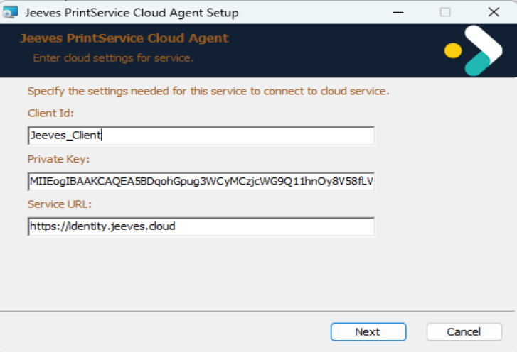
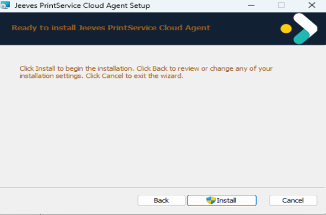
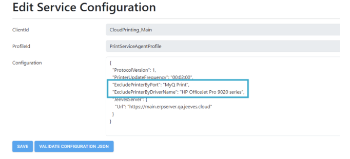
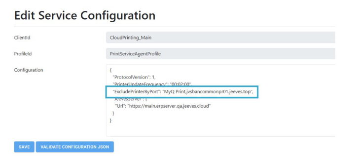

© Copyright Forterro Sweden AB. All Rights Reserved. 

# **Jeeves Cloud PrintService installation and configuration** 

###### **Copyright notice** 

- © Copyright Forterro Sweden AB. All Rights Reserved. 

No part of this guide may be copied, reproduced, translated, or transmitted in any form or by any means without the prior written consent of Jeeves Information Systems AB. 

###### **Document disclaimer** 

Information contained in this guide is subject to change without notice. Please check with your Jeeves support team representative to make sure you have the most recent information. 

2 (37) 

© Copyright Forterro Sweden AB. All Rights Reserved. 

**Contents** 

## **Contents** 

|**1**|**About this guide ....................................................................................... 4**|
|---|---|
|**1.1**|Document version/revision ............................................................................ 4|
|**1.2**|Audience................................................................................................. 4|
|**1.3**|Document conventions ................................................................................. 4|
|**1.4**|List of acronyms ........................................................................................ 4|
|**2**|**Introduction to Jeeves Cloud PrintService ....................................................... 5**|
|**3**|**Create/renew cloud print agent key .............................................................. 5**|
|**4**|**Cloud PrintService installation...................................................................... 5**|
|4.1|Prerequisites ............................................................................................ 5|
|4.2|Installation .............................................................................................. 5|
|4.3|Post installation ........................................................................................ 6|
|4.4|Troubleshooting and event log ....................................................................... 6|
|**5**|**Cloud PrintService setup ............................................................................ 7**|
|**6**|**Exclude Printers forcefully .......................................................................... 9**|

3 (9) 

© Copyright Forterro Sweden AB. All Rights Reserved. 

**About this guide** 

## 1 About this guide 

This guide contains information that must be considered when installing and configuring Jeeves Cloud PrintService. 

The objective is to help the reader understand the Cloud PrintService setup for Jeeves. 

### **1.1** Document version/revision 

|**Version/revision**|**Description**|**Date**|
|---|---|---|
|1.0|Created for Cloud PrintService installation|December 2025|
|2.0|Added info on Cloudprint agent key|February2026|
|3.0|Added section on excluding printers forcefully|May2026|

### **1.2** Audience 

This guide is intended for service technicians who will set up the Jeeves PrintService cloud agent. 

### **1.3** Document conventions 

Use of typographic conventions in documentation helps users locate and interpret information easily. The following guidelines present specific typographic conventions. This guide enables you to establish and maintain a common understanding of various conventions used in the document. For simplicity and consistency, this guide describes the method of performing tasks. Other conventions used in this guide are listed in the following table. 

|**Representation**|**Description**|
|---|---|
|Bold text|Procedures, references to screens, dialog boxes and their elements,file and folder names,commands and buttons.|
|Numbered list|Stepwise instructions.|
|Bulleted list|Sets of features or options used toperform an activity.|
|Note text|Anyexception,extra information,orpitfalls.|
|Italic text|References to related documents.|

### **1.4** List of acronyms 

|**Acronym **|**Description**|
|---|---|
|AWS|Amazon web services|
|JAS|Jeeves application services|
|URI|Uniform resource identifier|
|URL|Uniform resource locator|

4 (9) 

© Copyright Forterro Sweden AB. All Rights Reserved. 

On-premises setup 

## 2 Introduction to Jeeves Cloud PrintService 

Jeeves Cloud PrintService agent is used to process, print, and update the print status of cloud reports. 

##### **Note** 

The cloud printing service is available only for cloud-hosted Jeeves ERP installations. It will not be available for on-premise installations. 

## 3 Create/renew cloud print agent key 

The Cloud print agent operates using a cloud agent key (also called a Private key), which must be renewed before its expiration date. This key enables the locally installed cloud print service to communicate securely with cloud services. For details on the required key type, creation process, renewal procedure, and responsibilities, see Create/renew keys for cloud agents and APIs in the Hybrid cloud local installation and configuration guide. 

## 4 Cloud PrintService installation 

#### **4.1 Prerequisites** 

To be able to install the Cloud printing service, you must have the following: 

- Administrator privileges to install the Cloud PrintService 

- A client ID, private key, and service URL that you have received from Jeeves. Refer to Section 5: Cloud PrintService setup for more information. 

#### **4.2 Installation** 

1. Download the Cloud PrintService installer from the Jeeves ERP Product download center and extract the contents. 

2. Double-click Jeeves.CloudAgent.PrintService.Installer.msi to launch the installer. 

3. Enter the **Client ID** , **Private key,** and **Service URL** and click **Next** . 

4. Click **Install** to begin the installation. 

5 (9) 

© Copyright Forterro Sweden AB. All Rights Reserved. 

On-premises setup 

#### **4.3 Post installation** 

- After installation, navigate to **appsettings.json** in the **…\Program Files\Jeeves PrintService Cloud Agent folder** and check that your Client ID, Private key and service URL match the entered values. 

- Also, navigate to **agentConfig.json** in the **…\ProgramData\Jeeves ERP\PrintServiceAgent** folder and check for **agent id** . 

- Launch the **Task Manager** and navigate to the **Services** tab. You will find your **Jeeves.CloudAgent.PrintService.exe** service listed. Right-click on the service and select **Start** if the service is not started and running. 

- Run Jeeves.CloudAgent.PrintService.exe service using a service account that has the necessary permissions to access network printers. This ensures that the Print Service Agent can detect all available printers on the network. In addition, the service account must have access to the following path: 

   - C:\ProgramData\JeevesERP\PrintServiceAgent\agentConfig.json. 

#### **4.4 Troubleshooting and event log** 

Launch Microsoft **Event viewer** and navigate to **Applications and Services Logs > Jeeves Cloud Agen** t. Look for logging information from the Print service to verify that the service is running. Check for **PrnSrcCA** in the **Source** column, then select the relevant log and choose an action from the Actions pane as needed. 

You can also run the Jeeves Print Service from the command line to understand and troubleshoot. If your Jeeves Cloud Agent Print service is running, stop the service and then navigate to **C:\Program Files\Jeeves PrintService Cloud Agent** in your command prompt and run **Jeeves.CloudAgent.PrintService.exe** . 

6 (9) 

© Copyright Forterro Sweden AB. All Rights Reserved. 

On-premises setup 

## 5 Cloud PrintService setup 

To configure PrintService in admin console, perform the following steps: 

1. Configure a client for which the PrintService is to be set up and map the following scopes to that client in the admin console. 

   - Client Scope: Config JeevesErpPrintServiceClient. 

2. Configure PrintService in the admin console, navigate to the Service configuration tab and click Add configuration to add the following service configurations. 

   - ClientID: Select the client created during client configuration 

   - ProfileID: PrintServiceAgentProfile 

###### **Configuration:** 

{ } } 

"ProtocolVersion": 1, 

- "PrinterUpdateFrequency": "HH:MM:SS", "JeevesServer": { 

"Url": "<JeevesCloudServerURL>" 

###### **ProtocolVersion:** 

##### **Important** 

This is for future use; it is yet to be implemented. By default, keep this value as 1. 

- **PrinterUpdateFrequency** : Time interval for the cloud print agent to poll for available printers and update the agentConfig.json file accordingly. It is recommended to set this value as 23:59:59. 

- **JeevesServer** : Jeeves Server details. 

###### **Example of service configuration:** 

{ "ProtocolVersion": 1, "PrinterUpdateFrequency": "23:59:59", "JeevesServer": { "Url": "https://main.erpserver.qa.jeeves.cloud” } } 

7 (9) 

© Copyright Forterro Sweden AB. All Rights Reserved. 

On-premises setup 

###### 3. Add another service configuration with the following details: 

##### **Note** 

This configuration is set for user context for Jeeves server and is needed for api based communication. 

- **ClientID** : Select the client created during client configuration 

- **ProfileID** : JeevesErpServer 

###### **Example of service configuration:** 

{ "CompanyCode": 9900, "Perssign": "jsa", "DefaultLanguage": 999 } 

The information exchange for PrintService is as follows: 

|**Input/output**|**Data**|**Usage **|
|---|---|---|
|The service you request from Jeeves|Cloud PrintService|Service for printing cloud reports.|
|Input to Jeeves Cloud Operations|Customer name|Used to create a customer identifier in Jeeves Identity Service (Administration console).|
|Input to Jeeves Cloud Operations|Jeeves server URL|Used to configure in admin console.|
|Input to Jeeves Cloud Operations|CompanyCode Perssign DefaultLanguage|This configuration is set in the user context for the Jeeves server and is required for API- based communication.|
|Output from Jeeves Cloud Operations|Client ID|Required during local PrintService installation or in appsettings.json post installation.|
|Output from Jeeves Cloud Operations|Private key|Required during local PrintService installation or in appsettings.json post installation.|

In the on-premises environment, install and configure the PrintService agent as described in the PrintService installation section earlier in this document. 

For more information on the Jeeves application setup, please refer to Jeeves online documentation, chapter _Cloud printing service_ (404). 

8 (9) 

© Copyright Forterro Sweden AB. All Rights Reserved. 

On-premises setup 

## 6 Exclude Printers forcefully 

Printers can be forcefully excluded through service configuration in the admin console. To enable this, two new profile parameters have been introduced under the **PrintServiceAgentProfile** profile ID in the admin console: 

- **ExcludePrinterByPort** 

- **ExcludePrinterByDriverName** 

These parameters accept comma-separated values, for example: 

- "ExcludePrinterByPort": "Port10, Port1123" 

- "ExcludePrinterByDriverName": "Driver112320, Driver1123423" 

###### **Examples:** 

- 1) Example using both **ExcludePrinterByPort** and **ExcludePrinterByDriverName** 

- 2) Example of excluding multiple printers based on their port names. 

The system also maintains an internally predefined exclusion list that cannot be configured: 

- ExcludedPort = "NUL", "FILE", "XPS", "PORTPROMPT", "ONENOTE", "PDF", "FAX" 

- ExcludedDriver = "XPS", "ONENOTE", "PDF", "FAX", "REMOTE DESKTOP EASY PRINT" 

##### **Note** 

In addition to the predefined list, you can exclude printers as needed by configuring the exclusion parameters. 

9 (9) 

© Copyright Forterro Sweden AB. All Rights Reserved. 

