© Copyright Forterro Sweden AB. All Rights Reserved. 

**Jeeves ERP Design studio** Installation and configuration 

###### **Copyright notice** 

- © Copyright Forterro Sweden AB. All Rights Reserved. 

No part of this guide may be copied, reproduced, translated, or transmitted in any form or by any means without the prior written consent of Jeeves Information Systems AB. 

###### **Document disclaimer** 

Information contained in this guide is subject to change without notice. Please check with your Jeeves support team representative to make sure you have the most recent information. 

© Copyright Forterro Sweden AB. All Rights Reserved. 

2 ( 

18) 

<u>Contents</u> 


# **Contents** 

|**1**|**About this guide ........................................................................................................... 4**|
|---|---|
|1.1|Document version/revision..................................................................................................................... 4|
|1.2|Audience.......................................................................................................................................................... 4|
|1.3|Document conventions.............................................................................................................................. 4|
|**2**|**Install Design studio ..................................................................................................... 5**|
|2.1|Introduction................................................................................................................................................... 5|
|2.2|Deployment options................................................................................................................................... 6|
|2.2.1|Cloud deployment ................................................................................ 6|
|2.2.2|On-premises deployment ....................................................................... 6|
|2.2.3|General ............................................................................................ 7|
|2.3|Install Design studio application........................................................................................................... 8|
|2.3.1|Setup wizard ...................................................................................... 8|
|2.3.2|Destination folder ................................................................................ 8|
|2.3.3|Server settings for Design studio ............................................................... 9|
|2.3.4|Start installation ............................................................................... 11|
|2.3.5|Complete the installation ..................................................................... 12|
|2.4|Install Design studio using command prompt...............................................................................13|
|2.5|Upgrade from earlier versions.............................................................................................................14|
|2.6|Configure user settings...........................................................................................................................15|
|2.7|Configuring Desktop client access for macro execution..........................................................16|
|2.7.1|Configuration parameters in appsettings.json ............................................. 16|
|2.8|Known issues................................................................................................................................................18|
|2.8.1|Shortcuts ........................................................................................ 18|


© Copyright Forterro Sweden AB. All Rights Reserved. 

3 (18) 

<u>About this guide</u> 


# 1 About this guide 

This guide contains the procedure for the installation and configuration of Design studio available from Jeeves. 

The objective is to help the user to understand how to install the Design studio application. 

## 1.1 Document version/revision 

|**Version/revision**|**Description**|**Date**|
|---|---|---|
|1.6|Updated for Platform 2024.Q2.0|Feb 2024|
|1.7|Updated for Platform 2024.Q2.1|June 2024|
|1.8|Updated for Platform 2024.Q2.2|Aug2024|
|1.9|Updated for Platform 2024.Q2.3|Dec 2024|
|2.0|Updated for Platform 2025.Q2.0|March 2025|
|2.1|Updated for Platform 2025.Q2.1|May2025|
|2.2|Updated for Platform 2025.Q2.2|Aug2025|
|2.3|Updated for Platform 2025.Q2.3|Nov 2025|
|2.4|Updated for Platform 2026.Q2.0|Feb 2026|
|2.5|Updated for Platform 2026.Q2.1<br>Added section: Configuring Desktop client access<br>for macro execution|May 2029|
|2.6|Updated for Platform 2026.Q2.2<br>Updated to note that default connecttoserver.xml<br>will be picked up for Desktop client launch if there<br>is no desktopclientsettingsparameter available|Aug 2026|


## 1.2 Audience 

This guide is intended for technicians who want to set up the Design studio application from Jeeves. 

## 1.3 Document conventions 

Use of typographic conventions in documentation helps users locate and interpret information easily. The following guidelines present specific typographic conventions. This guide enables you to establish and maintain a common understanding of various conventions used in the document. For simplicity and consistency, this guide describes the method of performing tasks. Other conventions used in this guide are listed in the following table. 

|**Representation **|**Description **|
|---|---|
|Bold text|Procedures, references to screens, dialog boxes and their<br>elements,file and folder names,commands,and buttons.|
|Numbered list|Stepwise instructions.|
|Bulleted list|Sets of features or options used toperform an activity.|
|Note text|Anyexception,extra information,orpitfalls.|
|Italic text|References to related documents and important<br>information.|


© Copyright Forterro Sweden AB. All Rights Reserved. 

4 (18) 

<u>Install Design studio</u> 


# 2 Install Design studio 

## 2.1 Introduction 

Jeeves Design Studio is used for creating and publishing program layouts, menus, and dashboards for Jeeves Desktop Client and Mobile client, based on standard or custom-made Jeeves programs. 

The Jeeves Design Studio is used to separate design and development functionality from the functions in the user interface that are used on a more daily basis. This makes the user interface simple and intuitive, while still providing powerful design features. It also makes it easy to address the needs of the different types of users. 

In the Design Studio, you can create designs "from scratch" or open and modify existing designs. You can create new designs based on existing ones by saving them under new names. You can save designs to a file, which means they can be distributed between users and different databases, both for review and for use. 

The Design Studio supports the use of charts in both program layouts and dashboards. It also allows you to design and publish widgets that are displayed on the dashboards. 

You can create new terms and add them to a table and then add the table with the associated terms to a form or a list in the program designs created for the Desktop client or Mobile client. You can also edit an existing term, including a user-defined term, as required. 

You can control how data is structured and presented using field, form, and list settings. 

The macro editor allows you to create and edit macros that can be executed from the Desktop client. You can add hotkeys to run macros and enable the execution of pre-defined macro automatically in Jeeves by linking it to standard events or field-specific events. 

The template editor allows you to view templates belonging to a selected report and company and perform functions like adding or editing report templates, linking report templates to buttons and hotkeys, and deleting report templates if required. 

A Report designer is integrated into Design studio to facilitate the creation of cloud compliant reports. The Report designer enables you to create new reports from scratch, bind them to data, and fully customize them. You can bind report elements to individual data source fields or create expressions of any complexity. These expressions can include multiple data source fields and functions. 

The WYSIWYG (what you see is what you get) feature in Design studio enables you to get an accurate picture of the finished design in the client. 

Only English and Swedish translations are supported in the Design studio. If the translations are in languages other than English and Swedish, the English translations package must be installed to view programs in Design studio. The English language package can be found in the **Packages** folder in your Jeeves application folder. 

Please see the Design studio chapter in the online help for detailed information about the functionalities available and for information on how to go about designing, saving, and publishing program designs, menus, and dashboards for use in the Desktop and/or Mobile clients. 

© Copyright Forterro Sweden AB. All Rights Reserved. 

5 (18) 

<u>Install Design studio</u> 


## 2.2 Deployment options 

Jeeves supports both Cloud and On-premises deployments of Design studio as shown in the image below. 


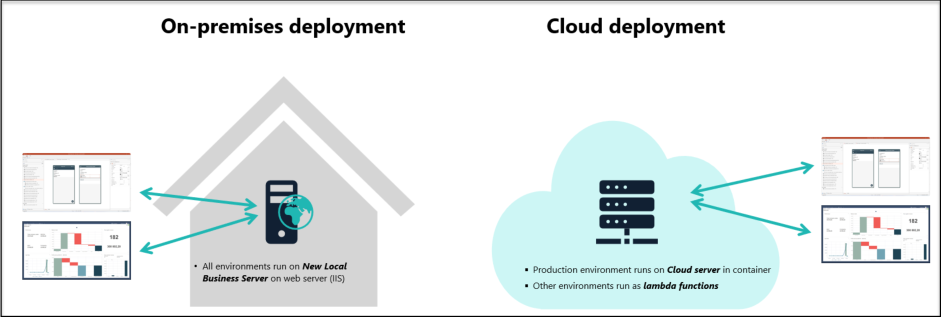


- Cloud deployment: In this configuration, the production environment is run on the cloud server in a container, while all other environments are run as Lambda functions. 

- On-premises deployment: This setup involves running all environments locally on the New Local Business Server, which is an on-premises version of the cloud-based Jeeves server. The server is hosted on IIS and supports running both the Design Studio and dashboard widgets in the Desktop client. Prerequisites before installation 

### 2.2.1 Cloud deployment 

Following is an illustration of how the connection to the local Jeeves installation is done: 


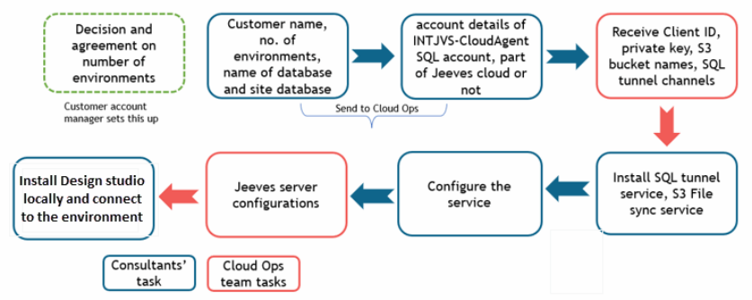


##### **<u>Note</u>** 

- You must uninstall the Cloud agent plugins and then uninstall the Cloud agent, before installing this service. 

To be able to install the S3 File sync service you must have the following: 

- Administrator privileges to install the S3 File sync service 

- A client ID, private key and service URL that you have received from Jeeves 

For more information, refer to the document: Jeeves ERP Hybrid cloud local installation and configuration 

### 2.2.2 On-premises deployment 

While here is an illustration of how to install and configure the New Local Business Server and Design studio: 

© Copyright Forterro Sweden AB. All Rights Reserved. 

6 (18) 

<u>Install Design studio</u> 


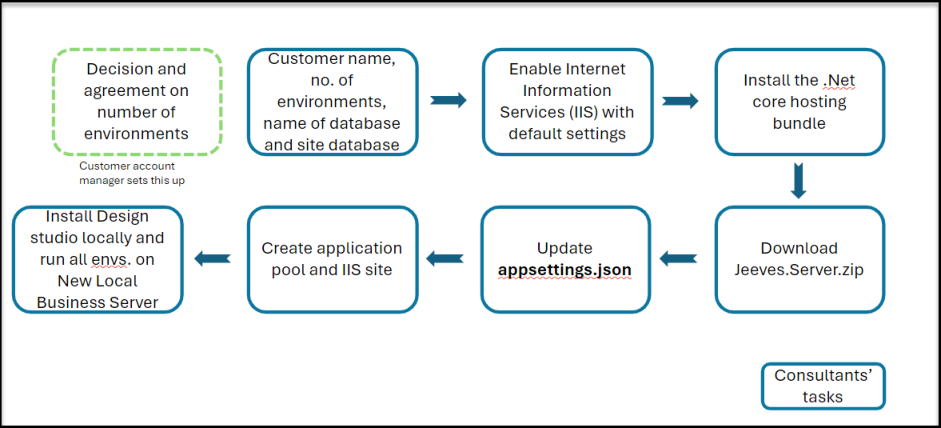


The prerequisites to be able to install the New Local Business Server: 

- Windows server 2022 

- The site database must be updated with the latest site database binary package (dacpac) as described in the next section. 

For more information, refer to the document: New Local Business Server installation and configuration 

### 2.2.3 General 

The prerequisites for installing the Design studio are as follows: 

- Jeeves ERP application services 2024.0 (along with latest hotfixes) or higher. 

- Jeeves ERP Platform 2024.0 or higher – install Jeeves ERP cloud server/ New Local Business Server using the necessary components. 

- .NET Core 10.x 

- Microsoft Edge WebView2 runtime 

- Install dacpac to create stored procedures and new table in the site repository database. Note that the dacpac must be taken from the corresponding Platform version as shown below: 

|Update version|Design studio version|Platform version|
|---|---|---|
|Updated<br>2026.Q2.1|Platform 2026.1|2026.1|
|Updated<br>2026.Q2.0|Platform 2026.0|2026.0|
|Updated<br>2025.Q2.0|Platform 2025.0|2025.0|
|Update<br>2024.Q2.0|Platform 2024.0|2024.0|


- We recommend that the site database not be shared between different environments, for example, between the test, staging, and production environments. 

An internet connection is required to download and install the Prerequisites MicrosoftEdgeWebview2Setup that is used to support Federated authentication in Design studio 

© Copyright Forterro Sweden AB. All Rights Reserved. 

7 (18) 

<u>Install Design studio</u> 


## 2.3 Install Design studio application 

Perform the following steps to install the Design studio application: 

The installation program is in English and the dialog boxes contain the following standard options: 

- **Back** – Return to the previous dialog 

- **Next** – Go to the next dialog 

- **Cancel** – Cancel the installation 

### 2.3.1 Setup wizard 

1. Start the installation by double-clicking on Jeeves.DesignStudio.msi. A small pop-up screen preparing the Setup wizard appears. 

**Note** : It may take a few seconds before the installation program starts and the **Welcome to the Jeeves Design Studio Setup Wizard** dialog appears. 

2. Click **Next** to continue. 


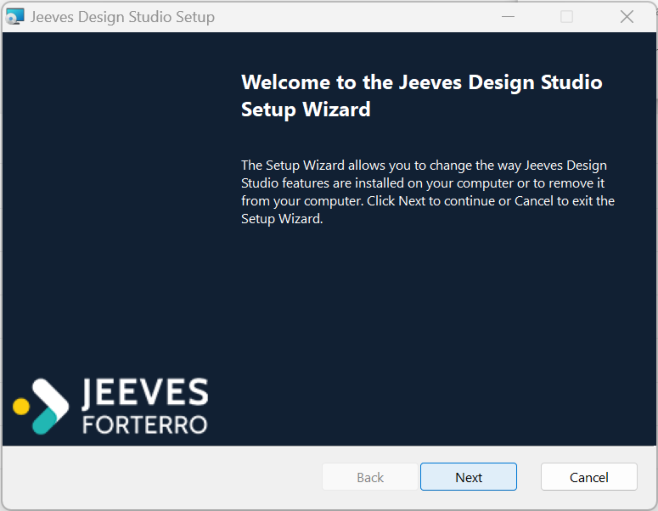


### 2.3.2 Destination folder 

In the **Destination Folder** dialog that appears, perform the following steps: 

1. Enter the destination folder for the application files. The default path is displayed, you can browse and select any custom destination path by clicking on the **Change** button. 

2. Click **Next** > to continue. 

© Copyright Forterro Sweden AB. All Rights Reserved. 

8 (18) 

<u>Install Design studio</u> 


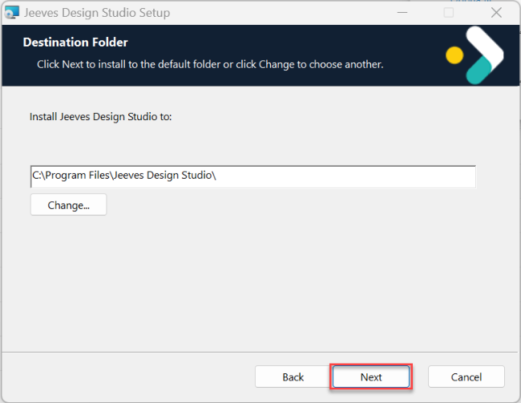


### 2.3.3 Server settings for Design studio 

The **Jeeves server** dialog appears. Perform the following steps: 

1. **Name** : Enter a name for the server. 

2. **URL** : Enter the corresponding URL to the server. 

Once you enter these two mandatory fields and press tab, the **Add** button is enabled. 

3. Click **Add** to include the details that have been entered. 


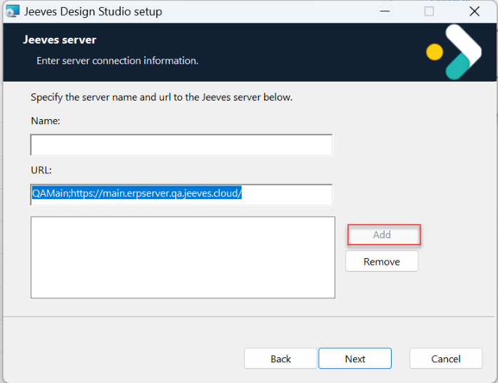


4. Click **Next** to continue. 

© Copyright Forterro Sweden AB. All Rights Reserved. 

9 (18) 

<u>Install Design studio</u> 


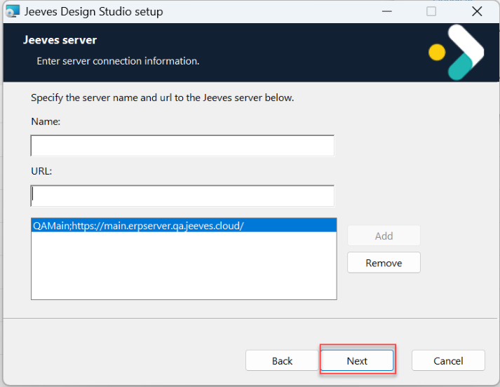


If you want to remove any added server, click the specific url in the list and then click **Remove** . 


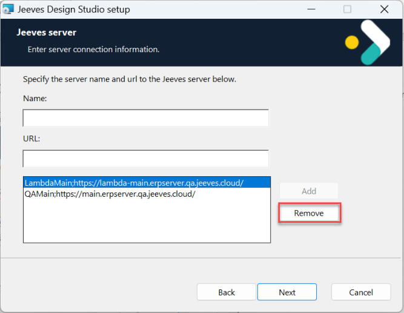


##### **<u>Note:</u>** 

- To remove the server(s) that have been added, you can also delete them from the <mark>Settings file in the following path:</mark> _<mark>C:\Program Files\Jeeves Design Studio\appsettings.json.</mark>_ <mark>or in the specific path mentioned during installation, if it</mark> differs. 

#### 2.3.3.1 Server settings to run Design studio on AWS Lambda 

You can run Design studio on a Jeeves cloud server that runs on AWS Lambda. With Lambda, any changes made in Design studio do not need a server restart to take effect. 

© Copyright Forterro Sweden AB. All Rights Reserved. 

10 (18) 

<u>Install Design studio</u> 


To enable this setting, enter the URL for Lambda in the Jeeves server dialog, then click **Add** to include the details that have been entered as shown in the example below followed by **Next** to continue. 


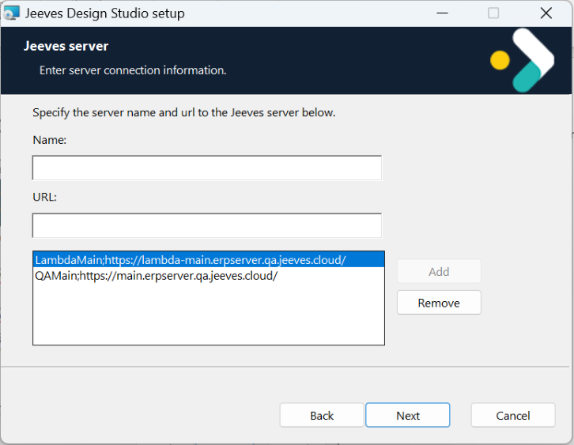


### 2.3.4 Start installation 

The **Ready to install Jeeves Design Studio** dialog appears. Click **Install** to start the installation. 


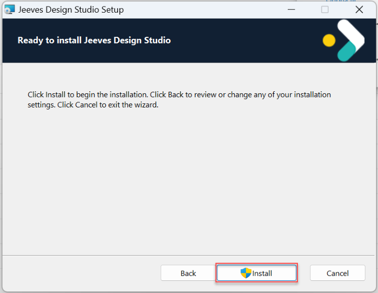


© Copyright Forterro Sweden AB. All Rights Reserved. 

11 (18) 

<u>Install Design studio</u> 


You will be asked to wait while the Setup wizard installs the Design studio. The Status bar displays the progress of the set-up process. 


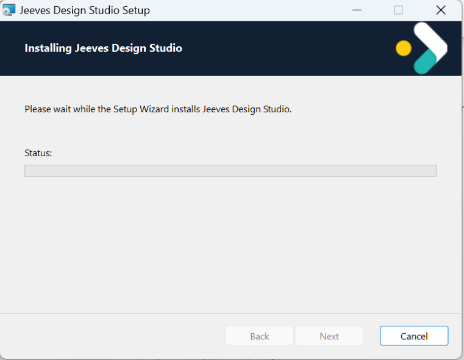


### 2.3.5 Complete the installation 

The **Completed the Jeeves Design Studio Setup Wizard** dialog appears. Click **Finish** to complete the installation. 


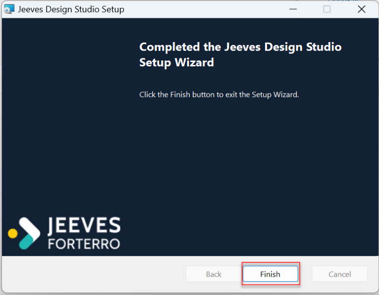


Once installed, a shortcut for Design studio is added to the Start menu by default. 

© Copyright Forterro Sweden AB. All Rights Reserved. 

12 (18) 

<u>Install Design studio</u> 


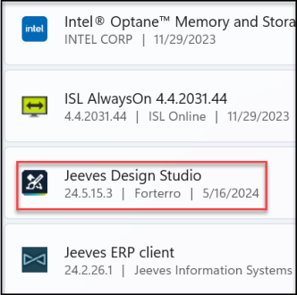


You can also create a shortcut on your desktop for easy access. 

## 2.4 Install Design studio using command prompt 

Alternatively, you can install Design studio using silent installation through the command prompt. You must run the command prompt as administrator. 


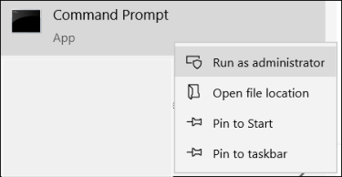


In the command line, mention the name of the server and the corresponding URL. If there are multiple server details to be entered, they must be separated using the pipe separator (|). Use hash symbol (#) to separate server name from server address. 

```
msiexec.exe /i "C:\Users\ bm\Downloads\Jeeves.DesignStudio.msi"
SERVERS="QA Azure#https://jeevesserver-
dev.azurewebsites.net/|AWS#https://main.erpserver.qa.jeeves.cloud/" /qn
```

Note **<u>:</u>** 

• The latest installer must be placed in the server path mentioned in the command line. 

Use the following command line for federated authentication for consultants: 

```
msiexec.exe /i Jeeves.DesignStudio.msi
SERVERS="AWS#https://main.erpserver.qa.jeeves.cloud/"
FederatedClientId="Consultants"
```

You can also pass the server configuration as a command line parameter to the Design studio using the **/usersettings=** attribute. This enables the system to locate and load the configuration automatically without the need for customer specific configuration. 

The following configuration paths are supported: File, HTTP, and HTTPS. An example of a configuration can look as follows: 

```
/usersettings=https://jeeves-bin-version.s3.eu-north-
1.amazonaws.com/Connections/DesignStudio-regression.json
```

For more details on federated authentication, refer to the document “Jeeves ERP Hybrid cloud local installation and configuration”. 

© Copyright Forterro Sweden AB. All Rights Reserved. 

13 (18) 

<u>Install Design studio</u> 


## 2.5 Upgrade from earlier versions 

If you have installed an earlier version of Design studio, you can run the installation program again to get the upgraded version. The existing application is replaced by the upgraded one. 

If Design studio is installed and you try to install the same version again, the following dialog is shown: 


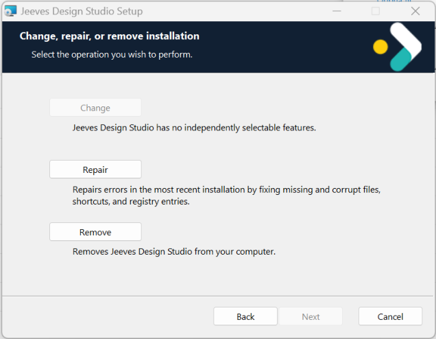


If you try to install a lower version of Design studio than the one already installed, the following dialog is shown: 


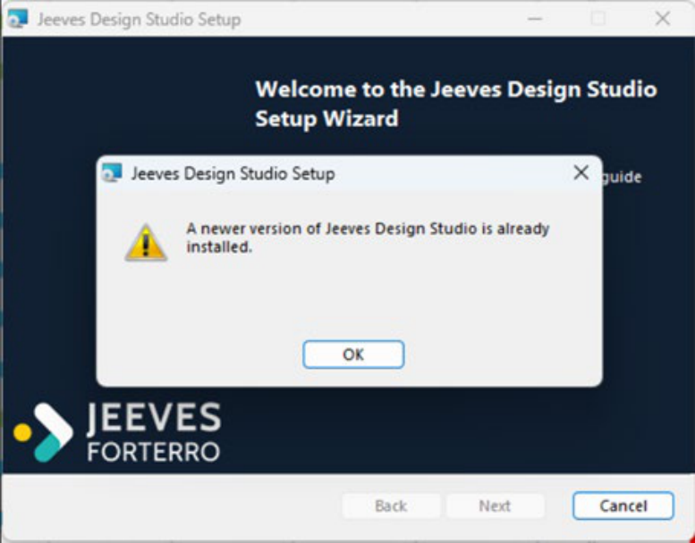


> © Copyright Forterro Sweden AB. All Rights Reserved. 

14 (18) 

<u>Install Design studio</u> 


## 2.6 Configure user settings 

After installing and launching Design Studio, click on "Edit connections" in the login window to add new server details. 

To configure other user settings, go to the **usersettings.json** file located in C:\Users\<username>\AppData\Local\Jeeves Information Systems\Jeeves Design Studio 

Below is an example of the **usersettings.json** file: 


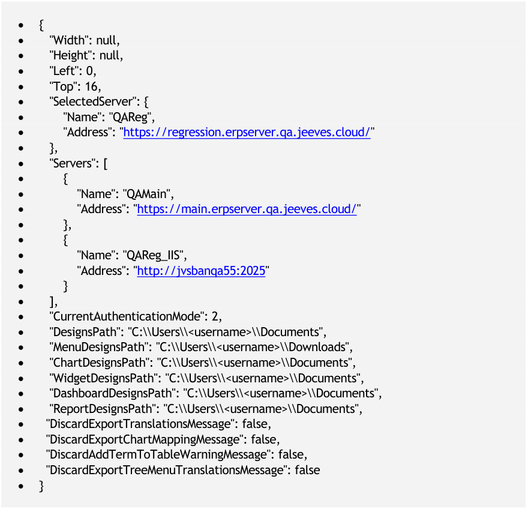


<!-- Start of picture text -->
• {<br>•    "Width": null,<br>•    "Height": null,<br>•    "Left": 0,<br>•    "Top": 16,<br>•    "SelectedServer": {<br>•        "Name": "QAReg",<br>•        "Address": "https://regression.erpserver.qa.jeeves.cloud/"<br>•    },<br>•    "Servers": [<br>•        {<br>•            "Name": "QAMain",<br>•            "Address": "https://main.erpserver.qa.jeeves.cloud/"<br>•        },<br>•        {<br>•            "Name": "QAReg_IIS",<br>•            "Address": "http://jvsbanqa55:2025"<br>•        }<br>•    ],<br>•    "CurrentAuthenticationMode": 2,<br>•    "DesignsPath": "C:\\Users\\<username>\\Documents",<br>•    "MenuDesignsPath": "C:\\Users\\<username>\\Downloads",<br>•    "ChartDesignsPath": "C:\\Users\\<username>\\Documents",<br>•    "WidgetDesignsPath": "C:\\Users\\<username>\\Documents",<br>•    "DashboardDesignsPath": "C:\\Users\\<username>\\Documents",<br>•    "ReportDesignsPath": "C:\\Users\\<username>\\Documents",<br>•   "DiscardExportTranslationsMessage": false,<br>•   "DiscardExportChartMappingMessage": false,<br>•   "DiscardAddTermToTableWarningMessage": false,<br>•   "DiscardExportTreeMenuTranslationsMessage": false<br>• }<br><!-- End of picture text -->

The parameter descriptions are as follows: 

- **Window position and size** 

   - **Width, Height, Left, Top** : Define the size and screen position of the Design Studio window. These values can be adjusted based on your display. 

- **Server configuration** 

   - **SelectedServer** : Indicates the server currently used for login. 

   - **Servers** : Lists all servers available in the login window’s dropdown list. You can also manually add new server entries here. 

© Copyright Forterro Sweden AB. All Rights Reserved. 

15 (18) 

<u>Install Design studio</u> 


Note that the server details can be added in either place—directly in this file or via the “Edit connections” option in the login window—and changes made in one location are reflected in the other. 

###### **Authentication settings** 

- **CurrentAuthenticationMode** : Specifies the authentication method used for login (e.g., federated login or SQL login). 

   - If this parameter is not present and you log in with federated authentication for the first time, it will be automatically added to the **usersettings.json** file. Upon closing and reopening the Design Studio application, it will log in automatically without prompting for user credentials. 

   - The same behaviour applies when logging in with SQL authentication. 

- **Design paths** 

- MenuDesignsPath 

- ChartDesignsPath 

- WidgetDesignsPath 

- DashboardDesignsPath 

- ReportDesignsPath 

Define storage paths for various design types. 

- **Warning messages** 

- DiscardExportTranslationsMessage 

- DiscardExportChartMappingMessage 

- DiscardAddTermToTableWarningMessage 

- DiscardExportTreeMenuTranslationsMessage 

Controls the display of specific warning messages during design. When set to true, the corresponding warning is suppressed. 

## 2.7 Configuring Desktop client access for macro execution 

The Design client supports creating and running macros that open the corresponding program in the ERP Desktop client and execute the macro automatically. 

To establish the connection to the ERP environment, the Desktop client uses the **ConnectToServer.xml** configuration file, which contains the server connection details required for authentication and login to the ERP server. 

Desktop client access and connection settings are configured through the appsettings.json file. 

While these settings support macro execution, they are also used by other Design studio functionalities that require integration with the ERP client. 

### 2.7.1 Configuration parameters in appsettings.json 

This section defines the available server environments, the ERP server address, and the location of the **ConnectToServer.xml** file. 

|**Parameter**|**Description **|
|---|---|
|Name|Displayname of the server configuration.|
|Address|URL of the Jeeves Cloud ERP server.|
|DesktopClientSettings|Full path to the ConnectToServer.xml file used by the<br>Jeeves ERP client.|


> © Copyright Forterro Sweden AB. All Rights Reserved. 

16 (18) 

<u>Install Design studio</u> 


|**Parameter**|**Description **|
|---|---|
||If this parameter is specified with a custom path, Design<br>Studio uses the connection details from that path.|
||If this parameter is not specified, Design Studio uses the<br>default connecttoserver.xml specified in the default path,<br>C:\ProgramData\Jeeves Information Systems\Jeeves ERP<br>Client\ConnectToServer.xml|
|AutoStart|Set to default. This parameter is not currently supported<br>but is reserved for future use.|


###### **Schema:** 

- { <mark>"Servers": [ { "Name": "<Name>", "Address": "<Jeeves Cloud Server URL>", "AutoStart": false } ]</mark> } 

<mark>"Address": "<Jeeves Cloud Server URL>", "DesktopClientSettings": "<PATH to ConnectToServer.xml>",</mark> 

###### **Example:** 

• { <mark>"Servers": [ { "Name": "Dev Service", "Address": "https://main.erpserver.sandbox.jeeves.cloud/", "DesktopClientSettings": "C:\\ProgramData\\Jeeves Information Systems\\Jeeves ERP Client\\ConnectToServer.xml", "AutoStart": false } ]</mark> } 

##### **<u>Notes</u>** 

- If **DesktopClientSettings** is configured with a custom path, Design Studio reads the ERP <mark>client connection details from that specified</mark> **<mark>ConnectToServer.xml</mark>** <mark>file.</mark> 

- <mark>If</mark> **<mark>DesktopClientSettings</mark>** <mark>is omitted, Design Studio automatically uses the default ERP client configuration file: C:\ProgramData\Jeeves Information Systems\Jeeves ERP Client\ConnectToServer.xml</mark> 

- <mark>If old user settings exist, delete the usersettings.json file located at C:\Users\<username>\AppData\Local\Jeeves Information Systems\Jeeves Design Studio and restart Design Studio so that the</mark> **<mark>DesktopClientSettings</mark>** <mark>setting is applied</mark> 

- <mark>Ensure that the configured ERP server in ConnectToServer.xml matches the intended Jeeves Cloud environment</mark> 

- <mark>Executing macros and editing Template Manager reports require users to have valid</mark> access permissions to both the ERP environment and the target program. 

© Copyright Forterro Sweden AB. All Rights Reserved. 

17 (18) 

<u>Install Design studio</u> 


## 2.8 Known issues 

### 2.8.1 Shortcuts 

Note that, once Design studio is installed, the shortcut that is created for the user cannot be accessed by another user from the same machine. Design studio must be accessed via the executable program. 

To have the shortcut accessible, Design studio must be installed separately for each user. 

© Copyright Forterro Sweden AB. All Rights Reserved. 

18 (18) 

