© Copyright Forterro Sweden AB. All Rights Reserved. 

# **Jeeves ERP Hybrid Cloud local installation and configuration** 

###### **Copyright notice** 

- © Copyright Forterro Sweden AB. All Rights Reserved. 

No part of this guide may be copied, reproduced, translated, or transmitted in any form or by any means without the prior written consent of Jeeves Information Systems AB. 

###### **Document disclaimer** 

Information contained in this guide is subject to change without notice. Please check with your Jeeves support team representative to make sure you have the most recent information. 

2 (37) 

© Copyright Forterro Sweden AB. All Rights Reserved. 

**Contents** 


## **Contents** 

|**1**|**About this guide ....................................................................................... 5**|
|---|---|
|1.1|Document version/revision ............................................................................ 5|
|1.2|Audience................................................................................................. 6|
|1.3|Document conventions ................................................................................. 6|
|1.4|List of acronyms ........................................................................................ 6|
|**2**|**Introduction to Jeeves Hybrid cloud .............................................................. 7**|
|**3**|**Create/renew keys for cloud agents and API platform ......................................... 8**|
|3.1|Cloud agent keys ....................................................................................... 8|
|3.2|API platform keys ...................................................................................... 8|
|**4**|**On-premises setup .................................................................................... 9**|
|4.1|S3 File sync service installation ...................................................................... 9|
|4.1.1|Prerequisites ............................................................................................ 9|
|4.1.2|Installation .............................................................................................. 9|
|4.1.3|Post installation ....................................................................................... 10|
|4.1.4|Troubleshooting and event log ...................................................................... 10|
|4.2|Jeeves Message Broker Cloud Agent Service installation ......................................... 11|
|4.2.1|Prerequisites ........................................................................................... 11|
|4.2.2|Installation ............................................................................................. 11|
|4.2.3|Post installation ....................................................................................... 12|
|4.2.4|Multiple envs for MessageBroker cloud agent service from command prompt ............... 12|
|4.2.5|Troubleshooting and event log ...................................................................... 13|
|4.3|SQL Tunnel service installation ...................................................................... 13|
|4.3.1|Prerequisites ........................................................................................... 13|
|4.3.2|Installation ............................................................................................. 13|
|4.3.3|Post installation ....................................................................................... 14|
|4.3.4|Troubleshooting and event log ...................................................................... 15|
|4.4|SQL Tunnel configuration ............................................................................ 15|
|**5**|**Hybrid cloud setup .................................................................................. 16**|
|5.1|Federated authentication ............................................................................ 16|
|5.1.1|Configuration of Federated authentication in Jeeves ............................................ 17|
|5.1.2|Register an application in Azure active directory................................................. 18|
|5.1.3|Order setup of Jeeves identity service ............................................................. 21|
|5.1.4|Configure Jeeves server for federated authentication ........................................... 22|
|5.1.5|Configure Jeeves clients for federated authentication .......................................... 23|
|5.1.6|Federated authentication in Design studio ........................................................ 23|
|5.1.7|Federated authentication for eApproval .......................................................... 24|
|5.1.8|Federated authentication in Jeeves cloud server for Desktop client .......................... 25|
|5.1.9|Troubleshooting ....................................................................................... 25|
|5.2|PEPPOL services ....................................................................................... 26|
|5.3|Notification service ................................................................................... 27|
|5.4|Jeeves ERP standard dashboard ..................................................................... 27|
|5.4.1|Install package and map signatures ................................................................. 28|
|5.4.2|<br>Set up Kernel parameter ............................................................................. 28|
|5.4.3|Launch Jeeves ERP standard dashboard ............................................................ 29|
|5.5|Sales API ................................................................................................ 29|
|5.5.1|Sales API service configuration ...................................................................... 30|
||3 (36)<br>|


© Copyright Forterro Sweden AB. All Rights Reserved. 

|||**Contents**|
|---|---|---|
|5.6|Finance API ............................................................|................................. 30|
|5.6.1|Finance API service configuration ..................................|................................. 31|
|5.7|Jeeves API Platform ..................................................|................................. 32|
|5.7.1|Jeeves API Platform service configuration ........................|................................. 32|
|5.7.2|Domain mapping ......................................................|................................. 34|
|5.7.3|Jeeves API Platform: Example process ............................|................................. 35|


4 (36) 

© Copyright Forterro Sweden AB. All Rights Reserved. 

**About this guide** 


## 1 About this guide 

This guide contains information that must be considered when installing and configuring cloud components for Jeeves applications in a local Jeeves on-premises environment. The objective is to help the reader understand the cloud setup made for Jeeves ERP. 

### 1.1 Document version/revision 

|**Version/revision**|**Description**|**Date**|
|---|---|---|
|1.0|Created for Cloud agent installer|January2021|
|1.1|Updated for Federated authentication|May2021|
|1.2|Updated for Jeeves ERP 6.0 Update 6|July2021|
|1.3|Updated for SQLTunnel configuration|March 2022|
|1.4|Updated for Windows service installations|May2022|
|1.5|Updated for Sales API and configurable caching|July2022|
|1.6|Updated for Event service cloud agent|September 2022|
|1.7|Updated for Federated authentication usingAWS console|February2023|
|1.8|Updated Dashboard information|May2023|
|1.8|Updated Dashboard/API information|Aug2023|
|1.9|Updated packages information for Jeeves ERP standard<br>dashboard|Oct 2023|
|2.0|Added information about Jeeves API Platform|Jan 2024|
|2.1|Updated information relating to the secret key used to<br>generate the JWT token<br>Updated resource information for guidance on<br>registering an app in Azure AD<br>Added note on federated log in availability for non-<br>Forterro users|June 2024|
|2.2|Updated copyright information|Aug2024|
|2.3|Updated information on Federated authentication in<br>Design studio<br>Updated images for installation of Jeeves S3 File Sync<br>Cloud agent, Message broker cloud agent and SQL<br>Tunnel Cloud agent|March 2025|
|2.4|Added information on Setting up multiple environments<br>for MessageBroker cloud agent service from command<br>prompt|May 2025|
|2.5|Added information to say the federated login is set as<br>the authentication mode in the Jeeves server<br>configuration.|August 2025|
|2.6|Added info on renewal of private keys for the Message<br>broker agent, SQL tunnel Agent, S3 File Sync Agent, and<br>theAPI keyfortheFinanceAPI.|November 2025|
|2.7|Added section: Create/renew keys for cloud agents and<br>API platform<br>Updated troubleshooting and event log for for S3 file sync<br>service installation.<br>Added prerequisites for federated authentication in<br>eApproval|February 2026|


5 (36) 

© Copyright Forterro Sweden AB. All Rights Reserved. 

**About this guide** 


### 1.2 Audience 

This guide is intended for service technicians who will set up cloud services and perform the hybrid deployment while configuring them for Jeeves. 

### 1.3 Document conventions 

Use of typographic conventions in documentation helps users locate and interpret information easily. The following guidelines present specific typographic conventions. This guide enables you to establish and maintain a common understanding of various conventions used in the document. For simplicity and consistency, this guide describes the method of performing tasks. Other conventions used in this guide are listed in the following table. 

|**Representation**|**Description**|
|---|---|
|Bold text|Procedures, references to screens, dialog boxes and their<br>elements,file and folder names,commands and buttons.|
|Numbered list|Stepwise instructions.|
|Bulleted list|Sets of features or options used toperform an activity.|
|Note text|Anyexception,extra information,orpitfalls.|
|Italic text|References to related documents.|


### 1.4 List of acronyms 

|**Acronym **|**Description**|
|---|---|
|AWS|Amazon web services|
|JAS|Jeeves application services|
|URI|Uniform resource identifier|
|URL|Uniform resource locator|


6 (36) 

© Copyright Forterro Sweden AB. All Rights Reserved. 

Introduction to Jeeves Hybrid cloud 


## 2 Introduction to Jeeves Hybrid cloud 

Jeeves Hybrid Cloud is a platform with cloud services in Amazon web services (AWS), offering extended capabilities to Jeeves ERP, available for both on-premises and cloud-hosted Jeeves ERP installations. 


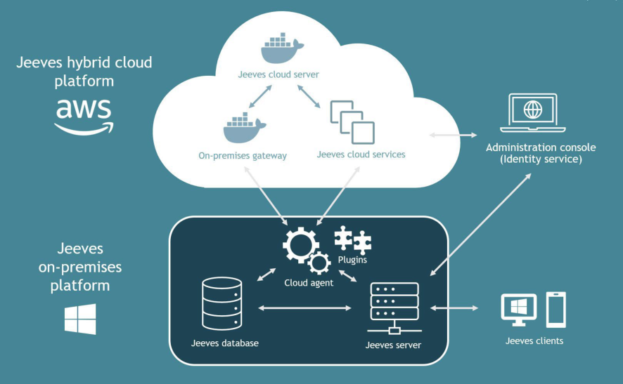


The main components of Jeeves hybrid cloud are: 

###### **Jeeves on-premises platform** 

- One or more cloud agent services for handling the connection between the cloud environment and the local environment 

- Plugins (local services) enabling interaction with specific cloud services These components are installed locally in the Jeeves on-premises environment. 

###### **Jeeves hybrid cloud platform** 

- A new cloud-based Jeeves server 

- An on-premises gateway for interaction with the on-premises Jeeves database 

- Cloud-based services for different functions 

- An administration console (linked to an identity service) for setting up customers and configuring the cloud-based services 

These components are set up and configured by Jeeves Cloud Operations. The services are ordered from Jeeves and require customer specific information to set up. 

Depending on the function that is used, different components and services are needed. 

7 (36) 

© Copyright Forterro Sweden AB. All Rights Reserved. 

On-premises setup 


3 Create/renew keys for cloud agents and API platform 

This chapter describes the operational process for creating and renewing: 

- Cloud agent keys (Private keys) 

- API platform keys 

### 3.1 Cloud agent keys 

Cloud agent keys (also referred to as Private keys) are required to establish a secure connection between an on-premises installation and cloud-hosted services.API keys are used to authenticate and authorize API calls to cloud services. 

The following types of keys are currently available to enable locally installed agents and API integrations to communicate with cloud services: 

- Message broker agent key 

- SQL tunnel agent key (excluding API platform usage) 

- S3 file sync agent key 

- Cloud print agent key 

- Sales API key 

- Finance API key 

When a customer purchases functionality that relies on one of these agents (for example, e- invoicing), the corresponding agent key is installed as part of the implementation process. The validity period of the key is defined at the time of **creation** . 

Jeeves is responsible for monitoring key expiration. Sixty (60) days prior to expiration, the process of **renewing** the key is proactively initiated: 

- For cloud/subscription customers, the key is renewed automatically in accordance with the applicable cloud or subscription agreement. 

- For on-premises customers, an email notification is sent to the primary customer contact registered in the Jeeves Support Portal, informing them of the upcoming expiration and providing the new key. 

### 3.2 API platform keys 

The API platform key (also referred to as API key) is the key that is linked to the API platform, and the SQL tunnel agent key is the key used by the API platform to establish a connection if required (note that the connection can be established either via SQL tunnel agent or direct). These keys are used to authenticate and authorize API calls to cloud services. 

**Creation** of the API platform key is managed through the Cloud portal. To request a new key, the customer must raise a request through their designated contact in the Cloud portal and specify the required validity period at the time of submission. Once the key is generated, it is shared with the customer’s contact and delivered to the customer. 

**Renewal** of the API platform key is also managed through the Cloud portal. As an API platform key approaches its expiration date, Jeeves sends a notification to the customer. To avoid service disruption, the renewal process must be initiated by the customer’s contact in the Cloud portal before the key expires. The contact simply clicks a button to submit a renewal request and specifies the new validity period. Upon approval, a new key is generated and shared with the customer’s contact and delivered to the customer. 

8 (36) 

© Copyright Forterro Sweden AB. All Rights Reserved. 

On-premises setup 


## 4 On-premises setup 

This chapter describes the components to be installed locally in the same environment as the Jeeves server and the Jeeves database. 

### 4.1 S3 File sync service installation 

The S3 File sync service is used to sync folders from an on-premises environment to the cloud. 

For example: The application directory (application parameters, Application directory or <u>\\Appserver\JBS\Jeeves) is required for the Jeeves ERP cloud server to function. Also, if you use e-</u> Approval the PDF folder with invoices will be synced both ways i.e., the Cloud S3-bucket to Onpremises share and vice-versa. 

#### **4.1.1 Prerequisites** 

To be able to install the S3 File sync service you must have the following: 

- Administrator privileges to install the S3 File sync service 

- A client ID, private key and service URL that you have received from Jeeves 

#### **4.1.2 Installation** 

###### **<u>Note</u>** 

When you upgrade your Jeeves S3 File Sync Cloud agent, the appsettings.json file is overwritten. Make sure you store your settings file elsewhere before upgrading to retain your customized settings. 

1. Download the S3 File sync service installer from the Jeeves ERP Product download center and extract the contents. 

2. Double-click **Jeeves.S3FileSync.CloudAgent.Installer.msi** to launch the installer. 

3. Enter the **Client ID** , **Private key** and **Service URL** and click **Next** . 


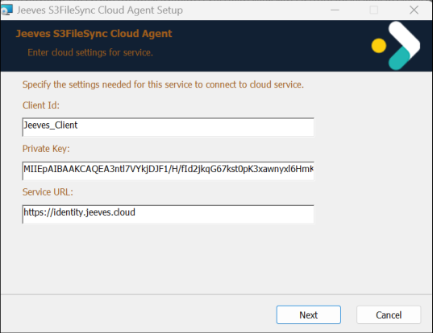


9 (36) 

© Copyright Forterro Sweden AB. All Rights Reserved. 

On-premises setup 


4. Click **Install** to begin the installation. 


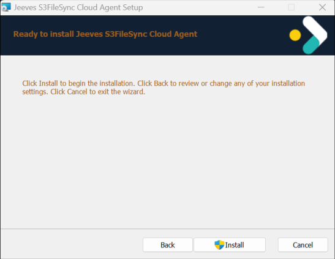


5. Click **Finish** to close the wizard or exit the setup. 

#### **4.1.3 Post installation** 

- After installation, navigate to **appsettings.json** in the **…\Program Files\Jeeves S3FileSync Cloud Agent** folder and check that your Client ID, Private key and service URL match the entered values. 

- Launch the **Task Manager** and navigate to the **Services** tab. You will find your **Jeeves.CloudAgent.S3FileSync.exe** service listed. Right-click on the service and select **Start** if the service is not started and running. 

#### **4.1.4 Troubleshooting and event log** 

Launch Microsoft **Event viewer** and navigate to **Applications and Services Logs > Jeeves Cloud Agent** . Look for logging information from the S3 File sync service to verify that the service is running. Check for **S3FSncCA** in the **Source** column, then select the relevant log and choose an action from the **Actions** pane as needed. 

You can also run the Jeeves S3 File Sync service from the command line to understand and troubleshoot. If your Jeeves S3 File Sync service is running, stop the service and then navigate to **C:\Program Files\ Jeeves S3FileSync Cloud Agent** in your command prompt and run **Jeeves.CloudAgent.S3FileSync.exe** . 

In addition to the general troubleshooting steps described above, the following scenarios may occur during operation: 

**Error: Failed to receive valid profile Jeeves.Cloud.Profiles.S3FileSyncProfile.** This error indicates that one or more configured S3 file paths are invalid. 

###### **Actions:** 

- Check Admin Console → Service Configuration → S3. 

- Verify that all configured Path entries are valid and accessible. 

- If multiple paths are configured, one invalid Path will prevent the S3 File Sync service from running. 

- Correct or remove invalid paths and restart the S3 File Sync service. 

**Error: The network name cannot be found.** This error occurs when files still exist in the S3 bucket under a previously configured path that no longer matches the current service configuration. 

- Files exist in the S3 bucket under a path that is no longer configured in Service Configuration → S3. 

- This can occur after changing a file share path (for example, when adding or removing $ in the share name). 

10 (36) 

© Copyright Forterro Sweden AB. All Rights Reserved. 

On-premises setup 


- The S3 File Sync service attempts to download files to a non-existing path and stops processing. 

###### **Actions:** 

- Remove files from the S3 bucket under the obsolete path, including the tobedownloaded folder. 

- Restart the S3 File Sync service. 

### 4.2 Jeeves Message Broker Cloud Agent Service installation 

The Jeeves Message Broker Cloud Agent Service plays an important role in transforming a financial invoice to a format that complies with the XSLT template for invoices. The service is required for: 

- Jeeves integration with PEPPOL (Message broker service) 

#### **4.2.1 Prerequisites** 

To be able to install the Jeeves Message Broker Cloud Agent Service you must have the following: 

- Administrator privileges to install the Jeeves Message Broker Cloud Agent Service 

- A client ID, private key and service URL that you have received from Jeeves 

#### **4.2.2 Installation** 

###### **<u>Note</u>** 

When you upgrade your Jeeves Message Broker Cloud Agent Service, the **appsettings.json** file is overwritten. Make sure you store your settings file elsewhere before upgrading to retain your customized settings. 

1. Download the Jeeves Message Broker Cloud Agent Service installer from the Jeeves ERP Product download center and extract the contents. 

2. Double-click **Jeeves.CloudAgent.MessageBroker.Installer.msi** to launch the installer. 

3. Enter the **Client ID** , **Private key** and **Service URL** and click **Next** . 


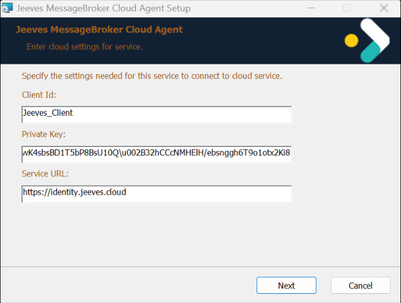


4. Click **Install** to begin the installation. 

11 (36) 

© Copyright Forterro Sweden AB. All Rights Reserved. 

On-premises setup 


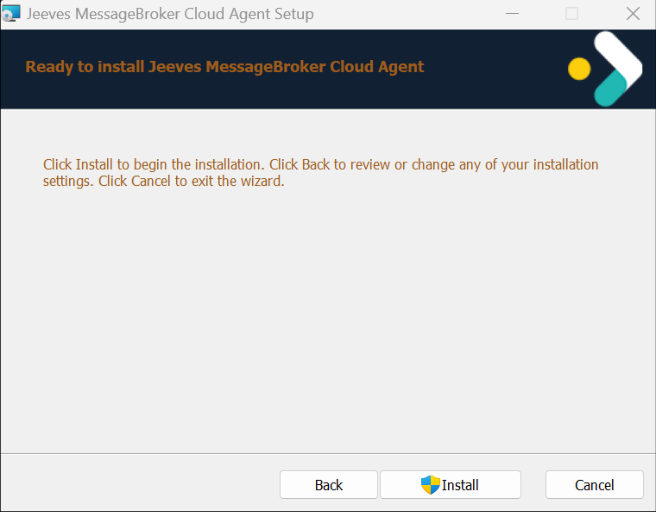


5. Click **Finish** to close the wizard or exit the setup. 

#### **4.2.3 Post installation** 

- After installation, navigate to **appsettings.json** in the **…\Program Files\Jeeves MessageBroker Cloud Agent** folder and check that your Client ID, Private key and service URL match the entered values. 

- Launch the **Task Manager** and navigate to the **Services** tab. You will find your **Jeeves MessageBroker Cloud Agent Service** listed. Right-click on the service and select **Start** if the service is not started and running. 

#### **4.2.4 Multiple envs for MessageBroker cloud agent service from command prompt** 

You can set up multiple environments of the MessageBroker cloud agent service through the command prompt. To do this, you must run the command prompt as administrator. 

###### **<u>Note</u>** 

The respective app settings must be updated with Client ID and Private key which are created in Admin console for different environments. 

Use the commands, as shown in the examples below, to set up the different environments if required: 

###### **Production environment:** 

```
SC CREATE "Jeeves MessageBroker Cloud Agent Service " binpath=
"\"C:\Program Files\Jeeves MessageBroker Cloud Agent
\Jeeves.CloudAgent.MessageBroker.exe\" -sOPTIONALSWITCH" start= auto
SC DESCRIPTION "Jeeves MessageBroker Cloud Agent Service " "Hosts
services that integrates with Jeeves ERP cloud infrastructure
```

12 (36) 

© Copyright Forterro Sweden AB. All Rights Reserved. 

On-premises setup 


**Test environment:** 

```
SC CREATE "Jeeves MessageBroker Cloud Agent Service_Test" binpath=
"\"C:\Program Files\Jeeves MessageBroker Cloud
Agent_Test\Jeeves.CloudAgent.MessageBroker.exe\" -sOPTIONALSWITCH"
start= auto
```

```
SC DESCRIPTION "Jeeves MessageBroker Cloud Agent Service_Test" "Hosts
services that integrates with Jeeves ERP cloud infrastructure"
```

#### **4.2.5 Troubleshooting and event log** 

Launch Microsoft **Event viewer** and navigate to **Applications and Services Logs > Jeeves Cloud Agent** . Look for logging information from the Message broker service to verify that the service is running. Check for **MsgBkrCA** in the **Source** column, then select the relevant log and choose an action from the **Actions** pane as needed. 

You can also run the Jeeves MessageBroker Cloud Agent Service from the command line to understand and troubleshoot. If your Jeeves MessageBroker Cloud Agent Service is running, stop the service and then navigate to **C:\Program Files\ Jeeves MessageBroker Cloud Agent** in your command prompt and run **Jeeves.CloudAgent.MessageBroker.exe** . 

### 4.3 SQL Tunnel service installation 

The SQL Tunnel service is used to be able to use Jeeves ERP hybrid solutions that read/create data in the on-premises SQL server. 

For example: e-Approval Cloud 5.242 requires this service for secure database communication and federated authentication scenarios. When reading invoices on the front-end web URL, the data is retrieved via the SQL tunnel service from the customer’s on-premises SQL server. The communication is encrypted and secure. No special firewall setup is needed (except 443 towards https://identity.jeeves.cloud). 

#### **4.3.1 Prerequisites** 

To be able to install the SQL Tunnel service you must have the following: 

- Administrator privileges to install the SQL Tunnel service 

- A client ID, private key, and service URL that you have received from Jeeves 

#### **4.3.2 Installation** 

###### **<u>Note</u>** 

When you upgrade your Jeeves SQL Tunnel Cloud agent, the appsettings.json file is overwritten. Make sure you store your settings file elsewhere before upgrading to retain your customized settings. 

13 (36) 

© Copyright Forterro Sweden AB. All Rights Reserved. 

On-premises setup 


Download the SQL Tunnel service installer from the Jeeves ERP Product download center and extract the contents. 

1. Double-click **Jeeves.SQLTunnel.CloudAgent.msi** to launch the installer. 

2. Enter the **Client ID** , **Private key** and **Service URL** and click **Next** . 


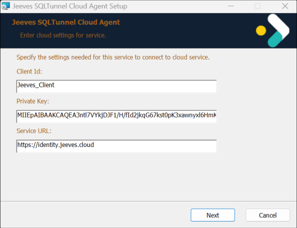


3. Click **Install** to begin the installation. 


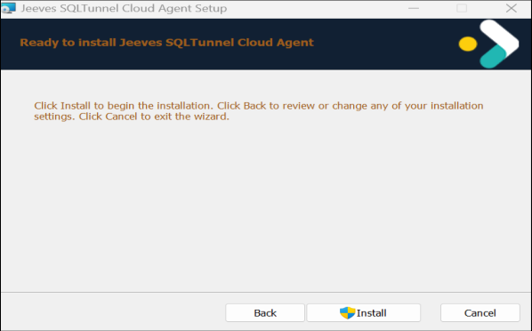


4. Click **Finish** to close the wizard or exit the setup. 

#### **4.3.3 Post installation** 

- After installation, navigate to **appsettings.json** in the **…\Program Files\Jeeves SQLTunnel Cloud Agent** folder and check that your Client ID, Private key and service URL match the entered values. 

- Launch the **Task Manager** and navigate to the **Services** tab. You will find your **Jeeves.CloudAgent.SQLTunnel.exe** service listed. Right-click on the service and select **Start** if the service is not started and running. 

14 (36) 

© Copyright Forterro Sweden AB. All Rights Reserved. 

On-premises setup 


#### **4.3.4 Troubleshooting and event log** 

Launch Microsoft **Event viewer** and navigate to **Applications and Services Logs > Jeeves Cloud Agent** . Look for logging information from the SQL Tunnel service to verify that the service is running. Check for **SqlTnlCA** in the **Source** column, then select the relevant log and choose an action from the **Actions** pane as needed. 

You can also run the Jeeves SQL Tunnel service from the command line to understand and troubleshoot. If your Jeeves SQL Tunnel service is running, stop the service and then navigate to **C:\Program Files\Jeeves SQLTunnel Cloud Agent** in your command prompt and run **Jeeves.CloudAgent.SQLTunnel.exe** . 

### 4.4 SQL Tunnel configuration 

Make sure that the Server and SQL Tunnel configuration have the same ANSI settings as your Jeeves Kernel. If your ANSI settings are off in the Jeeves Kernel, the AnsiSettingsOff parameter must be set to True in your Service configuration tab in your admin console. 

###### **<u>Note</u>** 

The default value of AnsiSettingsOff parameter is True. 

###### **Example:** 

In the Service configuration tab 

```
{
"TunnelService":"http://yourtunnelservice.jeeves.cloud",
"AnsiSettingsOff":true,
"Channels":[{"ChannelName":"mychannel"}]
}
```

15 (36) 

© Copyright Forterro Sweden AB. All Rights Reserved. 

Hybrid cloud setup 


## 5 Hybrid cloud setup 

This chapter describes how to set up the connection between the local Jeeves installation (onpremises platform) and the different services in Jeeves hybrid cloud platform. 

For all the services you must provide information about the customer environment to Jeeves Cloud Operations, who will initiate and configure the customer-unique services in Jeeves hybrid cloud platform. 

Jeeves Cloud Operations will provide the customer-unique access details for the cloud services that must be registered in your system settings or .ini files in the on-premises environment, defining the connection between the cloud services and the on-premises environment. 

###### **<u>Note</u>** 

The delay in repeated initialization of the Jeeves cloud server in case of failure has been set at 1 second and then at 5 mins after 50 retry attempts. 

Regularly rotate and update the secret key used to generate the JWT token; for instance, when applying updates or hotfixes. Note that the secret key must be lengthy, robust, and kept confidential at all times. 

This information exchange is illustrated in the following format for each service. 

|**Input/output**|**Data**|**Usage **|
|---|---|---|
|The serviceyou request from Jeeves<br>Input to Jeeves Cloud Operations|What is<br>sent/received|Where the data is applied|
|Output from Jeeves Cloud Operations|||


### 5.1 Federated authentication 

Federated authentication is an agreement and a process of authenticating the login to an application (also referred to as _System provider_ ) using a trusted _Identity provider_ . For example, authenticating users in Jeeves ERP _(as system provider)_ using Azure AD _(as Identity provider)._ 

When users try to log in to the application, they are redirected to the identity provider which has been preconfigured to accept authentication requests from the service provider. The Identity provider validates the user’s credentials and returns an Accept or a Reject response, thereby granting or denying access to the application. 


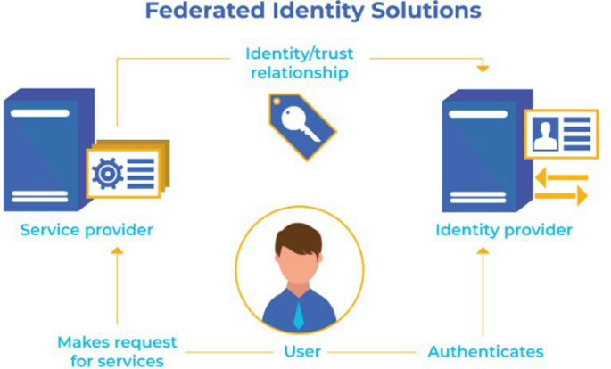


16 (36) 

© Copyright Forterro Sweden AB. All Rights Reserved. 

Hybrid cloud setup 


Federated authentication enables users to use a single authentication ticket/token to obtain access to different applications on the same network. It also allows **Single sign-on (SSO).** If you have signed on in one place you will not need to perform any other separate logins to use the application later. 

There are several different identity providers, who allow access from the service providers through different protocols. The solution for federated authentication in Jeeves ERP is based on the **OpenID Connect** protocol which among others is supported by Azure AD/Office 365, Google Identity, OKTA, and AWS Cognito. The solution by Jeeves ERP has been verified for Azure AD and OKTA. 

The authentication is made through _Jeeves Identity service_ , a cloud-based service which is called from the Jeeves ERP server and clients. 

#### **5.1.1 Configuration of Federated authentication in Jeeves** 

Perform the following to set up federated authentication for Jeeves: 

1. Register an app for OpenID connect at the identity provider. 

2. Provide details about your Identity provider application to Jeeves Cloud Operations, enabling configuration of Jeeves Identity service. 

3. Enter kernel parameters (jini) for the Jeeves server. The authentication through federated authentication, the URL to Jeeves identity service and a customer specific API key must be defined. Also, the users are mapped at this stage, as described later on. 

4. Enter settings for client initiation (.ini files). The authentication through federated authentication, the URL to Jeeves identity service and a customer specific API key must be defined. 

The above steps are explained in detail below with an example on how to set up federated authentication through Azure active directory (Azure AD) for a _Forterro_ company. 

For more information on configuration in Azure AD, refer to https://docs.microsoft.com/en- <u>us/powerapps/maker/portals/configure/configure-openid-settings</u> 

For guidance on registering an app in Azure Active Directory, refer to the **Register App in Azure Active Dir.mp4** (video) file that is available for download at Jeeves ERP Product download center. 

|**Input/output**|**Data**|**Usage**|
|---|---|---|
|The service you request from<br>Jeeves|Federated<br>authentication|Service to use a trusted identity<br>provider forauthentication inJeeves|
|Input to Jeeves Cloud Operations|Application name|Used to set up the customer-unique<br>link between Jeeves identity service<br>and theidentity provider|
|Input to Jeeves Cloud Operations|Client ID|Used to set up the customer-unique<br>link between Jeeves identity service<br>and theidentity provider|
|Input to Jeeves Cloud Operations|Client secret|Used to set up the customer-unique<br>link between Jeeves identity service<br>and theidentity provider|
|Input to Jeeves Cloud Operations|Client secret expiry|Used to set up the customer-unique<br>link between Jeeves identity service<br>and theidentity provider|
|Input to Jeeves Cloud Operations|Authority (URL)|Used to set up the customer-unique<br>link between Jeeves identity service<br>and theidentity provider|
|Output from Jeeves Cloud<br>Operations|Customer-unique<br>federated client ID|Value for FederatedClientID kernel<br>(jini) parameter under Jeeves<br>section|
|Output from Jeeves Cloud<br>Operations|URL to Jeeves identity<br>service|Value for Authority kernel (jini)<br>parameterunderJeeves section|


© Copyright Forterro Sweden AB. All Rights Reserved. 

17 (36) 

Hybrid cloud setup 


#### **5.1.2 Register an application in Azure active directory** 

You must decide the _name_ of the application (usually, it is the name of your company) to be registered in the Azure active directory. The application name will be used in the customer-unique URIs for signing in and signing out from Jeeves identity service. If you have more than one application, name them differently. This is the _Application name_ that must be sent to Jeeves Cloud Operations. 

Sign-in URI: https://identity.jeeves.cloud/[ApplicationName]/signin-oidc 

Logout URI: https://identity.jeeves.cloud/[ApplicationName]/signout-callback-oidc 

Perform the following to register your application: 

1. To register your application, you must log in to Azure. Navigate to **Azure active directory > App registrations.** 

2. Click **New registration** and enter **Name** and **Redirect URI** to register the application. 


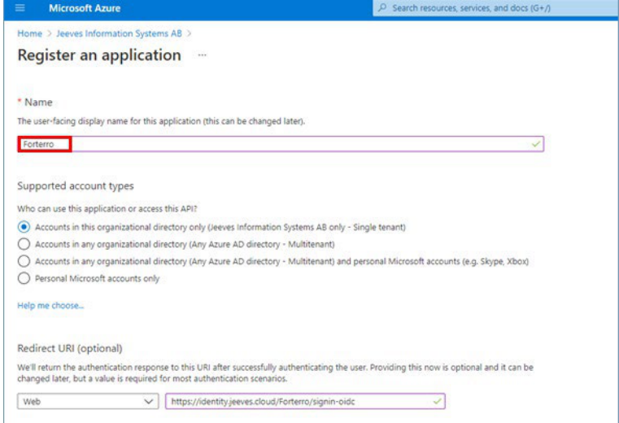


An application has now been created and you have received the **Application (client) ID** that must be sent to Jeeves Cloud Operations. 

Continue making configurations in the _Authentication_ , _Endpoints_ , _Certificates & Secrets_ an _d Token configuration_ sections as shown in the images below. 

18 (36) 

© Copyright Forterro Sweden AB. All Rights Reserved. 

Hybrid cloud setup 


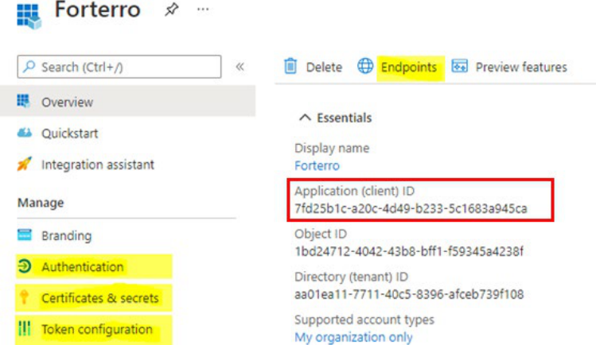


3. Navigate to the **Authentication** section and enter the sign-out URI in the **Front-channel logout URL** section with additional settings as shown in the image below. 


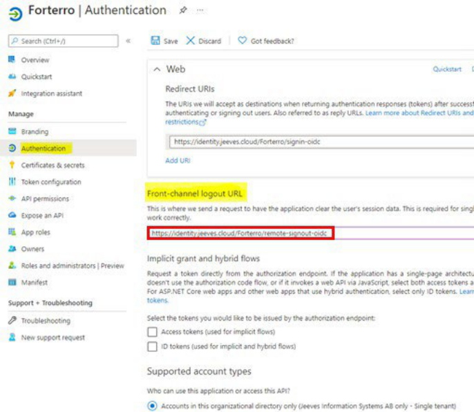


4. Navigate to the **Endpoints** section and copy the path in the **OpenID Connect metadata document** field until 2.0 as shown in the image below. This is the **Authority (URL)** you must send to Jeeves Cloud Operations. 

19 (36) 

© Copyright Forterro Sweden AB. All Rights Reserved. 

Hybrid cloud setup 


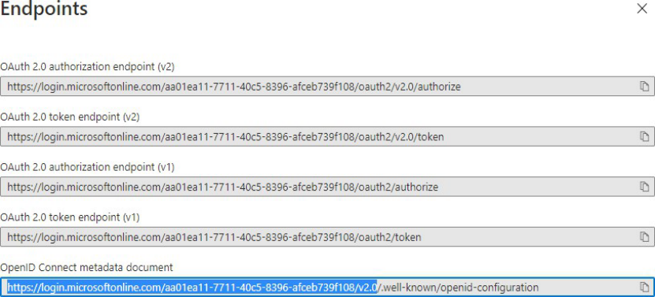


5. Navigate to **Certificates & secrets** and click **New client secret** to register a client secret with expiry. This is the **Client secret** and **Client secret expiry** you must send to Jeeves Cloud Operations. 

###### **Note** 

The client secret only is visible for the initial session. It is therefore recommended to copy it immediately. 


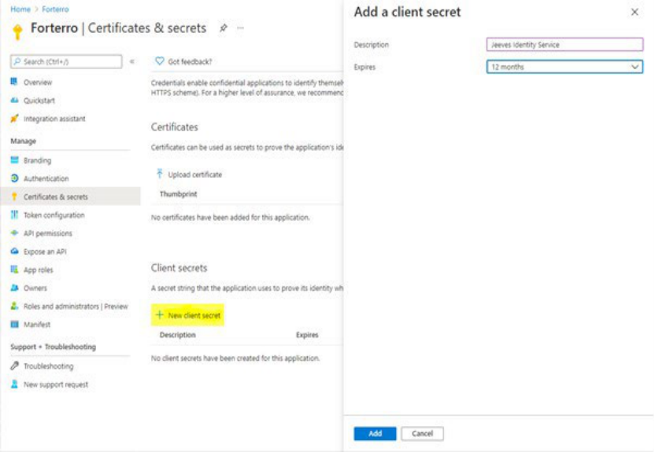


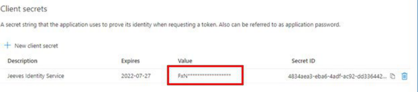


20 (36) 

© Copyright Forterro Sweden AB. All Rights Reserved. 

Hybrid cloud setup 


6. Navigate to the **Token configuration** section and click **Add optional claim** to register how users must be identified. Select I **D** as the **Token type** and **email** as the **Claim** option. Accept when asked to **Turn on the Microsoft Graph email permissions** . 


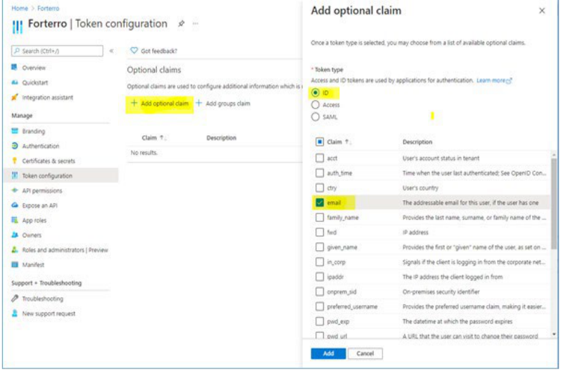


#### **5.1.3 Order setup of Jeeves identity service** 

The Azure AD application is now fully configurated and the below information must be sent to Jeeves Cloud Operations to enable the setting up of the customer-unique connection to Azure AD in Jeeves Identity Service. The below examples are from the demo customer - _Forterro_ . 

|**Property**|**Example**|
|---|---|
|Appname|Forterro|
|Client ID|7fd25b1c-a20c-4d49-b233-5c1683a945ca|
|Client secret|FxN-5~~~0zbMum1yxiFGQBnG4Rk6g_3~xR|
|Client secret expiry|12 months|
|Authority (URL)|https://login.microsoftonline.com/aa01ea11-7711-40c5-8396-<br>afceb739f108/v2.0|


The following information will be returned from Jeeves Cloud Operations after having set up the service. 

|**Property**|**Example**|
|---|---|
|Federated Client ID|Forterro_FedAuthClient|
|Authority (URL)|https://identity.jeeves.cloud|


The Authority (URL) is the same for all customers. 

Authority (URL): https://identity.jeeves.cloud/ 

The federated Client ID is customer unique. 

21 (36) 

© Copyright Forterro Sweden AB. All Rights Reserved. 

Hybrid cloud setup 


#### **5.1.4 Configure Jeeves server for federated authentication** 

##### 5.1.4.1 New kernel parameters 

Launch the Jeeves application and add the following two kernel parameters in the kernel parameters (jini) program: 

1. Enter the following values for the first parameter: 

   - Parameter section: Jeeves 

   - Kernel parameter: Authority 

   - Configuration name: * 

   - Group: 9999 

   - Signature: * 

   - Parameter data: Enter the URL of your identity service provided by Jeeves Cloud Operations. 

**(Example: https://identity.jeeves.cloud )** 

   2. Enter the following values for the second parameter: 

      - Parameter section: Jeeves 

      - Kernel parameter: FederatedClientID 

      - Configuration name: * 

      - Group: 9999 

      - Signature: * 

- Parameter data: Enter the Federated Client ID provided by Jeeves Cloud Operations. 

- **(Example: Forterro_FedAuthClient)** 

##### 5.1.4.2 Modified kernel parameter 

Change the values for the following kernel parameter: 

- Parameter section: DataBase 

- Kernel parameter: **SecurityMode** 

- Configuration name: * 

- Group: 9999 

- Signature: * 

- Parameter data = **6** 

##### 5.1.4.3 Enter user email addresses 

The association between the users in Jeeves and the users registered by the Identity provider is made through the email address that is entered on the user record in the Users (SY2) program. 

Enter the email address in the E-mail address ( **sy2.** YndEmailAddr) field for each user. 


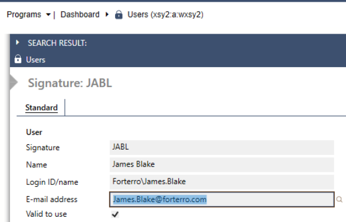


22 (36) 

© Copyright Forterro Sweden AB. All Rights Reserved. 

Hybrid cloud setup 


#### **5.1.5 Configure Jeeves clients for federated authentication** 

The information that is entered for the server should also be specified in the ini files for the Jeeves clients and mobile apps (REST service). 

Refer to the following sections in the _Jeeves ERP installation and configuration guide.pdf_ for more information on configuring federated authentication for Jeeves’ clients. 

|**Jeeves client**<br>**Area to be updated**|**Reference section in the document**|
|---|---|
|Classic client<br>ThinClient.ini|Configure thin client|
|[General]<br>HelpFileBasePath = \\servername\Jeeves\lang<br>SecurityMode = 6<br>FederatedClientID = ‘Forterro_FedAuthClient’<br>Authority= https:\\www.identity.jeeves.cloud.com<br> <br>||
|Desktopclient<br>Connecttoserver.xml|Configure connectToServer.xml|
|<server name="Jeeves" ip="kernelmobscm" port="4504"<br>FederatedClientId="MyFederatedClientId" Authority="ht<br>HtmlHelpBasePath=" C:\Program Files\Jeeves ERP Desk<br>Autoconnect="true" /><br> <br>|connectiontype="4" securitymode="6"<br>tps://identity.jeeves.cloud"<br>top Client\Jeeves Help Files\lang"<br>|
|Mobile client<br>Web.config|Federated login for Mobile client|
|<MobileConfigurations><br><add key="ClientId" value="Forterro_FedAuthClient”/><br><add key="Securitymode" value="6" /><br><add key="Authority" value="https:\\www.identity.jeeve<br></MobileConfigurations>|s.cloud.com" />|


###### **Note** 

Forterro employees can log in to the Jeeves clients through federated authentication without requiring a license if they are assigned the role of Consultant and have their FederatedClientId specified as Consultants. This facility is also available to non-Forterro users if their FederatedClientId is linked to the role of Consultant. For details, see Configure federated log in for non-Forterro users. 

Federated authentication can also be enabled in the Desktop client for command line installation, during installation and in the Desktop client shortcuts. Refer to the Jeeves ERP Installation and configuration guide for more information. 

#### **5.1.6 Federated authentication in Design studio** 

To implement federated authentication in the Design studio, make sure the following prerequisites are fulfilled and make the settings described below: 

###### **Prerequisites:** 

- Azure active directory must be set up for your application 

- A client and a dynamic resource must be set up for your application in the administration console for your identity service. 

- Federated login is set as the authentication mode in the Jeeves server configuration. 

###### **Settings in AWS Secret manager:** 

Add Authentication type, Authority, Federated Client ID and Identity provider to your Jeeves server’s secret. 

23 (36) 

© Copyright Forterro Sweden AB. All Rights Reserved. 

Hybrid cloud setup 


**For example** : If your authentication type is 3, authority is <u>https://identity.jeeves.cloud, federated</u> client ID is **Forterro_FedAuthClient** and identity provider is **Microsoft** and your Jeeves server is called **jeevesServer** , the following settings must be made to jeevesServer’s secret in AWS Secret manager. 

`AuthenticationSettings AuthenticationTypes: 3 AuthenticationSettings Federated Authority:` <u>https://identity.jeeves.cloud</u> `AuthenticationSettings Federated FederatedClientId:` Forterro_FedAuthClient 

```
AuthenticationSettings Federated Provider: Microsoft
```

###### **Note** 

Authentication types are defined as: 

- 1 – SQL login only (Security mode = 0) 

- 2 – Federated login only (Security mode = 6) 

- 3 – Both SQL and Federated login (Security modes 0 and 6) 

If the value of Authentication types is empty in the Secret manager, the Jeeves server does not start. If no value is required to be provided, remove the entire key. In this case, the system will default to Authentication type 2, Federated login only (Security mode = 6). 

After the above settings are saved, navigate to Design studio and log in using federated authentication. 

#### **5.1.7 Federated authentication for eApproval** 

The eApproval cloud application uses the federated authentication configuration described in section 5.1. 

When federated login is enabled for eApproval, authentication is performed through the existing Jeeves Identity service using the same configuration as Jeeves ERP clients. 

###### **Additional prerequisites when federated authentication is used with eApproval:** 

- Federated authentication must be configured in Jeeves ERP as described in section 5.1.1 

- SQL Tunnel cloud agent must be installed and running 

- Required authentication parameters must be configured in AWS Secrets Manager for the eApproval service 

###### **Minimum version requirements:** 

- SQL Tunnel Cloud Agent: Jeeves 2026.Q2.0 or later 

- Jeeves ERP: 2026.Q2.0 or later 

**The following parameters must exist in AWS Secrets Manager:** 

- Authentication_UseFederated 

- Authentication_OIDC_ClientId 

- Authentication_OIDC_ClientSecret 

- Authentication_OIDC_Authority 

If these parameters are missing, the eApproval application displays an OIDC configuration error during startup. 

Detailed configuration steps are described in the _eApproval Deployment and Configuration_ 

24 (36) 

© Copyright Forterro Sweden AB. All Rights Reserved. 

Hybrid cloud setup 


_documentation_ . 

#### **5.1.8 Federated authentication in Jeeves cloud server for Desktop client** 

To implement federated authentication in Desktop client using Jeeves cloud server, make the following settings in the Secrets manager in AWS console. 

Add the parameters for Authentication type, Authority, Federated Client ID and Identity provider to your Jeeves server’s secret as shown here: 

`AuthenticationSettings AuthenticationTypes: 2 AuthenticationSettings Federated Authority:` <u>https://main.identity.qa.jeeves.cloud</u> `AuthenticationSettings Federated FederatedClientId:` Consultants `AuthenticationSettings Federated Provider: Microsoft` 

The parameters must match the values entered in **connectToServer.xml** file. 

###### **Note** 

Authentication types are defined as: 

- 1 – SQL login only (Security mode = 0) 

- 2 – Federated login only (Security mode = 6) 

- 3 – Both SQL and Federated login (Security modes 0 and 6) 

Once you save the above settings, you can navigate to Desktop client and log in using federated authentication. 

#### **5.1.9 Troubleshooting** 

If you encounter issues accessing the URL of your identity service, add the URL of your Identity service provider to the list of trusted sites in your browser. 

25 (36) 

© Copyright Forterro Sweden AB. All Rights Reserved. 

Hybrid cloud setup 


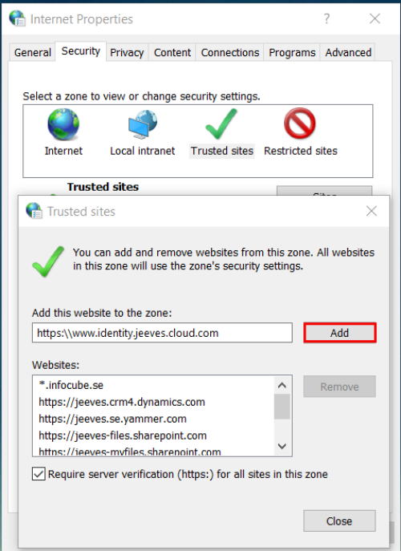


### 5.2 PEPPOL services 

Jeeves PEPPOL services include several services for handling e-invoicing in PEPPOL format (replacing our previous solution based on Jeeves Service Builder), through third-party providers Pagero or Crediflow, or through other access-points in a general format. 

To configure the cloud services, you must send the following information to Jeeves: 

- Customer name 

- Database details 

- Service provider information for sender service configuration 

- Request for setup of PEPPOL service 

In the on-premises environment, install and configure the Cloud agent service and the Message broker service as described in this document. Install the Message broker mapping tool and import the Pagero or Crediflow package described in the Jeeves ERP PEPPOL installation and configuration document. 

When the PEPPOL service has been set up by Jeeves Cloud Operations, if you are an authorized user, you can configure the service in the administration console. 

26 (36) 

© Copyright Forterro Sweden AB. All Rights Reserved. 

Hybrid cloud setup 


For more information on integration with PEPPOL, refer to the Jeeves ERP PEPPOL installation and configuration document. 

|**Input/output**|**Data**|**Usage **|
|---|---|---|
|The service you<br>request from Jeeves|PEPPOL services|Services for routing invoices and<br>trackinginformation duringbilling.|
|Input to Jeeves<br>Cloud Operations|Customer name|Used to create a customer identifier in<br>Jeeves Identity Service (Administration<br>console)|
|Input to Jeeves<br>Cloud Operations|Database details and<br>credentials|Used to configure Message broker<br>service in Jeeves hybrid cloudplatform|
|Input to Jeeves<br>Cloud Operations|Sender service|Used to set up the sender service<br>details for the specific third-party<br>provider.|
|Output from Jeeves<br>Cloud Operations|Client ID|Required during local Message broker<br>service installation or in<br>appsettings.jsonpost installation.|
|Output from Jeeves<br>Cloud Operations|Private key|Required during local Message broker<br>service installation or in<br>appsettings.jsonpost installation.|
|Output from Jeeves<br>Cloud Operations|Admin console access|Access to Billing tab and sender service<br>(Pagero or Crediflow)|


### 5.3 Notification service 

Jeeves Notification service is a service for sending push notifications to devices with Jeeves mobile app from the macro language. (The earlier notification service has been phased out and replaced with this service in Jeeves Hybrid Cloud platform.) 

To configure the cloud-based notification service, you must send the following information to Jeeves: 

- Customer name 

- Request of (API key for) notification service 

You will receive the URL for the notification service and a customer unique API key. Configure the NotificationUrl and NotificationApiKey kernel (jini) parameters and update your macro. 

For more information on the above steps, refer to _New functionality in kernel 5.1 R9 and Mobile client 1.34 (3021)_ chapter in Jeeves online documentation. 

|**Input/output**|**Data**|**Usage **|
|---|---|---|
|The service you<br>request from Jeeves|Notification service|The service for sending notifications to<br>devices with Jeeves mobile app from<br>macro.|
|Input to Jeeves<br>Cloud Operations|Customer name|Used to create a customer identifier in<br>Jeeves Identity Service (Administration<br>console)|
|Output from Jeeves<br>Cloud Operations|API key|Value for**NotificationApiKey**kernel<br>(jini) parameter under Jeeves section|
|Output from Jeeves<br>Cloud Operations|Service URL|Value for**NotificationUrl**kernel (jini)<br>parameter under Jeeves section|


### 5.4 Jeeves ERP standard dashboard 

The Jeeves ERP standard dashboard has pre-built dashboards that expand the available ways for users to present and interact with information. 

27 (36) 

© Copyright Forterro Sweden AB. All Rights Reserved. 

Hybrid cloud setup 


The data in the Jeeves ERP standard dashboard is retrieved from the new ERPServer (Cloud). You can read more about Hybrid services in the Introduction to Jeeves Hybrid cloud chapter later in this document. 

For information about the New Local Business Server hosted on IIS, refer to the document: Jeeves ERP New Local Business server installation and configuration. 

Currently, the following dashboards can be viewed on the Desktop client: 

- Sales dashboard provides a visual representation of sales data such as open invoices, sales against forecast, sales by item group, etc. 

- CFO dashboard provides a visual representation of financial data like profit and loss, balance sheet, revenue, cash flow, etc. 

To set up the Jeeves ERP standard dashboard, perform the following actions: 

#### **5.4.1 Install package and map signatures** 

Install the **Sales Dashboard.JSP or the CFO Dashboard.JSP** package as needed using the Jeeves apps builder (jvspackagesolutions) program or **JeevesPackageManager.exe** . Restart your Jeeves server after the package is installed. 

Once the server has been restarted, launch the Groups (jvssitegroups) program and select the Sales Dashboard or CFO Dashboard role depending on the information you would like to view. Move the required signatures (perssign) for the desired group/role to the right check-off list and save the check-off list. 

#### **5.4.2 Set up Kernel parameter** 

Make sure that the JeevesERPServer kernel parameter is configured in the Kernel parameters (jini) program, as detailed below: 

1. Add a new record in the jini program (Ctrl+A). 

2. Enter the following values: 

   - **Parameter section** : Jeeves 

   - **System (jini) parameter** : JeevesERPServer 

   - **Configuration name** : * 

   - **Group** : 9999 

   - **Signature** : * 

**Parameter data** : Enter the URL of the new ERP server as shown in the below image. 


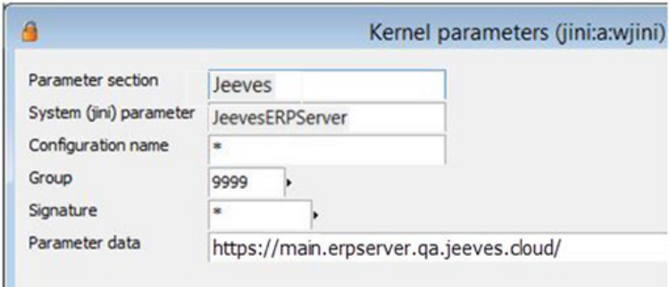


The dashboard retrieves the widget’s XAML from the cloud server specified in the JeevesERPServer kernel parameter. The data for the dashboard widgets is retrieved from the database specified by the Database kernel parameter. 

28 (36) 

© Copyright Forterro Sweden AB. All Rights Reserved. 

Hybrid cloud setup 


#### **5.4.3 Launch Jeeves ERP standard dashboard** 

Log in to the Desktop client with the signature you have mapped to the Sales dashboard/CFO Dashboard role. You will see the regular dashboard displayed. Switch the role to Sales dashboard/CFO dashboard and choose a company to view the redesigned dashboard. 

Note that when you change the company in Desktop client using the drop-down, the dashboard is updated accordingly and the information relevant to that company is displayed. 

###### **Note:** 

To view data in all the widgets in the Sales dashboard, make sure you are also a salesperson when you login to the Desktop client. 

Once you have completely set up your dashboard, it will be displayed in the Desktop client. An example of the Sales dashboard is shown below: 


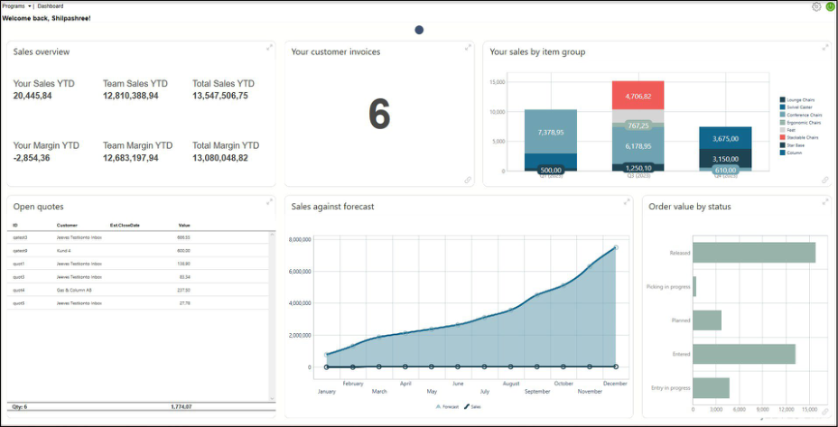


To view the list of widgets along with information about the data available in each widget, see the chapters on the Sales dashboard and CFO dashboard in the online help. 

### 5.5 Sales API 

Jeeves Sales API is a standardized integration service for sales in your Jeeves Cloud. To configure Jeeves Sales API, perform the following: 

**Prerequisites** : 

- A client, for which the Sales API is to be set up, is configured and the Sales API scope mapped to that client. 

- The SQL tunnel agent is set up and the service configuration updated in the admin console for the SQL tunnel agent. 

###### **Note** 

The application objects that are required to run the Sales API are included with Jeeves ERP 6.0 Update 11, but the APIs are available in the later updates. Please note that installing Jeeves ERP 6.0 Update 11 is not sufficient to be able to run the APIs. 

29 (36) 

© Copyright Forterro Sweden AB. All Rights Reserved. 

Hybrid cloud setup 


#### **5.5.1Sales API service configuration** 

In your admin console, navigate to the **Service configuration** tab and click **Add configuration** to add a service configuration for the Sales API. 

The information exchange for the Sales API is as follows: 

|**Input/output**|**Data**|**Usage **|
|---|---|---|
|The service you<br>request from Jeeves|Sales API|The service for monitoring if there are<br>any changes in the subscribed<br>programs.|
|Input to Jeeves<br>Cloud Operations|Customer name|Used to create a customer identifier in<br>Jeeves Identity Service (Administration<br>console).|
|Input to Jeeves<br>Cloud Operations|Database details|Used to configure the service in Jeeves<br>hybrid cloudplatform.|
|Output from Jeeves<br>Cloud Operations|API key|API key to consume Jeeves SALESAPI<br>service. This key is used for<br>authorization in Postman.|
|Output from Jeeves<br>Cloud Operations|Service URL|Value for Jeeves Sales API URL which<br>will be used in Postman.|


For example: 

```
{
"ConnectionString" : "Data Source=myDataSource;Initial Catalog=JIPv6;
UserID=userID; Password=mypassword",
"CompanyCode" : 9930,
"Perssign" : "jsa",
"TunnelService" : "https://mytunnel.jeeves.cloud",
"Channel" : "mychannel",
"DefaultLanguage" : 999,
}
```

```
"ConnectionString" : "Data Source=myDataSource;Initial Catalog=JIPv6;
UserID=userID; Password=mypassword",
```

### 5.6 Finance API 

Jeeves Finance API is a standardized integration service for financial transactions in your Jeeves cloud. To configure Jeeves Finance API, perform the following: 

**Prerequisites:** 

- A client, for which the Finance API is to be set up, is configured and the Finance API scope mapped to that client. 

- The SQL tunnel agent is set up and the service configuration is updated in the admin console for the SQL tunnel agent. 

- EDM paths are configured with PDF as the default document type as the invoice is saved in the PDF format. 

30 (36) 

© Copyright Forterro Sweden AB. All Rights Reserved. 

Hybrid cloud setup 


#### **5.6.1 Finance API service configuration** 

In your admin console, navigate to the **Service configuration** tab and click **Add configuration** to add a service configuration for the Finance API. 

The information exchange for the Finance API is as follows: 

|**Input/output**|**Data**|**Usage **|
|---|---|---|
|The service you request<br>from Jeeves|Finance API|The service for monitoring if there are any<br>changes in the subscribedprograms.|
|Input to Jeeves Cloud<br>Operations|Customer name|Used to create a customer identifier in<br>Jeeves Identity Service (Administration<br>console).|
|Input to Jeeves Cloud<br>Operations|Database details|Used to configure the service in Jeeves<br>hybrid cloud platform. Note that Perssign<br>must be an accounting (PR)user.|
|Input to Jeeves Cloud<br>Operations|Jeeves server URL<br>Jeeves server DB<br>username<br>Jeeves server DB<br>password|SQL server login credentials used to<br>communicate with Jeeves Cloud Server to<br>save the PDF.|
|Output from Jeeves<br>Cloud Operations|API key|API key to consume Jeeves FINANCEAPI<br>service. This key is used for authorization<br>in Postman.|
|Output from Jeeves<br>Cloud Operations|Service URL|Value for Jeeves Finance API URL which<br>will be used in Postman.|


For example: 

```
{
"ConnectionString" : "Data Source=myDataSource;Initial Catalog=JIPv6;
UserID=userID; Password=mypassword",
"CompanyCode" : 9930,
"Perssign" : "jsa",
"TunnelService" : "https://mytunnel.jeeves.cloud",
"Channel" : "mychannel",
"DefaultLanguage": 999,
"JeevesServer": {
"Url": "https://main.erpserver.qa.jeeves.cloud/",
"UserName": "myuser",
"Password": "mypassword"
}
}
```

31 (36) 

© Copyright Forterro Sweden AB. All Rights Reserved. 

Hybrid cloud setup 


### 5.7 Jeeves API Platform 

Jeeves API Platform is a standardized integration service platform that can be used for both standard API development by Jeeves and also for developing customized APIs. 

You can configure the Jeeves API Platform as follows: 

###### **Prerequisites:** 

- A client, for which the Jeeves API Platform is to be set up, is configured and the Jeeves API scope is mapped to that client. 

- The SQL tunnel agent is set up and the service configuration is updated in the admin console for the SQL tunnel agent. 

- The Domain name for domain mapping is created 

###### **<u>Note</u>** 

The application objects required to run the Jeeves API Platform are included with Jeeves ERP 2025.Q2.0. Please note that installing Jeeves ERP 2025.Q2.0 is not sufficient to run the Jeeves API Platform services 

#### **5.7.1 Jeeves API Platform service configuration** 

In your admin console, navigate to the **Service configuration** tab and click **Add configuration** to add a service configuration for the Jeeves API Platform. 

The information exchange for the Jeeves API Platform is as follows: 

|**Input/output**|**Data**|**Usage **|
|---|---|---|
|The service you request<br>from Jeeves|Jeeves API Platform|The service for monitoring if there are any changes<br>in the subscribedprograms.|
|Input to Jeeves Cloud<br>Operations|Customer name|Used to create a customer identifier in Jeeves<br>IdentityService(Administration console).|
|Input to Jeeves Cloud<br>Operations|Database details|Used to configure the service in Jeeves hybrid<br>cloud platform. Note that Perssign must be set up<br>in sy2(validtouse=False).|
|Input to Jeeves Cloud<br>Operations|API domain<br>mappings<br>details|Note that currently the following service<br>names are available:<br>Custom Api<br>Inventory Optimization Api<br>Transport Administration Api|
|Output from Jeeves<br>Cloud Operations|API key|API key to consume the Jeeves API Platform service.<br>This key is used for authorization in Postman.|
|Output from Jeeves<br>Cloud Operations|Service URL|Value for Jeeves API URL which will be used in<br>Postman.|


32 (36) 

© Copyright Forterro Sweden AB. All Rights Reserved. 

Hybrid cloud setup 


Example 1: Connection through Tunnel 

```
{
"ConnectionString": "Data Source=myDataSource;Initial Catalog=JIPv6;
UserID=userID; Password=mypassword",
"CompanyCode": 9930,
"Perssign": "jsa",
"TunnelService" : "https://mytunnel.jeeves.cloud",
"Channel" : "mychannel",
"DefaultLanguage": 999
}
```

Example 2: Direct SQL Connect 

```
{
"ConnectionString" : "Data Source=myDataSource;Initial Catalog=JIPv6;
UserID=userID; Password=mypassword",
"CompanyCode" : 9930,
"Perssign" : "jsa",
"TunnelService" : "",
"Channel" : "",
"DefaultLanguage": 999
}
```

33 (36) 

© Copyright Forterro Sweden AB. All Rights Reserved. 

Hybrid cloud setup 


#### **5.7.2 Domain mapping** 

1. In your admin console, navigate to the Home tab and click Domain Mapping > Create Domain Mapping. 

2. Provide the following information to map a domain with a Service ID. 

   - Domain name: Enter the registered domain name. 

   - Service ID: Enter the ID to which the domain should be mapped. 

   - Domain description: Enter a user-friendly description of the domain. 

   - Metadata S3 path: Enter the location where the metadata files should be stored (this field is reserved for future use). 


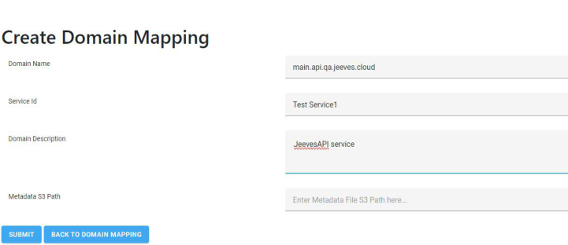


3. Click **Submit** to create a new record or **Back to domain mapping** to return to the **Jeeves API Domain mapping** page. 

34 (36) 

© Copyright Forterro Sweden AB. All Rights Reserved. 

Hybrid cloud setup 


#### **5.7.3 Jeeves API Platform: Example process** 

The following image shows an example for setting up the Jeeves API Platform environment and who is responsible for setting up each step within the process. Key steps in the process are explained below the image. 

**Jeeves API Platform Detailed** 


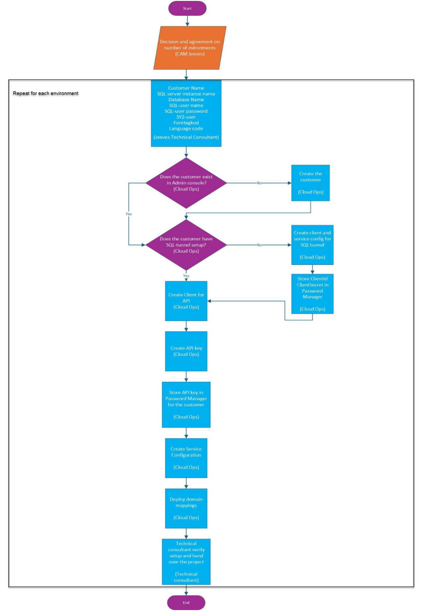


© Copyright Forterro Sweden AB. All Rights Reserved. 

35 (36) 

Hybrid cloud setup 


The following is an example of the process to be followed to set up a single environment for a customer named Corp AB 

1. The technical consultant provides the following information to the CloudOps team (values provided for example purposes only): 

   - Customer: Corp AB 

   - SQL-server: DB-SRV-01/Instace01 

   - DB name: Jeeves_Dev 

   - User: JVSINT-CloudAgent 

   - pw: somegoodpassword 

   - sy2 user: INTAPI 

   - Foretagkod: 1000 

   - Language: 999 

   - API domain mapping: CustomAPI 

2. Jeeves CloudOps creates the necessary setup based on the information provided above and an api key is generated, similar to the example below: 

user: x-api-key 

pw:BPR31GV1K4SGMV1UvT/ZEQocVlEVXQ2LUySbd2tyy1EDbUlVLhCU8tX1dOSMlpOTknDpzbXzX bUC5eIfDJc35sHETFKbSawVjcnoPl51 

3. Jeeves CloudOps shares the API key with the technical consultants. 

4. The technical consultant then, from a web browser or Swagger, opens the registered domain name and adds the API key to consume the APIs. Available URL(s) together with the x-api-key are provided when an order for the setup is placed. 

###### **<u>Note</u>** 

The content and what is visible in Swagger is dynamically built from the Jeeves API service details (apiservice) <mark>program and other related programs. For more information, see the Jeeves online documentation chapter on</mark> the Jeeves API platform and related APIs. 

36 (36) 

© Copyright Forterro Sweden AB. All Rights Reserved. 

