© Copyright Forterro Sweden AB. All rights reserved. 

# **Jeeves ERP** Installation and configuration Updated for Jeeves ERP 2026.Q2.2 

###### **Copyright notice** 

- © Copyright Forterro Sweden AB. All rights reserved. 

No part of this guide may be copied, reproduced, translated, or transmitted in any form or by any means without the prior written consent of Jeeves Information Systems AB. 

###### **Document disclaimer** 

Information contained in this guide is subject to change without notice. Please check with your Jeeves support team representative to make sure you have the most recent information. 

© Copyright Forterro Sweden AB. All rights reserved. 

2 (147) 

Contents 


### **Contents** 

|**1**|**About this guide ........................................................................................................... 9**|
|---|---|
|1.1|Document version/revision..................................................................................................................... 9|
|1.2|Audience........................................................................................................................................................10|
|1.3|Document conventions............................................................................................................................10|
|1.4|List of acronyms.........................................................................................................................................11|
|**2**|**System requirements ................................................................................................ 12**|
|2.1|Introduction.................................................................................................................................................12|
|2.2|Hardware requirements..........................................................................................................................12|
|2.3|Software requirements...........................................................................................................................12|
|2.3.1|Jeeves components ........................................................................... 12|
|2.3.2|Jeeves separate products .................................................................... 13|
|2.3.3|Jeeves Database server (SQL Server) ...................................................... 13|
|2.3.4|Jeeves Business server ....................................................................... 14|
|2.3.5|Jeeves thin client/Jeeves ERP Client ...................................................... 15|
|2.3.6|Jeeves rich client ............................................................................. 15|
|2.3.7|Other tools ..................................................................................... 16|
|2.4|Integrated third-party products..........................................................................................................16|
|**3**|**Install Jeeves application .......................................................................................... 17**|
|3.1|Jeeves Application services installation.........................................................................................17|
|3.1.1|Prerequisites ................................................................................... 17|
|3.1.2|Installation process overview ............................................................... 19|
|3.1.3|Install Jeeves Application services ......................................................... 19|
|3.1.4|Upgrade existing Jeeves application ....................................................... 24|
|3.1.5|Ready to install ................................................................................ 27|
|3.1.6|Installation summary ......................................................................... 28|
|3.1.7|SQL CLR in Jeeves installer .................................................................. 28|
|3.1.8|DLL required for DevExpress report printing on cloud ................................... 29|
|3.1.9|Post-installation steps ........................................................................ 29|
|3.2|Check log files.............................................................................................................................................29|
|3.2.1|Installation logs ............................................................................... 29|
|3.2.2|Running control of installation .............................................................. 30|
|3.3|Apply application hotfix.........................................................................................................................30|
|3.4|Install Kernel files.....................................................................................................................................31|
|3.5|Register database owner........................................................................................................................32|
|3.6|Install Site database.................................................................................................................................32|
|3.6.1|Introduction.................................................................................... 32|
|3.6.2|Prerequisites ................................................................................... 32|
|3.6.3|Install and upgrade Site database .......................................................... 33|
|3.6.4|Add kernel parameter for Site database................................................... 34|
|3.6.5|Create standard site groups if none exist ................................................. 35|
|3.7|Import and install application language.........................................................................................36|


© Copyright Forterro Sweden AB. All Rights Reserved. 3 (147) 

Contents 


|3.8|Load and connect application menus post-installation............................................................36|
|---|---|
|3.9|License key...................................................................................................................................................36|
|3.10|Summary of installation/upgrade process.....................................................................................36|
|3.11|Uninstall Jeeves Application services...............................................................................................37|
|3.12|Install additional features.....................................................................................................................37|
|3.12.1|Installation of the Swedish online documentation in a standard installation ........ 38|
|3.12.2|Install SQL Server Reporting Services - Native Mode ..................................... 38|
|3.12.3|Install report templates ...................................................................... 40|
|**4**|**Install Jeeves ERP Mobility framework .................................................................... 42**|
|4.1|Install REST service manually..............................................................................................................42|
|4.1.1|Prerequisites ................................................................................... 42|
|4.1.2|Pre-installation ................................................................................ 43|
|4.2|Installation....................................................................................................................................................44|
|4.3|Post-installation.........................................................................................................................................44|
|4.4|How to verify REST service is correctly installed.......................................................................44|
|4.5|Log related settings..................................................................................................................................44|
|4.6|Point REST service to server.................................................................................................................44|
|4.7|Configuration of connection types for REST service..................................................................45|
|4.8|Federated login for Mobile client.......................................................................................................45|
|4.9|Download and install Jeeves app and mobile routines.............................................................46|
|4.9.1|Install package ................................................................................ 46|
|4.9.2|Modifications .................................................................................. 46|
|4.10|Install Mobile client app.........................................................................................................................47|
|4.11|Point Jeeves mobile client to REST interface..............................................................................47|
|4.12|Configure MDM for Jeeves ERP app...................................................................................................47|
|**5**|**Install Jeeves client ................................................................................................... 49**|
|5.1|Install Jeeves ERP client........................................................................................................................49|
|5.1.1|Introduction.................................................................................... 49|
|5.1.2|System requirements ......................................................................... 49|
|5.1.3|Desktop client architecture ................................................................. 49|
|5.1.4|Install Desktop client application ........................................................... 49|
|5.1.5|Command line installation ................................................................... 52|
|5.1.6|Import language texts for Desktop client and Design studio ............................ 53|
|5.2|Configure Desktop client........................................................................................................................53|
|5.2.1|Create shortcut ............................................................................... 53|
|5.2.2|Configure connectToServer.xml ............................................................ 54|
|**6**|**Configuration.............................................................................................................. 59**|
|6.1|Jeeves Control server..............................................................................................................................59|
|6.1.1|Configure Jeeves Control server ............................................................ 59|
|6.1.2|Configure Jeeves Control client ............................................................ 62|
|6.2|Jeeves Client broker................................................................................................................................63|
|6.2.1|Configure Jeeves Client broker ............................................................. 63|


© Copyright Forterro Sweden AB. All Rights Reserved. 

4 (147) 

Contents 


|6.2.2|Configure Jeeves Business server with Jeeves Client broker ........................... 64|
|---|---|
|6.3|Configure thin client................................................................................................................................65|
|6.3.1|Create shortcut ............................................................................... 66|
|6.4|Configure SQL Server Reporting Services (SSRS).........................................................................67|
|6.4.1|Set user access roles and permissions in SQL Server Reporting Services .............. 71|
|6.4.2|Enable SSRS reports........................................................................... 72|
|6.5|Configure mobile client..........................................................................................................................73|
|6.5.1|SSRS reports ................................................................................... 74|
|6.5.2|Crystal reports................................................................................. 74|
|6.6|Backend process when using macros to print SSRS and Crystal reports...........................76|
|6.6.1|For SSRS reports ............................................................................... 76|
|6.6.2|For Crystal reports ............................................................................ 77|
|6.6.3|Data compression in IIS for REST service .................................................. 78|
|6.7|IPv6 support for Jeeves ERP.................................................................................................................78|
|**7**|**Troubleshooting ......................................................................................................... 79**|
|7.1|Jeeves server installation file..............................................................................................................79|
|7.1.1|Problem with installation program dialogs ................................................ 79|
|7.1.2|Transaction log errors ........................................................................ 79|
|7.1.3|Messages in Jeeves_Install_Error_Log: Mod procedures ................................. 80|
|7.1.4|Messages in Jeeves_Install_Log: Mod procedures ........................................ 80|
|7.1.5|Messages in Jeeves_Install_Error_Log: not Unicode ..................................... 80|
|7.1.6|Messages in Jeeves_Install_Log: not null->null and null->not null ..................... 81|
|7.1.7|Messages in JvsInstLog: duplicate site settings ........................................... 81|
|7.1.8|Messages in JvsInstLog: index ............................................................... 82|
|7.1.9|Messages in JvsInstLog: JEEVES_Kr_Fix_Kus_OrdSum .................................... 83|
|7.1.10|Messages in JvsInstLog: KundSaldoInklMoms/ tempdb.dbo.#a ......................... 83|
|7.1.11|Messages in JvsInstLog: xspr table .......................................................... 84|
|7.2|Miscellaneous..............................................................................................................................................85|
|7.2.1|Invalid foretagkod message wrongly displayed ........................................... 85|
|7.2.2|Running resource-intensive operations freezes all open instances of Classic client 85|
|7.2.3|Invalid character in URL ..................................................................... 85|
|7.2.4|SQL Server Native Client ODBC driver ...................................................... 85|
|7.2.5|Jeeves_Pre_DynUpg_Fix ..................................................................... 85|
|7.2.6|Deployment issues in site database ........................................................ 86|
|7.2.7|Installation issues with KrnUsrData table in site database .............................. 86|
|7.2.8|RunReport macro in the Mobile client ..................................................... 86|
|7.2.9|Issue with database mail ..................................................................... 86|
|7.2.10|Blank space in tabs after WebView2 upgrade ............................................. 87|
|7.2.11|Errors in Server log after setting up IPv6 .................................................. 87|
|7.2.12|Sales API: Possible primary key violation issues .......................................... 88|
|7.3|Jeeves reconnect when switching from LAN to Wi-Fi...............................................................89|
|7.4|Issues with online documentation......................................................................................................89|
|7.4.1|Location of online documentation files .................................................... 89|
|7.5|Issues and considerations with Desktop client.............................................................................89|
|7.5.1|CreateNewTransaction functionality....................................................... 89|
|© Copyr<br>All Righ|ight Forterro Sweden AB.<br>ts Reserved.<br>5 (147)|


Contents 


|7.5.2|Conditional formatting issues in Desktop client .......................................... 89|
|---|---|
|7.5.3|Embedded lists in Desktop client ........................................................... 89|
|7.5.4|Logout screen in Desktop client with federated authentication ....................... 89|
|7.5.5|GetTab object errors ......................................................................... 90|
|7.5.6|Reconnecting to the Desktop client ........................................................ 90|
|7.5.7|Displaying Cloud reports in the Expandable/collapsible menu in Desktop client .... 90|
|7.5.8|Excel COM object initialization error on Desktop client startup ....................... 90|
|7.6|Jeeves Mobility...........................................................................................................................................90|
|7.6.1|Connectivity issues ........................................................................... 90|
|7.6.2|Incorrect order status code shown for order .............................................. 90|
|7.7|Value format of MinAllowedClientVersion JINI parameter.....................................................91|
|**A.**|**Install .......................................................................................................................... 92**|
|**A.1**|Jeeves collation.........................................................................................................................................92|
|**A.2**|Manually install CustomerDropDown functionality.....................................................................92|
|**A.3**|Site repository.............................................................................................................................................94|
|**A.4**|Util folder.....................................................................................................................................................97|
|**B.**|**Configuration details ................................................................................................. 98**|
|**B.1**|Jeeves ini-files............................................................................................................................................98|
|**B.1.1**|Jeeves Client.ini .............................................................................. 98|
|**B.1.2**|Jeeves Server.ini .............................................................................. 99|
|**B.1.3**|Jeeves ClientBroker.ini ..................................................................... 102|
|**B.1.4**|Jeeves ControlClient.ini .................................................................... 103|
|**B.1.5**|Jeeves ControlServer.ini .................................................................... 104|
|**B.1.6**|Jeeves MasterConfig.ini ..................................................................... 106|
|**B.1.7**|JvsGenericClientServer.ini ................................................................. 108|
|**B.1.8**|JvsGCRemoteObjectThin.ini ................................................................ 109|
|**B.1.9**|Jvs32ThinGC.ini .............................................................................. 109|
|**B.2**|Admin rights to Temp folder............................................................................................................. 110|
|**B.3**|Connection types for REST service................................................................................................. 112|
|**B.4**|CLR functions and stored procedures............................................................................................ 113|
|**B.4.1**|JvsCLR_Network_CallWebservice .......................................................... 113|
|**B.4.2**|JvsCLR_Network_GetWebPageAsString ................................................... 114|
|**B.4.3**|JvsCLR_Network_UrlEncode ................................................................ 114|
|**B.4.4**|JvsCLR_Network_UrlDecode ................................................................ 114|
|**B.4.5**|JvsCLR_Network_GetBinaryDataFromUrl ................................................. 114|
|**B.4.6**|JvsCLR_Network_GetBinaryFileFromUrl .................................................. 115|
|**B.4.7**|JvsCLR_File_WriteToFile .................................................................... 115|
|**B.4.8**|JvsCLR_File_WriteToFileUsingUTF8 ....................................................... 115|
|**B.4.9**|JvsCLR_File_AppendTextToFile ............................................................ 115|
|**B.4.10**|JvsCLR_File_CreateDirectory ............................................................... 116|
|**B.4.11**|JvsCLR_File_DeleteDirectory ............................................................... 116|
|**B.4.12**|JvsCLR_File_DirectoryExists ................................................................ 116|
|© Copyr<br>All Right|ight Forterro Sweden AB.<br>s Reserved.<br>6 (147)|


Contents 


|**B.4.13**|JvsCLR_File_CopyFile ........................................................................ 116|
|---|---|
|**B.4.14**|JvsCLR_File_CopyFileOverwriteDestination .............................................. 117|
|**B.4.15**|JvsCLR_File_MoveFile ....................................................................... 117|
|**B.4.16**|JvsCLR_File_MoveFileOverwriteDestination .............................................. 117|
|**B.4.17**|JvsCLR_File_FileExists ....................................................................... 117|
|**B.4.18**|JvsCLR_File_FileDelete...................................................................... 117|
|**B.4.19**|JvsCLR_File_ReadTextFile .................................................................. 118|
|**B.4.20**|JvsCLR_File_ReadBinaryFile ................................................................ 118|
|**B.4.21**|JvsCLR_File_WriteBinaryFile ............................................................... 118|
|**B.4.22**|JvsCLR_File_ReadWithEncoding ............................................................ 118|
|**B.4.23**|JvsCLR_File_GetFileList ..................................................................... 118|
|**B.4.24**|JvsCLR_File_GetTempPath ................................................................. 119|
|**B.4.25**|JvsCLR_File_DeleteDirectoryAndFiles ..................................................... 119|
|**B.4.26**|JvsCLR_Ftp_FtpUpload ...................................................................... 119|
|**B.4.27**|JvsCLR_Ftp_FtpRenameFile ................................................................ 119|
|**B.4.28**|JvsCLR_Ftp_FtpDownload ................................................................... 119|
|**B.4.29**|JvsCLR_Ftp_FtpDownloadFiles ............................................................. 120|
|**B.4.30**|JvsCLR_Ftp_FtpFileDelete .................................................................. 120|
|**B.4.31**|JvsCLR_Ftp_FtpListFiles..................................................................... 120|
|**B.4.32**|JvsCLR_Ftp_FtpListFilesAsTable ........................................................... 121|
|**B.4.33**|JvsCLR_Ftp_FtpCreateDirectory ........................................................... 121|
|**B.4.34**|JvsCLR_Xslt_TransformFromXml ........................................................... 121|
|**B.4.35**|JvsCLR_Xslt_TransformFromString ........................................................ 121|
|**C.**|**Upgrade .................................................................................................................... 122**|
|**C.1**|Upgrade Jeeves database................................................................................................................... 122|
|**C.2**|Upgrade to SQL Server 2022 or SQL Server 2025...................................................................... 123|
|**C.2.1**|Upgrading Jeeves including customization and own T-SQL code ...................... 123|
|**C.2.2**|SQL Server native driver version ........................................................... 124|
|**C.3**|Jeeves and Unicode............................................................................................................................... 124|
|**C.3.1**|What is Unicode? ............................................................................. 124|
|**C.3.2**|Unicode in Jeeves ............................................................................ 124|
|**C.3.3**|Database ...................................................................................... 124|
|**C.3.4**|Procedures and triggers ..................................................................... 124|
|**C.3.5**|Jeeves data types ............................................................................ 125|
|**C.3.6**|Unicode specific SQL coding ................................................................ 126|
|**C.3.7**|Kernel .......................................................................................... 126|
|**C.3.8**|SQL user roles for Jeeves upgrades........................................................ 126|
|**C.3.9**|Limitations .................................................................................... 128|
|**C.4**|Install or upgrade to Unicode........................................................................................................... 128|
|**C.4.1**|Jeeves products .............................................................................. 129|
|**C.4.2**|Customizations ............................................................................... 129|


© Copyright Forterro Sweden AB. All Rights Reserved. 

|7 (147)|
|---|


Contents 


|**C.4.3**|Conversion tools .............................................................................. 130|
|---|---|
|**C.4.4**|Exceptions (Columns never converted to Unicode) ..................................... 133|
|**C.4.5**|Known issues .................................................................................. 135|
|**C.5**|Version specific upgrade issues........................................................................................................ 136|
|**C.5.1**|Increased length of voucher and invoice numbers ...................................... 136|
|**C.6**|Install hotfixes with JvsSqlRun......................................................................................................... 136|
|**C.6.1**|Logon and database selection .............................................................. 136|
|**C.6.2**|Execute Jeeves SQL Run .................................................................... 137|
|**C.6.3**|Checklist for installing (all) hotfixes for Jeeves Application services ................ 137|
|**C.6.4**|Install Time zone triggers for Jeeves Application services ............................. 139|
|**C.6.5**|Error log ....................................................................................... 139|
|**D.**|**Jeeves Control client user interface ..................................................................... 140**|
|**D.1**|Menu bar in Control client, overview............................................................................................ 140|
|**D.1.1**|File ............................................................................................. 140|
|**D.1.2**|Processes ...................................................................................... 141|
|**D.2**|Icon toolbar............................................................................................................................................... 141|
|**D.3**|Control servers embedded list.......................................................................................................... 141|
|**D.3.1**|Right-click options ........................................................................... 142|
|**D.4**|Server processes embedded list...................................................................................................... 142|
|**D.4.1**|Right-click options ........................................................................... 142|
|**D.5**|Client broker embedded list.............................................................................................................. 146|
|**D.5.1**|Right-click options ........................................................................... 147|


© Copyright Forterro Sweden AB. All Rights Reserved. 

8 (147) 

**About this guide** 


### 1 About this guide 

This guide contains guidelines about the hardware and software requirements for Jeeves ERP. It also gives installation and configuration information regarding the following: 

- Jeeves ERP 

- Desktop client 

- Mobile client 

- Site database 

- REST service 

This guide also contains an overview of Jeeves ERP Mobility framework, and instructions for the installation and configuration of the various related components. 

The objective of this guide is to allow you to: 

- gain an overview of the components in Jeeves ERP, 

- understand the function and operations of all components, 

- understand the method to install, configure, and upgrade the application, and 

- have a clear ready reference for all dedicated information in one guide. 

###### **<u>Note:</u>** 

Classic client is no longer delivered from 2026.Q2.2 onward. The information about Classic client in <mark>this guide remain for the benefit of any companies still using its functionality, but will be removed in</mark> a future version. 

#### 1.1 Document version/revision 

|**Version/revision**|**Description**|**Date**|
|---|---|---|
|Final version|Updated for Jeeves ERP 6.0|October 2019|
|Final version|Updated for Jeeves ERP 6.0 Update 1|March 2020|
|Final version|Updated for Jeeves ERP 6.0 Update 2|May2020|
|Final version|Updated for Jeeves ERP 6.0 Update 3|August 2020|
|Final version|Updated for Jeeves ERP 6.0 Update 4|November 2020|
|Final version|Updated for Jeeves ERP 6.0 Update 5|February2021|
|Final version|Updated for Jeeves ERP 6.0 Update 6|May2021|
|Final version|Updated for Jeeves ERP 6.0 Update 7|August 2021|
|Final version|Updated for Jeeves ERP 6.0 Update 8|November 2021|
|Final version|Updated for Jeeves ERP 6.0 Update 9|February2022|
|Final version|Updated for Jeeves ERP 6.0 Update 10|May2022|
|Final version|Updated for Jeeves ERP 6.0 Update 11|August 2022|
|Final version|Updated for Jeeves ERP 6.0 Update 12|November 2022|
|Final version|Updated for Jeeves ERP 6.0 Update 13|February2023|
|Final version|Updated for Jeeves ERP 6.0 Update 14|May2023|
|Final version|Updated for Jeeves ERP 6.0 Update 15|Aug2023|
|Final version|Updated for Jeeves ERP 6.0 Update 16|November 2023|
|Final version|Updated for Jeeves ERP 2024.Q2.0|February2024|
|Final version|Updated for Jeeves ERP 2024.Q2.1|May2024|
|Final version|Updated for Jeeves ERP 2024.Q2.2|Aug2024|


© Copyright Forterro Sweden AB. All rights reserved. 

9 (147) 

**About this guide** 


|**Version/revision**|**Description**|**Date**|
|---|---|---|
||Removed all references to Design client as it is no longer<br>supported.<br>Entered details of the Cloud section in the Server.ini file||
|Final version|Updated for Jeeves ERP 2024.Q2.3|Dec 2024|
|Final version|Updated for Jeeves ERP 2025.Q2.0<br>Updated minimum system requirements where applicable<br>Updated images for installation of Jeeves ERP Desktopclient|March 2025|
|Final version|Updated for Jeeves ERP 2025.Q2.1|May2025|
|Final version|Updated for Jeeves ERP 2025.Q2.2<br>Updated minimum system requirements where applicable<br>Added a section on COM registration during Desktop client<br>configuration<br>Added a section on how to troubleshoot incorrect translation<br>messages in messages or dialog boxes<br>Updated installation steps to display only the bin64 folder,<br>since deliverables from version 2025.0 onwards no longer<br>include 32-bit binaries(Jvs32 folder)|August 2025|
|Final version|Updated for Jeeves ERP 2025.Q2.3<br>Updated the Classic client’s About dialog image<br>Added a section on troubleshooting Excel COM object<br>initialization error duringDesktopclient startup|November 2025|
|Final version|Updated for Jeeves ERP 2026.Q2.0<br>Updated minimum system requirements where applicable<br>Updated about .NET Core upgrade to 10.0<br>Updated the classic client shortcut properties configuration<br>under the Install Kernel files section|February 2026|
|Final version|Updated for Jeeves ERP 2026.Q2.1|May 2026|
|Final version|Updated for Jeeves ERP 2026.Q2.2<br>Updated to note that the Classic client is no longer delivered<br>from 2026.Q2.2 onward. The information about Classic client<br>in this guide remains for the benefit of any companies still<br>using its functionality but will be removed in a future<br>version.<br>Updated to note that eApproval 5.2 is no longer supported<br>from 2026.Q2.2 onward.<br>Updated to reflect that manual COM registration of .NET<br>plugin components is no longer applicable from version<br>2026.0 onwards. The project build process no longer<br>generates .comhost.dll files. Consequently, manual COM<br>registration using regsvr32.exe is not required. Hence,<br>removed all references to the .comhost.dll files.<br>Updated information on Microsoft .NET Framework 4.8.1 as a<br>pre-requisite for keycomponents.|June 2026|


#### 1.2 Audience 

This guide is meant for technicians who will install and configure Jeeves ERP or who want to set up the Desktop client, Mobile client and configure Site repository service and REST services from Jeeves. 

It is also intended for technicians who will set up the mobility framework. Besides in-depth knowledge of the technology and functionality of Jeeves ERP, this also requires web/IIS competence. 

#### 1.3 Document conventions 

Use of typographic conventions in documentation helps users locate and interpret information easily. The following guidelines present specific typographic conventions. This guide enables you to establish and maintain a common understanding of various conventions used in the document. For simplicity and consistency, this 

© Copyright Forterro Sweden AB. All rights reserved. 

10 (147) 

**About this guide** 


guide describes the method of performing tasks. Other conventions used in this guide are listed in the following table. 

|**Representation **|**Description **|
|---|---|
|Bold text|Procedures, references to screens, dialog boxes and their<br>elements,file and folder names,commands and buttons.|
|Numbered list|Stepwise instructions.|
|Bulleted list|Sets of features or options used toperform an activity.|
|Note text|Anyexception,extra information,orpitfalls.|
|Italic text|References to related documents and information.|


#### 1.4 List of acronyms 

|**Acronym **|**Description **|
|---|---|
|AD|Active directory|
|CDD|CustomerDropDown|
|CLR|Common language runtime|
|CRM|Customer relationshipmanagement|
|GUI|Graphical user interface|
|HSTS|HTTP strict transport security|
|HTTP|HyperText transferprotocol|
|IE|Internet explorer|
|IIS|Internet information server|
|JAS|Jeeves Application services|
|JCP|Jeeves communicationprotocol|
|JIS|Jeeves information systems|
|JSB|Jeeves service builder|
|JSG|Jeeves servicegateway|
|JSON|JavaScript object notation|
|JVM|Java virtual machine|
|LAN|Local area network|
|MDM|Mobile device management|
|O/S|Operatingsystem|
|REST|Representational state transfer|
|SSL|Secure sockets layer|
|SSMS|SQL server management studio|
|TLS|Transport layer security|
|VPN|Virtualprivate network|


© Copyright Forterro Sweden AB. All rights reserved. 

11 (147) 

**System** requirements 


### 2 System requirements 

#### 2.1 Introduction 

Jeeves gives the following system recommendations for Jeeves ERP 2026.Q2.2 (based on Jeeves Application services 2026.2). 

###### **<u>Note</u>** 

These are minimum system requirements. 

Before installing a Jeeves system, make sure the system you are working with meets or exceeds the minimum hardware and software requirements. 

In many cases, better hardware is needed depending on the actual implementation and usage of the system. 

Optimal hardware configuration depends on a number of factors including number of users, network bandwidth, and traffic patterns. 

Some third-party applications, such as antivirus programs, might cause conflicts and/or interfere with the Jeeves application. This might cause performance issues and sometimes interrupt communication between different components of the Jeeves Kernel. 

The following points must be noted: 

- **Third party software** : Always check the system for requirements of any third-party software used with Jeeves. The third-party software must always be installed and used according to each vendor’s system requirements. 

- **Virtual servers** : In general, Jeeves works in virtualized environments provided that the software needed to run Jeeves, that is, Windows and SQL Server, are supported on the virtualization platform. 

- Jeeves system requirements follow Microsoft Support Lifecycle. When Microsoft's support for a product ends, Jeeves support will also expire. Jeeves support can also expire earlier than Microsoft's support. 

- Jeeves supports and recommends that you install all Microsoft critical patches for the operating systems. 

#### 2.2 Hardware requirements 

Hardware is shared between all applications that reside on the chosen computing resource. Tune all your resource applications such that each one competes favorably and efficiently uses the resources on hand. Inability to optimize the resources can severely slow down or stop Jeeves from functioning. 

- **CPU:** Size the CPU to handle all concurrently running applications. 

- **Memory:** Size the memory to handle all concurrently running applications. If the computing resource runs out of free random access memory (RAM), it will start paging (writing or reading into the RAM) to and from the disk. This will deteriorate performance. 

- **Disk:** Ensure that there is enough space for the database. There are several other considerations while setting up a disk system for Jeeves. These include RAID and/or SAN configurations, I/O capacity needed, and the manner of organizing database files on a different disk. 

- **Network:** Bandwidth requirements differ depending on how you use and configure Jeeves. Rich client will require more bandwidth than thin client. Users executing plenty of reasonably big reports will require more bandwidth. In addition, other applications on the network also require bandwidth. For instance, streaming software/sites can choke the network and stop Jeeves from working. 

#### 2.3 Software requirements 

##### 2.3.1 Jeeves components 

The following table contains the system requirements for Jeeves ERP 2026.Q2.2: © Copyright Forterro Sweden AB. All rights reserved. 

12 (147) 

**System** requirements 


|**Component**|**Specification **|
|---|---|
|Jeevesproduct version|Jeeves ERP 2026.Q2.2|
|Jeeves Application Services version|2026.2|
|Platform version|2026.2|
|Windows Server version|WS 2022/ WS 2025|
|SQL Server version|SQL Server 2022 (latest CU) and SQL Server<br>2025(latest CU)|
|Operating system|Windows 11 25H2 (or earlier versions supported<br>byMicrosoft)|
|.NET framework|4.8.1|
|.NET core()|For REST service: ASP.Net 10.0 Runtime|
|Unicode|Y|


For more information, refer to the _Jeeves ERP_ s _izing guidelines_ document on Jeeves' Customer portal under **Downloads** \ **Corporate** \ **Services** \ **Guidelines** \ **Jeeves ERP sizing guidelines.pdf** . 

##### 2.3.2 Jeeves separate products 

The following table provides an overview of the system requirements for Jeeves separate products. 

|**Jeeves**<br>**separate**<br>**products**|**Product**<br>**version**|**Jeeves**<br>**ERP**<br>**version **|**Windows**<br>**server**|**SQL**<br>**server**|**O/S**|**Micros**<br>**oft**<br>**Office**|**.Net**<br>**Frame**<br>**work**|**Uni**<br>**code**|**Other**|
|---|---|---|---|---|---|---|---|---|---|
|**Work**<br>**flow(Client)**|N/A|2026.Q2.2|N/A|N/A|Win 11|N/A|N/A|Yes|N/A|
|**e-Approval**|Cloud|2026.Q2.2|WS 2022/<br>2025|SQL server<br>2022 or<br>2025<br>(latest CU)|Win 11|N/A|.Net<br>4.6.2 or<br>higher|Yes|Edge/<br>Chrome|
|**SAP Crystal**<br>**Report**|2016/ 2020|2026.Q2.2|WS 2022/<br>2025|SQL server<br>2022 or<br>2025<br>(latest CU)|Win 11|N/A|.Net<br>4.6.2|Yes|Edge/<br>Chrome|
|**SQL**<br>**Server Repo**<br>**rting**<br>**Services**|2022|2026.Q2.2|WS 2022/<br>2025|SQL server<br>2022 or<br>2025<br>(latest CU)|Win 11|N/A|.Net<br>4.8.1|Yes|Edge/<br>Chrome|


###### **<u>Note</u>** 

eApproval 5.2 is no longer supported from 2026.Q2.2 onward. 

##### 2.3.3 Jeeves Database server (SQL Server) 

It is recommended that the Jeeves database server (SQL Server) is run on a separate machine. The critical resources for the database server are the physical memory and the processors. 

For minimum system requirements of SQL server, see _Microsoft’s website_ for Microsoft SQL Server 

The following table contains the Microsoft SQL Server system requirements for Jeeves: 

© Copyright Forterro Sweden AB. All rights reserved. 

13 (147) 

**System** requirements 


|**Component**|**Requirements**|
|---|---|
|**Operating system**|Windows Server 2022 or 2025 Standard x64 (64-bit)|
|**Processor**|Refer to_Microsoft SQL Server system requirements_.|
|**Hardware**|The disk system for a SQL Server database depends on numerous factors, such as<br>transaction volumes, number of users, performance, concurrency, and redundancy<br>requirements.<br>Therefore, use relevant RAID solutions for redundancy and performance and have<br>enough I/O capacity for the intended load.<br>That is, it is better with more small fast disks than with a few large disks.<br>Also, SAN-systems must be configured appropriately for optimal performance.<br>100 MB NIC or faster.|
|**Memory (RAM)**|8192 MB minimum (Depending on numerous factors, such as transaction volumes,<br>number of users andperformance).|
|**SQL Server**|SQL Server 2022 (latest CU) and SQL Server 2025 (latest CU)|
|**Driver**|ODBC Driver 18 for SQL Server<br>**Note:**The ODBC Driver for SQL Server will be used while executing Jeeves Server<br>or Jeeves as a rich client. If this driver is not available, the SQL Server Native Client<br>ODBC driver will be used.|
|**Network**|TCP/IP|
|**Collation**|When installing the SQL Server, make sure that you are running a collation that is<br>applicable for Jeeves.<br>Recommendation for all languages:<br>•<br>Latin1_General_CI_AS<br>**Note**: The recommendation is only for SQL Server collation, not database collation.<br>For database collation, use the one that is applicable for your country or language<br>and Jeeves.|


##### 2.3.4 Jeeves Business server 

It is recommended that the Jeeves Business server be run on a separate machine. 

The Jeeves Business server must be installed on the computer intended to run it. The critical resource is the physical memory. This machine must have a good network connection with the machine running the SQL Server. Check that screen savers and automatic updates (Windows update and any SUS related software) are disabled on the Jeeves Business server. 

For minimum system requirements of the Windows server, see _Microsoft’s website_ for Windows Server. 

The following table contains the Windows Server system requirements: 

|**Component**|**Requirements**|
|---|---|
|**Operating system**|Windows Server 2022 or 2025 Standard x64 (64-bit)|
|**Processor**|Refer to_Microsoft Windows Server system requirements_|
|**Hardware**|10 GB or more hard disk space is recommended for the file<br>system.<br>100 MB NIC or better.|
|**Memory (RAM)**|2048 MB of free RAM for each Jeeves Business server process.|
|**Network**|TCP/IP|
|**.Net**|.Net Framework 4.8.1|
|**Runtimes**|Microsoft Visual C++ runtime 14.0.|
|**ODBC Driver**|Microsoft ODBC Driver 17 for SQL Server<br>Microsoft ODBC Driver 18 for SQL Server|


© Copyright Forterro Sweden AB. All rights reserved. 

14 (147) 

**System** requirements 


**<u>Component</u> Requirements Note** : Jeeves relies on functionality available in ODBC Driver 17/ODBC Driver 18 for certain database operations. Earlier ODBC driver versions are not supported and may result in application errors or unexpected behavior. 

##### 2.3.5 Jeeves thin client/Jeeves ERP Client 

Refer to the minimum system requirements for your OS on _Microsoft’s website_ for applicable OS. 

The Net (Thin) client/Desktop client, 3-tier mode is as shown in the image below. 


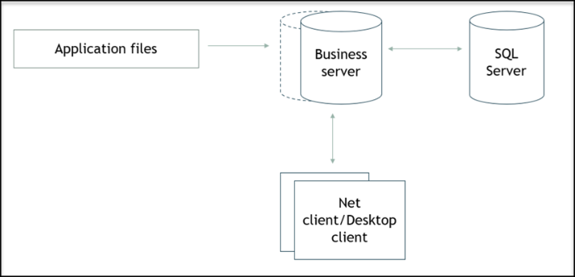


The following table contains the system requirements for Net (thin) client/Desktop client, 3-tier mode: 

|**Component**|**Requirements**|
|---|---|
|**Operating system**|Windows 11|
|**Processor**|Refer to_Windows Server system requirements_.<br>Supports x64(64-bit).|
|**Hardware**|10 GB or more hard disk space is recommended for the file<br>system.<br>100 MB NIC or better.|
|**Memory (RAM)**|2048 MB of free RAM for each Jeeves Business server process.|
|**Network**|TCP/IP|
|**Bandwidth**|30 Kbits per client executable running. More bandwidth can be<br>required depending on how the user works. For instance, large<br>reports or searches will require more bandwidth.|
|**Microsoft .NET**<br>**integration**|.NET framework version 3.5, 4.6.2, and 4.8.1.<br>For Jeeves ERP Client: .NET 10 Desktop Runtime.|


##### 2.3.6 Jeeves rich client 

###### **<u>Note</u>** 

Jeeves rich client is discontinued from 2026.Q2.2 onward. 

Jeeves rich client requires more bandwidth than thin client. 

Refer to the minimum system requirements for your OS on _Microsoft’s website_ for applicable OS. The Rich client, 2-tier mode is as shown in the image below. 

© Copyright Forterro Sweden AB. All rights reserved. 

15 (147) 

**System** requirements 


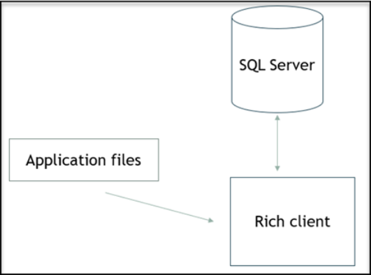


The following table contains the system requirements for Rich client, 2-tier mode requirements: 

|**Component**|**Requirements**|
|---|---|
|**Operating system**|Windows 11|
|**Processor**|Refer to_Windows system requirements_.<br>Supports x64(64-bit).|
|**Hardware**|10 GB or more hard disk space is recommended for the file<br>system.<br>XGA Monitor 1024x768 or higher resolution.<br>100 MB NIC or better.|
|**Memory (RAM)**|512-1024 MB of free RAM per rich client executable running.|
|**Network**|TCP/IP|
|**Microsoft .NET**<br>**integration**|.NET framework version 3.5, 4.6.2, and 4.8.1|


##### 2.3.7 Other tools 

|**Tool**|**Requirements**|
|---|---|
|**Microsoft Office**|Microsoft Office 365|


#### 2.4 Integrated third-party products 

For systems requirements regarding Jeeves integrated third-party products, refer to the vendor’s system requirements or contact Jeeves Product management. 

© Copyright Forterro Sweden AB. All rights reserved. 

16 (147) 

**Install** Jeeves application 


### 3 Install Jeeves application 

#### 3.1 Jeeves Application services installation 

###### **Introduction** 

The following sections describe the installation of Jeeves ERP 2026.Q2.2 (based on Jeeves Application services 2026.2 and Platform 2026.2). 

The Jeeves Application installation file is an installation wizard, meaning that dialog boxes will guide you through the installation process. All information needed for correct installation are gathered at the beginning of the installation, which implies that the time-consuming part of the installation may be left unattended. It is recommended that you read the explanatory texts in the wizard screens to avoid potential problems. Instructions are also provided for every screen in this detailed description of the installation procedure. 

The Jeeves Application installation file will install or upgrade application files and Jeeves database. It will also provide Swedish and English language files. You can download files for other languages from the Jeeves' Customer portal. 

##### 3.1.1 Prerequisites 

###### **Computer** 

The installation must be made on a computer that has access to the SQL server database server where Jeeves will be installed or upgraded. For more information, refer to the _Jeeves Database server (SQL Server)_ section in this document. 

###### **<u>Note</u>** 

If SQL server is not installed on the server, where you intend to install Jeeves application files, <mark>download and install</mark> **<mark>SQLSysClrTypes.msi and SharedManagementObjects.msi</mark>** <mark>available at</mark> <u><mark>Download Microsoft® SQL Server® 2016 Service Pack 3 Feature Pack from Official Microsoft Download Center</mark></u> <mark>Make sure you choose to download SQLSysClrTypes.msi and SharedManagementObjects.msi in the</mark> above link. 

###### **Permissions** 

The SQL Login used must have permissions equivalent to db_owner in the model and TempDB databases or have the following permissions on the server level to create new Jeeves databases: 

- CONNECT SQL 

- CREATE ANY DATABASE 

- VIEW ANY DATABASE 

- ADMINISTER BULK OPERATIONS 

- ALTER ANY DATABASE (required only for new installations) 

For Jeeves upgrades, the SQL Login must have permissions equivalent to the db_owner role in the database. This can be granted at the server level or by mapping to a database user with permissions equivalent to the db_owner role. Refer to the _SQL user roles for Jeeves upgrades_ section for more information. 

###### **<u>Note</u>** 

The Windows user performing the installation must have complete access to the directory where Jeeves is installed and to the shared folder where the application files are available. 

###### **Packages** 

Only the following packages are included in the Jeeves installer: 

- Lang_se.JSP.zip 

© Copyright Forterro Sweden AB. All rights reserved. 

17 (147) 

**Install** Jeeves application 


- Lang_sw.JSP.zip 

- Resourcetext Desktop&Design&Eapp.JSP.zip 

- SSRS 

Packages that are not included in the Installer (listed below) are available for download at Jeeves Download Center or the Support portal. 

- Jeeves ERP 6 template (9000).JSP.zip 

- JIP desktop design.JSP.zip 

- JIP site V6.JSP.zip 

- OptoSweden.JSP.zip 

- PEPPOLBIS3.0.JSP.zip 

- PUF.JSP.zip 

- VATNorway1.0.JSP.zip 

- Manufacturer Inc. (9900).JSP.zip 

- Retailer Inc. (9920).JSP.zip 

###### **Preparation for installation** 

The application directory is about 1.5 GB. 

The site database binary package (dacpac) must be available on the system where you will install your site database. 

The database driver uses the TCP/IP protocol to connect to the SQL Server. Therefore, enable the TCP/IP protocol. 

To enable the TCP/IP protocol, perform the following steps: 

1. Start **SQL Server Configuration Manager** . 

2. Drill down to **SQL Server Network Configuration.** 

3. Choose the server or instance to configure. 

4. Right-click **TCP/IP** and click **Enable.** 

5. Restart the SQL Server service. 

**Note** : If connecting to an instance does not work, make sure the SQL Server is running. It might be turned off because of security reasons. Make sure you restore it to its original state after the installation is completed. We recommend that you run the database server on a different machine than the Jeeves Business server. Always execute the SQL Server instance on a separate machine, irrespective of the rest of the infrastructure or architecture. 

The user that starts the SQL Server service must have Read permissions to the installed Jeeves and JeevesMaster (if used) files in the shared folder. The user must also have permissions to use Bulk insert. 

For more information on how to install and upgrade SQL Server, refer to What's new in SQL Server 2025 - <u>SQL Server | Microsoft Learn</u> 

For information on SQL collations which are Jeeves complaint, refer to the _Recommended SQL Server collation_ section in the Appendices. 

Before running the installation program, make sure that: 

- There is enough disk space (at least 1.5GB for the database) 

- SQL Server 2022 or SQL Server 2025 is installed; the collation is Jeeves compliant and is running 

- .Net framework 4.6.2 or above is installed and running 

© Copyright Forterro Sweden AB. All rights reserved. 

18 (147) 

**Install** Jeeves application 


##### 3.1.2 Installation process overview 


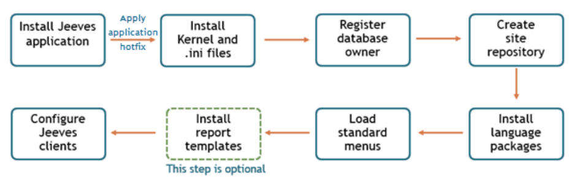


Jeeves basic installation process overview: 

1. Run the application installer, follow the process through the dialogs and complete the installation. If you are upgrading, run the data model upgrade. 

2. Install (for new installation) or copy (for upgrade) the Kernel files and add them to the application directory. Map your .ini files to the application file path. 

3. Register the database owner in the database (for new installation). 

4. Create a site repository database ( **with correct collation - same as in the Jeeves database** ) and run the dacpac to install the site repository (for new installation). 

5. Run the Apps builder to install language packages 6. Load and connect the standard application program menus 7. Configure the clients and servers (for new installation). 

Jeeves additional features installation process overview: 

1. Install Swedish online documentation 

2. Set up multi-company 

3. Install and configure Jeeves service builder (JSB) according to Jeeves Service builder Integration configuration and service development.pdf 

4. Set up CustomerDropDown 

5. Install SSRS 6. Install report templates 

##### 3.1.3 Install Jeeves Application services 

###### **<u>Note</u>** 

You can only run one instance of the installation program at a time. 

The installation program is in English and most of the dialog boxes contain the following standard options: 

- **Back** – Return to the previous dialog 

- **Next** – Go to the next dialog 

- **Cancel** – Cancel the installation 

###### **<u>Note</u>** 

Instructions are provided in the dialogs where necessary. Follow the instructions and navigate in the installation wizard using the above options. 

###### 3.1.3.1 Initial setup 

1. The installer can be run with or without logging functionality. To run the installer without logging Double-click **Jeeves Application.msi** to start the installation. Alternatively, use the PowerShell script by right-clicking **JASInstall_with_LOG.ps1** and select **Run with PowerShell** option. A log file is created in the current folder with the current date and time as a part of the file name. 

© Copyright Forterro Sweden AB. All rights reserved. 

19 (147) 

**Install** Jeeves application 


###### **<u>Note</u>** 

You may observe a PowerShell command prompt asking if you want to allow the installer to run. Allow <mark>the installer to run. The PowerShell script uses msiexec to run the installer. For more information on msiexec and logging options, refer to:</mark> <u><mark>https://docs.microsoft.com/en-us/windows-</mark> server/administration/windows-commands/msiexec</u> 

2. A small pop-up screen preparing the Windows installer appears. The installation routine begins by extracting files necessary to start the installation. Note that it may take a few seconds before the installation program starts and the **Welcome to the Jeeves application setup wizard** dialog appears. 

###### **<u>Note</u>** 

It is advised you run the installation with administrator privileges. 


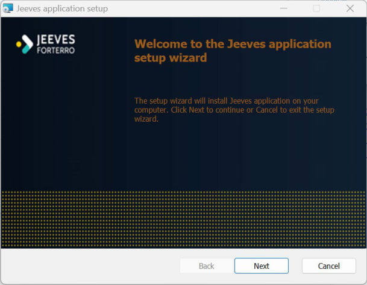


3. The **Jeeves license terms** dialog appears. Read the license terms and check the checkbox to accept the license terms. The **Next** button is now enabled. 


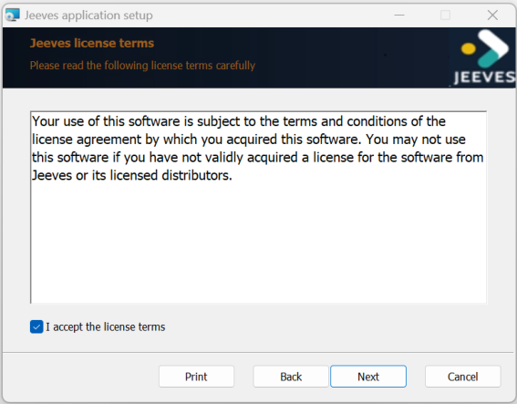


© Copyright Forterro Sweden AB. All rights reserved. 

20 (147) 

**Install** Jeeves application 


###### 3.1.3.2 Installation settings 

The **Installation settings** dialog appears. Choose your installation type (installation or upgrade). 


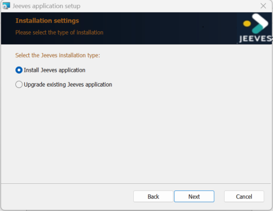


###### 3.1.3.3 Custom setup 

- 1) The **Custom setup** dialog appears. The following features are displayed: 

   - Install Jeeves application files – Select this feature to install all the application files for Jeeves 

   - Install or Upgrade Jeeves database – Select this feature to run the business logic for Jeeves database 

- 2) Click on the Disk icon for each feature ( ) and select your preferred option. You can select from the following options: 

   - **Will be installed on local hard drive** – only the selected feature will be installed 

   - **Entire feature will be installed on local hard drive** –the selected feature and all its sub-features will be installed 

Note that if the selected feature has no sub-feature(s), the above options have the same function. 

   - **Entire feature will be unavailable** – the selected feature will be unavailable. 

- 3) Click **Reset** to return to the default setting of all the features. 

- 4) Click **Disk Usage** to check the disk space required for the selected feature(s). 


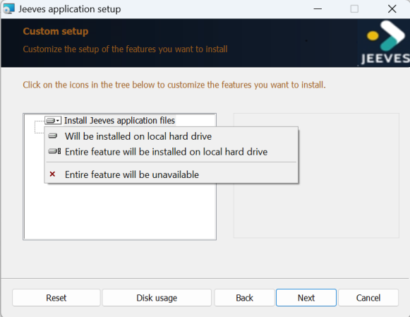


###### **<u>Note</u>** 

A warning message, as shown in the image below, will be displayed if you have not selected any feature and you click the **Next** button. 

© Copyright Forterro Sweden AB. All rights reserved. 

21 (147) 

**Install** Jeeves application 


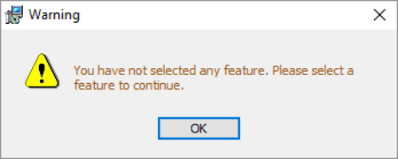


###### 3.1.3.4 Destination folder 

- 1) The **Destination folder** dialog appears. Perform the following: 

   - a) The default destination folder path for Jeeves appears in the **Install Jeeves application to** field. This is the path of your Jeeves folder. If required, click the **Change** button to browse and select a different destination folder path. 

   - b) Enter the shared folder name (this shared folder will contain Jeeves application files) in the **Jeeves shared folder** field. Make sure that you have read/write permissions for the shared folder. Click on the **Test shared folder** button to test that the folder exists. 

If you see the below warning message, open your command prompt and type **net share** . All shared folders and their associated directories in your system are displayed. Enter the shared folder name associated with the folder you have entered in **Install Jeeves application to** field. Click on the **Test shared folder** button. 


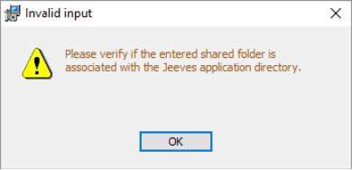


- c) If your shared folder exists and is associated with the path specified, the **Next** button is enabled. 


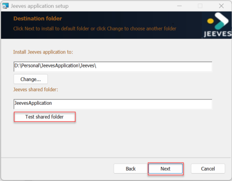


**Important** : All pre-existing files with the same name as the files to be installed will be deleted. To save these files, move them to another directory before the installation. 

###### **Jeeves application settings** 

If you have deselected the **Install Jeeves application files** feature in the **Custom setup** dialog, the **Jeeves application settings** dialog appears. Enter the shared folder path. Note that this is the path to your existing shared folder. 

© Copyright Forterro Sweden AB. All rights reserved. 

22 (147) 

**Install** Jeeves application 


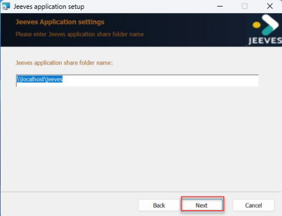


###### 3.1.3.5 SQL and database related settings 

- 1) The **SQL instance and database information** dialog appears. Perform the following: 

   - a) Enter the name of your database server on which the Jeeves application is to be installed in the **SQL Database server** field. 

Note that the default value is (local). This is the server instance of your localhost server. You can enter any SQL server instance on which you would like to host Jeeves server. Ensure that your SQL server version is 2022 or above. 

- b) Select one of the following forms of authentication: 

   - **Trusted** (Windows authentication): This is the default selection. 

   - **Specify username and password** (SQL authentication): When this form of authentication is selected, the **Username** and **Password** fields are enabled. Enter the username and password to the SQL database server. 

Note that the entered user must have sysadmin privileges. 


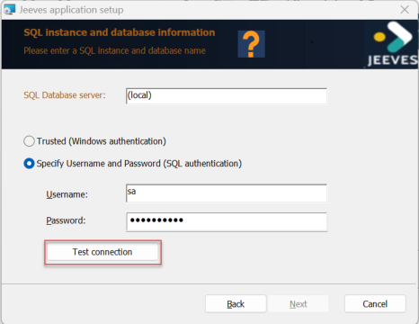


- c) Click **Test connection** to test if your credentials are valid. If you see the below warning message, click **OK** , then enter valid credentials. 


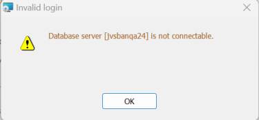


- d) If your credentials are valid, the **Next** button is enabled and you will observe a green tick in the header section of the dialog. 

© Copyright Forterro Sweden AB. All rights reserved. 

23 (147) 

**Install** Jeeves application 


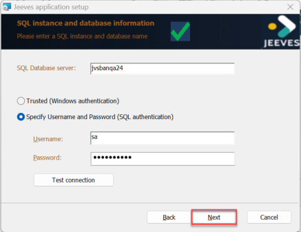


- 2) The **Database settings** dialog appears. Perform the following: 

   - a) Enter the name of the database in the **Jeeves database name** field in which Jeeves is to be installed. If you enter an existing database which is not empty or  has an instance of Jeeves, a warning message is displayed. The collation of this existing database must be Jeeves compliant. If the entered database does not exist, a database is created in the SQL database server specified in the previous dialog. This field cannot be left blank. 


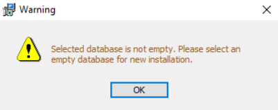


- b) Select one of the available collations from the **Collation** drop-down list. The collation mentioned in your database’s properties (you can verify this in SQL server management studio) is displayed as the default collation. The collations displayed are retrieved from the database server you have entered in the previous dialog. All of these collations are supported in Jeeves. The database will be created with the chosen collation. 

If you have chosen to upgrade an existing Jeeves installation, the **Collation** field with its options is not displayed. Collation can only be selected during new installations. For more information, refer to the _Jeeves collation_ section in the _Appendices_ . 

It must be noted that the database(s) are created according to the settings in the server with respect to the file location, initial file size, grow rate for files, etc. If you require values other than the server settings, create the database manually with the required properties before beginning the JAS installation. 


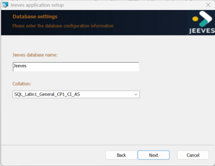


##### 3.1.4 Upgrade existing Jeeves application 

###### **<u>Note</u>** 

Before upgrading from Jeeves ERP 2024 to Jeeves ERP 2025.x or Jeeves ERP 2026, refer to _Known_ _<mark>Issue – UDO Subtag records removed during upgrade</mark>_ <mark>section in the</mark> _<mark>Upgrade Considerations guide</mark>_ <mark>.</mark> © Copyright Forterro Sweden AB. All rights reserved. 

24 (147) 

**Install** Jeeves application 


<mark>Additional mandatory pre-upgrade steps are required to prevent unintended removal of UDO subtag</mark> records during installation. 

###### **<u>Note</u>** 

If you terminate the upgrade/installation process before it is complete, and try to restart the process, <mark>you will get the message shown below. To avoid this, make sure that you end (kill) the Windows</mark> installer processes in Windows task manager before you run the installer. 


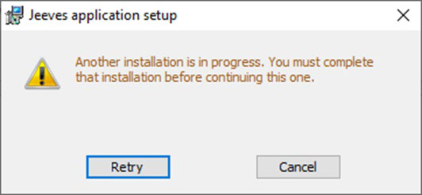


If you choose to upgrade your existing Jeeves application, perform the following: 

- 1) After you have accepted Jeeves license terms (as described above), select **Upgrade existing Jeeves application** in the **Installation settings** dialog. 


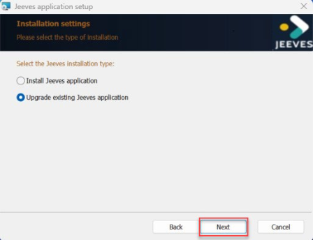


- 2) Enter/select data in **Custom setup** and **Destination folder** dialogs as described above. Note that you can modify the features in the **Custom setup** dialog during upgrades. 

- 3) In the **Jeeves application update settings** dialog, select your preferred option: 

   - Update Jeeves data model – updates the Jeeves database only with new tables and new fields. 

   - Update Jeeves data model and business logic – updates all the Jeeves databases. Note that this process takes a long time. 

Note that if you choose not to update the business logic in this step, you must do so later after you have installed the application. 

© Copyright Forterro Sweden AB. All rights reserved. 

25 (147) 

**Install** Jeeves application 


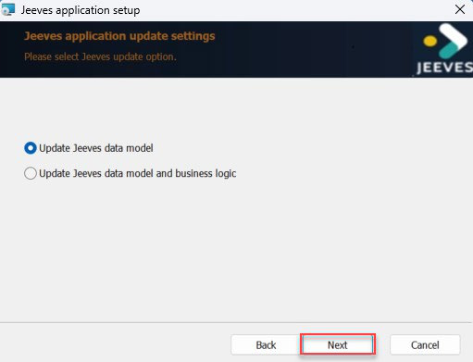


- 4) Enter your database information in **SQL instance and database information** dialog as described above. 

- 5) The **Database settings** dialog appears. Enter/select your Jeeves database from the drop-down list in the **Jeeves database name** field. 

###### **<u>Note</u>** 

Your Jeeves database must be online to be displayed in the drop-down list of databases. 


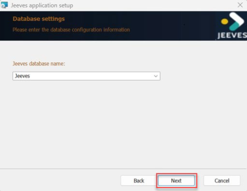


If your selected database is not in simple recovery model, a warning message is displayed. For more information on SQL server recovery models, refer: Recovery Models (SQL Server) - SQL Server | <u>Microsoft Learn</u> 


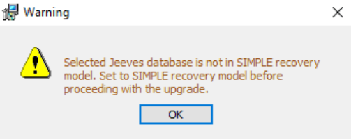


The Jeeves application installer supports upgrades from Jeeves version 4 and above. If your Jeeves database runs on Jeeves version 4 or lower, you will observe the following message. Click OK and choose a database that runs on Jeeves version 4 and above (or JAS version 13 and above). 

© Copyright Forterro Sweden AB. All rights reserved. 

26 (147) 

**Install** Jeeves application 


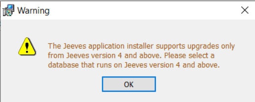


- 6) Continue the installation process as you do for new installations as described in the section below. 

###### **<u>Note</u>** 

Refer to the upgrade considerations for your JAS/Kernel version, if you are upgrading your Jeeves <mark>application from an earlier version. You will find them in the Upgrade considerations document,</mark> which can be downloaded from Jeeves Support download center. 

##### 3.1.5 Ready to install 

- 1) Click **Install** in the **Ready to install Jeeves application** dialog to begin the installation. 


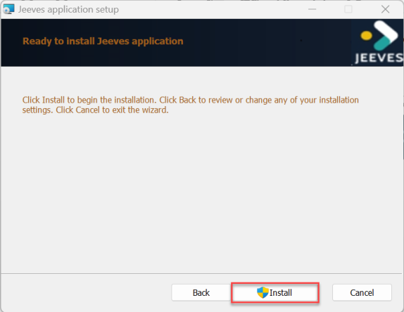


- If the **User account control** dialog appears, click **Yes** to proceed with the installation. 


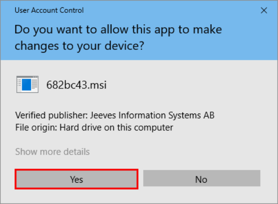


The installer may take some time to complete the installation process. 

© Copyright Forterro Sweden AB. All rights reserved. 

27 (147) 

**Install** Jeeves application 


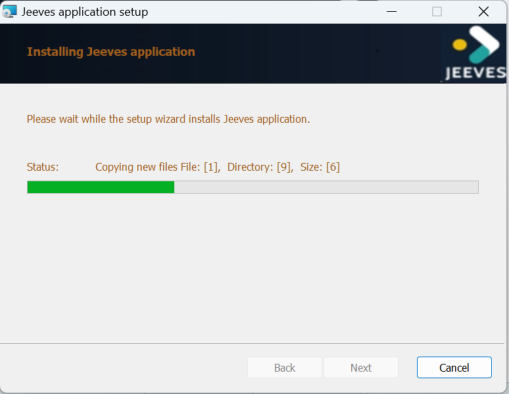


##### 3.1.6 Installation summary 

Once the installation is completed, the following dialog appears. Click Installation summary to view the details of your installation. 


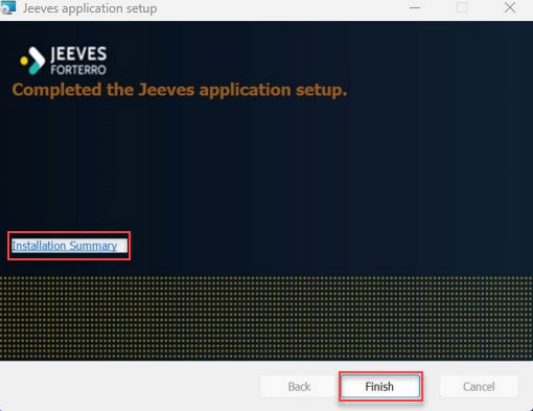


Note that the Installation summary is stored in the shared folder specified during installation. 

###### **<u>Note</u>** 

After the installation has been completed and is successful, the installation program automatically sets the database recovery model to FULL. 

##### 3.1.7 SQL CLR in Jeeves installer 

Jeeves supports Common language runtime (CLR) and, for this purpose, includes an assembly called **Jeeves.Sql.Utilities** . This assembly and its related stored procedures/functions will be set up when you install Jeeves. 

The Jeeves CLR contains functionality to do the following: 

- File operations 

- FTP operations 

- Network operations 

- Transform XML 

© Copyright Forterro Sweden AB. All rights reserved. 

28 (147) 

**Install** Jeeves application 


To check if CLR is enabled in your database and to enable it if it is not, execute the following in SQL Server management studio (SSMS): 

```
-- Check if CLR is enabled. Look at the column config_value.
EXEC sp_configure 'clr enabled'
-- If config_value is 0 then run this command
EXEC sp_configure 'clr enabled', 1
RECONFIGURE
-- Then run this again to make sure CLR is enabled
EXEC sp_configure 'clr enabled'
```

For more information on CLR, refer to the Appendices. 

##### 3.1.8 DLL required for DevExpress report printing on cloud 

The **Jvs32DevExpressReportCom.dll** enables DevExpress reporting functionality allowing you to print and export reports in the Desktop client. Ensure that this dll is present within the .. **Server\Plugin\DevExpressReports** folder. 

###### **<u>Note</u>** 

This **Jvs32DevExpressReportCom.dll** plugin for printing the DevExpress reports is loaded by the kernel but it is not regulated by any server ini settings. 

##### 3.1.9 Post-installation steps 

Make sure that the following are set up: 

- The Kernel files are installed/copied to application directory and your ini files are mapped to the application file path. 

- The database owner has been registered in the database. 

- A site repository database has been created and the site repository is installed using the dacpac. 

#### 3.2 Check log files 

After installation, check the summary for detailed information. 

##### 3.2.1 Installation logs 

You can enable logs for the actions done during the installation in the system’s editor. For more information, refer to: https://support.microsoft.com/en-in/help/223300/how-to-enable-windows-installer- <u>logging</u> 

Control the following log files after installation. 

###### **<u>Note</u>** 

If errors are encountered during the installation, send the log files to Jeeves (support@jeeves.se). <mark>Please attach the log files and specify the version you tried upgrading together with other information</mark> that may be of interest. 

- **Log table: jeeves_install_error_log** 

During the installation, an installation log table named **jeeves_install_error_log** is created in the Jeeves database. Execute the following query to check the log after installation. 

© Copyright Forterro Sweden AB. All rights reserved. 

29 (147) 

**Install** Jeeves application 


select * from jeeves_install_error_log where rowcreateddt >= '2019XXXX' order by lopnr 

where, **2019XXXX** is the date of installation. 

- **Check triggers and procedures** 

When installing and upgrading, a log is created in the **xspr** table for each trigger or procedure specifying that the trigger or procedure should exist. If the compilation of the trigger or procedure fails, it will not be in the database. However, there is a flag in the **xspr** log table, indicating that it should exist. 

Execute the procedure to check if triggers or procedures in the database match the flags in the **xspr** table: 

exec JEEVES_chk_spr 

The result shows a list of objects that are missing and those that are not updated, with information on type and when the objects were created and changed. It also shows, by date, how many triggers or procedures are compiled. For more information, see _Check triggers and procedures_ in the online documentation, chapter 402. 

- **Jeeves apps – Import result** 

When installing apps or packages with Jeeves Apps builder ( **JeevesPackageManager.exe** ) or Jeeves Business server installation, the import result is logged in the **jvspackageimportres** table. The log can be found in the Apps builder executable program ( **jvspackagedsolutions** ) and the **Import Result** node. 

You will find a detailed import result for the site repository in the Site repository import log ( **Jvssite_import_log** ) program and the **Log; steps from importing site repository** node. 

###### **<u>Note</u>** 

You can also enable logging by executing the command: **msiexec/i "Jeeves application .msi" /L*** **<mark>JASlog.txt</mark>** <mark>in your command prompt. A log file(</mark> **<mark>JASlog.txt</mark>** <mark>) is created in your working directory. For more information on command line options, refer to</mark> <u><mark>https://docs.microsoft.com/sv-</mark> se/windows/win32/msi/command-line-options</u> 

##### 3.2.2 Running control of installation 

After initiating the installation, the actual installation or upgrade of the database may take some time. The installation status will display the current task. The dynamic upgrade takes an especially long time. Execute a select script against the **jeeves_install_log** table, and sort by **lopnr** in descending order to check the progress of this task, and verify if the data is being written. 

**Example** : 

SELECT TOP 10 * FROM jeeves_install_log 

ORDER BY lopnr DESC 

It is recommended to not use the workstation until the installation is complete. 

#### 3.3 Apply application hotfix 

You must download and install the latest application hotfix files after you have installed JAS. It is important that you install all the files in the hotfix. 

The latest hotfix is available in Jeeves ERP Product download center. © Copyright Forterro Sweden AB. All rights reserved. 

30 (147) 

**Install** Jeeves application 


For information regarding installing the hotfix, refer to the _Install hotfixes with JvsSqlRun_ section in the _Appendices_ in this document. 

###### **<u>Note</u>** 

It is always recommended that you install the hotfix in a test environment with a test application directory and a test Site database first and then install it in your live/production environment. 

#### 3.4 Install Kernel files 

After installing JAS, perform the following to set up kernel files and the ini files required to smoothly run Jeeves: 

###### **<u>Note</u>** 

Copy the Kernel files to your local setup from Jeeves Product download center. 

- Copy the **bin64** folders from the **Server and Classic Client** folder and paste them in the folder that contains the files of the installed application. 

- Create a new folder called **Shortcut** and create a new or paste an existing Jeeves client shortcut in this folder. 

- Right-click the shortcut and select **Properties** . 

- Set the **Target** <u>property as shown below:</u> 

- `“\\...\bin64\Classic Client\Jvs32Client.exe” “\\...\bin64\Classic Client\RichClientServer.ini”` 

- Set the **Start in** <u>property as shown below:</u> 

```
"\\....\bin64\Classic Client"
```

Note that the complete path to the folder must be provided. 

- Navigate to **RichClient.ini** in the **..\bin64\Client** folder (the file may have a different name like JvsClient_template.ini, rename it to RichClient.ini). Enter the following: 

   - ServerIniFile – path to RichClientServer.ini 

   - HelpFileBasePath – path to the lang folder 

   - Connection type 

   - Plugins – required number and path to each plugin 


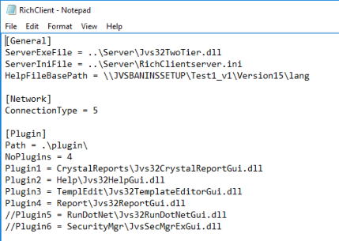


- Navigate to **RichClient_server.ini** in the **...\bin64\Server** folder (the file may have a different name like Jvs32Server_template.ini, rename it to RichClient.ini). Enter the components and database credentials. 

© Copyright Forterro Sweden AB. All rights reserved. 

31 (147) 

**Install** Jeeves application 


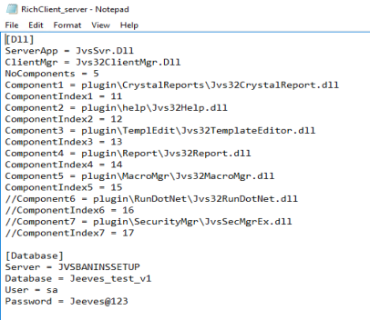


#### 3.5 Register database owner 

To begin with, the database owner must be registered in the database. This is done using the **JvsRegisterDBO.exe** program, which creates the **JvsLgCrptV2** procedure that stores username and password for the database owner. 

- 1) In **JvsRegisterDbo.exe** , enter username and password. 2) Click the **Test Current** button to check if the current password is valid. 


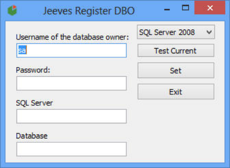


#### 3.6 Install Site database 

##### 3.6.1 Introduction 

The Site database is a part of Jeeves kernel from version 5.1. 

The Site database for Kernel version 5.1 R10 is shipped as a binary package (dacpac). 

###### **<u>Note</u>** 

The Site database must be updated after the Jeeves Business server is installed. 

##### 3.6.2 Prerequisites 

The following SQL server version must be installed to deploy the Site database: 

- SQL Server 2022 or SQL Server 2025. 

© Copyright Forterro Sweden AB. All rights reserved. 

32 (147) 

**Install** Jeeves application 


###### **<u>Note</u>** 

If you upgrade your Kernel to version 5.1 or higher, you will not be able to use an earlier version of <mark>the Site database. You must make a copy or a backup of the earlier site database before you upgrade.</mark> You can then upgrade to the new Site database. 

##### 3.6.3 Install and upgrade Site database 

###### **<u>Note</u>** 

You must install different Site databases if you intend to run different Jeeves Kernel versions. 

The Site database is built and deployed as a binary file, **JeevesSiteDB.dacpac** . Copy the SiteDatabase folder from Jeeves Product download center to your local folder. 

To deploy this to a database (new or existing), open PublishDataBase.bat for editing and script the following command according to your settings and then run the command: 

```
sqlpackage.exe /a:Publish /sf:JeevesSiteDB.dacpac
/Profile:JeevesSiteDB.publish.xml/tsn:{SERVER} /tdn:{DATABASENAME}
/tu:{SA_USER}/ tp:{SA_PASSWORD}
```

In the above command: 

- Verify the path of your SQL server and modify if needed 

- Check the **sf** parameter to match the dacpac file 

- Check the **Profile** parameter to match the batch file 

- Enter the name of your SQL server in the **tsn** parameter 

- Enter the database name (in which the Site will be deployed) in the **tdn** parameter 

- Enter the username of the SQL servers in the **tu** parameter 

- Enter the password of the SQL servers in the **tp** parameter 

```
For example:"%ProgramFiles(x86)%\Microsoft SQL
Server\140\DAC\bin\SqlPackage.exe" /a:Publish /sf:JeevesSiteDB.dacpac
/Profile:JeevesSiteDB.publish.xml /tsn:JVSBANINSSETUP /tdn:SiteDB_test_v1
/tu:sa /tp:MyPassword!123
```

###### **<u>Note</u>** 

The **publish.xml** is generated along with the binary files and is available in the **SiteDatabase** folder. You must have the access to the folder to use the **/Profile** parameter. 

If an error message is displayed about data loss, append the following parameter to the preceding command: 

```
/p:BlockOnPossibleDataLoss=False
```

If you are updating your Site database, you can view the differences in the new file with the following parameters in the preceding command: 

```
/a:DeployReport /op:ReportName.xml
```

For example, the following will create an XML file called Report.xml in the current directory. This file can be opened in any web browser/XML editor to view the result: 

© Copyright Forterro Sweden AB. All rights reserved. 

33 (147) 

**Install** Jeeves application 


```
"%ProgramFiles(x86)%\Microsoft SQL Server\140\DAC\bin\SqlPackage.exe"
/a:DeployReport /op:ReportName.xml /sf:JeevesSiteDB.dacpac
/Profile:JeevesSiteDB.publish.xml /tsn:JVSBANINSSETUP /tdn:SiteDB_test_v1
/tu:sa /tp:MyPassword!123
```

If you observe an error about encryption or certificate chain, append the following command to the above command: 

```
/SourceEncryptConnection:False /TargetEncryptConnection:False
```

For example, the following error message is displayed: 

_Unable to connect to target server [servername]. Please verify the connection information such as the server name, login credentials, and firewall rules for the target server. A connection was successfully established with the server, but then an error occurred during the login process. (provider: SSL Provider, error: 0 - The certificate chain was issued by an authority that is not trusted.)_ 

_The certificate chain was issued by an authority that is not trusted._ 

The command in the **PublishDataBase.bat** file to prevent the error is: 

```
"%ProgramFiles(x86)%\Microsoft SQL
Server\140\DAC\bin\SqlPackage.exe" /a:Publish
/sf:JeevesSiteDB.dacpac /Profile:JeevesSiteDB.publish.xml
/tsn:JVSBANINSSETUP /tdn:SiteDB_test_v1 /tu:sa /tp:MyPassword!123
/SourceEncryptConnection:False /TargetEncryptConnection:False
```

###### **<u>Note</u>** 

**SqlPackage.exe** is installed with the SQL Server. It can also be installed manually or as a part of <mark>other software packages. For more information, please search for sqlpackage.exe in Microsofts online documentation.</mark> 

<mark>The location of the Microsoft SQL server depends on its version. You can use the following PowerShell</mark> command to search the C: drive for sqlpackage.exe: 

```
Get-ChildItem -Path C:\ -Filter sqlpackage.exe -Recurse -ErrorAction
SilentlyContinue -Force
```

##### 3.6.4 Add kernel parameter for Site database 

After you have installed the Site database, for a fresh installation of Jeeves, launch the Jeeves application and add a Kernel parameter for the Site database. 

Perform the following in Kernel parameters (jini) program: 

- 1) Add a new record in the jini program (Ctrl+A). 

- 2) Enter the following values: 

   - **Parameter section** : DataBase 

   - **System (jini) parameter** : SiteRepository 

   - **Configuration name** : * 

   - **Group** : 9999 

   - **Signature** : * 

   - **Parameter data** : Enter the name of the database on which you have installed the dacpac. 

© Copyright Forterro Sweden AB. All rights reserved. 

34 (147) 

**Install** Jeeves application 


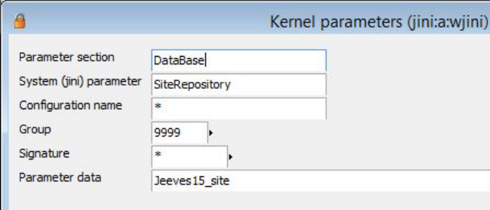


3) Save the record. For more information regarding deploying a dacpac, refer to: https://docs.microsoft.com/en- <u>us/sql/relational-databases/data-tier-applications/deploy-a-data-tier-application</u> 

For more information regarding Site database, refer to the Appendix: _Site repository_ . 

###### **<u>Note</u>** 

After you have installed the site database, set the user and company dimensions using the Groups <mark>(jvssitegroups) program. For more information, refer to the</mark> _<mark>Setting up groups for settings (601)</mark>_ chapter in Jeeves online documentation. 

##### 3.6.5 Create standard site groups if none exist 

###### **<u>Note</u>** 

This step is only necessary if you have a new installation of Jeeves without any template companies or packages. 

Once you have the dacpac successfully installed, execute the following code in your site database: 

SELECT * FROM [dbo].[JvsSiteGroups] WHERE dbo.JvsSiteGroups.JvsSiteGroupId IN (0,9999) 

If no records are returned, execute the following: 

IF NOT EXISTS (SELECT 1 FROM [dbo].[JvsSiteGroups] WHERE[dbo].[JvsSiteGroups].JvsSiteGroupId = 0) 

BEGIN <mark>INSERT INTO [dbo].[JvsSiteGroups] ([JvsSiteGroupId],[JvsSiteGroupName],[JvsSitePriority],[JvsSiteAllowChange],[NoOfGroupsOnNextLevel],[ JvsSiteAllUsersDefMembers]) VALUES(0,</mark> ' <mark>Personal</mark> ' <mark>,1,</mark> ' <mark>1</mark> ' <mark>,0,</mark> ' <mark>1</mark> ' <mark>)</mark> 

END 

<mark>IF NOT EXISTS (SELECT 1 FROM  [dbo].[JvsSiteGroups] WHERE  [dbo].[JvsSiteGroups].JvsSiteGroupId = 9999)</mark> 

BEGIN INSERT INTO [dbo].[JvsSiteGroups] <mark>([JvsSiteGroupId],[JvsSiteGroupName],[JvsSitePriority],[JvsSiteAllowChange],[NoOfGroupsOnNextLevel],[ JvsSiteAllUsersDefMembers]) VALUES (9999,</mark> ' <mark>All users</mark> ' <mark>,9999,</mark> ' <mark>1</mark> ' <mark>,0,</mark> ' <mark>1</mark> ' <mark>)</mark> END 

© Copyright Forterro Sweden AB. All rights reserved. 

35 (147) 

**Install** Jeeves application 


#### 3.7 Import and install application language 

Jeeves apps builder (also known as Jeeves package manager) is used to build apps in Jeeves. This is used to import packages into Jeeves. For more information on Jeeves apps builder, refer to Jeeves Apps builder (former Package manager) chapter (604) in Jeeves online documentation. 

After the complete installation of Jeeves application, navigate to the **Packages** folder in your Jeeves application folder. Both English (Lang_sw.JSP.zip) and Swedish (Lang_se.JSP.zip) language packages can be found here. 

These .zip files contain data for: 

- Application parameters (jvsp) 

- Standard records 

- Descriptions of tables and their SQL settings (Jeeves_dddl) 

- Details of tables in available languages (Jeeves_lddl) 

- SQL error and information messages (jder) 

- Term, table and program prompts, user function messages (lang_sw/lang_se) 

Launch **JeevesPackageManager.exe** and import these language packages into your database. 

The default language needs to be set up for standard records at the company level in the Language (SprakKod) field in the System data, own company (sy1) program. Refer to Jeeves online documentation for Language codes. 

#### 3.8 Load and connect application menus post-installation 

After installation of the Jeeves application, you must install Jeeves standard, full menus for the application in in English and, if desired, in Swedish. 

For new installations, perform the following steps: 

For new installations, launch the Jeeves application and navigate to the File menu. Select Create new program menu for new installations. Upload the menu file (Jeeves_xx.pmu) available in \lang\Menu\xx folder, where xx is the language code. Restart your Jeeves application. 

For more information on creating new menus or editing existing menu, refer to the Program menus in Jeeves (1016) chapter in Jeeves online documentation. Repeat the process for each of the menu files present in the package. 

#### 3.9 License key 

The first time Jeeves is started, you will be asked to load a license key. If a license key is not provided, the application will allow you to evaluate the application for 30 days. The application will cease to work after the 30 days have lapsed. 

###### **<u>Note</u>** 

The license key needs to be renewed when a major upgrade of the kernel is done, for example when upgrading from Kernel version 4.0 to Kernel version 5.0. 

#### 3.10 Summary of installation/upgrade process 

###### **Jeeves does the following during the installation and upgrade process.** 

|**Jeeves installation and upgrade**|
|---|


1 Distributes the installation directory. 

© Copyright Forterro Sweden AB. All rights reserved. 

36 (147) 

**Install** Jeeves application 

2 Executes the **<u>jvstype.sql</u>** and **<u>jvsdef.sql</u>** scripts into **tempdb** and **model** . 


###### **<u>Jeeves installation and upgrade</u>** 

###### **Jeeves repeats the following steps for each database that is selected for the installation** . 

|1|Executes the**JvsLogEvent.sql**script to track database changes.|
|---|---|
|2|Compiles**Jeeves_Install_Sql_Deliv.sql**into the database.|
|3|Uses BCP to load the following files:**JEEVES_SysTypes.dat**,**JEEVES_SysObjects.dat**,<br>**JEEVES_SysColumns.dat**,**JEEVES_SysIndexes.dat**,**JEEVES_SysComments.dat**,<br>**Jeeves_SysForeignKeys.dat**,**Jeeves_SysIndexKeys.dat**and**Jeeves_SysReferences.dat**.|
|4|Executes the**Jeeves_Pre_DynUpg_Fix.sql**script.|
|5|Executes**old2new.sql**. This is done when upgrading from a version earlier than v8.0 sp1. The<br>**jeeves_dbver** procedure determines the version from which the upgrade has to be done.|
|6|Executes**JEEVES_Install_Sql_Deliv**.|
|7|Checks if the**sy1**table has the right data.|
|8|Executes**hotfix.sql**(the hotfix that exists in the SQL folder during compilation of upgrade**exe**<br>file).|
|9|Loads Crystal Reports Library (**cr.sql**)into Jeeves.|
|10|Loads**xfil**into the database.|
|11|Executes**Custom.sql**(collected from the sql folder under Jeeves and not overwritten during<br>installation. Resellers canput their own solutions here).|
|12|Recompiles views to handle changed table definitions:<br>•<br>executes**jeeves_sp_refreshview**<br>•<br>executes**JEEVES_Drop_Auto_Create_Statistics**|
|13|Updates the**jini**table.|
|14|Checks the**reportpath**and sets it if it does not exist or does not have any paramdata.|


#### 3.11 Uninstall Jeeves Application services 

Before upgrading, Jeeves always recommends backing up files on the application folder, JeevesMaster, and Jeeves database. There is no rollback function in the installation program. Restore the backup files and start the upgrade all over again if something goes wrong. 

If there has been an error during the installation, drop the database and delete the application folder to clear the Jeeves database and thus uninstall the application. 

#### 3.12 Install additional features 

###### **<u>Note</u>** 

For information related to **Customer-drop-down** , refer to the _Manually install CustomerDropDown functionality_ section in the Appendices. 

© Copyright Forterro Sweden AB. All rights reserved. 

37 (147) 

**Install** Jeeves application 


##### 3.12.1 Installation of the Swedish online documentation in a standard installation 

When a new version of the English online documentation has been approved, it is translated into Swedish. The translation and approval process can mean that the Swedish online documentation is released separately, and therefore needs separate, manual installation. 

To install the Swedish online documentation, copy the following five (5) **.chm** files to the **lang/se** folder in the application directory: 

- Jeeves_SE.chm 

- DocAreas_SE.chm 

- Terms_SE.chm 

- Tables_SE.chm 

- Programs_SE.chm 

##### 3.12.2 Install SQL Server Reporting Services - Native Mode 

- 1) Run the SQL Server setup wizard (setup.exe) and step through the preliminary pages: a) On the **Setup Role** page, select **SQL Server Feature Installation** . 


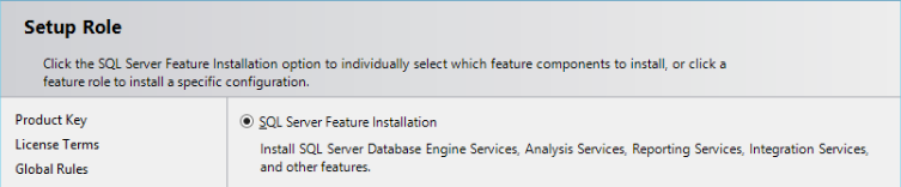


- 2) On the **Features** page, select the following: 

   - **a) Database Engine Services** , unless an instance of the database engine is already installed. **b) Reporting Services-Native** . 


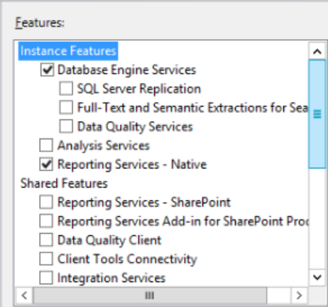


- 3) On the Reporting Services Configuration page, select Install only and click Next. 

© Copyright Forterro Sweden AB. All rights reserved. 

38 (147) 

**Install** Jeeves application 


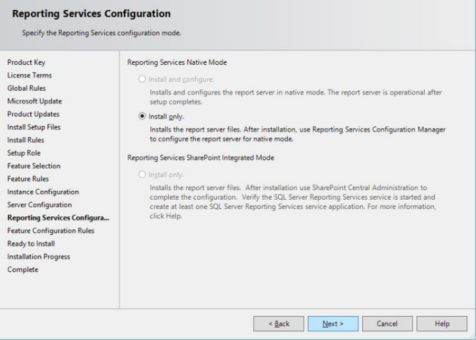


- 4) Check your selections. Click Back to make any required changes or Install to start the installation. 


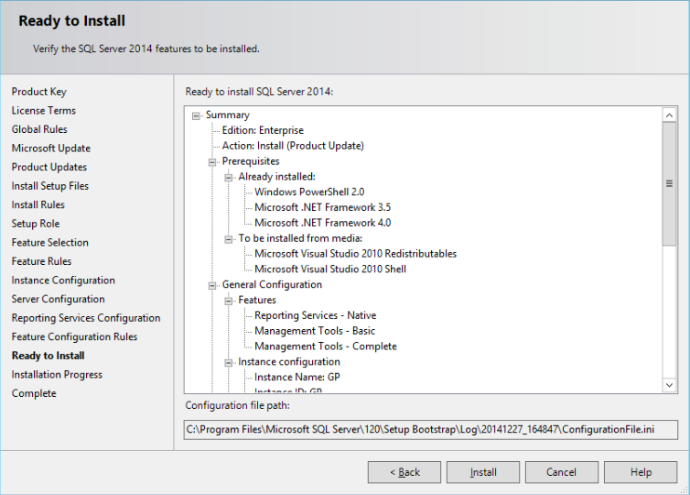


Once the installation is complete, a window opens showing the status of the installation tasks. 


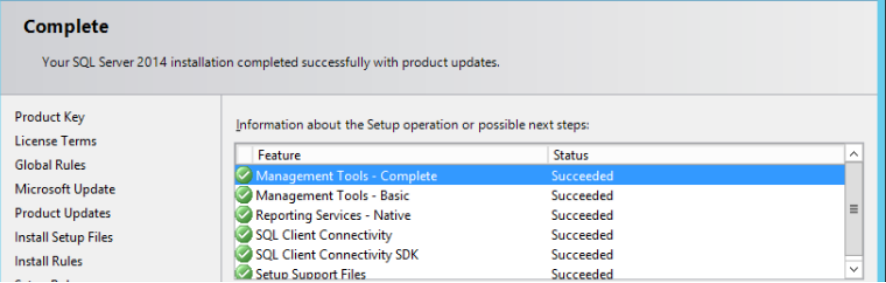


© Copyright Forterro Sweden AB. All rights reserved. 

39 (147) 

**Install** Jeeves application 


##### 3.12.3 Install report templates 

Jeeves includes predefined reports, such as delivery notes, order confirmations and payment reminders, as well as different types of statistic reports and journals. 

These predefined report templates must be installed manually in new and upgrade installations of Jeeves. 

There are several different scripts depending on different report template packages, languages, company codes, and report templates types. 

###### **Different report packages** 

There are two different report packages, **@templates** and **je templates** : 

- **@templates:** Templates indicated with @ in the beginning are old templates and are therefore not maintained or developed anymore. But, the package can still be installed as proposals and translated to the following languages: pl, dk, no, de, fr, fi, and nl. 

- **Je templates:** Templates indicated with je in the beginning are developed to follow the standard flow charts in Jeeves ERP. New templates are developed for each new Jeeves version and the je templates are supported and maintained. The je reports are available in English and Swedish. The templates are installed for new installations into the template company automatically through the installation program. 

- • **Translated je reports** are also available in Polish and German and are indicated with pl and de in the beginning. 

###### **Install files for @templates** 

The report files for **@templates** can be downloaded from the Jeeves ERP Product download center under **Language files** as follows: 

- 1) Download the language file. 2) Unzip the file and add the language folder to the **... \lang\templates\xx** directory where Jeeves is installed. 

The templates can be found in the following folder: **… \lang \templates\xx** , where **xx** =language code. 

The following different **@templates** scripts are available for installation depending on use: 

|**Scripts**|**Comments**|
|---|---|
|**Rtpl_insert.sql **|Install new Jeeves standard templates.|
|**Rtpl_insertupdate.sql**|Install new and update old Jeeves standard templates.<br>**Note**: Anymodifications to Jeeves standard templates will be lost.|
|**Rtpl_over.sql**|Install Jeeves overlaid templates with the file**rtpl_over.sql.**Overlaid<br>templates can be used forglobal information.|


###### **Install files for je templates** 

The report files for je templates can be found under the **…\lang \templates\xx** folder in the Jeeves application directory. 

The files can also be downloaded from the Jeeves' Customer portal under **Downloads** \ **Localizations** \ **Translations** \ **Report Templates** : 

- 1) Download the report template file. 

- 2) Unzip the file 

The following different **je templates** scripts are available for installation depending on company code. 

|**Scripts**|**Comments**|
|---|---|
|**rtpl_insert_update_je_xx.sql**|Install new and update old templates.<br>**Note**: Anymodifications toje templates will be lost.|
|**rtpl_insert_update_je_xx_ftg9999.sql**|Install new and update old templates to the new template<br>company<br>Where, **xx**=language code|
|© Copyright Forterro Sweden AB.<br>All rights reserved.|4|


40 (147) 

**Install** Jeeves application 


Translated je reports are also available in Polish and German and are indicated with pl and de at the beginning. 

To install the report templates, perform the following steps: 

- 1) Install the report templates in the site repository database. 2) Open the file in Microsoft SQL Server Management Studio or Query Analyzer. 

- 3) Modify the insert script using the **Find and Replace** command under **Edit** in the **Program** menu. 4) Modify the script using the correct company code. Select REPLACE from the drop-down list and replace it with the relevant company code. (Template company). 


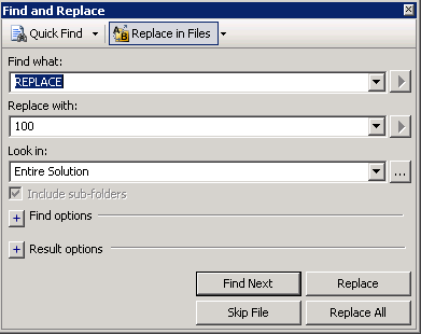


- 5) Select the appropriate site repository database and execute the script. 

© Copyright Forterro Sweden AB. All rights reserved. 

41 (147) 

**Install** Jeeves ERP Mobility framework 


### 4 Install Jeeves ERP Mobility framework 

To start using Jeeves mobility you need to install the REST service and make it accessible on the Internet and download the Jeeves ERP mobile client app from AppStore or Google Play. Also, you either download and install Jeeves mobile routine packages, e.g. the mobile order, warehouse, shopfloor, field service or CRM routine packages, or develop own mobile routines. 

If you intend to make modifications to Jeeves mobile routine packages, or develop own mobile routines, you will also need to install the Design studio. For more information, refer to the Jeeves ERP Design studio installation and configuration guide.. 

The image below gives an overview of the configuration used for mobility. 


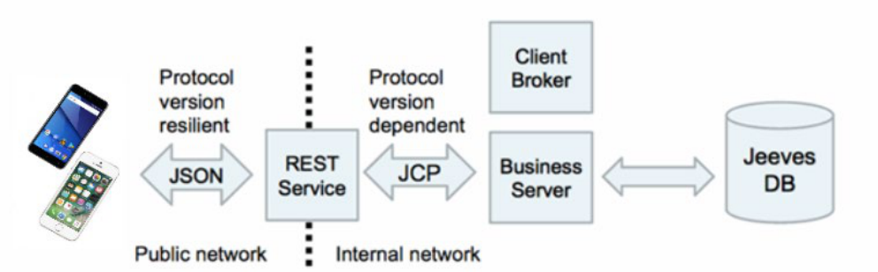


#### 4.1 Install REST service manually 

##### 4.1.1 Prerequisites 

Make sure that .NET Core 10.0 Runtime is installed on the REST service server. 

Make sure that the ASP.NET application development features are enabled. These IIS features are required to support customization on the mobile configuration page. 

To start the REST service in IIS, you must have installed .NET 10.0 Core and ASP.NET 10.0 Runtime: 

- You can download ASP.NET Core **10.0 Core(v10.0.3)** from https://dotnet.microsoft.com/enus/download/dotnet/thank-you/runtime-aspnetcore-10.0.3-windows-x64-installer 

Post installation, your .NET installation may look as follows: 


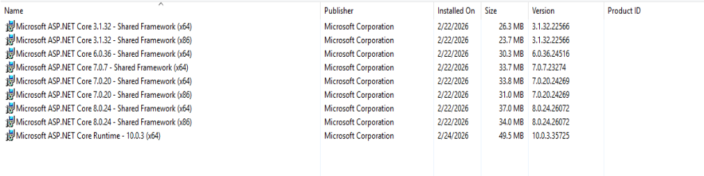


© Copyright Forterro Sweden AB. All rights reserved. 

42 (147) 

**Install** Jeeves ERP Mobility framework 


##### 4.1.2 Pre-installation 

- 1) Create an application pool. .Net CLR version must be 4.x or higher and integrated mode must be on. The name of this could, for example, be **JeevesRestServiceAppPool** (optional). 


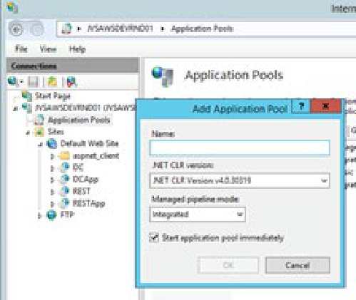


- 2) Configure the maximum session length without traffic in the application pool. In **Advanced settings** set **Idle time-out** to the required number of minutes, for example 120. **Note:** It is recommended that the value of **Idle time-out** is greater than or equal to 120 minutes, otherwise the user session will expire prematurely if the mobile app is inactive. 


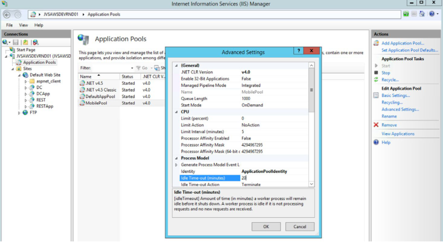


- 3) Select your application pool and click on **Recycling…** in the **Edit application pool** actions in the righthand side menu. The **Edit Application pool recycling settings** dialog is displayed. Under Fixed intervals, set the **Regular time intervals (in minutes)** to the same value as your Jeeves Kernel restart time. The default value resets the IIS and causes instability in the Mobile app. 

###### **<u>Note:</u>** 

You can have only one REST service in one application pool. Multiple REST services cannot be hosted <mark>in an application pool. If you have more than one REST service, create an application pool for each of</mark> them. 

- 4) Copy the Jeeves REST service folder to the machine where you would like to install the service. 

###### **<u>Note</u>** 

You must have complete rights to enable logging of information to the **C:\\Windows\Temp** folder. For more information, see Appendix: _Admin rights to Temp folder_ 

© Copyright Forterro Sweden AB. All rights reserved. 

43 (147) 

**Install** Jeeves ERP Mobility framework 


#### 4.2 Installation 

Please refer to Microsoft’s documentation for a description of the generic way to add and configure a web site in the IIS: https://technet.microsoft.com/en-us/library/cc772042(v=ws.10).aspx 

###### **<u><mark>Note</mark></u>** 

Do not use underscore (_) in any part of the REST URL. For more info, see the Invalid character in URL section later in this document. 

#### 4.3 Post-installation 

It is highly recommended that you set up an SSL certificate if this does not already exist. The network traffic between the mobile and the REST service is not encrypted without the SSL certificate. The installation of the certificate is standard. Please refer to Microsoft’s documentation for information regarding when a certificate is required and how it is configured: https://support.microsoft.com/en-us/help/324069/how-to-set- <u>up-an-https-service-in-iis</u> 

#### 4.4 How to verify REST service is correctly installed 

You can verify that the REST service is correctly installed by performing these steps: 

- 1) Choose Rest Service. 

- 2) Right-click and select Manage Application. 

- 3) Click on the Browse option. 

The browser should now open confirming the details of the version of the REST interface. 


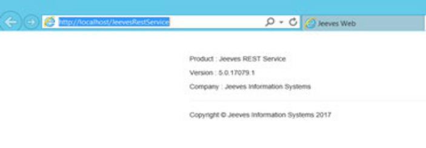


#### 4.5 Log related settings 

Logs are created when the client connects to and disconnects from the client, server, or REST service. 

You can enable or disable the logging feature based on the settings in the **appsettings.json** file that is available in the Jeeves Rest Service installation directory: 

- **EnableLogTraffic** : This parameter takes True/False values. Set the EnableLogTraffic value to False. This is the default value. The administrator can set the value to True if there are connection problems with the REST service. 

- **EnableLogs** : This parameter records all interactions between the REST service and the client. You can enable or disable the logging feature by assigning True/False values to this parameter. The default value of this parameter is False. Change the value to True when you want to access the debugging information that is recorded in the log files stored in the **Log** folder. 

#### 4.6 Point REST service to server 

To point the REST service to the server, navigate to your Jeeves REST folder and open the **appsettings.json** file. 

© Copyright Forterro Sweden AB. All rights reserved. 

44 (147) 

**Install** Jeeves ERP Mobility framework 


Navigate to the **JeevesServer** parameter and define the server name, the port number to be used to connect to the server/Client broker and the relevant connection type, preference towards IPv6 connectivity depending on the configuration. 

###### **Example:** 

```
"JeevesServer": {
      "Server": "MyJeevesServer",
      "Port": 4503,
      "ConnectionType": 6
      "preferipv6":0
}
```

For more information on the different connection types, see Appendix: _Connection types for REST service_ 

#### 4.7 Configuration of connection types for REST service 

The REST service can connect with various types of network and connection types. The following table describes the recommended connection type(s) for the different network types: 

###### **<u>Note:</u>** 

If you connect using connection type 2, the minimum and maximum ports must be specified for the Jeeves server. 

|**Networktype**|**Connection type**|
|---|---|
|**Local network only (Wi-Fi)**<br>(When Jeeves server and REST service are<br>hosted on the same network)|•<br>If there are multiple servers, connection type =<br>6 (Recommended)<br>•<br>If there is one server, connection type = 4|
|**Locally hosted Internet (Wi-Fi/4G)**<br>(When REST or REST and Client broker are<br>connected to server)|•<br>If the Client broker is hosted on the server and<br>your firewall is open, connection type = 6<br>(Recommended|
|**Jeeves Cloud (Wi-Fi/4G)**<br>(When Jeeves servers and REST service are<br>hosted in Cloud)|•<br>Connection type = 6 (Recommended)|


###### **<u>Note:</u>** 

It is recommended that you use connection types 6 with the Client broker and avoid using connection <mark>type 3. Use of connection type 3 with the Client broker leads to channeling the network traffic</mark> through the Client broker, which adds latency and makes the connection less scalable. 

#### 4.8 Federated login for Mobile client 

**Prerequisites:** The **FederatedClientID** and **Authority** kernel parameters must be set up in your Jeeves application using the values from your Identity service. 

You can enable federated login for your Mobile client in the **appsettings.json** file that is available in the Jeeves Rest Service installation directory. Navigate to the **MobileConfiguration** section and enter your Federated Client ID, Security mode and Authority values. For example: 

© Copyright Forterro Sweden AB. All rights reserved. 

45 (147) 

**Install** Jeeves ERP Mobility framework 


```
"MobileConfiguration": {
      "ClientId": "MyFederatedClientID",
      "SecurityMode": "6",
      "Authority": "https://identity.jeeves.cloud.com/" }
```

###### **<u>Note</u>** 

- For federated login, the security mode must always be 6. 

- At least one browser must be installed on the mobile device for validation purposes. 

#### 4.9 Download and install Jeeves app and mobile routines 

Jeeves mobile platform is comprised of two parts: 

- Jeeves ERP mobile client app 

- A mobile routine package, including selected functionality and design (e.g. the mobile order, warehouse, shopfloor, Field service, or CRM routine) 

##### 4.9.1 Install package 

Follow these steps to install the package: 

- 1) Import the mobile routine package using Jeeves Apps builder. 

- 2) Update the database – **very important** . 

- 3) Open the Design studio and find the user defined program that is part of the routine. 

- 4) Publish the user defined program with relevant priority settings. 

If a user accesses the mobile client with the relevant credentials for which the mobile routine has been published, the user will have access to the mobile routine. 

Jeeves standard/template routines, and their role groups: 

|**Package**|**Role group to connect**|
|---|---|
|Jeeves mobile CRM|CRM (40000)|
|Jeeves mobile field service|Field service(41000)|
|Jeeves mobile e-Approval|e-Approval(42000)|
|Jeeves mobile order|Mobile order(43000)|
|Jeeves mobile shopfloor|Mobile shopfloor(43100)|
|Jeeves mobile warehouse|Mobile warehouse(43200)|


###### **<u>Note</u>** 

The role group ID may change after the package is imported, if the ID is in use. 

##### 4.9.2 Modifications 

Any **business logic changes** to the package routine will be realized only after importing the package once again, which will replace the existing package. However, the user defined program must be published again using the Design studio. 

Any **user interface changes** in the package can be made using the Design studio. They must be saved to the site. 

© Copyright Forterro Sweden AB. All rights reserved. 

46 (147) 

**Install** Jeeves ERP Mobility framework 


Any **changes in the macros** defined in the package should be made by accessing the user defined program in the classic client and using the macro editor. The server must be restarted in order for the changes to take effect. 

###### **<u>Note</u>** 

Any Jeeves standard program can be used in mobile routines, if they are published under a menu used by Jeeves mobile user group in the Design studio. 

#### 4.10 Install Mobile client app 

Using your device, download Jeeves Mobile client app by searching for the **Jeeves ERP** app or by using this link: 

For Apple devices: https://itunes.apple.com/in/app/jeeves-erp/id1133586475?mt=8 For Android devices: https://play.google.com/store/apps/details?id=com.jeeves.jeeveserp 

#### 4.11 Point Jeeves mobile client to REST interface 

There are different ways to point the Jeeves Mobile client to the REST interface: 

- By using Dynamic link for iOS provided by administrator – Use your iPhone or iPad, click on the Open Jeeves ERP iOS dynamic link. If Jeeves Mobile client is installed it will pre-fill the REST interface URL, login credentials and signature, and the login process will be completed. 

- By using Dynamic link for Android provided by administrator – Use your Smartphone, click on the Open Jeeves ERP Android dynamic link, if Jeeves Mobile client is installed it will pre-fill the REST interface URL, login credentials and signature, and the login process will be completed. 

- By manually entering your login details – Open Jeeves Mobile client in the login screen. Enter the URL of the REST interface, enter your Jeeves ERP username, password, turn on auto login, and enter your signature. 

###### **<u>Note</u>** 

If you are configuring your REST service on an internal network, you must host the service on the <mark>internal network. Similarly, if you are configuring it on the public network, you must host the service on the public domain.</mark> 

<mark>It is highly recommended that the REST service is made available on the public network (If the user is in a Wi-Fi shadow region, the mobile network will be used to connect to the REST service. If the REST</mark> service is not accessible, the user experiences a broken connection). 

#### 4.12 Configure MDM for Jeeves ERP app 

Mobile device management (MDM) is the centralized administration of mobile devices and is typically used to deploy configurations including policies, certificates, and backend infrastructure. The MDM functions the same for both iOS and Android operating systems. 

You can configure your REST URL and profile name for Jeeves ERP in the MDM provider (like Microsoft InTune/MobileIron). It must be noted that once you configure the REST URL and profile name via MDM, they can be updated only via MDM. You can update/add/delete profiles that were added manually or through an URL. 

MDM can be configured for your Jeeves ERP app for iOS as follows: 

- Enter **profile_list** as the **Key** value 

- Select **string array** as the **Value type** 

- Enter **{\"profile_name\":\"Profile1",\"rest_url\":** 

**\"https://customer.mobileapi.jeeves.cloud"}"** as the **Value** . 

© Copyright Forterro Sweden AB. All rights reserved. 

47 (147) 

**Install** Jeeves ERP Mobility framework 


###### **<u>Note</u>** 

The content in the Value field is a json string. The **profile_name** and **rest_url** are the json string <mark>properties. You must enter your profile name and your REST URL instead of</mark> **<mark>Profile1</mark>** <mark>and</mark> **https://customer.mobileapi.jeeves.cloud** in the above value. 

The XML file for iOS can be in one for the following formats: 

###### Format 1: 

<?xml version="1.0" encoding="UTF-8"?> <mark><!DOCTYPE plist PUBLIC "-//Apple//DTD PLIST 1.0//EN" "http://www.apple.com/DTDs/PropertyList-1.0.dtd"> <plist version="1.0"> <dict> <key>profile_list</key> <array> <string>{"profile_name":"YourProfileName","rest_url":"https://name.mobileapi.jeeves.cloud/rest_pr</mark> <u><mark>od"}</string></mark></u> <mark></array> </dict></mark> </plist> 

###### Format 2: 

<?xml version=""1.0"" encoding=""UTF-8""?> <mark><!DOCTYPE plist PUBLIC ""-//Apple//DTD PLIST 1.0//EN"" http://www.apple.com/DTDs/PropertyList1.0.dtd></mark> <plist version=""1.0""> <dict> <key>profile_list</key> <array> <string>"{\"profile_name\":\"YourProfileName\",\"rest_url\":\" <u><mark>https://name.mobileapi.jeeves.cloud/r est_prod\</mark></u> "}"</string> </array> </dict> </plist> 

MDM can be configured for your Jeeves ERP app for Android as follows in your MDM solution provider: 

- Enter the **key** of your array bundle as the **profile_list** value 

- The array bundle has two string properties, the key for **profile_name** is your **profile name** and the key for **rest_url** is your **REST URL** . 

© Copyright Forterro Sweden AB. All rights reserved. 

48 (147) 

**Install** Jeeves client 


### 5 Install Jeeves client 

#### 5.1 Install Jeeves ERP client 

##### 5.1.1 Introduction 

Jeeves ERP Client, also known as Desktop client, is based on JAS 2026.2 and Platform version 2026.2. It helps to conduct bulk data operations and delivers the core ERP functionality within an intuitive and easily customized interface. 

It is aimed at users who wish to have the functionality of the Classic client, as well as the modern interface of the Desktop client. 

##### 5.1.2 System requirements 

The system requirements for the Desktop client are as follows: 

- Operating system - Windows 11 

- .Net framework 4.6.2 (for Crystal Report integration) 

- .NET 10 Desktop Runtime 

- Microsoft Edge WebView2 runtime 

- Microsoft Visual C++ runtime 14.0. 

##### 5.1.3 Desktop client architecture 


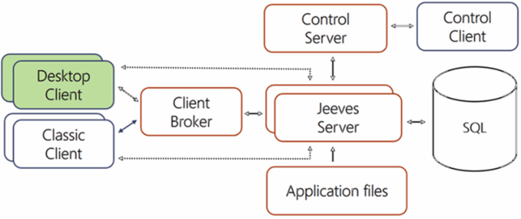


The Jeeves ERP Client can be run in parallel with the Classic client. 

##### 5.1.4 Install Desktop client application 

Perform the following steps to install the Desktop client application: 

- 1) Start the installation by double-clicking **Jeeves.ERPClient.msi** . This opens the setup wizard. The installation program starts and the **Welcome to Jeeves ERP client setup wizard** dialog appears. Click **Next** to continue. 

© Copyright Forterro Sweden AB. All rights reserved. 

49 (147) 

**Install** Jeeves client 


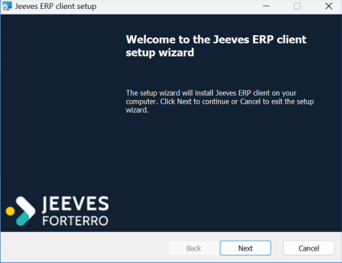


- 2) Enter the path to the destination folder and click **Next** . If required, you can browse and select a different destination path by clicking the **Change** button. 


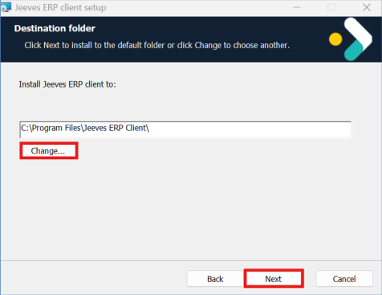


- 3) The **Jeeves server** dialog appears. 

   - a) If your server details are displayed in the list box, select it and click **Next** to continue. 

   - b) If your server details are not present in the **Jeeves server** dialog, create a new server connection by providing the following information: 

   - **Name:** The name of the server connection. 

**Note:** If you enter a name that already exists in the list, the following warning message is displayed; click **OK** to exit the dialog and enter a unique name. 


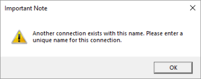


- **Server name or ip** : The name or IP address of the server where your Jeeves server is or will be installed. If no name or IP is entered, localhost is considered as the default server/IP. 

- **Server port** : The port that you are or will be using to connect to your Jeeves server from the User client. You can use any port in the range 4502-4534. It is recommended that you start from port 4502 and increment for each new Jeeves server. If no server port is entered, port 4502 is considered as the default. 

- **Security mode:** Specifies the type of authorization Jeeves shall use. Enter one of the following values: 

   - 0 = Default SQL Login 

   - 1 = Windows user authentication against SQL Server and **sy2** , then SQL Login. In this case, when a user connects through a Windows user account, the SQL Server validates the 

© Copyright Forterro Sweden AB. All rights reserved. 

50 (147) 

**Install** Jeeves client 


account name and password using the Windows principal token in the operating system. This means that the user’s identity is confirmed by Windows, so SQL Server does not request the password or perform the identity validation. Windows Authentication is the default authentication mode. 

   - 2 = Windows user authentication against SQL Server and **sy2.** 

   - 3 = Windows user authentication against **sy2** , then SQL Login. 

   - 4 = Windows user authentication against **sy2.** 

   - 5 = Windows user authentication against Security ID ( **SID** ) stored in Jeeves. 

   - 6 = Federated login using Identity service specified in the **Authority** kernel parameter. If no security mode is entered, 0 is considered as the default security mode. Refer to Jeeves’ online documentation for more information on security modes. 

- **Federated Client ID** : The client ID setup for you by Cloud ops in your Identity service. The entered value must match the **FederatedClientId** kernel parameter. 

- **Authority** : The URL of the Identity service. This must match the value specified in the **Authority** kernel parameter. 

- **Connection type** : Choose from the following options: 

   - 2 - Client connects to the Client broker and then the server with least load will connect to the client. 

   - 3 - All calls go through Client broker 

   - 4 - Direct access to server (default) 

   - 6 - Client connects to Client broker and then to the server with least load 

- c) Click **Add** to include the connection in the list of server connections. **Note:** If you wish to remove an existing connection, select the connection from the list and click **Remove** . 

- d) Click **Next** to continue. 


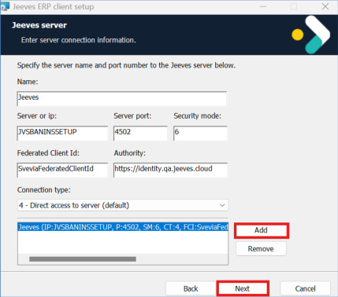


- 4) Click **Install** to begin the installation. 


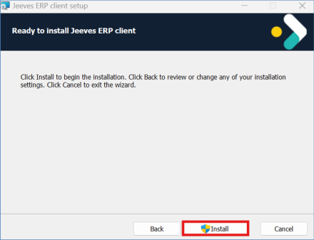


- 5) The **User Account Control** dialog appears. Click **Yes** to continue. 

© Copyright Forterro Sweden AB. All rights reserved. 

51 (147) 

**Install** Jeeves client 


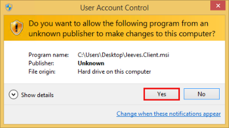


- 6) Click **Finish** to complete the installation. 


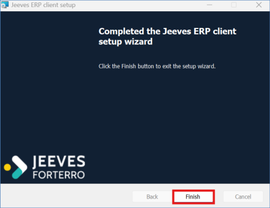


###### **<u>Note</u>** 

Microsoft Edge WebView2 Runtime is installed automatically on your system when you install Jeeves <mark>ERP Client. You can check this in the Control Panel.</mark> 

<mark>If the installer fails due to issues in MicrosoftEdgeWebview2Setup.exe, you can also install WebView2 Runtime manually from</mark> <u><mark>https://developer.microsoft.com/en-us/microsoft-edge/webview2/</mark></u> <mark>If you already have WebView2 runtime installed, the Desktop client installer will identify it</mark> and skip the installation of WebView2 Runtime. 

##### 5.1.5 Command line installation 

Jeeves ERP Client can also be installed through the command prompt using command line parameters. For example: 

Security modes 0 – 5: 

```
msiexec /i Jeeves.Client.msi /qb /lime install.log ADDLOCAL=ALL
SERVERNAME=JVSBANINSSETUP SERVERPORT=4502 SECURITYMODE=0
```

Security mode 6: 

```
msiexec /i Jeeves.Client.msi /qb /lime install.log ADDLOCAL=ALL
SERVERNAME=JVSBANINSSETUP SERVERPORT=4502 SECURITYMODE=6
FEDERATEDCLIENTID=MyFederatedClientID AUTHORITY= https://identity.qa.jeeves.
/forceLogin
```

where Jeeves.Client.msi is the name of the installer file. Enter your Server name, Port and preferred Security mode. If you choose security mode 6, you must enter Authority and Federated Client ID. 

Note that the /forceLogin command line parameter can be used to force login to the identity service during Federated Authentication if required. 

© Copyright Forterro Sweden AB. All rights reserved. 

52 (147) 

**Install** Jeeves client 


##### 5.1.6 Import language texts for Desktop client and Design studio 

After you have completely installed the Jeeves ERP Client and Design studio, navigate to the **Packages** folder in your Jeeves application folder. Along with the English and Swedish language packages, you will find the **ResourceText Desktop&Design.JSP** package. This package contains the Design studio and Desktop clients’ texts including their translations for the toolbar, menus, and dialogs. 

To install **ResourceText Desktop&Design.JSP** package, perform the following: 

- Navigate to **ResourceText Desktop&Design.JSP** 

- Run Jeeves Apps builder (JvsPackageManager.exe) and import the package into Jeeves 

- Restart the Jeeves servers in Control client 

For more information on Jeeves Apps builder, refer to Jeeves Apps builder (former Package manager) chapter (604) in Jeeves online documentation. 

#### 5.2 Configure Desktop client 

When the installation is completed, the files are saved in the path **C:\Program Files\Jeeves ERP Client** . Double-click **Jeeves.ERPClient** in the **Jeeves ERP Client** folder to start the Desktop client. 

##### 5.2.1 Create shortcut 

You can create a shortcut to the folder and place it on the desktop for easy access. The shortcut icon appears as shown below. 


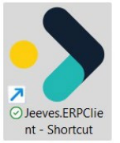


###### 5.2.1.1 Configure start-up parameters in Desktop client shortcut 

You can configure start-up parameters in the Desktop client shortcut to avoid manually entering them each time you launch the client. 

After you have created the shortcut as described above, perform the following to add start-up parameters: 

- 1) Right-click on the shortcut and select **Properties** . 

- 2) Navigate to the **Shortcut** tab. The **Target** field displays the path of the **Jeeves.ERPClient.exe** . Append this path with parameters and values as follows: 

   - **/U** : Database username 

   - **/p** : Database password 

   - **/s** : Signature (used to launch the client) 

   - **/S** : Server configuration name - in the format 

serverName;port:connectionType;securityMode;FederatedClientID;Authority 

   - the server configuration name must exist in **connectToServer.xml** . 

- /forceLogin: Command line parameter used to force login to identity service in security mode 6 (during Federated Authentication). 

For example: **C:\Program Files\Jeeves ERP Client\Jeeves.ERPClient.exe /Usa /pMyPassword1 /sJSA /Skernelmobscm;4504;4;6;MyFederatedClientId;https://identity.qa.jeeves.cloud /forceLogin** Where, 

   - sa is the database username, 

   - MyPassword1 is the database password, 

   - JSA is the signature, 

   - kernelmobscm is the server name, 

- 4504 is the port number (default = 4502), 

- © Copyright Forterro Sweden AB. 

All rights reserved. 

53 (147) 

**Install** Jeeves client 


- 4 is the connection type (default), 

- C:\Helpfiles is the HtmlHelpBasePath (default = empty), 

- 6 is the security mode (default = 0), 

- MyFederatedClientID is the Federated Client ID (default = empty), 

- https://identity.qa.jeeves.cloud is the Authority (default = empty) and 

- /forceLogin is the command line parameter used to force login to the identity service in security mode 6. 

If the /s parameter is not entered, default values are displayed. 

###### **<u>Note</u>** 

The above parameters are case-sensitive. 

###### 5.2.1.2 Set other shortcut properties 

**Start in** : Enter the path to your Jeeves ERP Client shortcut in the **Start in** field. 

###### **<u>Note</u>** 

It is recommended that you enter the path in the **Start in** parameter to avoid errors during printout. 

**Shortcut key** : Enter a shortcut key to launch the Jeeves ERP Client shortcut. 


##### 5.2.2 Configure connectToServer.xml 

The **connectToServer.xml** file can only be modified and saved when it is stored in the **ProgramData** folder. If it is not available in the **ProgramData** folder, it is copied to **C:\ProgramData\Jeeves Information Systems\Jeeves ERP Client** when you launch the application. 

The **connectToServer.xml** file has the following attributes: 

© Copyright Forterro Sweden AB. All rights reserved. 

54 (147) 

**Install** Jeeves client 


|**Attribute**|**Description**|**Mandatory**|
|---|---|---|
|**enableserverentry**|Determines whether the Login dialog should be shown before initiating<br>the server connection.<br>True = Login dialog is displayed asking before the server connection is<br>initiated. The Server field in the login dialog displays the configured<br>servers and is editable.<br>False = Server connection is initiated before the login dialog is displayed.<br>If onlyone server entryis configured,it is displayed in the Server field.|N|
|**defaultserver**|The default server that the Desktop client will connect to. In case of<br>multiple server entries, only the first one is selected to initiate a server<br>connection. However, if the defaultserver value set on the <Server><br>element is one of the multiple server entries,it is selected first.|N|
|**Name**|The name of the server that the Desktop client will connect to. If<br>multiple servers are configured, the Login dialog is displayed before the<br>server connection is initiated with all the configured servers displayed in<br>the Server drop-down list.|Y|
|**Reinstallfrom**|Currentlynot used.|N|
|**AllowOldClient**|Deprecated.|N|
|**Autoconnect**|Determines whether the client can automatically connect to the server.<br>True = Connection is initiated upon loading of the application.<br>False = Connection is initiated whenyou click on Connect.|N|
|**preferipv6**|Parameter to control the initial connection attempt that happens before<br>the communication protocol is selected.<br>True = The client tries to connect to the IPv6 socket, if it fails, it checks<br>and connects to the IPv4 socket. You can set the parameter to True if you<br>are sure your network is IPv6 compatible.<br>False (default) = The client tries to connect to the IPv4 socket, if it fails,<br>it checks and connects to the IPv6 socket.<br>**Note:**As many connections are IPv4 capable, you can achieve faster<br>connectivitywhenpreferipv6 = false.|N|
|**IP**|The IP address to where the Jeeves server is located. Multiple IP<br>addresses can be added through comma separated values.|Y|
|**Port**|The port that shall be used to connect to the Jeeves server. Multiple<br>ports can be added through comma separated values.|Y|
|**Connectiontype**|The configuration to be used:<br>3 = All calls go through Client broker.<br>4 = Direct access to server (default).<br>6 = Client connects to Client broker and then to the server with the least<br>load.|N|
|**Securitymode**|Specifies which type of authorization Jeeves shall use:<br>0 = Default SQL Login.<br>1 = Windows user authentication against SQL Server and sy2, then SQL<br>Login.<br>2 = Windows user authentication against SQL Server and sy2.<br>3 = Windows user authentication against sy2, then SQL Login.<br>4 = Windows user authentication against sy2.<br>5 = Windows user authentication against SID stored in Jeeves.<br>6 = Federated login using Identity service|N|
||If a server is selected with the security mode set to a value other than 0,<br>the User, Password and Signature fields are disabled in the Login screen.<br>However, for security modes 1 and 3, these fields will be enabled if<br>authentication fails.<br>**Note**: In security modes 5 and 6, the following fields in the Users (sy2)<br>program restrict access to corresponding features in Jeeves for both SID<br>and FA users:||


© Copyright Forterro Sweden AB. All rights reserved. 

55 (147) 

**Install** Jeeves client 


|**Attribute**|**Description**|**Mandatory**|
|---|---|---|
||-<br>When the Adm RightclickBySA (JVSAdminFun_RightClickBySA) field is<br>disabled, users are restricted from right-clicking into any program<br>not listed in the menu, if the RightClickBySA parameter is enabled.<br>-<br>When the Adm Security manager (JVSAdminFun_SecMgrEX) field is<br>disabled, users are restricted from accessing the Security manager.<br>-<br>When the Adm Shutdown (JVSAdminFun_Shutdown) field is disabled,<br>users are restricted access to the Shut down from client feature.||
||Note: The JvsAdminFunction database table entries, which assign admin<br>functions to users and provide access to the above features, are not<br>considered in security modes 5 and 6.||
||For more information on the Kernel and Application versions that support<br>the above features, refer to the ‘Considerations when upgrading to<br>Jeeves ERP version 2024.Q2.3’ section in the Upgrade considerations<br>guide.||
|**HtmlHelpFileBasePa**<br>**th**|The file path to the location of the online documentation files. In a<br>standard installation, it is in the application directory and the relevant<br>language folder.|Y|
|**FederatedClientId**|The client ID is generated for you by Cloud ops in your Identity service.<br>The entered value must match the**FederatedClientId**kernelparameter.|N|
|**Authority**|URL of the Identity service. This must match the value in the**Authority**<br>kernelparameter.|N|
|/connectToServer=U<br>RL/path|Parameter to locate and load the server configuration automatically. The<br>value against this parameter can be a URL path such as**http://**or<br>**https://**. Theparameter also supports**file:///** paths.|N|


###### **Example XML** 

Following is an example of a configuration with the options set in the **connectToServer.xml** file: 

```
<servers enableserverentry="true" defaultserver=”Sandbox” >
<server name="Sandbox" reinstallfrom="http://servername/path"
AllowOldClient="false" Autoconnect="true" ip=" kernel51spman,kernelmain"
port="4502,4503" connectiontype="4"
HtmlHelpBasePath=\\kernel51spman\Jeeves\Lang securitymode="1"/>
```

```
<server name="Jeeves" ip="kernelmobscm" preferipv6="True"
port="4504" connectiontype="4" securitymode="6"
FederatedClientId="MyFederatedClientId"
Authority="https://identity.jeeves.cloud" HtmlHelpBasePath="
C:\Program Files\Jeeves ERP Desktop Client\Jeeves Help Files\lang"
Autoconnect="true" /> </servers>
```

You can define the server name, the IP address of the server, the port number to be used to connect to the Jeeves server and the relevant connection type, depending on the configuration. 

In addition, you can configure this file to enable the option to select a server or manually enter a server to connect to during start of the Desktop client or specify the default server to select the existing server as the default when logging in to the Desktop client. 

Note that if multiple server entries are configured in the connecttoserver.xml file, only the first one is selected to initiate a server connection. However, if the defaultserver value set on the **<Server>** element is one of the multiple server entries, it is selected first. You can change the selected value by choosing another server from the list. 

© Copyright Forterro Sweden AB. All rights reserved. 

56 (147) 

**Install** Jeeves client 


###### 5.2.2.1 Option to select Jeeves server during start of Desktop client 

You can configure the **connectToServer.xml** file to enable the option to select a server, or manually enter a server to connect to during start of the Desktop client. 

This option is available if multiple servers are configured in the **connectToServer.xml** , or if the **enableserverentry** attribute is set to True. 

Normally, only one server is configured, or the server is passed as a startup parameter, but you can enable the selection or manual entry of the Jeeves server by adding one of the following configuration options: 

- An attribute with the name **enableserverentry** with the value of True in the root **<Servers>** element. 

- More than one **<Server>** element 

An example of a configuration can look as follows: 

```
<servers enableserverentry="true" defaultserver=”Sandbox”>
<server name="sandbox" ip="kernel51spman" port="4502" securitymode="1"/>
<server name="Production" ip="kernel51r1man" port="4502" connectiontype="6" />
</servers>
```

Once this is done, the login dialog will be shown before initiating the connection to the specified server unless the security mode is set to a value other than 0. When you click **OK** in the login dialog, the connection is initiated. 

###### 5.2.2.2 Server connections based on configuration options 

Following are the different configuration scenarios and information on when the server connection is initiated: 

- When **enableserverentry** is set to True, the login dialog is displayed before the connection is initiated. This is irrespective of the values set for any other parameters. 

- When multiple server entries are configured: 

   - **enableserverentry** is set to True and **securitymode** is not specified or set to 0, the login dialog is displayed before the server connection is initiated. 

   - **enableserverentry** is unavailable or set to False and **securitymode** is not specified or set to 0, the login dialog is displayed before the server connection is initiated. 

- 

- When a single server entry is configured: 

- **enableserverentry** is set to True and **securitymode** is not specified or set to 0, the login dialog is displayed before the server connection is initiated. 

- **enableserverentry** is set to False and **securitymode** is not specified or set to 0, the server connection is initiated before the login dialog is displayed. 

- **enableserverentry** is set to False and **securitymode** is set to a value other than 0, the server connection is initiated, and the login dialog is not displayed. 

- **enableserverentry** is set to False and **securitymode** is set to 6, the server connection is not initiated until the user authenticates from identity service, and the login dialog is not displayed. 

###### 5.2.2.3 Set securitymode attribute 

The Desktop client uses the **securitymode** attribute configured on the **<Server>** element in the **connectToServer.xml** file, for example: 

```
<server name="Jeeves" ip="kernel51spman" port="4502" securitymode="1"/>
```

- If the **securitymode** attribute in the file does not match the value on the server, it is updated with the value sent from the server after connection is established. 

- If this attribute is missing or not set in the file, the client will try to use the default value of 0 and the login dialog will be displayed before the server connection is initiated. 

> © Copyright Forterro Sweden AB. 

All rights reserved. 

57 (147) 

**Install** Jeeves client 


- If the **securitymode** on the server has a value other than 0 and this attribute is missing in the file, the value sent from the server is added in the file. 

###### **<u>Note</u>** 

If no changes are made to the **connectToServer.xml** file, the client will initiate the server connection using the Connection type. 

###### 5.2.2.4 Command line parameter values to load the server configuration 

Following are examples of values that can be set for the /connectToServer=URL/path parameter to enable the Jeeves cloud client installer application to automatically locate and load the server configuration required to update the Desktop client: 

- **https://** URL path: 

```
/connectToServer=https://MyCompany.s3.eu-north-
1.amazonaws.com/Connections/AppSer01.xml
```

- **http://** URL path: 

```
/connectToServer=http://MyCompany.s3.eu-north-
1.amazonaws.com/Connections/AppSer01.xml
```

- file:/// path: 

```
/connectToServer=file:///C:\ProgramData\Jeeves Information Systems\Jeeves ERP
Client\Connecttoserver1.xml
```

© Copyright Forterro Sweden AB. All rights reserved. 

58 (147) 

**Configuration** 


### 6 Configuration 

This section describes the method to configure Jeeves Control server, Jeeves Control client, Jeeves Business server, Jeeves Client broker, and the method to create a shortcut to a thin client. Before attempting any of the tasks in this document, ensure that Jeeves is installed, and you have technical information about your servers like names and IP addresses. You also need some technical knowledge about computer networks, servers, and databases. In all areas where ports are used in initiation files, make sure that these are available and are not used by any other application on your server. 

#### 6.1 Jeeves Control server 

The Jeeves Control server can run one or more Jeeves Business servers and perform daily restart at specified times. 

###### **Advantages** : 

- Track the amount of connected users 

- CPU usage 

- Start and stop Jeeves Business servers manually 

To perform these tasks in the Jeeves Control server, use the Jeeves Control client. 

###### **Important** 

You can only have one installed Jeeves Control server per server. 

Note that the Control server can only be restarted using the same account as the one used to start the business servers that are already running. If you use a different account, you will get errors when attempting to restart the control service. These errors can be viewed in the JeevesControlLogg. 

There is a limitation on the number of client connections that are allowed towards a single server (OS instance), and it is dependent on the number of handles being used by the user session running the Control server. If the control server is running with an account which is not used by other applications or services, Jeeves recommends a maximum of 450 client connections towards the OS instance. The number can vary depending on the number of Jeeves Server instances set up on the OS instance. 

###### **<u>Note</u>** 

The Control client is automatically terminated after 5 minutes of user inactivity. <mark>Prolonged connection between the Control client and the server has been observed to cause significant memory leaks, resulting in increased resource consumption and potential performance degradation over time.</mark> 

<mark>To minimize memory usage and prevent leaks, it is strongly recommended to close the Control client when it is not actively in use and reconnect only when needed. This helps maintain optimal system</mark> performance and stability. 

##### 6.1.1 Configure Jeeves Control server 

When setting up a Jeeves Control server, first configure the Jeeves Business server that you want to control in the Jeeves Control server. To do this, you must configure an initiation file. An example of such a file is displayed below. Configure it to fit your needs and name it **Jvs32SvrSvc_Server.ini** . 

**Jvs32SvrSvc_Server.ini [Dll] ServerApp = JvsSvr.dll ClientMgr = Jvs32ClientMgr.dll ServerGui = Jvs32SvrSvcGui.dll** 

© Copyright Forterro Sweden AB. All rights reserved. 

59 (147) 

**Configuration** 


**NoComponents = 6 Component1 = plugin\CrystalReports\Jvs32CrystalReport.dll ComponentIndex1 = 11 Component2 = plugin\help\Jvs32Help.dll ComponentIndex2 = 12 Component3 = plugin\TemplEdit\Jvs32TemplateEditor.dll ComponentIndex3 = 13 Component4 = plugin\Report\Jvs32Report.dll ComponentIndex4 = 14 Component5 = plugin\MacroMgr\Jvs32MacroMgr.dll ComponentIndex5 = 15 Component6 = plugin\RunDotNet\Jvs32RunDotNet.dll ComponentIndex6 = 16** 

**[Database] Server = DatabaseServer Database = DatabaseName User = user Password = password** 

**[Network] ListenPort = 2033 MaxConnectedClients = 50 SuperBufferSize = 1400 SuperBufferSendTime = 30** 

Then configure an initiation file for the Jeeves Control server. An example of how this file must be configured is displayed below. Configure it and name it **Jvs32SvrSvc.ini** . 

**Jvs32SvrSvc.ini [General] ServerName = Control ServiceExtension = Ctrl NTService = 1 LangFilesPath = D:\ControlServer\bin EventLogDllPath = D:\ControlServer\bin NoServers = 1 Server1 = \\servername\SharedFolder\Server\Jvs32Server.exe D:\PathToServerIniFile\Jvs32SvrSvc_Server.ini Name1 = Name will be displayed in the Control client MoveServerLogFilesAfterDays = 1 TruncateBackupLogFilesAfterCount = 10** 

**[Users] NoUsers = 1 User1 = userName** 

© Copyright Forterro Sweden AB. All rights reserved. 

60 (147) 

**Configuration** 


**[Dll] Path = D:\ControlServer\bin ServerApp = Jvs32Control.dll ServerGui = Jvs32SvrSvcGui.dll ClientMgr = Jvs32ClientMgr.dll** 

**[Network] ListenPort = 3010 FlushTimeout = 50 MaxConnectedClients = 50 SuperBufferSize = 1400 SuperBufferSendTime = 30** 

If you want to control more than one Jeeves Business server in the Jeeves Control server, add them in the initiation file. To do this, increase the NoServers count to your number of servers and for each server, add Server2, Name2, and so on. See the following example with three servers. 

**NoServers = 3 Server1 = \\servername\SharedFolder1\Server\Jvs32Server.exe D:\PathToServerIniFile\Jvs32SvrSvc_Server1.ini Name1 = Name will be displayed in the Control Client Server2 = \\servername\SharedFolder2\Server\Jvs32Server.exe D:\PathToServerIniFile\Jvs32SvrSvc_Server2.ini Name2 = Name will be displayed in the Control Client Server3 = \\servername\SharedFolder3\Server\Jvs32Server.exe D:\PathToServerIniFile\Jvs32SvrSvc_Server3.ini Name3 = Name will be displayed in the Control Client** 

The **Jvs32SvrSvc.ini** file must be placed in the kernel server folder which you are using for your Jeeves Control server and it must be named **Jvs32SvrSvc.ini** . The **Users** section is important because only the users specified in this file will be able to start the Control client. 

After you have set up all the necessary initiation files, the next step is to install the Jeeves Control server execution file as a service on your server. The file is called **Jvs32SvrSvc.exe** and is placed in your kernel server folder. To do this, start the command prompt as an administrator, provide the path to your **Jvs32SvrSvc.exe** file, and type **/install** as shown in the image below. 


This will install the Jeeves Control server as a service on your server, but it will not start automatically. 

To start the Control server, perform the following steps: 

- 1) Start the **Services** program. **Path:** Administrative tools on your server. 

- 2) Right-click **JeevesSvr_ctrl** in the list of services and choose **Properties** . 3) In **Properties** , do the following: a) Click the **General** tab and choose **start up type** : **Automatic** . b) Click the **Log on** tab and choose the user that should run the Jeeves Control server. 

© Copyright Forterro Sweden AB. 

All rights reserved. 

61 (147) 

**Configuration** 


When you start the service, it will automatically use the initiation file you created earlier and is placed in the same folder as the **Jvs32SvrSvc.exe** file which you installed as a service. 

##### 6.1.2 Configure Jeeves Control client 

By this point, the Jeeves Control server is running with one Jeeves Business server. However, to control the server you need to configure the Jeeves Control client which is used as a graphical interface for the Jeeves Control server. The initiation file for the Jeeves Control client must be configured similar to the following: 

###### **<u>Note</u>** 

Make sure that the IP address is the one where your Jeeves Control server is installed. Configure this file and name it **ControlClient.ini.** 

###### **ControlClient.ini** 

**[Network] Addr = 111.11.1.111 Port = 3010 ConnectionType = 4 SuperBufferSize = 1400 SuperBufferSendTime = 30** 

After you have configured the Control client initiation file, you need to set up a shortcut for the Jeeves Control client to start it. Perform the following steps: 

- 1) Right-click on **Jvs32Client.ini** . 

This is located in your **kernel client** folder. 

- 2) Choose **Create Shortcut** . 

- 3) When the shortcut is created, right-click on it and choose **Properties** . 4) In the **Target** field, add the file path to your **ControlClient.ini** file. 


When this is done, you can start your Control client. 

- © Copyright Forterro Sweden AB. All rights reserved. 

62 (147) 

**Configuration** 


#### 6.2 Jeeves Client broker 

The Jeeves Client broker is used for load balancing between different Jeeves Business servers. You can have a Client broker on one machine or on several machines. When a user starts up a client, the Jeeves Client broker connects the user to the server that has the least number of connected users. It can be used in two ways: either to let all traffic pass through the Jeeves Client broker or to let the Jeeves Client broker establish the connection and then let the client and server communicate on their own. Jeeves Client broker can be run as a standalone program or as a service on your server. This document describes how to configure it and install it as a service. 

##### 6.2.1 Configure Jeeves Client broker 

To install Jeeves Client broker as a service, perform the following: 

- 1) Copy the following files to a folder on the server on which you want to run your Jeeves Client broker. 

   - **Jvs32CBSvc.exe** 

   - **FastMM_FullDebugMode.dll** 

   - **JvsSocket.dll** 

   - initiation file **Jvs32CBSvc.ini** 

**Note** : All these files, except the initiation file, can be found in the **kernel server** folder. 

2) Create the initiation file and name it **Jvs32CBSvc.ini** . For example, 

**Jvs32CBSvc.ini** 

**[General] Description=My Client Broker 01 ServiceExtension=My_CB_01** 

**[Network] FlushTimeout=0 Uniport=22625 DefaultIPAddress=111.11.1.111** 

To install Jeeves Client broker as a service on your server, perform the following steps: 

- 1) Start the command prompt as **administrator** . 

- 2) Type the path to your **Jvs32CBSvc.exe** file. 

- 3) Type **/install** . 

© Copyright Forterro Sweden AB. All rights reserved. 

63 (147) 

**Configuration** 


This will install the Jeeves Client broker as a service on your server, but it will not start automatically. 

To start the Client broker, perform the following steps: 

- 1) Start the **Services** program. 

**Path:** Administration tools on your server. 

- 2) Right-click on **Client Broker** in the list of services and choose **Properties** . 3) In **Properties** , click the **General** tab and choose **start up type** : **Automatic** . 

- 4) Click the **Log on** tab, and choose the user that should run the Jeeves Client broker. When you start the service, it will automatically use the initiation file you created earlier and is placed in the same folder as the **Jvs32CBSvc.exe** file, which you installed as a service. 

##### 6.2.2 Configure Jeeves Business server with Jeeves Client broker 

The next step is to configure a Jeeves Business server that uses Jeeves Client broker to communicate with the client. To do that, you need an initiation file for the Jeeves Business server. An example of such an initiation file is as shown. 

**Jvs32SvrSvc_Server_CB.ini [Dll] ServerApp = JvsSvr.dll ClientMgr = Jvs32ClientMgr.dll ServerGui = Jvs32SvrSvcGui.dll NoComponents = 6 Component1 = plugin\CrystalReports\Jvs32CrystalReport.dll ComponentIndex1 = 11 Component2 = plugin\help\Jvs32Help.dll ComponentIndex2 = 12 Component3 = plugin\TemplEdit\Jvs32TemplateEditor.dll ComponentIndex3 = 13 Component4 = plugin\Report\Jvs32Report.dll ComponentIndex4 = 14 Component5 = plugin\MacroMgr\Jvs32MacroMgr.dll ComponentIndex5 = 15 Component6 = plugin\RunDotNet\Jvs32RunDotNet.dll ComponentIndex6 = 16 [Database] Server = DatabaseServer Database = DatabaseName User = user Password = password [Network] ListenPort = 2033** 

© Copyright Forterro Sweden AB. All rights reserved. 

64 (147) 

**Configuration** 


###### **MaxConnectedClients = 50 SuperBufferSize = 1400 SuperBufferSendTime = 30** 

###### **ClientBrokerPort=22625 ClientBrokerIP=111.11.1.111 ClientBrokerMode=3** 

###### **ConnectIPAddress=computername or IP address that the client can resolve** 

The bottom part of the initiation file in the above example is the important part of this configuration. It is also the only difference in the initiation file if you compare it with the one that was used in _Jeeves Control server_ chapter. **ClientBrokerPort** must be the same as Uniport in your Client broker initiation file and the **ClientBrokerIP** must be the address to the server where your Client broker is placed. **ClientBrokerMode** must be configured according to the mode you are planning to use. If you have Client brokers on several machines, specify the port numbers and their IP addresses in the same order, comma separated. 

The different modes are: 

- 1 = No Client broker is used (default) 

- 2 = Clients are only connected though Client broker 

- 3 = Clients are connected through Client broker and directed to the server 

When you have configured your server initiation file, you can use this file to set up a Jeeves Business server with Jeeves Control server as described in the _Jeeves Control server_ section. The point of having the Jeeves Client broker is that you have more than one Jeeves Business server. This can be done by combining the _Jeeves Control server_ and _Jeeves Client broker_ sections, that is, by installing Jeeves Control server to run Jeeves Business servers on two or more servers. 

#### 6.3 Configure thin client 

After setting up Jeeves Business server, Jeeves Control server, Jeeves Control client, and Jeeves Client broker, you need a client to be able to run Jeeves. To begin, configure a client initiation file like the following example 

**ThinClient.ini [General] HelpFileBasePath = “C:\Program Files\Jeeves\lang” SecurityMode = 6 FederatedClientID = ‘MyFederatedClientID’ Authority = https:\\www.identity.jeeves.cloud.com [Network] Addr = 111.11.1.111 Port = 22625 ConnectionType = 3 SuperBufferSize = 1400 SuperBufferSendTime = 30 [Plugin] Path = .\plugin\** © Copyright Forterro Sweden AB. All rights reserved. 

65 (147) 

**Configuration** 


**NoPlugins = 6 Plugin1 = CrystalReports\Jvs32CrystalReportGui.dll Plugin2 = Help\Jvs32HelpGui.dll Plugin3 = TemplEdit\Jvs32TemplateEditorGui.dll Plugin4 = Report\Jvs32ReportGui.dll Plugin5 = MacroMgr\Jvs32MacroMgrGui.dll Plugin6 = RunDotNet\Jvs32RunDotNetGui.dll** 

###### **<u>Note</u>** 

The **SecurityMode** , **FederatedClientID** and **Authority** parameters are to be used only when using federated login. 

In this example, you are using a Client broker which all traffic passes through, i.e., Client broker mode 3. Configure the file and name it **ThinClient.ini** . 

In the network section, **Addr** must be the IP address to the server where your Client broker is installed, and **Port** must be the same as the Uniport in your Client broker initiation file. If you have Client brokers on several machines, specify the port numbers and their IP addresses in the same order with comma separated values. When you start the client, it will connect to the Client broker and will direct you to a server. The **ConnectionType** should match the **ClientBrokerMode** that you have configured in your server initiation file. 

If you are using the Jeeves Client broker to only set up the connection between the server and the client, i.e., connection type 2, 3 or 6, consider the following: 

- With connection type 2, the server connects to the client. You must add the below example to your client initiation file and change the **ConnectionType** to 2. The **MinPort** and **MaxPort** tell the server which ports to connect to on the client. 

- In complex network infrastructures, this setup may be hard to configure. It is recommended you use connection type 6. 

- With connection type 6, the client connects to the server. In this case, you do not need to enter **MinPort** or **MaxPort** in the client initiation file. 

- With connection type 3, the client will communicate only with a Jeeves server through the Client broker. 

###### **MinPort=5700** 

###### **MaxPort=5701** 

##### 6.3.1 Create shortcut 

After you have completed setting up the client initiation file, you need to set up a shortcut for the thin client to be able to start it, as follows: 

- 1) Right-click on the **Jvs32Client.exe** file. This is located in your **kernel client** folder. 

- 2) Choose **Create Shortcut** . 

- 3) Right-click on the shortcut and choose **Properties** . 

- 4) In **Target** , add the file path to the **ThinClient.ini** file. Note that when entering the directory path for any **ini** file, ensure that the path does not contain spaces and is not enclosed within double quotes. Now, you will be able to start the thin client. 

© Copyright Forterro Sweden AB. All rights reserved. 

66 (147) 

**Configuration** 


#### 6.4 Configure SQL Server Reporting Services (SSRS) 

Launch the **Reporting Services Configuration Manager** on your system and configure a Reporting Services installation as follows: 

The **Reporting Services Configuration Manager** is version-specific. The Reporting Services Configuration tool that installs with this version of SQL Server cannot be used to configure an earlier version of Reporting Services. 

- 1) Launch **SQL Server Reporting Services Configuration Manager** . 2) In the Reporting Services Configuration Connection dialog, configure a report server instance: 

- a) In the **Server Name** field, enter the name of the computer on which the report server instance is installed. 

- b) In the **Report Server Instance** field, select the SQL Server Reporting Services instance that you want to configure. Only report server instances for this version of SQL Server appear in the list. You cannot configure earlier versions of Reporting Services. 

- c) Click **Connect** . 


© Copyright Forterro Sweden AB. All rights reserved. 

67 (147) 

**Configuration** 


- 3) Open the **Service Account** dialog and select the account details. Click **Apply** to save your selection. 

- 4) Open the **Web Service URL** dialog and configure a URL for the Report Server web service. 

   - a) Specify the virtual directory. For the Report Server web service, the default virtual directory name is **ReportServer** . You can modify this value as desired. 

   - b) Click **Apply** to create the URL. You can test the URL by clicking the link in the URLs section of page. Note that the report server database must be created and configured before you can test the URL. Note that if the URL fails to connect, open Internet Explorer as administrator and browse to the URL. 


- 5) Open the **Database** dialog and click the **Change Database** button. A pop-up dialog opens. Select **Create a new report server database** and click **Next.** 


- 6) Connect to the instance of the database engine that you will use to create and host the report server database: a) Enter the SQL Server database engine instance that you want to use. 

   - b) Enter the **Authentication type** as **SQL Server Account** . 

   - c) Click **Test Connection** to validate the connection to the server. 

   - d) Click **Next** . 

© Copyright Forterro Sweden AB. All rights reserved. 

68 (147) 

**Configuration** 


- 7) Specify properties used to create the database. 

   - a) Enter the name of the report server database. 

   - b) Select the language in which you want role definitions and My Reports to appear. 

   - c) Select the Report server mode as **Native** . 

   - d) Click **Next** . 


- 8) Specify the credentials used by the report server to connect to the report server database as **Service Credentials** and click **Next** . With this option, the server connects using integrated security; credentials are not encrypted or stored. 


- © Copyright Forterro Sweden AB. All rights reserved. 

69 (147) 

**Configuration** 


- 9) Review the information on the **Summary** page to verify the settings are correct and click **Next** . 


- 10) Click **Finish** . The selected database and login details are displayed. Click **Apply** to save the database configurations. 

- 11) Verify the connection by clicking a URL on the **Report Server URL** page or **Report Manager URL** page. The URLs must be defined for this test to work. If the report server database connection is valid, you will see either the report server folder hierarchy or Report Manager in a browser window. Note that if the URL fails to connect, open IE as administrator and browse to the URL. 


- 12) Click **Apply** once the configuration is completed and verified. To check if the configurations are completed successfully, navigate to http://<Servername>/Reports. If the configurations are done correctly, the Report Server screen is displayed. 


© Copyright Forterro Sweden AB. All rights reserved. 

70 (147) 

**Configuration** 


##### 6.4.1 Set user access roles and permissions in SQL Server Reporting Services 

- 1) Access the local URL or server URL, http://localhost/reports. The user interface is displayed as follows. 


- 2) Configure site settings as follows: 

   - a) Click the **Site Setting** link at the top right corner. A new window opens. 

   - b) Click the **Security** link. The **BUILTIN\Administrators** user assigned to the **System Administrators** role is displayed. 

   - c) Click the **New Role Assignment** button and in the **New System Role Assignment** page, enter the username, select the roles based on the requirement, and click **OK** . Once the process is completed, you can see the user with the role listed. 


Configure folder settings as follows: 

- a) Click **Folder settings** as shown below. 


- b) A new window opens as shown in the screen below. Click the **Security** link. The **BUILTIN\Administrators** user assigned to the **Content Manager** role is displayed. 


- c) Click the **New Role Assignment** button. In the **New Role Assignment** page, enter the user name, select the required roles, and click **OK** . 


Role assignments are typically inherited from a parent node, but you can create a new role assignment for a particular item. For example, a user who is a member of Browser role for one report may be a member of the Content Manager role for another report. 

Points to note when granting access to report server items and operations: 

© Copyright Forterro Sweden AB. All rights reserved. 

71 (147) 

**Configuration** 


- Identify the users and groups that require access to the report server, and at what level. Most users should be assigned to the Browser role or the Report Builder role. A smaller number of users should be assigned to the Publisher role. Very few users should be assigned to Content Manager. 

- Use Report Manager to assign roles for each user or group who requires access from the Home folder under Folder settings > Security. 

###### **<u>Note</u>** 

The Browser role is the basic role that should be assigned to users to allow them to run reports in Jeeves. 

Create additional role assignments as needed for specific folders, reports, and other items by right-clicking on the desired item(s) and selecting Security 

##### 6.4.2 Enable SSRS reports 

To enable SSRS reports, perform the following: 

- Make sure that the **SSRSReports** folder is present in Bin\Server\Plugin\SSRSReports folder and Bin\Client\Plugin\SSRSReports folder, and they contain **JvsNetReportingServices.dll** . 

- In **Jvs32SvrSvc.ini** (server-side ini file), make the following changes in the **[plugin]** section: 

NoComponents = 8 … … Component8 = plugin\SSRSReports\Jvs32SSRSReport.dll ComponentIndex8 = 18 

- In **Jvs32Client.ini** (client-side ini file), make the following changes in the **[plugin]** section: 

NoComponents = 7 … … Plugin7 = SSRSReports\Jvs32SSRSReportGui.dll 

- Build the SSRS Report template in Microsoft SQL server report builder. For more information, please refer to the online documentation, chapter _Make SSRS reports available in Jeeves and print reports_ (400). 

- Set the SSRSPrint and SSRSExportToFile macros to allow printing of the SSRS reports. For more information, please refer to the online documentation, chapters _Macro functions (1998) and Macro examples (1030)_ . 

© Copyright Forterro Sweden AB. All rights reserved. 

72 (147) 

**Configuration** 


#### 6.5 Configure mobile client 

Once you have downloaded and installed the app as described above, configure the Mobile clients according to the following steps: 

- 1) Tap on the **Jeeves ERP** app icon. The app appears in iOS and Android as shown below: 


The **Settings** dialog is displayed. The Settings dialog for iOS and Android are as shown below: 


- 2) Enter the address of the REST server. 3) Turn-on or check the **Auto login** checkbox (If you do not want the login screen to be opened every time). 

- 4) Enter your Jeeves ERP username, password, and signature respectively in the bottom three fields. 5) Tap **Save** on your iOS device or **Confirm** on your Android device. 

© Copyright Forterro Sweden AB. All rights reserved. 

73 (147) 

**Configuration** 


###### **<u>Note</u>** 

Notifications to the Mobile client on iOS and Android are sent with macros to the notification service <mark>at:</mark> <u><mark>https://notify.jeeves.se:9000/jsb-url/</mark></u> <mark>For more information and examples on macros, refer to Jeeves online documentation.</mark> If your iOS device is in a low battery state, notifications will not be displayed in the iOS mobile app. 

##### 6.5.1 SSRS reports 

To enable SSRS reports for your Mobile client, perform the following: 

- Make sure that the **SSRSReports** folder is present in the **Bin\Server\Plugin** folder and that it contains **JvsNetReportingServices.dll** . 

- In **Jvs32SvrSvc.ini** (server-side ini file), make the following changes in the **[plugin]** section: 

NoComponents = 8 … … Component8 = plugin\SSRSReports\Jvs32SSRSReport.dll ComponentIndex8 = 18 

- In **Jvs32Client.ini** (client-side ini file), make the following changes in the **[plugin]** section: 

NoComponents = 7 … … Plugin7 = SSRSReports\Jvs32SSRSReportGui.dll 

- Build the SSRS Report template in Microsoft SQL server report builder. For more information, please refer to the online documentation, chapter _Make SSRS reports available in Jeeves and print reports_ (400). 

- Set the SSRSPrint and SSRSExportToFile macros to allow printing of the SSRS reports. For more information, please refer to the online documentation, chapters _Macro functions (1998) and Macro examples (1030)_ . 

To use this functionality in your mobile device, press the **Reporting services** option in the **Reports** menu as shown in the image below. 


##### 6.5.2 Crystal reports 

In the Mobile client, Crystal reports can be run only through a macro. © Copyright Forterro Sweden AB. All rights reserved. 

74 (147) 

**Configuration** 


###### **Prerequisites:** 

   - Crystal reports must be installed on your Jeeves server 

   - The **CrystalPrint** and **CrystalExportToFile** macros must be configured in your Classic client. Specify the printer in which your report must be printed in the **CrystalPrint** macro. 

- Buttons for macros must be created in the Classic client 

- Perform the following to view your Crystal reports in the Mobile client: 

   - Launch the **Design studio** and open the design for the program in which you would like to view Crystal reports. 

   - Add the buttons for printing and exporting the report. Save and publish your design to the Mobile client. These buttons will appear in your Mobile client. 

###### **<u>Note</u>** 

You can also link the macros to respective macro events to perform the same functionality. For more information, refer to _Link an event to a macro (1004)_ chapter in the online documentation. 


###### **<u>Note</u>** 

If no folder path is entered when exporting to a file, a PDF will be streamed to the Mobile client. 

© Copyright Forterro Sweden AB. All rights reserved. 

75 (147) 

**Configuration** 


- 6.6 Backend process when using macros to print SSRS and Crystal reports 

##### 6.6.1 For SSRS reports 

###### **In Classic Client** 

- 1) The Client calls the macro API. 

- 2) The Server checks if the Preview is True/False. 

   - If Preview is True, 

      - a) The Server creates the report URL by using the SSRS service URL(specified under the ReportingServicesURL kernel parameter) and passed in the report file name. 

      - b) A Web browser form is instantiated and opens up the specified URL. 

   - If Preview is False, it means the report is to be printed to a printer. 

      - a) The Server initiates the server-side plugin dll, which causes a message to be sent to the Client to load the SSRS plug-in dll. 

      - b) The Client loads the client-side plug-in viz. Jvs32SSRSReportGui.dll, which internally loads JvsNetReportingServices.dll. 

      - c) The JvsNetReportingServices.dll uses the .net framework-provided class ReportExecutionService. For more info, see: ReportExecutionService Class <u>(ReportExecution2005) | Microsoft LearnThe Server invokes the print method, and the</u> message is sent to the Client-side plug-in which calls the print functionality provided by ReportExecutionService. Following is an example of a sample message: 

ReportExecutionService rs = new ReportExecutionService(); 

rs.Url = <u>http://<servername>/reportserver/reportexecution2010.asmx?wsdl</u> 

rs.Credentials = System.Net.CredentialCache.DefaultCredentials; 

###### **<u>Note</u>** 

In this case, the credential used is System.Net.CredentialCache.DefaultNetworkCredentials; 

- The credentials returned by DefaultNetworkCredentials represents the authentication credentials for the current security context in which the application is running. 

- For a client-side application, these are usually the Windows credentials (username, password, and domain) of the user running the application. 

- For ASP.NET applications, the default network credentials are the user credentials of the loggedin user, or the user being impersonated. 

   - d) To print the specified report, the parameters passed in through macro API are first populated. Then use LoadReport and Render methods of the ReportExecutionService class. 

   - e) For an exact call, see ReportExecutionService.Render Method (ReportExecution2005) | <u>Microsoft Learn</u> 

   - f) If opted (via the pszPrinterName parameter), before the actual print happens the Windows standard Print dialog is shown. For more info, see PrintDialog Class (System.Windows.Forms) <u>| Microsoft Learn</u> 

Note that Jeeves does not do anything special that can cause performance issues while printing. 

###### **In Desktop client** 

The flow described earlier was applicable even for the Desktop client up to 5.2 R1, but with changes in the Desktop client due to the .Net core upgrade, the client-side class is different. 

- 1) The Client calls the macro API. 

- 2) Server checks if Preview is True/False. 

   - If Preview is True, 

© Copyright Forterro Sweden AB. All rights reserved. 

76 (147) 

**Configuration** 


   - a) The Server creates the report URL by using the SSRS service URL(specified under the ReportingServicesURL kernel parameter) and passed in the report file name. 

   - b) A Web browser form is instantiated and opens the specified URL. 

- If Preview is False, it means the report is to be printed to a printer. 

   - a) The Server initiates server-side plugin dll which causes a message to be sent to The Client to load the SSRS plug-in dll. 

   - b) The Client instantiates the ReportExecutionServiceSoapClient class. The code is added below for the reference: 

private ReportExecutionServiceSoapClient <mark>CreateClient(string url) { var httpBinding = new BasicHttpBinding(); httpBinding.Security.Transport.ClientCredentialType = HttpClientCredentialType.Basic; //20MB So we can download reports bigger than 64 KBytes can be adjusted to our need httpBinding.MaxBufferPoolSize = 20000000;</mark> httpBinding.MaxBufferSize = 20000000; <mark>httpBinding.MaxReceivedMessageSize = 20000000; httpBinding.ReceiveTimeout = new TimeSpan(0, 5, 0);</mark> var endpointAddress = new EndpointAddress(url); var resClient = new ReportExecutionServiceSoapClient(httpBinding, endpointAddress); // Set user name and password resClient.ClientCredentials.Windows.ClientCredential = <mark>System.Net.CredentialCache.DefaultNetworkCredentials;</mark> return resClient; } 

###### **Note** 

In this case, the credential used is System.Net.CredentialCache.DefaultNetworkCredentials; 

   - The credentials returned by DefaultNetworkCredentials represents the authentication credentials for the current security context in which the application is running. 

   - For a client-side application, these are usually the Windows credentials (username, password, and domain) of the user running the application. 

   - For ASP.NET applications, the default network credentials are the user credentials of the loggedin user, or the user being impersonated . 

- 3) If opted (via the pszPrinterName parameter), before actual print happens, the Windows standard Print dialog is shown. For more info, see: PrintDialog Class (System.Windows.Forms) | Microsoft Learn 

##### 6.6.2 For Crystal reports 

- 1) The Client calls the macro API. 

- 2) The Server initiates the server-side plugin dll, which causes a message to be sent to the Client to load the SSRS plug-in dll. 

- 3) The Client loads the client-side plug-in viz. Jvs32CrystalReportGui.dll, which internally loads JvsNetCrystalReport.dll. 

- 4) The JvsNetCrystalReport.dll uses Crystal report .net runtime classes for printing. For more info, see: 

   - <u>CrystalReportViewer Class (CrystalDecisions.Windows.Forms) | Microsoft Learn</u> 

© Copyright Forterro Sweden AB. All rights reserved. 

77 (147) 

**Configuration** 


   - <u>To bind the CrystalReportViewer control to a ReportDocument object | SAP Help Portal</u> 

- 5) To show a preview, the CrystalReportViewer is instantiated and placed on a form and the report is rendered in it. 

- 6) To print, the server invokes the print method, and the message is sent to the client-side plug-in which calls the print functionality provided by ReportDocument class. To view a sample report, see: 

   - <u>To print a report to the default printer | SAP Help Portal</u> 

###### **Note** 

As CrystalPrint is a client-side operation, there is no centralized server involved like SSRS. Hence, no authentication issues are expected. 

##### 6.6.3 Data compression in IIS for REST service 

You can switch on the data compression setting in Internet information services (IIS) to enable better performance of the Mobile client during slow network connectivity. This is a general IIS setting for the REST service. For information on how to set up data compression, refer to <u>https://blogs.msdn.microsoft.com/friis/2017/09/05/iis-dynamic-compression-and-new-dynamiccompression-features-in-iis-10/</u> 

#### 6.7 IPv6 support for Jeeves ERP 

For Kernel 5.1 R9 and above, Jeeves ERP supports Internet protocol version 6 (IPv6) for connection types 3, 4 and 6. This enables Jeeves to be used in IPv6 networks i.e., in DirectAccess networks. Jeeves ERP automatically selects the available socket version and connects to it. 

For more information on DirectAccess networks, refer to: https://docs.microsoft.com/en-us/windows- <u>server/remote/remote-access/directaccess/directaccess</u> 

This implies a change in the way connections work between the client and server, the client and Client broker and the server and Client broker. The client application tests for an IPv6 socket version. If available, the client connects to the IPv6 socket. If an IPv6 socket is not available, the client tests for an IPv4 socket and repeats the process. 

It is advised that you use the **ConnectIPAddress** parameter in your Jeeves server.ini file or **DefaultIPAddress** parameter in your Jeeves client.ini file for better resolution of IP addresses and to achieve smoother connectivity. For example: 

```
[Network]
ConnectIPAddress = ComputerName
```

Note that the domain name must be fully qualified. For more information on the **ConnectIPAddress** parameter, refer to the _Jeeves Server.ini_ section in the _Appendices_ . 

Limitations in IPv6 support for Jeeves: 

- Backward compatibility - A client with only IPv4 capability cannot connect to the server that has IPv6 capability. 

- IPv6 connectivity with connection type 2 and 5 is not supported. Rich client is not supported because Server DLLs take a lot of time to load in Direct access network. 

© Copyright Forterro Sweden AB. All rights reserved. 

78 (147) 

**Troubleshooting** 


### 7 Troubleshooting 

The following known issues exist when upgrading to Jeeves ERP 2026.Q2.2 based on Jeeves Application services 2026.2. 

#### 7.1 Jeeves server installation file 

##### 7.1.1 Problem with installation program dialogs 

The server installation cannot be run with the Windows Aero theme enabled because it will cause problems with the appearance of the server installation dialog boxes. Disable the Windows Aero theme before running the server installation. 

##### 7.1.2 Transaction log errors 

The database transaction log exceeded its limit, when the disk space is not enough for the transaction logs and you may find the following exception message displayed during the installation/upgrade of Jeeves application: 

```
The transaction log for database 'db_name' is full due to
'LOG_BACKUP'
```

You can modify the recovery model of the database before you install/upgrade the Jeeves application for such reasons. This decision must be made by the database administrator. 

After creating the database, execute the following: 

ALTER DATABASE db_name SET RECOVERY SIMPLE 

When the installation completes, execute one the following based on your database preference: 

ALTER DATABASE db_name SET RECOVERY FULL 

or 

ALTER DATABASE db_name SET  BULK_LOGGED 

**<u>Note</u>** 

**db_name** is the name of your database in the above statements. 

© Copyright Forterro Sweden AB. All rights reserved. 

79 (147) 

**Troubleshooting** 


##### 7.1.3 Messages in Jeeves_Install_Error_Log: Mod procedures 

If any mod procedures have new or changed parameters, these stored procedures will not automatically be replaced with the new changed stored procedures. Instead, a record will be created in the Jeeves_Install_Error_log table. 

To find which mod procedures have new or changed parameters, run the following SQL query: 

SELECT * FROM Jeeves_Install_Error_Log 

WHERE Jeeves_Install_Log_Text LIKE 'NOTE! Customer mod procedure%has changed parameters%' 

If you have used any of these parameters, you must change your mod procedure manually and compile it into the database. 

##### 7.1.4 Messages in Jeeves_Install_Log: Mod procedures 

The mod procedures do not get altered if there is a change in datatypes during upgrade. The differences are logged in the **jeeves_install_log** table as shown below: 


You can manually fix or modify the procedures by referring to the log and comparing with the **spr** file. 

##### 7.1.5 Messages in Jeeves_Install_Error_Log: not Unicode 

You will notice the following messages in the **jeeves_install_error_log** table while upgrading to Jeeves ERP and “not Unicode”. **JvsType.sql** will build new logical data types for Unicode and the dynamic upgrade function will then change the types to “not Unicode”. Therefore, you can ignore these messages. These will occur the first time you upgrade. 

```
select * from jeeves_install_error_log
The MODEL database contains incorrect user defined data types
**************************************************
use model; drop type [JEEVES_OffNr];
use model; create type [JEEVES_OffNr] from VarChar(10);
use model; drop type [JEEVES_ItemNo];
use model; create type [JEEVES_ItemNo] from VarChar(30);
use tempdb; drop type [Jeeves_StrVarCharMax];
use tempdb; create type [Jeeves_StrVarCharMax] from VarChar(max);
…
```

© Copyright Forterro Sweden AB. All rights reserved. 

80 (147) 

**Troubleshooting** 


```
The TEMPDB database contains incorrect user defined data types
**************************************************
use tempdb; drop type [JEEVES_OffNr];
use tempdb; create type [JEEVES_OffNr] from VarChar(10);
use tempdb; drop type [JEEVES_ItemNo];
use tempdb; create type [JEEVES_ItemNo] from VarChar(30);
use tempdb; drop type [Jeeves_StrVarCharMax];
use tempdb; create type [Jeeves_StrVarCharMax] from VarChar(max);
```

##### 7.1.6 Messages in Jeeves_Install_Log: not null->null and null->not null 

Fields that have been changed from not null -> null and null -> not null in the Jeeves’ development environment are stated in the **jeeves_install_log** log table. These fields are not changed in the upgraded database. This is for information purposes only. 

```
select * from jeeves_install_log
null -> not null
JvsLogDDLEvent.CreatedByDbObject
xspr.SprTrgType
```

##### 7.1.7 Messages in JvsInstLog: duplicate site settings 

If you upgrade a database with site settings containing duplicate keys, you will encounter errors in the **JvsInstLog** file while creating indexes. Remove duplicates and run **siterep.sql** in the site repository database again or ignore the message. The site repository will continue to work as it did previously. 

For example, while upgrading a database that contains two or more buttons with the same ID, you will notice the following error in the installation log file: 

```
-------------------------------------------------------------------
------------------------------
```

```
The CREATE UNIQUE INDEX statement terminated because a duplicate
key was found for the object name 'dbo.JvsSiteUserButtons' and the
index name 'JvsSiteUserButtons_02'. The duplicate key value is
(<NULL>).
Time: 15:21:17
Server: JVSDS003\SQL2005
Database: JvsSe10upg
Class: class com.installshield.extras.common.DBHandler
Method: execSql
```

© Copyright Forterro Sweden AB. All rights reserved. 

81 (147) 

**Troubleshooting** 


```
File: \\jvsds003\TestInst\JvsSe10upg\sql\siterep.sql
```

```
Error msg: java.sql.SQLException: The CREATE UNIQUE INDEX statement
terminated because a duplicate key was found for the object name
'dbo.JvsSiteUserButtons' and the index name
'JvsSiteUserButtons_02'. The duplicate key value is (<NULL>).
Error stmt:  if (select count(*) from [SysIndexes] where
[id]=Object_ID ('JvsSiteUserButtons') and
[Name]='JvsSiteUserButtons_02') = 0
create unique index [JvsSiteUserButtons_02] on [JvsSiteUserButtons]
([JvsSiteUniqueId])
```

Following are some sample scripts that may help you identify settings that violate the regulations. 

-- General rule for searching for duplicates in tables. select key1, key2, key3, count( *) from table_X group by key1, key2, key3 having count(*)>1 -- Select all duplicates on table JvsSiteUserButtons 

select jvssitewindowfieldid, COUNT (*) from JvsSiteUserButtons group by jvssitewindowfieldid having COUNT(*)>1 

-- Select all duplicates on table JvsSiteNodeWin select  jvssiteforglobal, jvssiteforgrp, JvsSiteForUser, jvssiteprogramname, jvssiteprogramnode, jvssitewindowname, foretagkodall, jvssiteCmpGroup, COUNT (*) from JvsSiteNodeWin group by jvssiteforglobal, jvssiteforgrp, JvsSiteForUser, jvssiteprogramname, jvssiteprogramnode, jvssitewindowname, foretagkodall, jvssiteCmpGroup having count(*)>1 

##### 7.1.8 Messages in JvsInstLog: index 

If you encounter a message regarding an index, check if the index is created. If the index is not created, create one using SQL Server Management Studio. 

For example, 

```
-------------------------------------------------------------------
------------------------------
JEEVES_Install_Sql_Deliv error
Method: dynamicUpgrade
Error msg: The following Jeeves indexes could not be executed in
Test_MC2:
```

```
Index: arsr02 table: arsr index keys: ArtNr, x_IdNr, X_IdRad,
X_IdSubRad, OpNr, DummyUniqueId, AktTypLayer index description:
nonclustered, uniqueIndex: sfld01 table: sfld index keys: sequence,
ServFlow index description: nonclustered, unique
```

© Copyright Forterro Sweden AB. All rights reserved. 

82 (147) 

**Troubleshooting** 


```
Error stmt:  select 'Index: ',JVS_Index_Name,' table:
',JVS_Table_Name,' index keys: ',JVS_Index_Keys,' index
description: ',JVS_Index_Descr from JEEVES_sysindexes where
JVS_DoNotCreate=2
```

##### 7.1.9 Messages in JvsInstLog: JEEVES_Kr_Fix_Kus_OrdSum 

You can ignore the following error in the **JvsInstLog** file when upgrading to Jeeves ERP from Jeeves ERP v3.0.0 (JAS 12.0.0.0). The **JEEVES_Kr_Fix_Kus_OrdSum** procedure is corrected in the **hotfix.sql** script and is executed in the database. 

```
Column name or number of supplied values does not match table
definition.
Method: execSql
File:
\\JVSSTOTD02\TestInst\Int12010JDBUCUpg120126Uni\sql\old2new.sql
Error msg:  java.sql.SQLException: Column name or number of
supplied values does not match table definition.
Error stmt: /* * Rekonstruera ordervärde på kund (KUS) ***/
declare @FtgKod smallint
select @FtgKod = -32500
while 1=1
begin
  select @FtgKod=min(ForetagKod)
from sy1 where
ForetagKod > @FtgKod
  if @@RowCount = 0 or @FtgKod is NULL
     BREAK
  execute JEEVES_Kr_Fix_Kus_OrdSum '%', 'u', @FtgKod
end
```

##### 7.1.10 Messages in JvsInstLog: KundSaldoInklMoms/ tempdb.dbo.#a 

When upgrading from v3.0.0 (JAS 12.0.0.0), the following message may appear: 

```
Error msg:  java.sql.SQLException: Cannot insert the value NULL
into column 'KundSaldoInklMoms', table
'tempdb.dbo.#a_____________________________________________________
_____________________________________________________________000000
00002C'; column does not allow nulls. UPDATE fails.
```

© Copyright Forterro Sweden AB. All rights reserved. 

83 (147) 

**Troubleshooting** 


```
Error stmt:          /* * Rekonstruera ordervärde på kund (KUS)
***/
declare @FtgKod smallint
select @FtgKod = -32500
while 1=1
begin
  select @FtgKod=min(ForetagKod)
                from sy1 where
                ForetagKod > @FtgKod
  if @@RowCount = 0 or @FtgKod is NULL
     BREAK
  execute JEEVES_Kr_Fix_Kus_OrdSum '%', 'u', @FtgKod
end
```

The error can be solved by manually running the following code after the installation: 

declare @FtgKod smallint select @FtgKod = -32500 while 1=1 begin select @FtgKod=min(ForetagKod) from sy1 where ForetagKod > @FtgKod if @@RowCount = 0 or @FtgKod is NULL BREAK execute JEEVES_Kr_Fix_Kus_OrdSum '%', 'u', @FtgKod end 

##### 7.1.11 Messages in JvsInstLog: xspr table 

You can ignore the following error in the **JvsInstLog** file when upgrading to Jeeves ERP from Jeeves Universal v3.0.0 (JAS 12.0.0.0). During dynamic upgrade, the installation routine alters the **xspr** table and the column will have the correct length. 

© Copyright Forterro Sweden AB. All rights reserved. 

84 (147) 

**Troubleshooting** 


```
The object 'xspr_primary_key' is dependent on column 'sprtrgname'.
Method: execSql
File:
\\JVSSTOTD02\TestInst\Int12010JDBUCUpg120126Uni\sql\old2new.sql
Error msg: java.sql.SQLException: The object 'xspr_primary_key' is
dependent on column 'sprtrgname'.
Error stmt: alter table xspr
alter column sprtrgname nvarchar(60)
```

#### 7.2 Miscellaneous 

##### 7.2.1 Invalid foretagkod message wrongly displayed 

When you change the company in the Application parameters (JVSP) program after opening the Application parameters, current value node, the following error message is shown: Invalid column name 'foretagkod'. 

To resolve this problem, close the JVSP program and reopen it whenever the company is changed. 

##### 7.2.2 Running resource-intensive operations freezes all open instances of Classic client 

In Classic client Kernel 5.1 R10 and later, following the switch to WebView2 (Edge chromium browser), when any resource-intensive operation is executed, for example; loading a record with thousands of records in the embedded list, it results in the freezing of all other open instances of the Jeeves client. 

The issue is caused by an underlying Edge browser component used in the BackWebPage functionality that creates a thread to receive the Windows messages thus causing the application to freeze. To avoid this issue, do NOT configure the BackWebPage kernel parameter or remove the ParamValue against this parameter. 

The issue can also occur if you open/add the web browser via the Application.OpenWebBrowser or Form.AddWebBrowser macro API. So, it is advised not to show the web browser while loading records with large lists. 

##### 7.2.3 Invalid character in URL 

When using Android devices, you cannot connect to any domain name with the underscore character (_) in the URL. This is because underscore is not a valid character in internet host names according to IETF standards. 

##### 7.2.4 SQL Server Native Client ODBC driver 

You will encounter problems while executing Jeeves Server or Jeeves as a rich client if you do not have SQL Server Native Client ODBC driver or have an old version of this driver installed on the server or client computer. Install SQL Server Native Client ODBC driver for your corresponding SQL Server version to resolve this problem. 

##### 7.2.5 Jeeves_Pre_DynUpg_Fix 

Columns with data type text or ntext available in standard tables on Jeeves will be changed to varchar(max) and nvarchar(max). Possible defaults will be deleted. 

This may affect own terms (q fields). Consequently, the own logic has to be changed and the defaults entered again. For example, if you use the SQL command **updatetext** , it must be changed to **update** . 

© Copyright Forterro Sweden AB. All rights reserved. 

85 (147) 

**Troubleshooting** 


Otherwise, you will encounter the following errors while running Jeeves: 

```
Msg 8116, Level 16, State 1, Line 2
Argument data type varchar(max) is invalid for argument 1 of
textptr function.
Msg 7125, Level 16, State 4, Line 5
The text, ntext, or image pointer value conflicts with the column
name specified
```

##### 7.2.6 Deployment issues in site database 

Issues may occur during the deployment of the site database (Dacpac) when the **AUTO_UPDATE_STATISTICS_ASYNC** SQL flag is OFF. This can be resolved by removing the database, on which the site is deployed, from the availability group to enable efficient deployment of the site database. 

##### 7.2.7 Installation issues with KrnUsrData table in site database 

During the installation of site database, you may observe an error regarding User-specific records for Favorites and Notes in the Jeeves menu ( **KrnUsrData** ). To resolve this issue, delete the records with more than 4000 characters in the Notes data ( **notedta** ) field and restart the site database (dacpac) installation. 

##### 7.2.8 RunReport macro in the Mobile client 

In the Mobile client, the RunReport macro does not support null values in the template parameter, although it is supported in the Classic client. 

##### 7.2.9 Issue with database mail 

If you have set your TLS (Transport layer security) to 1.2, you may encounter issues with your database mail when you enable SSL in any form of STMP authentication. 

It is recommended that you make the following registry settings in your Jeeves database: 

[HKEY_LOCAL_MACHINE\SOFTWARE\Microsoft\.NETFramework\v4.0.30319] "SchUseStrongCrypto"=dword:00000001 [HKEY_LOCAL_MACHINE\SOFTWARE\Wow6432Node\Microsoft\.NETFramework\v4.0.30319] "SchUseStrongCrypto"=dword:00000001 <mark>[HKEY_LOCAL_MACHINE\SYSTEM\CurrentControlSet\Control\SecurityProviders\SCHANNEL\Protocols\TLS 1.2] [HKEY_LOCAL_MACHINE\SYSTEM\CurrentControlSet\Control\SecurityProviders\SCHANNEL\Protocols\TLS 1.2\Client]</mark> "DisabledByDefault"=dword:00000000 "Enabled"=dword:00000001 

<mark>[HKEY_LOCAL_MACHINE\SYSTEM\CurrentControlSet\Control\SecurityProviders\SCHANNEL\Protocols\TLS 1.2\Server]</mark> "DisabledByDefault"=dword:00000000 "Enabled"=dword:00000001 

Restart your Windows server that hosts the SQL server. 

© Copyright Forterro Sweden AB. All rights reserved. 

86 (147) 

**Troubleshooting** 


##### 7.2.10 Blank space in tabs after WebView2 upgrade 

After you have upgraded your web browser component to Microsoft Edge-based chromium WebView2 runtime, and the web browser component is loaded in a tab that is not active, you may observe a blank space in the tab and the browser may not be displayed. 

To overcome this issue, select the tab and use the **oTab.AddWebBrowser** macro as shown in the example below: 

```
     oTab, oForm, oWeb : object;
begin
     oForm:=Application.GetCurrentForm;    //Identify the Form
object
     oTab := oForm.GetTab('Underhållning'); //Identify the Tab
object
     oWeb:=oTab.AddWebBrowser('https://www.jeeves.se',100,100,400,4
00);     //Add a browser on the tab
end;
```

###### **<u>Note</u>** 

If a tab is not active (focused) you can call **oTab.SetActive** macro and then the **oTab.AddWebBrowser** macro. 

##### 7.2.11 Errors in Server log after setting up IPv6 

After IPv6 connectivity is set up, you may observe the following error in the server log files: 

PID/THID(9320/1468) JvsInformation  2021-11-16 17:12:01 :function DBF_ExecSQL(iProc:...)SQL-error: dbsqlexec; ifCOL_LENGTH('XJvsAS','ip')<> 50 altertable XJvsAS altercolumnipvarchar(50) 

PID/THID(5556/8580) 

JvsInformation  2021-11-16 17:01:27 :function DBF_ExecSQL(iProc:...)SQL-error: dbsqlexec; ifCOL_LENGTH('XJvsCCU','ip')<> 50 altertable XJvsCCU altercolumnipvarchar(50) 

To resolve this error, perform the following steps: 

- 1) Delete the index for your Jeeves database. 

DROP INDEX [XJvsCCU01] ON [dbo].[XJvsCCU] WITH ( ONLINE = OFF ) GO DROP INDEX [XJvsAS01] ON [dbo].[XJvsAS] WITH ( ONLINE = OFF ) GO 

© Copyright Forterro Sweden AB. All rights reserved. 

87 (147) 

**Troubleshooting** 


- 2) Run the below script to change the column length. 

if COL_LENGTH('XJvsAS','ip')<> 50 alter table XJvsAS alter column ip varchar(50) 

if COL_LENGTH('XJvsCCU','ip')<> 50 alter table XJvsCCU alter column ip varchar(50) 

- 3) Add the index back to the Jeeves database. 

CREATE UNIQUE CLUSTERED INDEX [XJvsCCU01] ON [dbo].[XJvsCCU] ( [ip] ASC, [port] ASC, [clientO] ASC ) 

WITH (PAD_INDEX = OFF, STATISTICS_NORECOMPUTE = OFF, SORT_IN_TEMPDB = OFF, IGNORE_DUP_KEY = <mark>OFF, DROP_EXISTING = OFF, ONLINE = OFF, ALLOW_ROW_LOCKS = ON, ALLOW_PAGE_LOCKS = ON) ON [PRIMARY]</mark> 

GO 

CREATE UNIQUE CLUSTERED INDEX [XJvsAS01] ON [dbo].[XJvsAS] 

( [ip] ASC, [port] ASC, [serverO] ASC ) 

<mark>WITH (PAD_INDEX = OFF, STATISTICS_NORECOMPUTE = OFF, SORT_IN_TEMPDB = OFF, IGNORE_DUP_KEY = OFF, DROP_EXISTING = OFF, ONLINE = OFF, ALLOW_ROW_LOCKS = ON, ALLOW_PAGE_LOCKS = ON) ON [PRIMARY]</mark> 

G 

- 4) Restart the Jeeves server ( **jvs32server.exe** ) again to verify if the errors recur. 

##### 7.2.12 Sales API: Possible primary key violation issues 

The ForetagKod, ICTRuleNumber, and IntrnCoNoOrigin columns have been removed from the Sales API related tables listed below: 

- APIService 

- APIMethod 

- APIProcedure 

- APIProcedureParameters 

- APIResultSet 

- APIResultSetColumn 

Jeeves does not foresee any issues arising from this change as these columns were not used in any business logic. However, primary key violation issues may occur if data has been inserted based on different ForetagKod combinations in these tables, and a message similar to that below will be shown: 

```
The CREATE UNIQUE INDEX statement terminated because a duplicate
key was found for the object name 'dbo.APIService' and the index
name 'apiservice_primary_key'. The duplicate key value is
(8266a595-536d-4713-a333-008dee7728b8)
```

In such cases, change the data manually before executing the update script provided to remove these columns in the Jeeves_Upd_1517.spr procedure. 

© Copyright Forterro Sweden AB. All rights reserved. 

88 (147) 

**Troubleshooting** 


#### 7.3 Jeeves reconnect when switching from LAN to Wi-Fi 

Jeeves applications can be run in both wired (LAN) and wireless (Wi-Fi) connections. However, when switching from LAN to Wi-Fi, reconnection is successful only when it is done within 35 seconds. Reconnection is supported for connection types 2, 4 and 6 and not supported for connection type 3. The user is advised not to perform any actions on the applications during this time. 

###### **<u>Note</u>** 

When switching from LAN to Wi-Fi or from Wi-Fi to LAN, Jeeves reconnects only if the clients have the <mark>static IP addresses within the LAN. The Ethernet network cards and Wi-Fi adapters are assigned different unique IP addresses by the DHCP server in LAN and this will not work with the reconnect</mark> functionality of Jeeves. 

#### 7.4 Issues with online documentation 

##### 7.4.1 Location of online documentation files 

If you do not have the online documentation on your local system, you may face issues with navigating to linked chapters and with right-click options in the online documentation. Due to issues related to Microsoft updates (KB4103721, KB4103725, KB4457133, KB4457133, KB4457136, KB4457141), Jeeves online documentation may not work. To avoid such scenarios, make sure you store the online documentation files locally on your computer. 

The files are available in the **lang** folder in Jeeves' application folder. If you already have the files locally on your computer, you can redirect the **HelpFileBasePath** to the local folder specified in the client's .ini file. 

#### 7.5 Issues and considerations with Desktop client 

##### 7.5.1 CreateNewTransaction functionality 

The CreateNewTransaction macro object may cause unknown issues in the Desktop client including causing the application to hang. To avoid problems from arising when using CreateNewTransaction in the Desktop client, it is recommended to call ShowForm before any other function calls. 

##### 7.5.2 Conditional formatting issues in Desktop client 

Row and cell background color settings are not reflected when you scroll through the list window in the Desktop client. This is caused by issues in conditional formatting settings. 

##### 7.5.3 Embedded lists in Desktop client 

A window context will not display different embedded lists for different programs in the Desktop client due to the saved XAML design. Incorrect designs from underlying levels may be displayed. Appropriate error messages will be displayed to help you depending on the setting in the ShowErrorMessageOnListBindFailed kernel parameter. 

##### 7.5.4 Logout screen in Desktop client with federated authentication 

In the Desktop client with federated authentication, if you have closed the previous session without logging out, on subsequent login the following known issue exists: 

When you log out of the current session using the logout button, the sign-out screen that is displayed does not close automatically. You must close the browser manually. 

© Copyright Forterro Sweden AB. All rights reserved. 

89 (147) 

**Troubleshooting** 


##### 7.5.5 GetTab object errors 

You may observe errors in the Desktop client when the **GetTab** object is linked with a node start/restart event. It is recommended that you link the **GetTab** object with the **After retrieving a ecord** event when the **GetTab** object is called for a tab to avoid the errors. 

##### 7.5.6 Reconnecting to the Desktop client 

When there is a long network interruption and if the server sends large data to the Desktop client during this network interruption, reconnecting to the Desktop client fails. 

For more information, refer to _Desktop client, navigation_ (1521) and Design studio (1010) chapters in Jeeves online documentation. 

##### 7.5.7 Displaying Cloud reports in the Expandable/collapsible menu in Desktop client 

The Cloud Reports option, located within the expandable/collapsible menu, displays reports that are linked with the currently active program. 

Note: This menu option is NOT displayed under the following conditions: 

- No reports are linked to the active program. 

- The JeevesERPserver kernel parameter is not configured with the URL of the Jeeves Cloud ERP server. 

For more information on Cloud compatible reports, refer to _Desktop client, navigation_ (1521) and Design studio (1010) chapters in Jeeves online documentation. 

##### 7.5.8 Excel COM object initialization error on Desktop client startup 

If the Excel COM object initialization error occurs during Desktop client startup, check the license for MS Office with this Powershell script: 

try { $excel = New-Object -ComObject Excel.Application Write-Host "Excel COM-instance created!" $excel.Quit() [System.Runtime.Interopservices.Marshal]::ReleaseComObject($excel) | Out-Null } catch { Write-Host "Failed to create Excel COM-instance: $($_.Exception.Message)" } 

#### 7.6 Jeeves Mobility 

##### 7.6.1 Connectivity issues 

There may be issues with connectivity in Jeeves Mobility when the REST servers are located behind a proxy server. If you face a similar issue, try to connect to the Internet without a proxy server. 

##### 7.6.2 Incorrect order status code shown for order 

The order status is displayed as 0 in the order header form after every new deployment of application/kernel in both Android and iOS. This happens despite the correct order status code being returned by the database as well as in the client. 

© Copyright Forterro Sweden AB. All rights reserved. 

90 (147) 

**Troubleshooting** 


The issue can be resolved by updating the database using Update database in the File menu. This must be done for every new deployment of the application/kernel in Android or iOS. 

#### 7.7 Value format of MinAllowedClientVersion JINI parameter 

The MinAllowedClientVersion JINI parameter must be updated for Kernel versions as follows to log in to Jeeves successfully. 

1. For versions before Kernel 2024.0, enter the value of MinAllowedClientVersion JINI parameter using the below format: 

<Major ver>.<Minor ver>.<yy<dayofyear>>.<Revision> 

For example: 

   - 5.1.17331.2 

   - 5.2.24058.1 

2. For versions Kernel 2024.0 and later, enter the value of MinAllowedClientVersion JINI parameter using the below format: 

<Major ver>.<Minor ver> (yy.mm.dd.revision) 

For example: 

- 2024.3 (25.01.08.01) 

- 2024.0 (24.12.31.09) 

© Copyright Forterro Sweden AB. All rights reserved. 

91 (147) 

**Troubleshooting** 


## Appendix 

### **A.** Install 

##### **A.1** Jeeves collation 

###### **Recommended SQL Server collation** 

When creating a database from the Jeeves installation program, a drop-list with valid collations are shown. The following collation is recommended for all languages: 

- Latin1_General_CI_AS 

###### **<u>Note</u>** 

The recommendation is only for SQL Server collation, not database collation. For database collation, use one that is applicable for your country or language and Jeeves. 

###### **Invalid collations** 

The following collation groups are invalid to use for the Jeeves server installation: 

- case-sensitive 

- only supported on Unicode data types 

- 'v'='W' 

For a complete list of invalid collations, refer to the list generated by the **jeeves_collation** procedure that is installed when upgrading Jeeves. 

###### **<u>Note</u>** 

If the server is installed with an invalid collation, Jeeves dynamic upgrade stops. Check the log file or the **Jeeves_install_log** table. 

##### **A.2** Manually install CustomerDropDown functionality 

The **CustomerDropDown** ( **CDD** ) functionality is installed only in new installations using the Jeeves Business server installation file when a Jeeves application is chosen. If you are running the Jeeves application in multiple languages, you can choose to install this functionality. You can, manually install CDD for upgrades and new installations without Jeeves apps. 

Use the CDD functionality **only** if you need language management in the drop-down lists as well as any example data in the system. In other words, if you switch language in the client, the language of the content in drop-down lists and example data also changes. 

It is not recommended to set up CDD functionality for one company and not the others. 

Set the following parameters to use the CDD functionality: 

- Application parameter: **GENERAL013** = **Y** for all companies 

- • Kernel parameter (jini): **UseCDD** = **Y** 

###### **Use CDD in installations with no Jeeves apps** 

To start using CDD in an installation with no Jeeves apps, perform the following steps: 

1) Set the **GENERAL013** application parameter to **Y** for all companies that should use CDD. © Copyright Forterro Sweden AB. All rights reserved. 

92 (147) 

**Troubleshooting** 


- 2) Ensure the **Languages** ( **xxw** ) program has the **Language mgmt of data** checkbox selected for all languages that should use CDD functionality. 

- 3) Insert existing translations into CDD. This step is not mandatory. If any changed descriptions need to be retained, load these into **CustomerDropDown** using the **Jeeves_Install_Base_2_CDD** procedure. 

If this step is not performed, Jeeves’ standard descriptions will overwrite the existing descriptions. Note that all records that are inserted in **CustomerDropDown** will be locked through the Block autoupdate checkbox ( **cddisupdated** ). This means records overwritten when loading **CustomerDropDown** must be manually unchecked. 

Execute the **Jeeves_Install_Base_2_CDD** procedure with these parameters: 

- ForetagKod 

- 'PersSign' 

- 'ztable' 

**Foretagkod** = numeric ID of the internal company **Perssign** = user signature 

**Ztable** = the table that the descriptions belong to; use NULL for all tables 

- 4) Load new descriptions or translations into **CustomerDropDown** . This step is not mandatory. Use the **Jeeves_Load_CustomerDropDown** procedure to insert Jeeves standard translations into **CustomerDropDown** . 

**Note** : Execute **Jeeves_Load_CustomerDropDown** manually to retrieve the new or updated descriptions to the **CustomerDropDown** table for other languages after each upgrade installation. The installation routine does not run the procedure. 

Execute **Jeeves_Load_CustomerDropDown** 

- ForetagKod 

- zLanguage 

- 'update' 

- 'insert' 

- '1' 

- '1' 

- 'PersSign' 

- NULL 

- 'Jia_Extended' 

- 'Jia_Dummy_Dddl' 

- 'zTable' 

- ‘IgnoreOnlyNewOrChanged’ 

**Foretagkod** = numeric ID of the own company 

**Zlanguage** = the language of the translation **Update** = 0 or 1. Normally 0 

Use 1 to overwrite translations in **CustomerDropDown** that are flagged as manually changed in the **Block auto-update** column ( **cddisupdated** ). 

**Insert** = 1 or 0. Normally 1. Use 0 to not make any inserts. Used with 1 in previous parameter. **Proposals** =Set this parameter to 1. Old example data ( **prop.txt** , the file was removed from version 10, service pack 1). 

**Standard** = Set this parameter to 1. Standard data ( **sys.txt** ) **Perssign** = user signature 

**Jia_Extended** = normally 0. Use 1 when a Jeeves application is installed and company ID refers to the template company or demo companies. Additional drop-down list data 

**Jia_Dummy_Dddl** = normally 0. Use 1 when a Jeeves application is installed and company ID refers to the template company or demo companies. Non drop-down list data that requires language management 

**zTable** = the table to which the standard data descriptions belong. Use NULL for all tables. **IgnoreOnlyNewOrChanged =** Ignores logic for only updating new or changed components compared to saved Jeeves_lddl from old version. Use NULL. 

###### **Update base table with translations from CustomerDropDown** 

The following procedure is useful if you export example and standard data with Jeeves Apps builder ( **JeevesPackageManager.exe** ) and want to change the export data language in the import database. 

For example, you export standard data for Jeeves template company and all the data is in English. You import the package with Jeeves Apps builder ( **JeevesPackageManager.exe** ) into a Swedish database © Copyright Forterro Sweden AB. All rights reserved. 93 (147) 

93 (147) 

**Troubleshooting** 


(sy1.sprakkod=0). However, you do not want to use the CustomerDropDown functionality and you want the data in Swedish. 

- 1) Set the **GENERAL013** application parameter to **N** for all companies. 

- 2) Execute **Jeeves_CDD_2_basetable_all** with these parameters: 

   - ForetagKod 

   - 'PersSign' 

   - Language 

**Foretagkod** = numeric ID for the own company 

- **Perssign** = user signature 

**Language** = the language for which the **CustomerDropDown** texts are retrieved 

##### **A.3** Site repository 

This section provides a checklist for creating a site repository. 

###### **Check collation and database owner** 

The collation and database owner must be the same in the site repository database as on the Jeeves database. Start checking the properties of the Jeeves database: 

- 1) Right-click the Jeeves database and choose **Properties** . 


- 2) The **Database Properties** dialog appears. Verify the **Owner** and **Collation** fields. 

© Copyright Forterro Sweden AB. All rights reserved. 

94 (147) 

**Troubleshooting** 


###### **Create a new database** 

- 1) Right-click on **Databases** and choose **New Database.** 


- 2) Enter the following values in the tabs: 

   - **General** tab 

   - **Database name** - Give it any name. However, it is a good idea to include the Jeeves database name and site as it makes it easier to find which database it belongs to. 

   - **Note** : The database name cannot begin with a number. 

   - **Owner** - Same as the Jeeves database. 

   - **Database files** - The default file path where the database files will be stored. Change the path in the **Path** column. 

   - **Options** tab 

   - **Collation** - Same as the Jeeves database. 

   - **Recovery model** – Simple. 

- 3) Click **OK** . 

- 4) The following steps are valid only if you are upgrading from an older kernel version. For example: If you are upgrading from an old Jeeves kernel 4.x to a recent Jeeves kernel 5.1 y, you must perform the following. Execute **siterep.sql** and **SiteRepInsightAdditions.sql** in the database. 

- 5) Retrieve the **SiteRepInsightAdditions.sql** and **Siterep.sql** files either from the **Jeeves\sql** folder or from the Jeeves' Customer portal under **Download** \ **Support** . 

- 6) Retrieve the new database in the drop-down list before clicking the **Execute** button. Execute both **SiteRepInsightAdditions.sql** and **Siterep.sql** and in this order. 

© Copyright Forterro Sweden AB. All rights reserved. 

95 (147) 

**Troubleshooting** 


If you are upgrading from an earlier Jeeves Kernel 5.1x to a recently released kernel, you must run only the dacpac. 

###### **<u>Note</u>** 

Own (customized) columns in the Jeeves are not supported in the site database. 

###### **Change site repository** 

- 1) Start the Jeeves client and open the **Kernel parameters** ( **jini** ) program. 

- 2) Search for the **SiteRepository** parameter. 

- 3) Change **Parameter data** to the database name of the new site repository. 


- 4) Start a new client (do not close the old one) and make sure that it opens correctly. **Tip** : Go to **Help** > **About** and check that it is using the new site repository. 

© Copyright Forterro Sweden AB. All rights reserved. 

96 (147) 

**Troubleshooting** 


##### **A.4** Util folder 

The . **..\bin64\Util** folder has the following contents: 

|**File**|**Description **|
|---|---|
|Jvs32Start.exe|Helps to run the Jeeves client. The ini file path is as in<br>Jvs32Start_template.ini. The shortcut in Jvs32Start.exe Properties<br>will have the format:<br><path of Jvs32Start.exe> <path of Jvs32Start_template.ini> <path to<br>client ini> <parameters>|
|JvsCleanCompabilityReg.exe|Clears your compatibility settings in the Windows registry. It also<br>clears the values stored in the<br>Computer\HKEY_CURRENT_USER\Software\Microsoft\Windows<br>NT\CurrentVersion\AppCompatFlags\Layers registry key.<br>Navigate to JvsCleanCompabilityReg.exe Properties to configure<br>these settings.|
|JvsClientRegEntry.exe|Makes registry entries of the registered clients in Classic and Desktop<br>clients.|
|KillAllJeevesClients.exe|Utility application to terminate multiple Classic client instances<br>running on the machine. This tool will force terminate the running<br>clients.|
|StopAllJeevesServers.exe|Utility application to terminate multiple Jeeves server and Jeeves<br>service instances.|
|JvsKernelDependenciesx64.msi|Must be run on every client to be able to start Jeeves. For more<br>information refer to Configuration of clients’ computers section in<br>this document.|
|JvsDataTypeParser.exe|Reads files that contain SQL code and generates new files that<br>contain Unicode adjusted SQL code. For more information refer to<br>the JvsDataTypeParser.exe section in_Appendices_.|


© Copyright Forterro Sweden AB. All rights reserved. 

97 (147) 

Appendix B 


### **B.** Configuration details 

##### **B.1** Jeeves ini-files 

Jeeves can be configured in many ways. Depending on the type of configuration, different **ini** files are used. In this chapter all the **ini** files and their contents are listed. 

###### **<u>Note</u>** 

When entering the directory path for any **ini** file, ensure that the path does not contain spaces and is not enclosed within double quotes. 

##### **B.1.1** Jeeves Client.ini 

There is a **client.ini** file in all types of Jeeves configurations. It is needed to be able to run a Jeeves client. The file contains the following sections and parameters: 

|**[General]**|||
|---|---|---|
|**Parameter **|**Description **|**Mandatory**|
|**HelpFileBasePath**|The file path to the location of the online documentation files. In a<br>standard installation, it is in the application directory and the<br>relevant language folder.|Y|
|**ShowMailPanel**|When enabled, the mail icon is visible in the bottom panel of the<br>program menu in Jeeves Classic client.|N|


|**[Network]**|||
|---|---|---|
|**Parameter**|**Description**|**Mandatory**|
|**Addr**|The IP address(es) to where the Jeeves server is located. If you<br>have client brokers on several machines, specify both<br>addresses,comma separated.|Y|
|**Port**|The port(s) to be used to connect to the Jeeves server. If you<br>have client brokers on several machines, specify both port<br>numbers, comma separated, in the same order as the<br>addresses.|Y|
|**ConnectionType**|The configuration to be used. The parameter can be set to a<br>number from 2 to 6.<br>2 = The client shall connect to the Client broker. The Jeeves<br>server with the least load will then connect to the client.<br>3 = The client shall only communicate with a Jeeves server<br>through the Client broker.<br>4 = The client shall connect direct to a Jeeves server.<br>5 = Rich client.<br>6 = The client shall connect to the Client broker. The client<br>will then connect to the server with the least load.<br>Recommended configuration instead of connection type 2.|Y|
|**SuperBufferSize**|How much data the Jeeves client shall buffer before it sends<br>the data to the Jeeves server (bytes). If the parameter is not<br>set up,the default value 1200 will be used.|N|
|**SuperBufferSendTime**|How long the Jeeves client shall wait before it sends data to<br>the Jeeves server (milliseconds). If the parameter is not set<br>up,the default value 30 will be used.|N|


© Copyright Forterro Sweden AB. All rights reserved. 

98 (147) 

Appendix B 


|**[Network]**|||
|---|---|---|
|**Parameter **|**Description **|**Mandatory**|
|**DefaultIpAddress**|The IP address of the network device that the client should use<br>to connect to the server .<br>If no IP address is entered, the client will pick the first<br>network device in the list.<br>If there are several network devices on this machine, a<br>warning message will appear when you start the Jeeves client.<br>By setting this parameter to =NoWarning, you will avoid this<br>warning message. By setting this parameter to *, you tell the<br>client to tryanother network if the connection is unsuccessful.|N|


|**[Plugins]**|||
|---|---|---|
|**Parameter **|**Description **|**Mandatory**|
|**Path**|The file path to the location of the plug-in files. In a standard<br>installation, it is in the application directory within<br>**bin64\Jvs32Client\plugin**.|N|
|**NoPlugins**|Number of plug-ins that shall be used. If set to 2, it will read plugin1<br>andplugin2 and skip plugin3 even if it is listed.|N|
|**Plugin1**|The plug-in that shall be used.|N|


##### **B.1.2** Jeeves Server.ini 

There is a **Server.ini** file in all types of Jeeves configurations. It is needed to be able to start a server and a client. The file contains the following sections and parameters: 

|**[Dll]**<br>**Parameter **|**Description **|**Mandatory**|
|---|---|---|
|**ServerApp**|JvsSrv.dll|Y|
|**ClientMgr **|Jvs32ClientMgr.dll|Y|
|**ServerGui**|If the Jeeves server shall be monitored by a Jeeves Control server,<br>this parameter must be set to**Jvs32SvrSvcGui.dll**.<br>If the Jeeves server should be run manually, it must be set to<br>**Jvs32ServerGui.dll**. Then a window appears when you start the<br>Jeeves server.|Y|
|**NoComponents**|Number of plug-ins that the server shall communicate with. If it is<br>set to 2, it will read Component1 and Component2 and skip<br>Component3 even if it is listed.|N|
|**Component1**|The file path to the DLL file of the plug-in.|N|
|**ComponentIndex1**|Each component shall be given a unique number. Numbers 1-10<br>are reserved for Jeeves standard components; therefore, the first<br>**ComponentIndex**must start with 11.|N|


|**[Database]**|||
|---|---|---|
|**Parameter **|**Description **|**Mandatory**|
|**Server**|The name of the SQL Server where the Jeeves database is located.|Y|
|**Database**|The name of the Jeeves database.|Y|


© Copyright Forterro Sweden AB. All rights reserved. 

99 (147) 

Appendix B 


|**[Database]**|||
|---|---|---|
|**Parameter **|**Description **|**Mandatory**|
|**Config**|Can be used to direct the Jeeves server to read different kernel<br>parameters before starting. For example, it can be used to start a<br>certain site repository or start with a security mode that allows you<br>to login with a Jeeves signature other thanyour own.|N|
|**User**|A SQL user that has execution rights to the JvsLgCrptV2 procedure<br>(or JvsLgCrptV1 if it is an older Jeeves installation) found in the<br>Jeeves database. If you do not set this parameter, Windows<br>authentication will be used but the user still needs execution rights<br>to theprocedure.|N|
|**Password**|Thepassword for the SQL user stated in the**User** parameter.|N|


|**[Network]**|||
|---|---|---|
|**Parameter **|**Description **|**Mandatory**|
|**ListenPort**|The port that shall be used to connect to the Jeeves client.|Y*|
|**MaxConnectedClients**|The number of clients that are allowed to connect to the<br>server.|N|
|**SuperBufferSize**|How much data the Jeeves Server shall buffer before it sends<br>the data to the Jeeves client (bytes). If the parameter is not<br>set up,the default value 1200 will be used.|N|
|**SuperBufferSendTime**|How long the Jeeves server shall wait before it sends data to<br>the Jeeves client (milliseconds). If the parameter is not set up,<br>the default value 30 will be used.|N|
|**ClientBrokermode**|Defines if Client broker is used, and if it is used, how clients<br>are allowed to connect to the Jeeves server.<br>1 = Client broker is not used.<br>2 = Only allow the server to accept clients through Client<br>broker.<br>3 = Allow clients to connect through Client broker but also<br>direct to server.|N|
|**ClientBrokerPort**|The port(s) to where the server shall connect to the Client<br>broker. If you have client brokers on several machines, specify<br>both ClientBrokerPort numbers,comma separated.|N|
|**ClientBrokerIP**|The IP address(es) to where the Client broker is located. . If<br>you have client brokers on several machines, specify both<br>ClientBrokerIP addresses, comma separated, in the same order<br>as theport numbers.|N|
|**ReconnectPort**|The port number for clients to reconnect to the server. It is<br>required when using the Insight client in non-elevated mode<br>and must be set to a port number in the 4502-4530 range. If it<br>is not set, you cannot start the Insight client. If it is not set<br>when running the classic client, the value will be<br>automatically assigned with the first available port number<br>from 30000 and upbythe server.|Y (for Insight<br>in non-<br>elevated<br>mode) / N<br>(other)|
|**ConnectIPAddress**|The external IP address of the server. Note thatthis is the IP<br>address of the server and not an FQDN. This parameter exists<br>to ease the connection by removing the need of address<br>resolution by the communication layer in Jeeves.|N|


© Copyright Forterro Sweden AB. All rights reserved. 

100 (147) 

Appendix B 


|**[Network]**|||
|---|---|---|
|**Parameter **|**Description **|**Mandatory**|
||This value must be set when the clients are connecting on an<br>external network where the server has a different IP address<br>than on the local network. In other words, during network<br>address translation (NAT). The server is only aware of its local<br>network address and will report that as the address for<br>reconnections. This will not work when the clients are not on<br>the same local network and are accessing through an external<br>IP address. The ConnectIPAddress setting will make the server<br>report the IP address of the setting instead of its local address.<br>It is recommended that you use this parameter for a better<br>resolution of hostname of Jeeves server from the client<br>machine.||
||With IPv6 implementation, the Server/Client broker uses the<br>IPv6 address of the machine as the default address in the<br>absence of**ConnectIPAddress**or**DefaultIPAddress**. The<br>following behavior is observed for IPv6 capable kernels:<br>•<br>When a client tries to connect from LAN/VPN, the<br>IPv6 address cannot be resolved by the DNS on the<br>client machine and hence the client is not<br>connected.<br>•<br>When a client is in a LAN/VPN, you must specify the<br>hostname or the IPv4 address of the machine in this<br>parameter.<br>•<br>When a client is in pure IPv6 or DirectAccess<br>network, you must specify the hostname or IPv6<br>address of the machine in this parameter.<br>Ping the hostname to determine if the client can resolve the<br>server address.||


###### **<u>Note</u>** 

- *= If using **MasterConfig.ini** , the ListenPort can be listed there instead of in **server.ini** . 

|**[Tuning]**<br>**Parameter **|**Description **|**Mandatory**|
|---|---|---|
|**ProcMemUtil**|Windows limits the server process to use a maximum of 2 GB<br>memory. With this parameter, you can limit how much of this<br>memory the server process shall use. If set to 90, it means that it will<br>never use more than 1.8 GB (2 x 0.9).<br>If the parameter is not set up, the default value 90 (percent) will be<br>used.|N|
|**PhysMemUtil**|This parameter can be used to set a maximum limit on how much of<br>the physical memory should be used before preventing new clients to<br>log on. If set to 90, it means that 7.2 GB RAM is the limit if the<br>physical machine has 8 GB RAM (8 x 0.9). It is only used by the Client<br>broker to decide which server process it should connect a client to.<br>If the parameter is not set up, the default value 90 (percent) will be<br>used.|N|


© Copyright Forterro Sweden AB. All rights reserved. 

101 (147) 

Appendix B 


|**[Tuning]**<br>**Parameter **|**Description **|**Mandatory**|
|---|---|---|
|**ProcMemFactor**|This parameter can be used to define how much the process memory<br>should be taken into account (compared to the**PhysMemFactor**<br>and the**ClientFactor**) when calculating the load balance. If the<br>parameter is not set up,the default value 0(percent)will be used.|N|
|**PhysMemFactor**|This parameter can be used to define how much the physical memory<br>should be taken into account (compared to the**ProcMemFactor**<br>and the**ClientFactor**) when calculating the load balance. If the<br>parameter is not set up,the default value 0(percent)will be used.|N|
|**ClientFactor**|This parameter can be used to define how much the client factor<br>should be taken into account (compared to the**ProcMemFactor**<br>and the**PhysMemFactor**) when calculating the load balance. If the<br>parameter is not set up,the default value 100(percent)will be used.|N|


|**[Cloud]**<br>**Parameter **|**Description **|**Mandatory**|
|---|---|---|
|S3FolderPath|The S3 folder path where the application files are stored, along with<br>the S3 bucket name.<br>When this parameter is not configured or does not start with ‘s3://’,<br>then the other two parameters do NOT have any impact, and the<br>Kernel does not validate them. It will instead load the application files<br>from thepath mentioned in ApplicationDirectoryJINIparameter.|Y – required<br>to look for<br>application<br>files in AWS<br>S3 bucket.|
|S3Region|The AWS S3 region.|Y|
|LocalPathForS3|The local path in the system, where application files and folders are<br>downloaded from the AWS S3 bucket.<br>It must be a valid local directory name to cache the application files<br>from AWS S3|Y|


###### **<u>Note</u>** 

The access information is available with the role assigned to the EC2 instance and will be used <mark>without additional configuration. The assigned role must have necessary permissions to access AWS</mark> S3. 

##### **B.1.3** Jeeves ClientBroker.ini 

If you have thin clients and multiple Jeeves servers you can use a Client broker to balance the load between the Jeeves servers. The **ini** file for the Client broker must be named **Jvs32CBSvc.ini** . 

If you run it as a service, place the **ini** file in the same directory as **Jvs32CBSvc.exe** . 

If you have **client brokers on several machines,** set up one machine with the server, Client broker and a client and the other machine with only a Client broker and a client. Each machine needs an **ini** file with settings as described below. See the preceding sections for details about the settings in the server **ini** and client **ini** files. 

###### **<u>Note</u>** 

To identify why the Client Broker process sometimes goes up to 100%, logging to find potential loops <mark>and logging incomplete logins has been added to the</mark> **<mark>Jvs32ClientBroker.exe</mark>** <mark>file.</mark> 

<mark>To enable the logging, set the following parameter in the Jvs32CBSvc.ini file:</mark> 

> © Copyright Forterro Sweden AB. 

All rights reserved. 

102 (147) 

Appendix B 


<mark>[General]</mark> VerboseLog = 1 

|**[General]**|||
|---|---|---|
|**Parameter **|**Description **|**Mandatory**|
|**Description**|When running the graphical interface, the description written here is<br>shown in the**Client**window.|N|
|**ServiceExtension**|This extension will be added to the**JeevesCB_ name**in the<br>**Services**window. Use A-Z, a-z, or_0-9 as characters. Do not use<br>spaces.|N|


|**[Network]**|||
|---|---|---|
|**Parameter **|**Description **|**Mandatory**|
|**Uniport**|The port that the server and clients shall use to connect to the<br>Client broker.|Y|
|**DefaultIPAddress**|The IP address of the current computer.|N|
|**ReconnectPort**|If you have client brokers on several machines, the other<br>computer’s client brokerport number.|N|
|**ConnectIPAddress**|Name of the computer|N|


###### **<u>Note</u>** 

If your Client broker incorrectly displays the Status as red though the Client broker is up and running, <mark>add the ConnectIPAddress parameter in your Clientbroker.ini file to resolve the issue. For more</mark> information on ConnectIPAddress parameter, refer to IPv6 support for Jeeves ERP. 

##### **B.1.4** Jeeves ControlClient.ini 

If you have thin clients, you can set up a Control server or client to get surveillance of the servers. The **ControlClient.ini** file contains the following sections and parameters: 

|**[Network]**<br>**Parameter**|**Description**|**Mandatory**|
|---|---|---|
|**Addr**|The IP address to where the Control server is located.|Y|
|**Port**|The port which shall be used to connect to the Control server.|Y|
|**ConnectionType**|The configuration to be used.<br>4 = Direct connection to server, and is used for the Control<br>client.|Y|
|**SuperBufferSize**|How much data the Control client shall buffer before it sends<br>the data to the Control server (bytes). If the parameter is not<br>set up,the default value 1200 will be used.|N|
|**SuperBufferSendTime**|How long the Control client shall wait before it sends data to<br>the Control server (milliseconds). If the parameter is not set<br>up,the default value 30 will be used.|N|
|**DefaultIpAddress**|The IP address that the Control server shall go to, to connect<br>to the Control client. If no IP address is entered, the Control<br>server will by itself find an IP address to where the Control<br>client is located. If there are several IP addresses on this<br>location, it will result in a warning message when you start the<br>Control client. By setting this parameter to = NoWarning, you<br>will avoid this warningmessage.|N|


© Copyright Forterro Sweden AB. All rights reserved. 

103 (147) 

Appendix B 


##### **B.1.5** Jeeves ControlServer.ini 

If you have thin clients, you can set up a Control server or client to get surveillance of the servers. The **ini** file for the Control server must be named **Jvs32SvrSvc.ini** and if you run it as a service, it must be placed in the same directory as **Jvs32SvrSvc.exe** . 

The **ControlServer.ini** file contains the following sections and parameters: 

|**[General]**<br>**Parameter **|**Description **|**Mandatory**|
|---|---|---|
|**ServiceExtension**|This extension will be added to the<br>**JeevesSvr_ name**in the**Services**window.|N|
|**EventLogDllPath**|The file path to where the DLL files<br>(**Jvs32SvrSvcEvent.dll**and<br>**Jvs32SvrSvcCategory.dll**) used to<br>communicate with Windows are located. If the<br>parameter is not set, it will look for the files in<br>the application directory below<br>**\bin64\Server**where they are located in a<br>standard installation.<br>If the DLL files are found, it will print to<br>windows event log.|N|
|**MasterConfigfile**|The file path to where the**MasterConfig.ini**<br>file is located.|N|
|**NetworkCheckInterval**|How often the Control server shall check that it<br>is possible to connect to the Jeeves server<br>(seconds). The result is shown in the<br>**Connectable**column in the Control client. If<br>the parameter is not set up, the default value<br>30 will be used.|N*|
|**NoServers**|Number of Jeeves servers that the Control<br>server shall monitor. If it is set to 2, it will read<br>server1 and server2 and skip server3 even if it<br>is listed.|Y *|
|**Server1**|The file path to where the**Jvs32Server.exe**<br>(Jeeves Server execution file)file is located.|Y *|
|**Name1**|The name that you want to have to identify the<br>Jeeves server. The log for this Jeeves server<br>will begiven this name.|Y *|
|**Autorestart**|This parameter is set to false by default which<br>means that the server will not restart when it<br>reaches full load. To restart the server when it<br>reaches full load, append this parameter to the<br>server file path as follows:<br>Server1 = \\Server file path \\Server ini path<br>/Autorestart<br>Note that full load on the server is reported in<br>the respective server logfile.|N*|
|**RestartEveryday1**|The time when the Jeeves server shall be<br>restarted. Shall be written in the format<br>**hh:mm**. If there are several Jeeves servers, it<br>is recommended to set the restart time some<br>minutes apart.<br>If the parameter is not set, it will restart at<br>00.00.<br>If the parameter is set to = *, it will not restart<br>at all.|N*|


© Copyright Forterro Sweden AB. All rights reserved. 

104 (147) 

Appendix B 


|**[General]**<br>**Parameter **|**Description **|**Mandatory**|
|---|---|---|
|**Group1**|This parameter can be used to label the server.<br>If you, for example, have some Jeeves servers<br>that are in production and some that are for<br>test, you can use this parameter to categorize<br>them. In the Control client, you can search or<br>sort Jeeves servers based on this label (drop-<br>down list).|N*|
|**Stop1**|The time when the Jeeves server shall be<br>stopped. Shall be written in the format<br>**hh:mm**. Used together with the start<br>parameter to stop the Jeeves server for a<br>certain length of time, for instance, to take<br>back-ups of the database, install updates, and<br>so on.|N*|
|**Start1**|The time when the Jeeves server shall be<br>started. Shall be written in the format<br>**hh:mm**. Used together with the stop<br>parameter to stop the Jeeves server for a<br>certain length of time, for instance, to take<br>back-ups of the database, install updates, and<br>so on.|N*|
|**MoveServerLogFilesAfterDays**|The number of days after which the log files<br>are to be zipped and moved to the backup<br>folder. If the parameter is set to 0 or is not set,<br>no backup process is triggered. One backup file<br>is available for each day. Control server checks<br>for log files based on their created date.<br>Example:**MoveServerLogFilesAfterDays =**<br>**1**means the control server checks for log files<br>that were created on theprevious day.|N|
|**TruncateBackupLogFilesAfterCount**|The number of log files allowed to be kept in<br>the folder before file truncation. Example:<br>**TruncateBackupLogFilesAfterCount = 10**<br>means the control server checks the number of<br>zip files in the backup folder, and when there<br>are more than 10, the oldest zip file in the<br>folder is truncated.|N|


|**[Users]**|||
|---|---|---|
|**Parameter**|**Description**|**Mandatory**|
|**NoUsers**|Number of users that shall be able to start the Control client. If set<br>to 2,it will read user1 and user2 and skipuser3 even if it is listed.|N*|
|**User1**|The complete name of the user that shall be able to start the<br>Control client(includingdomain name).|N*|


|**[UserGroups]**|||
|---|---|---|
|**Parameter**|**Description**|**Mandatory**|
|**NoGroups**|Number of AD groups whose members shall be able to start the<br>Control client. If set to 2, it will read Group1 and Group2 and skip<br>Group3 even if it is listed.|N *|
|**Group1 **|An AD group.|N*|


© Copyright Forterro Sweden AB. All rights reserved. 

105 (147) 

Appendix B 


|**[Dll]**<br>**Parameter **|**Description **|**Mandatory**|
|---|---|---|
|**Path**|The file path to the location of the files needed by the Control<br>server to function. Normally, that is in the application directory<br>below**\bin64\Server**.|Y|
|**ServerApp**|In a Control server**ini**file, this parameter shall be set to<br>**Jvs32Control.dll**.|Y|
|**ServerGui**|In a Control server**ini**file, this parameter shall be set to<br>**Jvs32SvrSvcGui.dll**.|Y|
|**ClientMgr **|Thisparameter shall be set to**Jvs32ClientMgr.dll**.|Y|


|**[Network]**<br>**Parameter **|**Description **|**Mandatory**|
|---|---|---|
|**ListenPort**|The port which shall be used to connect to the Control client.|Y|
|**MaxConnectedClients**|The number of clients that are allowed to connect to the<br>Control server.|N|
|**SuperBufferSize**|How much data the Control server shall buffer before it sends<br>the data to the Control client (bytes). If the parameter is not<br>set up,the default value 1200 will be used.|N|
|**SuperBufferSendTime**|How long the Control server shall wait before it sends data to<br>the Control client (milliseconds). If the parameter is not set<br>up,the default value 30 will be used.|N|
|**Note**|||


* = If a MasterConfigfile is used, this parameter is listed in **MasterConfig.ini** instead of here. 

##### **B.1.6** Jeeves MasterConfig.ini 

The **MasterConfig.ini** file is given the name **MasterSvrSvcConfig.ini** by the installation. You can give it any name you like as long as you make sure that the **MasterConfigfile** parameter in **ControlServer.ini (Jvs32SvrSvc.ini)** points to it. 

The file contains the following sections and parameters: 

|**[General]**|||
|---|---|---|
|**Parameter**|**Description**|**Mandatory**|
|**NetworkCheckInterval**|How often the Control server shall check that it is possible to<br>connect to the Jeeves server (seconds). The result is shown in|N|
||the**Connectable**column in the Control client. If the<br>parameter is not set up,the default value 30 will be used||


|**[ControlServerGrou**|**p]**||
|---|---|---|
|**Parameter **|**Description **|**Mandatory**|
|**NoControlServers**|Number of Control servers. If it is set to 2, it will read<br>ControlServer1 and ControlServer2 and skip ControlServer3 even<br>if it is listed.|Y|
|**ControlServer1**|IP address or computer name that the Control server is running<br>on.|Y|


© Copyright Forterro Sweden AB. All rights reserved. 

106 (147) 

Appendix B 


|**[ControlServerGroup]**|||
|---|---|---|
|**Parameter **|**Description **|**Mandatory**|
|**ControlServerPort1**|The port that is used for communication between the Control<br>servers.|Y|


|**[ControlServer1]**<br>**Parameter **|**Description **|**Mandatory**|
|---|---|---|
|**NoServers**|Number of Jeeves servers that the Control server shall monitor.<br>If it is set to 2, it will read server1 and server2 and skip server3<br>even if it is listed.|Y|
|**Server1**|The file path to where**Jvs32Server.exe**(Jeeves Server<br>execution file)is located.|Y|
|**Name1**|The name that you want to have to identify the Jeeves server.<br>The logfor this Jeeves server will begiven this name.|Y|
|**Group1**|This parameter can be used to label the server. If you, for<br>example, have some Jeeves servers that are in production and<br>some that are for test, you can use this parameter to categorize<br>them. In the Control client, you can search or sort Jeeves<br>servers based on this label.|N|
|**ServerPort1**|The port that is used for communication between the Jeeves<br>clients and the Jeeves server. Can also be written as the<br>**Listenport**parameter in the**server.ini**file. However, by<br>placing the port here, you can minimize the number of<br>**server.ini**files.|N|
|**Autorestart**|This parameter is set to false by default which means that the<br>server will not restart when it reaches full load. To restart the<br>server when it reaches full load, append this parameter to the<br>server file path as follows:<br>Server1 =\\Server file path\\Server ini path /Autorestart<br>Note that full load on the server is reported in the respective<br>server logfile.|N|
|**RestartEveryday1**|The time when the Jeeves server shall be restarted. Shall be<br>written in the format**hh:mm**. If there are several Jeeves<br>servers, it is recommended to set the restart time some minutes<br>apart.<br>If the parameter is not set, it will restart at 00.00.<br>If theparameter is set to = *,it will not restart at all.|N|
|**Stop1**|The time when the Jeeves server shall be stopped. Shall be<br>written in the format**hh:mm**. Used together with the start<br>parameter to stop the Jeeves server for a certain time, for<br>example, to take back-ups of the database, install updates, and<br>so on.|N|
|**Start1**|The time when the Jeeves server shall be started. Shall be<br>written in the format**hh:mm**. Used together with the stop<br>parameter to stop the Jeeves server for a certain time, for<br>instance, to take back-ups of the database, install updates, and<br>so on.|N|
|**ListenPort**|The Control servers’**Listenport**. Used to connect to the<br>Control client.|Y|


© Copyright Forterro Sweden AB. All rights reserved. 

107 (147) 

Appendix B 


|**[Users]**|||
|---|---|---|
|**Parameter **|**Description **|**Mandatory**|
|**NoUsers**|Number of users that shall be able to start the Control client. If set<br>to 2,it will read user1 and user2 and skipuser3 even if it is listed.|N*|
|**User1**|The complete name of the user that shall be able to start the<br>Control client(includingdomain name).|N*|


|**[UserGroups]**|||
|---|---|---|
|**Parameter **|**Description **|**Mandatory**|
|**NoGroups**|Number of AD groups whose members shall be able to start the<br>Control client. If set to 2, it will read Group1 and Group2 and skip<br>Group3 even if it is listed.|N*|
|**Group1 **|An AD group (excluding domain name).|N*|


*= Could be set in each **ControlServer.ini** 

##### **B.1.7** JvsGenericClientServer.ini 

To configure Jeeves service gateway (JSG), navigate to the .. **Bin64/GenClient** folder and set the parameters in the **JvsGenericClientServer.ini** file. 

The file contains the following sections and parameters: 

|**[General]**<br>**Parameter**|**Description**|**Mandatory**|
|---|---|---|
|**VoidGUI**|Defines if**JvsGenericClientServer.exe**should be run as a<br>background or a foreground process.<br>If set to Yes, it is run as a background process without a Graphical<br>user interface (GUI). If set to No, which is the default value, it runs<br>as a foregroundprocess and displays a GUI.|N|
|**LogLevel**|Controls the type of information logged in JSG. This parameter takes<br>the following values:<br>0 = Logs debug information<br>1 = Logs general information (default value)<br>2 = Logs warnings<br>3 = Logs errors|N|


|**[Dll]**|||
|---|---|---|
|**Parameter **|**Description **|**Mandatory**|
|**NoConnectors**|Number of Generic client connectors which can be connected to JSG.<br>If it is set to 2, it will read Connector1, ConnectorIni1, Connector2,<br>and ConnectorIni2 and skip Connector3 and ConnectorIni3 even if it<br>is listed.|Y|
|**Connector1**|The file path to**JvsGCRemoteObject.dll**(Generic client<br>connection file).|Y|
|**ConnectorIni1**|The filepath to**JvsGCRemoteObjectThin.ini.**|Y|


© Copyright Forterro Sweden AB. All rights reserved. 

108 (147) 

Appendix B 


##### **B.1.8** JvsGCRemoteObjectThin.ini 

Navigate to the .. **Bin64/GenClient** folder and double-click on **JvsGCRemoteObjectThin.ini** or navigate to the file path mentioned in the **ConnecterIni** parameter in the **[Dll]** section in **JvsGenericClientServer.ini** file to set the following parameters. 

The **JvsGCRemoteObjectThin.ini** file contains the following sections and parameters: 

|**[General]**<br>**Parameter **|**Description **|**Mandatory**|
|---|---|---|
|**RunTest1**|Initiates a connection from JSG. If the value is 1, the parameters in<br>the section**[Test]**are used to establish the connection with Jeeves<br>server. If the value is 0, this parameter is used to perform unit tests<br>on different connectors. Bydefault,theparameter has no value.|Y|
|**[Test]**|||
|**Parameter **|**Description **|**Mandatory**|
|**User**|The SQL Server username that JSG will use to connect to the<br>database.|Y|
|**Password**|Thepassword for the SQL user entered in the**User** parameter.|Y|
|**ClientIni**|The filepath to the JSG client**ini**file.|Y|


|**[Network]**|||
|---|---|---|
|**Parameter **|**Description **|**Mandatory**|
|**Port**|The IP port number that JSG will use to listen for incoming traffic.<br>The default port is 6001. This is used to connect Jeeves service<br>gateway and Jeeves service builder (JSB). This port number must be<br>the same as mentioned in JSB configuration.|Y|


##### **B.1.9** Jvs32ThinGC.ini 

Navigate to the .. **Bin64/GenClient** folder and double-click on **Jvs32ThinGC.ini** or navigate to the file path mentioned in the **ClientIni** parameter in the **[Test]** section in **JvsGCRemoteObjectThin.ini** file to set the parameters. 

The **Jvs32ThinGC.ini** file contains the following sections and parameters: 

|**[General]**|||
|---|---|---|
|**Parameter **|**Description **|**Mandatory**|
|**HelpFileBasePath**|The file path to the location of the online documentation files. In a<br>standard installation, it is in the application directory and the<br>relevant language folder.|Y|
|**[Network]**|||
|**Parameter **|**Description **|**Mandatory**|
|**Addr**|The IP address of the machine where the Jeeves server is run.<br>This is the IP address for JSG to connect to the Jeeves server.|Y|


© Copyright Forterro Sweden AB. All rights reserved. 

109 (147) 

Appendix B 


|**[Network]**|||
|---|---|---|
|**Parameter **|**Description **|**Mandatory**|
|**Port**|The port that shall be used to connect to the Jeeves server.<br>Enter the port number which was retrieved from the<br>**Server.ini**file.|Y|
|**ConnectionType**|The configuration to be used.<br>4 = Direct connection to server,and is used for the Thin client.|Y|
|**SuperBufferSize**|How much data the Jeeves client shall buffer before it sends<br>the data to the Jeeves server (bytes). If the parameter is not<br>set up,the default value 1200 will be used.|N|
|**SuperBufferSendTime**|How long the Jeeves client shall wait before it sends data to<br>the Jeeves server (milliseconds). If the parameter is not set<br>up,the default value 30 will be used.|N|


|**[Plugin]**|||
|---|---|---|
|**Parameter**|**Description**|**Mandatory**|
|**Path**|The file path to the plug-in files. In a standard installation, it is in<br>the application directorywithin**bin64\Client\plugin**.|N|
|**NoPlugins**|Number of plug-ins that shall be used. If set to 2, it will read plugin1<br>andplugin2 and skip plugin3 even if it is listed.|N|


##### **B.2** Admin rights to Temp folder 

To grant administrative rights to the **Temp** folder, perform the following steps: 

- 1) Right-click on the **Temp** folder and select **Properties** . The properties dialog appears as shown in the image below: 


- 2) Select the **Security** tab and click on **Edit** . 

© Copyright Forterro Sweden AB. All rights reserved. 

110 (147) 

Appendix B 


- 3) The **Permissions for Temp** dialog appears, if present, select IIS_IUSRS. If not, add the user as follows: 

   - a) Click on **Add** . 


- b) Click on **Locations** and select your system’s name and click **OK** . 

© Copyright Forterro Sweden AB. All rights reserved. 

111 (147) 

Appendix B 


- c) Enter IIS_IUSRS in the **Enter the object names to select** field and click on **Check Names** . Your IIS user name appears, click **OK** . 


- d) Select IIS_IUSRS in the **Group or user names** list. 

- 4) Under the Permissions for IIS_IUSRS, check the **Allow** checkbox for the Full control permission and click **OK.** 


##### **B.3** Connection types for REST service 

The following are the available connection types for REST service: 

© Copyright Forterro Sweden AB. All rights reserved. 

112 (147) 

Appendix B 


|**Connection type**|**Description**|
|---|---|
|2|The REST service shall connect to the Client broker. The Jeeves<br>server with the least load will then connect to the REST service.|
|3|The REST service shall only communicate with a Jeeves server<br>through the Client broker.|
|4|The REST service shall connect directlyto a Jeeves server.|
|6|The REST service shall connect to the Client broker. The service<br>will then connect to the server with the least load.|


##### **B.4** CLR functions and stored procedures 

Common language runtime (CLR) is used in Jeeves to provide better support for T-SQL functionality. It also has an advantage of providing stability in Jeeves for features that will be added in the future. 

For example, CLR can be used to call a web service to send/receive data from external sources. The following code is used to calculate Freight cost, verify addresses, etc: 


<!-- Start of picture text -->
exec JvsCLR_Network_CallWebservice<br>@address = ‘https://url/freightcost’,<br>@method = ‘GET’,<br>@contenttype = @contenttype,                                    @accept =<br>@accept,                                       @bearerToken =<br>@bearerToken,                                    @headers = @headers,<br>@data = @data,                                    @responseStatusCode =<br>@responseStatusCode OUTPUT,                                    @responseBody =<br>@responseBody OUTPUT,                                    @responseHeaders =<br>@responseHeaders OUTPUT<br><!-- End of picture text -->

The function parameters are described in the next section. 

For more information on CLR functions refer to: System.text.encoding documentation - <u>https://docs.microsoft.com/en-us/dotnet/api/system.text.encoding?view=netcore-3.1</u> 

##### **B.4.1** JvsCLR_Network_CallWebservice 

JvsCLR_Network_CallWebservice calls a web service and uses the HttpWebRequest internally. 

<mark>JvsCLR_Network_CallWebservice has the following parameters:</mark> 

|**Name**|**Type**|**Description**|
|---|---|---|
|address|nvarchar(max)|Full address of the service endpoint|
|method|nvarchar(max)|One of the following HTTP methods: Get, head, post,<br>put,delete,connect,options or trace.|
|contenttype|nvarchar(max)|Content type to use in the call, for example:<br>charset=utf-8|
|accept|nvarchar(max)|Accept header to be used in the call, for<br>example: application/json|
|bearerToken|nvarchar(max)|If the service uses token-based authentication and the<br>bearer token format (like Oath2) it must be added in<br>thisparameter.|
|headers|nvarchar(max)|List of headers separated by pipe(“|”), for<br>example: Gov-Client-Public-IP: 198.51.100.0|Gov-Client-<br>Public-Port: 12345|
|data|nvarchar(max)|Data to be sent(if any)|
|responseStatusCod<br>e|int|Response status code, for example: 200|


© Copyright Forterro Sweden AB. All rights reserved. 

113 (147) 

Appendix B 


|**Name**|**Type**|**Description**|
|---|---|---|
|responseBody|nvarchar(max)|Body of the response, for example: {"message" : "Hello<br>World"}|
|responseHeaders|nvarchar(max)|List of response headers separated by pipe(“|”).|


##### **B.4.2** JvsCLR_Network_GetWebPageAsString 

JvsCLR_Network_GetWebPageAsString retrieves a webpage as a string datatype. 

JvsCLR_Network_GetWebPageAsString has the following parameters: 

|**Name**|**Type**|**Description **|
|---|---|---|
|address|nvarchar(max)|URL of the webpage|
|user|nvarchar(max)|Username to retrieve the webpage. Leave blank to not<br>use username/password|
|password|nvarchar(max)|Password to use while retrievingthe webpage|
|encoding|nvarchar(max)|The string must have a supported encoding. If empty,<br>the default value is ISO-8859-1.|
|timeOut|int|Timeout of the webpage call, in milliseconds. If empty,<br>the default for system.net.httpwebrequest.timeout<br>propertyin SQL is applied.|


##### **B.4.3** JvsCLR_Network_UrlEncode 

JvsCLR_Network_UrlEncode encodes a text value using System.Uri.EscapeDataString with a character limit of 32766. 

JvsCLR_Network_UrlEncode has the following parameter: 

|**Name**|**Type**|**Description**|
|---|---|---|
|text|nvarchar(max)|Text to encode|


##### **B.4.4** JvsCLR_Network_UrlDecode 

JvsCLR_Network_UrlDecode decodes a string using System.Uri.UnescapeDataString. 

JvsCLR_Network_UrlDecode has the following parameters: 

|**Name**|**Type**|**Description**|
|---|---|---|
|text|nvarchar(max)|Text to encode|


##### **B.4.5** JvsCLR_Network_GetBinaryDataFromUrl 

JvsCLR_Network_GetBinaryDataFromUrl gets binary data from an online resource and stores it in the memory (not suitable for very large files). 

JvsCLR_Network_GetBinaryDataFromUrl has the following parameters: 

|**Name**|**Type**|**Description**|
|---|---|---|
|url|nvarchar(max)|Full address(URL)of the HTTP call|
|username|nvarchar(max)|Username, if using HTTP authentication. If set to default,<br>Windows credentials are used. If you do not want to use<br>HTTP authentication set theparameter to null.|


© Copyright Forterro Sweden AB. All rights reserved. 

114 (147) 

Appendix B 


|**Name**|**Type**|**Description**|
|---|---|---|
|password|nvarchar(max)|Password, if using HTTP authentication. If you do not<br>want to use HTTP authentication set the parameter to<br>null.|


##### **B.4.6** JvsCLR_Network_GetBinaryFileFromUrl 

JvsCLR_Network_GetBinaryFileFromUrl gets binary data from an online resource and writes it to a file. 

JvsCLR_Network_GetBinaryFileFromUrl has the following parameters: 

|**Name**|**Type**|**Description **|
|---|---|---|
|url|nvarchar(max)|Full address(URL)of the HTTP call|
|filename|nvarchar(max)|Name of the local file to write to, for<br>example: C:\temp\report.pdf|
|username|nvarchar(max)|Username, if using HTTP authentication. If set to default,<br>Windows credentials are used. If you do not want to use<br>HTTP authentication set theparameter to null.|
|password|nvarchar(max)|Password, if using HTTP authentication. If you do not<br>want to use HTTP authentication set the parameter to<br>null.|


##### **B.4.7** JvsCLR_File_WriteToFile 

JvsCLR_File_WriteToFile writes the specified content to a file. 

JvsCLR_File_WriteToFile has the following parameters: 

|**Name**|**Type**|**Description **|
|---|---|---|
|content|nvarchar(max)|Content to write to the file.|
|fileName|nvarchar(max)|Name of the file to write to (for example:<br>C:\temp\text.txt)|
|encoding|nvarchar(max)|The string must have a supported encoding. If empty, the<br>default value is Windows-1252. Refer to the<br>documentation for System.Text.Encoding for a list of<br>supported strings.|


##### **B.4.8** JvsCLR_File_WriteToFileUsingUTF8 

JvsCLR_File_WriteToFileUsingUTF8 writes the specified content to a file using UTF-8 coding. 

JvsCLR_File_WriteToFileUsingUTF8 has the following parameters: 

|**Name**|**Type**|**Description**|
|---|---|---|
|content|nvarchar(max)|Content to write to the file|
|fileName|nvarchar(max)|Name of the file to write to, for example:<br>C:\temp\text.txt|
|includeBOM|bit|Set to true if a BOM must be added to the file.|


##### **B.4.9** JvsCLR_File_AppendTextToFile 

JvsCLR_File_AppendTextToFile appends text to the specified file. 

JvsCLR_File_AppendTextToFile has the following parameters: 

© Copyright Forterro Sweden AB. All rights reserved. 

115 (147) 

Appendix B 


|**Name**|**Type**|**Description**|
|---|---|---|
|textToAppend|nvarchar(max)|Text to be appended. A line break/new line character will<br>be added to the appended text.|
|file|nvarchar(max)|The source path and name of the file to copy.<br>C:\temp\sourceFile.txt|
|encoding|nvarchar(max)|The string must have a supported encoding. If empty, the<br>default value is Windows-1252. Refer to the<br>documentation for System.Text.Encoding for a list of<br>supported strings.|


##### **B.4.10** JvsCLR_File_CreateDirectory 

JvsCLR_File_CreateDirectory creates the specified, new directory. 

JvsCLR_File_CreateDirectory has the following parameter: 

|**Name**|**Type**|**Description **|
|---|---|---|
|directoryName|nvarchar(max)|Path and name of the directoryto be created|


##### **B.4.11** JvsCLR_File_DeleteDirectory 

JvsCLR_File_DeleteDirectory deletes an empty, specified directory. 

JvsCLR_File_DeleteDirectory has the following parameter: 

|**Name**|**Type**|**Description **|
|---|---|---|
|directoryName|nvarchar(max)|Path and name of the directoryto be deleted|


##### **B.4.12** JvsCLR_File_DirectoryExists 

JvsCLR_File_DirectoryExists checks if the specified directory exists. 

JvsCLR_File_DirectoryExists has the following parameter: 

|**Name**|**Type**|**Description**|
|---|---|---|
|directoryName|nvarchar(max)|Path in which the directory is searched for and name of<br>the directory|


##### **B.4.13** JvsCLR_File_CopyFile 

JvsCLR_File_CopyFile copies the specified file. 

JvsCLR_File_CopyFile has the following parameters: 

|**Name**|**Type**|**Description**|
|---|---|---|
|sourceFile|nvarchar(max)|Source path and file name to be copied, for<br>example: C:\temp\sourceFile.txt|
|destinationFile|nvarchar(max)|Destination path and file name, for<br>example: C:\temp\destinationFile.txt|
|overwrite|bit|Set to True if the file in the destination folder must be<br>overwritten.|


© Copyright Forterro Sweden AB. All rights reserved. 

116 (147) 

Appendix B 


##### **B.4.14** JvsCLR_File_CopyFileOverwriteDestination 

JvsCLR_File_CopyFileOverwriteDestination copies the specified file and overwrites the file in the destination path. 

JvsCLR_File_CopyFileOverwriteDestination has the following parameters: 

|**Name**|**Type**|**Description **|
|---|---|---|
|sourceFile|nvarchar(max)|Source path and file name to be copied, for<br>example: C:\temp\sourceFile.txt|
|destinationFile|nvarchar(max)|Destination path and file name, for<br>example: C:\temp\destinationFile.txt|


##### **B.4.15** JvsCLR_File_MoveFile 

JvsCLR_File_MoveFile moves a file. 

JvsCLR_File_MoveFile has the following parameters: 

|**Name**|**Type**|**Description **|
|---|---|---|
|fromFile|nvarchar(max)|File (with full path) to be moved, for<br>example: C:\temp\MyTest.txt|
|toFile|nvarchar(max)|Destination(fullpath)for example: C:\temp2\MyTest.txt|


##### **B.4.16** JvsCLR_File_MoveFileOverwriteDestination 

JvsCLR_File_MoveFileOverwriteDestination moves a file and overwrites the file in the destination path. 

JvsCLR_File_MoveFileOverwriteDestination has the following parameters: 

|**Name**|**Type**|**Description **|
|---|---|---|
|fromFile|nvarchar(max)|File name with full path that shall be moved, for<br>example: C:\temp\MyTest.txt|
|toFile|nvarchar(max)|Destinationpath,for example: C:\temp2\MyTest.txt|


##### **B.4.17** JvsCLR_File_FileExists 

JvsCLR_File_FileExists checks if the specified file exists. 

JvsCLR_File_FileExists has the following parameters: 

|**Name**|**Type**|**Description**|
|---|---|---|
|file|nvarchar(max)|Full path and file name to be checked, for<br>example: c:\temp\MyTest.txt|


##### **B.4.18** JvsCLR_File_FileDelete 

JvsCLR_File_FileDelete deletes a file. 

JvsCLR_File_FileDelete has the following parameter: 

|**Name**|**Type**|**Description **|
|---|---|---|
|file|nvarchar(max)|Full path and name of the file to be deleted, for<br>example: c:\temp\MyTest.txt|


© Copyright Forterro Sweden AB. All rights reserved. 

117 (147) 

Appendix B 


##### **B.4.19** JvsCLR_File_ReadTextFile 

JvsCLR_File_ReadTextFile reads a physical text file into a string datatype. 

JvsCLR_File_ReadTextFile has the following parameter: 

|**Name**|**Type**|**Description **|
|---|---|---|
|fileName|nvarchar(max)|Full path and name of the file to be read, for<br>example: c:\temp\MyTest.txt|


##### **B.4.20** JvsCLR_File_ReadBinaryFile 

JvsCLR_File_ReadBinaryFile reads a binary file and returns it in varbinary datatype. This internally uses the System.IO.File.ReadAllBytes method and hence must not be used with very large files. 

JvsCLR_File_ReadBinaryFile has the following parameter: 

|**Name**|**Type**|**Description**|
|---|---|---|
|fileName|nvarchar(max)|Name of the file to be read, for<br>example: c:\temp\MyTest.txt|


##### **B.4.21** JvsCLR_File_WriteBinaryFile 

JvsCLR_File_WriteBinaryFile writes varbinary data to the specified file. If the file already exists, it will be overwritten 

JvsCLR_File_WriteBinaryFile has the following parameters: 

|**Name**|**Type**|**Description**|
|---|---|---|
|fileData|varbinary(max)|Data to be written|
|fileName|nvarchar(max)|Full path and name of the file to write to, for<br>example: c:\temp\MyTest.pdf|


##### **B.4.22** JvsCLR_File_ReadWithEncoding 

JvsCLR_File_ReadWithEncoding reads a physical text file into a string giving the supplied encoding. 

JvsCLR_File_ReadWithEncoding has the following parameter: 

|**Name**|**Type**|**Description **|
|---|---|---|
|fileName<br>encoding|nvarchar(max)<br>nvarchar(max)|Fullpath and filename,for example: c:\temp\MyTest.txt<br>The string must have a supported encoding. Refer to the<br>documentation for System.Text.Encoding for a list of<br>supported strings.|


##### **B.4.23** JvsCLR_File_GetFileList 

JvsCLR_File_GetFileList lists all files in a directory filtered by a pattern. 

JvsCLR_File_GetFileList has the following parameters: 

|**Name**|**Type**|**Description**|
|---|---|---|
|directory|nvarchar(max)|Fullpath to the directory,for example: c:\MyDir\|
|filePattern|nvarchar(max)|Pattern to filter the files by,for example: *.xml|
|separator|nvarchar(max)|Separator for multiplepaths. If empty,default value is;|


© Copyright Forterro Sweden AB. All rights reserved. 

118 (147) 

Appendix B 


##### **B.4.24** JvsCLR_File_GetTempPath 

JvsCLR_File_GetTempPath gets the path to the temp folder of the current user. 

##### **B.4.25** JvsCLR_File_DeleteDirectoryAndFiles 

JvsCLR_File_DeleteDirectoryAndFiles deletes all files and the directory. 

JvsCLR_File_DeleteDirectoryAndFiles has the following parameter: 

|**Name**|**Type**|**Description **|
|---|---|---|
|directory|nvarchar(max)|Directoryto be deleted,for example: c:\MyDir\|


##### **B.4.26** JvsCLR_Ftp_FtpUpload 

JvsCLR_Ftp_FtpUpload uploads a file to the FTP server. 

JvsCLR_Ftp_FtpUpload has the following parameters: 

|**Name**|**Type**|**Description **|
|---|---|---|
|uri|nvarchar(max)|URI that identifies the FTP resource, for<br>example: ftp://www.example.com/upload/newFile.txt|
|user|nvarchar(max)|Username used to connect to the server. If null, an<br>anonymous login will be attempted.|
|password|nvarchar(max)|Password used to connect to the server|
|filename|nvarchar(max)|Name of local file to be uploaded to the server|
|passiveMode|bit|If set to true,FTP will be used|


##### **B.4.27** JvsCLR_Ftp_FtpRenameFile 

JvsCLR_Ftp_FtpRenameFile renames a file on the FTP. 

JvsCLR_Ftp_FtpRenameFile has the following parameters: 

|**Name**|**Type**|**Description **|
|---|---|---|
|uri|nvarchar(max)|URI that identifies the FTP resource, for<br>example: ftp://www.example.com/upload/newFilenam<br>e.txt|
|user|nvarchar(max)|Username used to connect to the server. If null, an<br>anonymous login will be attempted.|
|password|nvarchar(max)|Password used to connect to the server|
|newFilename|nvarchar(max)|New file name that will be used to rename the file|


##### **B.4.28** JvsCLR_Ftp_FtpDownload 

JvsCLR_Ftp_FtpDownload downloads a file from the FTP server. 

JvsCLR_Ftp_FtpDownload has the following parameters: 

|**Name**|**Type**|**Description **|
|---|---|---|
|uri|nvarchar(max)|URI that identifies the FTP resource, for<br>example: ftp://www.example.com/upload/newFilenam<br>e.txt|
|user|nvarchar(max)|Username used to connect to the server. If null, an<br>anonymous login will be attempted.|


© Copyright Forterro Sweden AB. All rights reserved. 

119 (147) 

Appendix B 


|**Name**|**Type**|**Description**|
|---|---|---|
|password|nvarchar(max)|Password used to connect to the server|
|filename|nvarchar(max)|Local filename|
|passiveMode|bit|If set to true,FTP will be used|


##### **B.4.29** JvsCLR_Ftp_FtpDownloadFiles 

JvsCLR_Ftp_FtpDownloadFiles downloads multiple files from an FTP directory. 

JvsCLR_Ftp_FtpDownloadFiles has the following parameters: 

|**Name**|**Type**|**Description **|
|---|---|---|
|uri|nvarchar(max)|URI that identifies the FTP resource, for<br>example: ftp://www.example.com/upload/newFile.txt|
|user|nvarchar(max)|Username used to connect to the server. If null, an<br>anonymous login will be attempted.|
|password|nvarchar(max)|Password used to connect to the server|
|downloadDirector<br>y|nvarchar(max)|Local directory to which the files will be downloaded,<br>for example: C:\temp\|
|wildCard|nvarchar(max)|Wildcard to use in the call,for example: *Parts.csv|
|passiveMode|bit|If set to true,FTP will be used|


##### **B.4.30** JvsCLR_Ftp_FtpFileDelete 

JvsCLR_Ftp_FtpFileDelete deletes a file on the FTP server. 

JvsCLR_Ftp_FtpFileDelete has the following parameters: 

|**Name**|**Type**|**Description **|
|---|---|---|
|uri|nvarchar(max)|URI that identifies the FTP resource, for<br>example: ftp://www.example.com/upload/newFile.txt|
|user|nvarchar(max)|Username used to connect to the server. If null, an<br>anonymous login will be attempted.|
|password|nvarchar(max)|Password used to connect to the server|


##### **B.4.31** JvsCLR_Ftp_FtpListFiles 

JvsCLR_Ftp_FtpListFiles lists the files on the FTP server. 

JvsCLR_Ftp_FtpListFiles has the following parameters: 

|**Name**|**Type**|**Description**|
|---|---|---|
|uri|nvarchar(max)|URI that identifies the FTP resource, for<br>example: ftp://www.example.com/upload/newFile.txt|
|user|nvarchar(max)|Username used to connect to the server. If null, an<br>anonymous login will be attempted.|
|password|nvarchar(max)|Password used to connect to the server|
|downloadDirector<br>y|nvarchar(max)|Local directory to which the files will be downloaded,<br>for example: C:\temp\|
|wildCard|nvarchar(max)|Wildcard to use in the call,for example: *Parts.csv|
|separator|nvarchar(max)|Separator for multiple files. If empty,default value is;|


© Copyright Forterro Sweden AB. All rights reserved. 

120 (147) 

Appendix B 


##### **B.4.32** JvsCLR_Ftp_FtpListFilesAsTable 

JvsCLR_Ftp_FtpListFilesAsTable lists files on the FTP server and returns them in a table. 

JvsCLR_Ftp_FtpListFilesAsTable has the following parameters: 

|**Name**|**Type**|**Description **|
|---|---|---|
|uri|nvarchar(max)|URI that identifies the FTP resource, for<br>example: ftp://www.example.com/upload/newFile.txt|
|user|nvarchar(max)|Username used to connect to the server. If null, an<br>anonymous login will be attempted.|
|password|nvarchar(max)|Password used to connect to the server|
|wildCard|nvarchar(max)|Wildcard to use in the call,for example: *Parts.csv|


##### **B.4.33** JvsCLR_Ftp_FtpCreateDirectory 

JvsCLR_Ftp_FtpCreateDirectory creates a directory on the FTP server. 

JvsCLR_Ftp_FtpCreateDirectory has the following parameters: 

|**Name**|**Type**|**Description **|
|---|---|---|
|uri|nvarchar(max)|URI that identifies the FTP resource, for<br>example: ftp://www.example.com/upload/newFile.txt|
|user|nvarchar(max)|Username used to connect to the server. If null, an<br>anonymous login will be attempted.|
|password|nvarchar(max)|Password used to connect to the server|


##### **B.4.34** JvsCLR_Xslt_TransformFromXml 

JvsCLR_Xslt_TransformFromXml performs XSLT transformation on XML data. 

JvsCLR_Xslt_TransformFromXml has the following parameters: 

|**Name**|**Type**|**Description**|
|---|---|---|
|inputDataXml|XML|Input data document in XML format|
|inputXSLT|XML|Input document in XSLT format|


##### **B.4.35** JvsCLR_Xslt_TransformFromString 

JvsCLR_Xslt_TransformFromString performs XSLT transformation on string (nvarchar) datatype. 

JvsCLR_Xslt_TransformFromString has the following parameters: 

|**Name**|**Type**|**Description **|
|---|---|---|
|inputDataXml|nvarchar(max)|Input data document in XML format|
|inputXSLT|nvarchar(max)|Input document in XSLT format|


© Copyright Forterro Sweden AB. All rights reserved. 

121 (147) 

Appendix C 


### **C.** Upgrade 

This chapter described the general upgrades to be made. For version-specific updates, please refer the succeeding chapters. 

##### **C.1** Upgrade Jeeves database 

###### **<u>Note</u>** 

Before upgrading, always back up all Jeeves application files, Jeeves database, JeevesMaster, and the site repository database. 

###### **Truncate log tables** 

If you are upgrading an old database, truncate the following log tables before upgrading: 

- **jeeves_install_error_log** 

- **jeeves_install_log** 

###### **Update kernel parameters** 

If the Jeeves database is restored to another server, the following kernel parameters must be updated before upgrading a Jeeves database. 

- 1) Open SQL Server Management Studio. 

- 2) Perform the following steps: 

   - a. Open a query window in the database and type “select * from jini”. b. Run the command. 

   - c. Get the new values from the databases created with the installations program and change jini in the Jeeves database. 

   - d. Run the update statements in each RESTORED database. 

###### **Change jini in JeevesMaster** 

--Change jini in JeevesMaster: 

update jini set ParamData = 'new value' where ConfigName = '*' and ParamEntry = 'ApplicationDirectory' 

go 

update jini set ParamData = 'new value' where ConfigName = 'LocalSystemAccount' and ParamEntry = 'ApplicationDirectory' 

go 

update jini set ParamData = 'new value' where ParamEntry = 'SQLServer' go 

© Copyright Forterro Sweden AB. All rights reserved. 

122 (147) 

Appendix C 


###### **Change jini in Jeeves database** 

--Change Jini in Jeeves database: 

update jini set ParamData = 'new value' where ConfigName = '*' and ParamEntry = 'ApplicationDirectory' go update jini set ParamData = 'new value' where ConfigName = 'LocalSystemAccount' and ParamEntry = ' <mark>ApplicationDirectory</mark> ' go update jini set ParamData = 'new value' where ParamEntry = 'ReportPath' go update jini set ParamData = 'new value' where ParamEntry = 'SiteRepository' and ConfigName = '*' go update jini set ParamData = 'new value' where ParamEntry = 'SQLServer' go 

###### **Site repository database** 

If the Jeeves Business server installation should upgrade a site repository within the Jeeves database (older versions), change the following kernel (jini) parameters: 

update jini set ParamData = '*' where ParamEntry = 'SiteRepository' and ConfigName = '*' 

Only the site repository database with ConfigName=* is upgraded during installation. Manually execute the **SiteRepInsightAdditions.sql** and **Siterep.sql** scripts if other site repository databases are upgraded. 

First run **SiteRepInsightAdditions.sql** , and then run **Siterep.sql** . 

###### **<u>Note</u>** 

Always download and run the latest **siterep.sql** file from the Jeeves' Customer portal for each kernel track. 

##### **C.2** Upgrade to SQL Server 2022 or SQL Server 2025 

For Jeeves Application services 2026.Q2.0, SQL Server 2022 and SQL Server 2025 are supported. 

##### **C.2.1** Upgrading Jeeves including customization and own T-SQL code 

The major change in Jeeves is the use of **RaisError** . Jeeves has created a new stored procedure called **Jeeves_RaisError** . Old style cannot be used any more. Instead of: 

RaisError 21001 @wt; 

you must use: 

© Copyright Forterro Sweden AB. All rights reserved. 

123 (147) 

Appendix C 

EXECUTE Jeeves_RaisError 21001, @wt; 


##### **C.2.2** SQL Server native driver version 

Jeeves Kernel supports SQL Server Native driver version 13 and 17. Therefore, Jeeves recommends that you install the driver on the machines (some installations of SQL server may do this automatically) where you run the Jeeves server and/or rich client. 

##### **C.3** Jeeves and Unicode 

##### **C.3.1** What is Unicode? 

Unicode is a character set designed to include “all” written texts, such as Swedish, Chinese, and Cyrillic. It can represent 65536+ characters and exists in different formats. 

UTF-16 is the Unicode format used by Windows, and therefore that is also the format used by the kernel. SQL Server uses UCS-2 to store Unicode characters. 

Unicode is used where support is needed for international characters like ”ываываф”. 

Unicode is supported from Jeeves ERP 2.0 (Jeeves Application services 11.0.0.0/Kernel 3.0.0) 

All new databases are installed as Unicode databases. It is not allowed to mix Unicode databases and nonUnicode databases on the same SQL Server instance. This is important since JeevesMaster and TempDB are shared common resources. 

Disk storage for Unicode columns in the database is twice the size of non-Unicode columns. 

For more information, see Appendix: _Jeeves and Unicode_ . 

##### **C.3.2** Unicode in Jeeves 

For Jeeves to support Unicode, changes have been made in the databases, in the business logic, and in the kernel. 

##### **C.3.3** Database 

The data types varchar and char are changed to nvarchar and nchar in all Jeeves databases (that is, the Jeeves database, site repository, and JeevesMaster). Columns of these Unicode data types will take up twice the size as equivalent non-Unicode columns. 

The largest nvarchar of a defined size is therefore nvarchar(4000), and all columns in the database that are larger than 4000 will be converted to nvarchar(max). 

Char(1) is not converted to nchar(1). It is referred as char(1) since it is “only” used as a Boolean (contains 1, 0, or null) and does not need to support Unicode. 

The conversion of the database to Unicode must be done manually using Unicode conversion tools as mentioned in _Conversion tools_ section in the _Appendices_ . 

##### **C.3.4** Procedures and triggers 

To be able to support both Unicode and non-Unicode, use user-defined data types in procedures and triggers. 

Depending on if it is a Unicode installation or not, set the definitions of the Jeeves data types to either varchar or nvarchar. This solution allows you to use the same triggers and procedures for both types of installations. 

© Copyright Forterro Sweden AB. All rights reserved. 

124 (147) 

Appendix C 


A consequence of using user-defined data types is that you cannot run both Unicode and non-Unicode databases on the same server instance. The reason for this is that the Jeeves database shares common resources with JeevesMaster, TempDB, and Model. The definitions of the Jeeves data types must therefore be the same in all these databases. 

We have converted all Jeeves standard procedures and triggers using the tool **JvsDatatypeParser.exe** . It replaces varchar with Jeeves data types and it also makes the other necessary Unicode changes to the SQL code. 

##### **C.3.5** Jeeves data types 

You can check the definitions of the Jeeves data types on a database by using the following select statement: 

SELECT * FROM sys.types WHERE is_user_defined = 1 AND system_type_id IN ( 167, 231 ) ORDER BY Name 

Below is a list of those Jeeves data types that need to be either varchar or nvarchar depending on if Unicode is installed or not. Note that the below table lists only System_type_id 231=nvarchar and system_type_id 167=varchar. 

|**Jeeves data type**|**System_type_id - Unicode**|**System_type_id – Not**<br>**Unicode**|
|---|---|---|
|**Jeeves_Account**|231|167|
|**Jeeves_CompanyNo**|231|167|
|**Jeeves_Dev_ObjectDescr**|231|167|
|**Jeeves_Dev_ObjectDoc**|231|167|
|**Jeeves_ItemNo**|231|167|
|**Jeeves_OffNr**|231|167|
|**Jeeves_ProjCode**|231|167|
|**Jeeves_SuppInvNo**|231|167|
|**Jeeves_StrVarChar**|231|167|
|**Jeeves_StrVarChar2**|231|167|
|**Jeeves_StrVarChar3**|231|167|
|**Jeeves_StrVarChar4**|231|167|
|**Jeeves_StrVarChar5**|231|167|
|**Jeeves_StrVarChar6**|231|167|
|**Jeeves_StrVarChar7**|231|167|
|**Jeeves_StrVarChar8**|231|167|
|**Jeeves_StrVarChar9**|231|167|
|**Jeeves_StrVarChar10**|231|167|
|**Jeeves_StrVarChar11**|231|167|
|**Jeeves_StrVarChar12**|231|167|
|**Jeeves_StrVarChar13**|231|167|
|**Jeeves_StrVarChar14**|231|167|
|**Jeeves_StrVarChar15**|231|167|


© Copyright Forterro Sweden AB. All rights reserved. 

125 (147) 

Appendix C 


|**Jeeves data type**|**System_type_id - Unicode**|**System_type_id – Not**<br>**Unicode**|
|---|---|---|
|**Jeeves_StrVarChar16**|231|167|
|**Jeeves_StrVarChar17**|231|167|
|**Jeeves_StrVarChar18**|231|167|
|**Jeeves_StrVarChar19**|231|167|
|**Jeeves_StrVarChar20**|231|167|
|**Jeeves_StrVarChar32**|231|167|
|**Jeeves_StrVarChar64**|231|167|
|**Jeeves_StrVarChar128**|231|167|
|**Jeeves_StrVarChar256**|231|167|
|**Jeeves_StrVarChar512**|231|167|
|**Jeeves_StrVarChar1024**|231|167|
|**Jeeves_StrVarChar2048**|231|167|
|**Jeeves_StrVarChar4000**|231|167|
|**Jeeves_StrVarCharMax**|231|167|
|**ZtBinLocation**|231|167|
|**ztCompanyNo**|231|167|


We have created a Jeeves data type for all sizes in the range 1-20. Sizes larger than that are rounded to the nearest higher number for example varchar(28) becomes Jeeves_StrVarChar32 and varchar(56) becomes Jeeves_StrVarChar64. For the exact definition of which Jeeves data type each SQL data type will be converted to, see Appendix: _JvsDatatypeParser.exe_ . 

##### **C.3.6** Unicode specific SQL coding 

- The Unicode marker N is added to all strings, ‘Hello’ becomes N’Hello’. 

- The largest nvarchar of a defined size is nvarchar(4000). 

- The DATALENGTH function cannot be used as previously since it counts bytes instead of characters. The LEN function can be used instead since it counts characters, but note that LEN does not count ending spaces and it does not work together with the XML data type. 

- The COL_LENGTH function cannot be used as previously since it counts bytes instead of characters. You need to consider if column is nvarchar or nchar and then divide by 2 to get result in characters. 

- Index can at a maximum consist of 900 bytes (not characters). 

##### **C.3.7** Kernel 

As of kernel 3.0.0, DB lib is no longer used. Instead, we use ODBC which supports Unicode. This means that kernel 3.0.0 can manage Unicode, but it can also still be used in a Jeeves environment that is not upgraded to Unicode. 

When adding terms and fields to tables, note that ztstring, ztchar, and ztblob in a Unicode database will be created as nvarchar or nchar. Ztblob will get the length max (i.e. nvarchar(max)). 

##### **C.3.8** SQL user roles for Jeeves upgrades 

For Jeeves upgrades, the SQL Login user must have permissions equivalent to the db_owner role in the database. This can be granted at the server level or by mapping to a database user with permissions equivalent to the db_owner role, such as the following: 

- CREATE TABLE 

- CREATE VIEW 

© Copyright Forterro Sweden AB. All rights reserved. 

126 (147) 

Appendix C 


- CREATE PROCEDURE 

- CREATE FUNCTION 

- CREATE RULE 

- CREATE DEFAULT 

- BACKUP DATABASE 

- BACKUP LOG 

- CREATE TYPE 

- CREATE ASSEMBLY 

- CREATE XML SCHEMA COLLECTION 

- CREATE SCHEMA 

- CREATE SYNONYM 

- CREATE AGGREGATE 

- CREATE ROLE 

- CREATE MESSAGE TYPE 

- CREATE SERVICE 

- CREATE CONTRACT 

- CREATE REMOTE SERVICE BINDING 

- CREATE ROUTE 

- CREATE QUEUE 

- CREATE SYMMETRIC KEY 

- CREATE ASYMMETRIC KEY 

- CREATE EXTERNAL LIBRARY 

- CREATE FULLTEXT CATALOG 

- CREATE CERTIFICATE 

- CREATE DATABASE DDL EVENT NOTIFICATION 

- CONNECT 

- CONNECT REPLICATION 

- CHECKPOINT 

- SUBSCRIBE QUERY NOTIFICATIONS 

- AUTHENTICATE 

- SHOWPLAN 

- ALTER ANY USER 

- ALTER ANY ROLE 

- ALTER ANY APPLICATION ROLE 

- ALTER ANY COLUMN ENCRYPTION KEY 

- ALTER ANY COLUMN MASTER KEY 

- ALTER ANY SCHEMA 

- ALTER ANY ASSEMBLY 

- • ALTER ANY DATABASE SCOPED CONFIGURATION • ALTER ANY DATASPACE 

- ALTER ANY EXTERNAL DATA SOURCE 

- ALTER ANY EXTERNAL FILE FORMAT 

- ALTER ANY EXTERNAL LIBRARY 

- ALTER ANY MESSAGE TYPE 

- ALTER ANY CONTRACT 

- ALTER ANY SERVICE 

- ALTER ANY REMOTE SERVICE BINDING 

- ALTER ANY ROUTE 

- ALTER ANY FULLTEXT CATALOG 

- ALTER ANY SYMMETRIC KEY 

- ALTER ANY ASYMMETRIC KEY 

- ALTER ANY CERTIFICATE 

- ALTER ANY SECURITY POLICY 

- • SELECT • INSERT 

© Copyright Forterro Sweden AB. All rights reserved. 

127 (147) 

Appendix C 


- UPDATE 

- DELETE 

- REFERENCES 

- EXECUTE 

- ALTER ANY DATABASE DDL TRIGGER 

- ALTER ANY DATABASE EVENT NOTIFICATION 

- ALTER ANY DATABASE AUDIT 

- ALTER ANY DATABASE EVENT SESSION 

- KILL DATABASE CONNECTION 

- VIEW ANY COLUMN ENCRYPTION KEY DEFINITION 

- VIEW ANY COLUMN MASTER KEY DEFINITION 

- VIEW DATABASE STATE 

- VIEW DEFINITION 

- TAKE OWNERSHIP 

- ALTER 

- ALTER ANY MASK 

- UNMASK 

- EXECUTE ANY EXTERNAL SCRIPT 

- ADMINISTER DATABASE BULK OPERATIONS 

- CONTROL 

##### **C.3.9** Limitations 

Jeeves Replication Engine and e-Approval do not support Unicode. 

If the current version of e-Approval is used with JS/JU 2.0.3 Unicode, you may have performance problems and problems with incorrect characters entered in the web interface. 

###### **<u>Note</u>** 

You may still have performance problems and problems with incorrect characters. 

Import or export of the Workflow process has the following limitations: 

- **c)** Export from Workflow client can be imported to a non-Unicode database. 

- **d)** Export from Unicode can only be imported to a Unicode database. 

- **e)** Export from non-Unicode can only be imported to a non-Unicode database. 

##### **C.4** Install or upgrade to Unicode 

Unicode has been supported since Jeeves 2.0. New installations are only available in the Unicode format. If you upgrade from a prior Jeeves version, you will however have the option to upgrade to Unicode. 

The site repository database will always be converted to Unicode no matter if you choose or do not choose to run the Jeeves database in Unicode. 

Before you upgrade, note the following points: 

- It is not possible to run both Unicode and non-Unicode Jeeves databases on the same server instance. 

- • If you are using table permissions in the database, these have to be redone after upgrade. When upgrading to Unicode, the tables are renamed and recreated as Unicode. The data is then copied from the old table to the new table. The old table is deleted after copying. This erases all security permissions set up on the table. Please recreate the security settings. 

- A database converted to Unicode is expected to become 25-40% larger. The transaction log must be able to grow substantially, perhaps up to 50% of database size. Make sure that you have enough disk space on the server to manage this. 

- Upgrading from a non-Unicode database to Unicode is expected to take 30-40% longer time due to the conversion of the tables. This will be a one-time upgrade cost and will not affect future upgrades. 

© Copyright Forterro Sweden AB. All rights reserved. 

128 (147) 

Appendix C 


##### **C.4.1** Jeeves products 

When you manually convert to Unicode using Unicode conversion tools as mentioned in _Conversion tools_ section in the _Appendices,_ the following are converted: procedures, triggers, functions and tables for standard Jeeves. However, the solution does not automatically solve the conversion of those Jeeves applications and third-party products that are not included in the Jeeves standard product. 

###### **<u>Note</u>** 

All tables that consist of non-Unicode data types will be recreated with their index, and the triggers <mark>and extended properties towards these tables are recreated. However, the code of the non-standard triggers and procedures is not converted. This must be done to secure functionality in case Unicode</mark> characters appear in the data. Use the data type conversion tool to perform this conversion. 

Execute the following select statement to find out what triggers and procedures, which are not part of the standard Jeeves installation, do. 

###### **<u>Note</u>** 

If you have modified the xspr table and entered own triggers or procedures in this table, you will not get warnings in the Unicode log. However, your triggers or procedures need to be converted. 

select name from sys.objects where type in ( 'P','TR') and not exists(select 1 from xspr where <mark>SprTrgType=(type COLLATE DATABASE_DEFAULT) and (name COLLATE</mark> DATABASE_DEFAULT)=SprTrgName ) 

##### **C.4.2** Customizations 

Own tables in the Jeeves database will automatically be converted if you choose to upgrade to Unicode. 

Use nchar and nvarchar instead of char and varchar when you develop the customer’s environment further. The only exception to this rule is as follows: when char(1) is used for storing boolean values, you must continue to use char(1) for these columns. 

Own procedures, mod_procedures, triggers and other types of SQL code must however be converted manually. You can do this by storing them in files, use the conversion tool **JvsDatatypeParser.exe** that is provided by Jeeves, and compile them into the database again. 

You may also need to check the SQL code that you have written in macros. If you want to use Unicode, you need to adapt the code. 

FROM select ftgnamn,'ываываф',convert(varchar(30),FtgPostAdr1) from fr where ForetagKod = 1 TO select ftgnamn,N'ываываф',convert(nvarchar(30),FtgPostAdr1) from fr where ForetagKod = 1 

ToSQL is treated by the kernel as Unicode, i.e. you should not add N’ to the strings where you use ToSQL in the macro code. 

If you have built integrations between Jeeves and other programs, please check if these programs use a framework that supports Unicode. 

© Copyright Forterro Sweden AB. All rights reserved. 

129 (147) 

Appendix C 


##### **C.4.3** Conversion tools 

Two conversion tools are created and are used to upgrade a standard Jeeves to Unicode. **JvsDatatypeParser.exe** is an application that you can run to convert files that contain SQL code. **UnicodeConvert.sql** contains procedures and functions that can be used to convert an existing table or all tables in a database to Unicode. 

###### **<u>Note</u>** 

Both **JvsDatatypeParser.exe** and **UnicodeConvert.sql** are free and can be used as is. However, <mark>you have to do this at your own risk. Jeeves does not support these products and is not responsible for</mark> results generated by using these tools. 

###### **JvsDatatypeParser.exe** 

The program reads files that contain SQL code and generates new files that contain Unicode adjusted SQL code. 

###### **<u>Note</u>** 

The **JvsDatatypeParser.exe** file is present in the **Util** folder or contact Jeeves ERP support. 


###### **Method** 

Select an input path to the files that you want to parse either by writing the path or using the **browse** button. It will only parse files in this input path with the file endings: **.spr** , **.trg** , **.cvw** , **.qry** , and **.sql** . 

Then select an output path where you want the parsed files to be saved. The input and output paths could be the same but make sure that the files in the folder are not read-only since in this case 

**JvsDatatypeParser.exe** changes inside the existing files. 

Select the following checkboxes: 

- **Datatypes in strings log only** 

© Copyright Forterro Sweden AB. All rights reserved. 

130 (147) 

Appendix C 


Data types in strings will not be converted but with this checkbox selected, you can log all places where such instances exist and manually change from varchar to nvarchar. 

- **Datalength replace only** 

If you select this checkbox, it will ONLY replace DATALENGTH with the LEN function. No other conversion will be done. 

###### **<u>Note</u>** 

You need to evaluate the logic so it works with the LEN function. 

- **Include datalength replace** 

If you do not have this checkbox checked, it will skip changing DATALENGTH to LEN but will <u>perform all other conversions.</u> 

###### **<u>Note</u>** 

You need to evaluate the logic so it works with the LEN function. 

- **Unicode strings to ASCII** 

If you select this checkbox, it will ONLY remove N’ before string constants. This means the constants will not be converted to Unicode. The is done to prevent performance issues when a string constant is used in the where clause of a non-Unicode database. 

- **Use utv database** 

The UTV database is used to parse SQL files of the following types: **.spr** , **.trg** , **.cvw** , **.qry** , and **.sql** . These are saved in the database as **Binary Large Object (Blob) fields** . If you select this checkbox, the **JvsDatatypeParser.exe** will update these **Blob fields** directly in the database. Note that when you check this field, the **Input Path** and **Output Path** fields are disabled. 

Perform the following steps if you have selected the **Use utv database** checkbox: 

**Note:** The **Processed blobs** field displays the **Blob fields** that are processed when the utv database is used. 

- a) Click **Database Settings** to specify the database details for the **Blob fields** . 

- b) Enter the following information: 

**Note:** You must enter valid credentials to establish a database connection. 

- **Server** – Name of the database server. 

- **Database** – Name of the database, 

- **User** - SQL Server user name to establish a database connection. 

- **Password** - Password for the SQL user entered in the **User** field. 


- c) Click **Test** to verify the entered details. 

**Note:** When the Test button is clicked, a connection is made to the specified database server using the user credentials. If the credentials are valid, a success message is displayed. 

- d) Click **OK** to continue to return to the parent screen. 

Click the **Run** button when you have selected the input and output folders or saved the **Database Settings** . The parser will log all changes to nvarchar(max) in the text box. The log is not saved. You must copy and paste the text into a text file to save it. 

###### **What will not be converted?** 

© Copyright Forterro Sweden AB. All rights reserved. 

131 (147) 

Appendix C 


- Transact SQL code inside strings or code which is commented out will not be parsed to Unicode. 

- • char(1) will not be parsed to nchar(1). 

It is important to know that the files will not have the Unicode format after the **JvsDatatypeParser.exe** is run **;** it is the Transact SQL code that will change to Unicode. 

###### **What will be converted?** 

- Strings with double quotation marks (”) are changed into single quotation marks (’), 

- The Unicode marker N is added to all strings, that is, ‘Hello’ becomes N’Hello’, 

- The DATALENGTH is changed into the LEN function, 

- All varchar data types in tables together with Cast, Convert, and Collate are converted to nvarchar, 

- All other varchar data types are converted to Jeeves data types according to Table given below. 

|**Before conversion**|**After conversion**|
|---|---|
|**Varchar**|Jeeves_StrVarchar|
|**Varchar(1)**|Jeeves_StrVarchar|
|**Varchar(2)**|Jeeves_StrVarChar2|
|**Varchar(3)**|Jeeves_StrVarChar3|
|**Varchar(4)**|Jeeves_StrVarChar4|
|**Varchar(5)**|Jeeves_StrVarChar5|
|**Varchar(6)**|Jeeves_StrVarChar6|
|**Varchar(7)**|Jeeves_StrVarChar7|
|**Varchar(8)**|Jeeves_StrVarChar8|
|**Varchar(9)**|Jeeves_StrVarChar9|
|**Varchar(10)**|Jeeves_StrVarChar10|
|**Varchar(11)**|Jeeves_StrVarChar11|
|**Varchar(12)**|Jeeves_StrVarChar12|
|**Varchar(13)**|Jeeves_StrVarChar13|
|**Varchar(14)**|Jeeves_StrVarChar14|
|**Varchar(15)**|Jeeves_StrVarChar15|
|**Varchar(16)**|Jeeves_StrVarChar16|
|**Varchar(17)**|Jeeves_StrVarChar17|
|**Varchar(18)**|Jeeves_StrVarChar18|
|**Varchar(19)**|Jeeves_StrVarChar19|
|**Varchar(20)**|Jeeves_StrVarChar20|
|**Varchar(21) - Varchar(32)**|Jeeves_StrVarChar32|
|**Varchar(33) - Varchar(64)**|Jeeves_StrVarChar64|
|**Varchar(65) - Varchar(128)**|Jeeves_StrVarChar128|
|**Varchar(129) - Varchar(256)**|Jeeves_StrVarChar256|
|**Varchar(257) - Varchar(512)**|Jeeves_StrVarChar512|
|**Varchar(513) - Varchar(1024)**|Jeeves_StrVarChar1024|
|**Varchar(1025) - Varchar(2048)**|Jeeves_StrVarChar2048|
|**Varchar(2049) - Varchar(4000)**|Jeeves_StrVarChar4000|


© Copyright Forterro Sweden AB. All rights reserved. 

132 (147) 

Appendix C 


|**Before conversion **|**After conversion **|
|---|---|
|**Varchar(4000)**|Jeeves_StrVarCharMax|
|**Varchar(max)**|Jeeves_StrVarCharMax|


##### **C.4.3.1** UnicodeConvert.sql 

You can use the procedures and functions in this file to convert the tables of a database to Unicode, that is, change all data types from varchar to nvarchar and char to nchar. 

You can compile **UnicodeConvert.sql** in a database and manually call a procedure in it to convert tables or all tables in a database, explicitly. 

###### **To convert all tables** : 

exec ConvertDB null, '1' 

###### **To convert explicit tables** : 

exec ConvertDB null, '1', 'q_table_test' 

###### **<u>Note</u>** 

Triggers and extended properties are not handled. If you use **UnicodeConvert.sql,** you therefore need to create these again. 

##### **C.4.4** Exceptions (Columns never converted to Unicode) 

Some columns are never converted to Unicode since version 12.0.3. For details, see the list towards the end of this section. The reason for not converting them to Unicode is that many of them exist as keys and indexes. The index will be larger than necessary with these columns, when converted to Unicode. These columns will never contain Unicode characters as only Jeeves applications insert data into these columns. 

###### **<u>Note</u>** 

In earlier versions, there were problems in the installation program that resulted in some of the columns (not all) being in Unicode. 

If you have any customization that uses these columns it is important that columns and variables have the correct data type. 

The following Jeeves data types uses varchar instead of nvarchar even in a Unicode installation. 

|**Jeeves data type**|**Length **|
|---|---|
|**JEEVES_StrDateTime**|38|
|**JEEVES_DummyUniqueId**|38|
|**JEEES_FlowDummyUniqueId**|38|
|**JEEVES_WFLDummyUniqueId**|38|
|**ztBgNr**|20|
|**ztPgNr**|20|


© Copyright Forterro Sweden AB. All rights reserved. 

133 (147) 

Appendix C 


|**Jeeves data type**|**Length **|
|---|---|
|**ztUniqueIdentifier**|40|


|**Columns not converted to Unicode**|
|---|
|**Mainactivity**|
|**Inclinhr**|
|**Bankgiro**|
|**Bankgiro**|
|**BankGiroKrFakt**|
|**BankGiroOCR**|
|**bPdmDummy**|
|**BpfConnDummyUniqueID**|
|**bpi_DummyUniqueId**|
|**ConnAorDummyUniqueID**|
|**ConnBpfDummyUniqueID**|
|**ConnBpiDummyUniqueID**|
|**ConnDummyUniqueID**|
|**ConnExDummyUniqueID**|
|**ConnMrDummyUniqueID**|
|**ConnOruDummyUniqueID**|
|**ConnPdmDummyUniqueID**|
|**ConnTo_Bpak**|
|**StrDateTime**|
|**CopiedFromDummyUniqueId**|
|**DummyUniqueID**|
|**FatherUniqueTagid**|
|**FlowDummyUniqueId**|
|**GUID_Str**|
|**IrkDummyUniqueID**|
|**LevBankgiro**|
|**LevBankgiroKorr**|
|**Msdb_job_id'**|
|**OldDummyUniqueID**|
|**OldPDMDummyuniqueId**|
|**OriginPDMDummyUniqueId**|
|**OrkDummyUniqueID**|
|**oru_DummyUniqueId**|
|**PdmDummyUniqueId**|


© Copyright Forterro Sweden AB. All rights reserved. 

134 (147) 

Appendix C 


|**Columns not converted to Unicode**|
|---|
|**RowRevWithKeyStrDateTime**|
|**SFRConnUniqueId**|
|**SFRUniqueId**|
|**SonUniqueTagid**|
|**SrDummyUniqueId**|
|**StrDateTime**|
|**StrDateTimeBia**|
|**StrDateTimehr**|
|**StrDateTimeOrpo **|
|**StrDateTimePal**|
|**TmpUniqueId**|
|**TorkDummyUniqueID**|
|**uAoToDoDummy1 **|
|**uAoToDoDummy2 **|
|**UniqueTagId**|
|**WCelDummyuniqueid**|
|**WDocDummyuniqueid**|
|**Wextdummyuniqueid**|
|**WflInstance_master'**|
|**WfRowUniqueID**|
|**WGrdDummyuniqueid'**|
|**Wmaldummyuniqueid**|
|**Wnotdummyuniqueid**|
|**Wpiadummyuniqueid**|
|**Wpiadummyuniqueid_master**|
|**Wpiadummyuniqueid_return**|
|**Wpildummyuniqueid**|
|**WpraDummyUniqueId**|
|**Wremdummyuniqueid**|
|**Wstpdummyuniqueid**|
|**WtiaDummyUniqueId**|
|**WtriDummyUniqueId**|


##### **C.4.5** Known issues 

When upgrading to Unicode, the tables are renamed and recreated as Unicode. The data is then copied from the old table to the new table. Then the old table is deleted, thus erasing all security permissions set up on the table. Hence, you will have to recreate the security settings. 

© Copyright Forterro Sweden AB. All rights reserved. 

135 (147) 

Appendix C 


##### **C.5** Version specific upgrade issues 

##### **C.5.1** Increased length of voucher and invoice numbers 

From Jeeves Application version 9.2, the database length of the voucher number and invoice number has been changed from int (+- 2 147 483 647 ) to bigint (+-9 223 372 036 854 775 807 ). 

If you intend to use this new length, you must ensure that the non-Jeeves code is modified to handle this much larger number correctly. 

- **Own SQL development, including procedures, trigger and own tables** : 

   - Use the **Jeeves_InvNo** or **Jeeves_VchrNo** datatypes in procedures and triggers, and **bigint** in tables. 

- **Own macro code** : 

   - Declare variables as **faktnr (InvNo)** or **vernr (VchrNo)** when you intend to store these values. 

- **Own program written in different languages** : 

   - Change from 32-bit integer to 64-bit integer to be sure that the value can be stored correctly. 

##### **C.6** Install hotfixes with JvsSqlRun 

**JvsSqlRun.exe** is a utility program for installing procedures, triggers, views, and SQL-scripts. 

The file is found in the **…\Bin64\Util** folder. Always place **JvsSqlRun.exe** and **JvsODBC_DBLib.dll** in the same folder. 

###### **Recommendations** 

It is recommended that you place files you want to compile in a separate folder, that is, you can place all patches for a specific version or service pack level in a separate folder. 

This folder is later selected in the **Load from** field. 

Entering the Jeeves base application directory and checking Recursive is not recommended since some folders contain files that should not be compiled or executed. 

##### **C.6.1** Logon and database selection 


JvsSqlRun tries to localize a suitable ODBC driver for SQL Server. 

© Copyright Forterro Sweden AB. All rights reserved. 

136 (147) 

Appendix C 


The Driver - SQL Server is selected by default. You can select another preferred driver in the drop-down list. 

If the driver is set to DSN, the server name is treated as DSN name instead and the database configured can be managed with ODBC admin in the **Control Panel** . 

##### **C.6.2** Execute Jeeves SQL Run 


|**Field**|**Description**|
|---|---|
|**Load from**|Enter folder from where files must be retrieved. Text file formats that are<br>supported are:<br>•<br>ASCII<br>•<br>UTF8<br>•<br>UTF16|
||Click this button to select desired directory to scan for files.|
|**File extensions**|Enter desired file extensions. Change to the specific file extension you want<br>to execute.|
|**Recursive**|Select this checkbox if you want**JVSSqlRun.exe**to search sub-folders<br>when executing files according to the path in**Load from**. Use this feature<br>with caution to avoid executingfiles in sub folders.|
|**Halt on error**|Select this checkbox if you want the process to halt upon raised errors.|
|**Extra error info**|If checked, the entire object will be logged after the error message in the<br>logwindow,instead of onlythe error message.|


##### **C.6.3** Checklist for installing (all) hotfixes for Jeeves Application services 

When installing all hotfixes for Jeeves Application services, perform the following steps: 

> 1) Download and extract the hotfix file to a separate folder. 

> 2) Copy the following files: 

© Copyright Forterro Sweden AB. All rights reserved. 

137 (147) 

Appendix C 


   - a) Copy client files from the hotfix folder to Jeeves standard application directory for your database. 

   - b) Copy all files to the Jeeves “root” folder. 

   - Copy all **tbd** files 

   - Copy all **cvw** files 

   - Copy all **cxx** files 

   - Copy all **lvl** files 

   - Copy all **pgm** files 

   - Copy all **rep** files 

   - Copy all **wcd** files 

      - You can also extract the hotfix folder to the application folder as stated in the ApplicationDirectory Application parameter. 

- 3) Start Jeeves and update database. 

   - a) Choose **Update database** . 

   - b) Accept ***.tbd** in table files and check **Update tables and Delete all procedures** . (If you receive errors regarding non-existing defaults, execute **jvsdef.sql** from the hotfixes and rerun the update). 

- 4) Compile views using **jvssqlrun** . 

   - **Load from** must be your standard application directory, to which you copy the **cvw-files** from the hotfixes. These files are the only ones that you compile from your standard application folder. 

   - Compile all views since some tables might have changed. 

   - Always change file extension to match the specific file type you want to execute. ***.cvw** . 

   - Run an action twice if errors appear. All files are compiled in alphabetic order and some files can have dependencies on others that have not been executed yet. 

   - Clear log windows between executions. 

- 5) Compile procedures using **jvssqlrun** . 

   - Load from must be set to the separate folder in which the hotfixes where placed. 

   - Always change file extension to match the specific file type you want to execute. *.spr. 

   - Run an action twice if errors appear. All files are compiled in alphabetic order and some files can have dependencies on others that have not been executed yet. 

   - Clear log windows between executions. 

- 6) Compile triggers using **jvssqlrun** . 

   - **Load from** must be set to the separate folder in which the hotfixes were placed. 

Always change file extension to match the specific file type you want to execute. ***.trg** . 

- Run an action twice if errors appear. All files are compiled in alphabetic order and some files can have dependencies on others that have not been executed yet. 

- Clear log windows between executions. 

Files that cannot be executed in **jvssqlrun.exe** can be executed in SQL Server Management Studio to receive a better error message. This tool also gives the opportunity to analyze why the error occurs (row number in script etc.). 

If objects cannot be executed due to missing data types in the database, **jvstype.sql** may need to be executed. Execute this script in SQL Server Management Studio, then recompile objects that failed. 

Files of type SQL are not normally run when installing hotfixes. Only execute ***.sql** files if instructed by Jeeves. 

The **jvsp.sql** file contains all application parameters and it can be executed if you need to add new application parameters. 

Run: 

Starts execution. Before starting, you need to mark a file in the desired folder. A browser dialog appears when you click the arrow button after the **Load from** field. 

First text blob, Log: display all executions. 

Second blob, Error log: only display errors and additional log information if checked when starting. 

© Copyright Forterro Sweden AB. All rights reserved. 

138 (147) 

Appendix C 


Use Page up or Page down to scroll in the text. Error logs are not saved, so if you want to save them for later analysis, copy the text and paste it into another format. 

##### **C.6.4** Install Time zone triggers for Jeeves Application services 

###### **<u>Note</u>** 

The Time zone triggers should only be installed by companies that need the functionality, as it affects performance. 

To generate Time zone triggers for Jeeves Application services, perform the following steps: 

- For all tables: 

- 1) Execute the following in SQL Server Management Studio in text format ( **Ctrl+T** ): 

execute Jeeves_Generate_TimeZone_Triggers_Customer  Null 

- 2) Copy the trigger query from the output procedure and compile it in your database. 

- For a single table: 

- 1) Execute the following in SQL Server Management Studio in text format ( **Ctrl+T** ): 

execute Jeeves_Generate_TimeZone_Triggers_Customer 'Tablename' 

- 2) Copy the trigger query from the output procedure and compile it in your database. 

For more information, see _Time zone management_ in the online documentation, chapter 824. 

##### **C.6.5** Error log 

The error log must be evaluated. 

For further information, specific files can be opened and executed in the SQL Server Management Studio. 

© Copyright Forterro Sweden AB. All rights reserved. 

139 (147) 

Appendix D 


### **D.** Jeeves Control client user interface 

The Jeeves Control client is used as a graphical interface for the Jeeves Control server. 

It provides information on the connected Control servers, Server processes, and Client brokers. 

###### **<u>Note</u>** 

To run the Control client, it has to be entered in the Control service ini file (Jvs32SvrSvc.ini), for <mark>example: [Users] NoUsers = 1 User1 = JEEVESTOP\lars.hellberg</mark> For more information, refer to the Configure Jeeves Control server section in this guide. 


###### **<u>Note</u>** 

When the Control client is connected to the server for long periods, significant memory leaks are <mark>observed. It is recommended that you shut down the Control client when it is not in use to stop</mark> further leaks. 

##### **D.1** Menu bar in Control client, overview 

When you open the Control client, the menu bar is displayed at the top of the window. The menus in the menu bar are drop-down menus that open when you click on them. 

##### **D.1.1** File 


The **File** menu has only one option, to exit the Control client. 

© Copyright Forterro Sweden AB. All rights reserved. 

140 (147) 

Appendix D 


##### **D.1.2** Processes 


The **Processes** menu has functions that allow you to monitor and manage server processes. Each of these functions is described in detail in the Server processes embedded list section. 

##### **D.2** Icon toolbar 


The Icon toolbar contains buttons to manage the following Server processes: 

- **f)** Stop process 

- **g)** Restart process 

- **h)** Start process 

- **i)** Add process 

- **j)** Remove process 

- **k)** Users 

- **l)** Find 

- **m)** Message 

- **n)** Edit business server 

Each of these functions is described in detail in the Server processes embedded list section. 

##### **D.3** Control servers embedded list 


The Control Servers embedded list provides the following information on the Control servers connected with the Jeeves Business server. 

- **o)** Control server – Name of the Control server(s) used to control the Jeeves business server 

- **p)** Status - Status - (Green/red – for connected/disconnected) 

- **q)** Num. Server Proc – Number of server processes associated with the control server **r)** Listen port – Listen port number 

- **s)** CS-port – Control server port number 

- **t)** Last ping – Date and time of the most recent ping 

- **u)** Total memory/Available memory in GB 

- **v)** OS – Operating system version 

© Copyright Forterro Sweden AB. All rights reserved. 

141 (147) 

Appendix D 


##### **D.3.1** Right-click options 


The following options are available when you right-click on a row in the Control servers embedded list: 

- **w) Show selected** – Shows server processes connected to the selected control server in the Server processes embedded list 

- **x) Show all** – Shows server process connected to all the control servers in this list in the Server processes embedded list 

##### **D.4** Server processes embedded list 


The Server process embedded list displays the following information on the Control server processes connected with the Jeeves Business server. 

- **y)** Control server – Name of the Control server(s) used to control the Jeeves business server **z)** Status – Server status (Green/red – for connected/disconnected) **aa)** Process ID – ID of the server instance **bb)** Group – Name of the user group 

- **cc)** Server process – Name of the server connected to the Control server **dd)** Connectable – Connected to control server (Green/red – for connected/disconnected) **ee)** Port – Listening port number **ff)** Accept clients – If connectable, displays whether the server is accepting clients **gg)** Last ping – Date and time of the most recent ping **hh)** Users (Max) – Maximum number of connected users **ii)** CPU time – Duration of the connection **jj)** Memory – Memory consumption information **kk)** Start time – Time when server process was started 

- **ll)** Schedule – Restart schedule **jj)** Server kernel version – Kernel version 

- **nn)** Clientbroker points – Client broker points **oo)** Command line – Path of the server and INI file 

##### **D.4.1** Right-click options 

The following options are available when you right-click on a row in the Server processes embedded list. These options can also be accessed as follows: 

- 1) Click on a row in the Server processes embedded list and, 

   - **pp)** select this option from the Processes menu or 

   - **qq)** click this icon on the Icon toolbar. 

© Copyright Forterro Sweden AB. All rights reserved. 

142 (147) 

Appendix D 


##### **D.4.1.1** Start server process 

When you select this option, a dialog opens asking if you want to start the business server process. Click Yes to confirm. Note that the Status button turns green when the process is started. 

##### **D.4.1.2** Stop server process 

When you select this option, a dialog opens asking if you want to stop the business server process. Click Yes to confirm. The server process is closed and the Status button turns red. 

##### **D.4.1.3** Restart server process 

When you select this option, a dialog opens asking if you want to restart the business server process. Click Yes to confirm. The server process is closed and then restarted. 

##### **D.4.1.4** Add server process 

You can select this option to add a business server process in the Control client. When you select this option, 

- 1) A dialog opens asking if you want to add new business processes. Click Yes to open the Add business process dialog. 

- 2) Enter the configuration information, and click Save. 


> © Copyright Forterro Sweden AB. All rights reserved. 

143 (147) 

Appendix D 


###### **<u>Note</u>** 

For information on the settings that you can enter in this dialog, see the example of the Control server ini-file ( **Jvs32SvrSvc.ini** ) in the _Configure Jeeves Control server_ section. 

- **rr)** Service INI file: Location of the service ini file. 

- **ss)** Server name: Name of the server 

- **tt)** Server EXE file: Location of the executable file. 

- **uu)** Server INI file: Location and name of the ini file for the added server. This file is created as a copy of the **Jvs32Server_template.ini** file. 

- **vv)** Config: Database configuration 

- **ww)** Group: Name of the user group 

- **xx)** Server port: Listening port number for the new server (overrides the listening port number in the template ini file). It is added as ServerPort in the Control service ini file ( **Jvs32SvrSvc.ini** ). 

- **yy)** Restart everyday: Time when the process should restart on a daily basis (00:00). Note that the * symbol indicates that a daily restart is not required. 

- **zz)** Start time: Time when the add business process should be started. 

**aaa)** Stop time: Time when the add business process should be stopped. 

###### **<u>Note</u>** 

A new ini file is created based on the **Jvs32Server_template.ini** file, while the listening port is <mark>entered in the Control service ini file (</mark> **<mark>Jvs32SvrSvc.ini</mark>** <mark>).</mark> The ini file is updated only after the dialog is closed. 

##### **D.4.1.5** Remove server process 

Select the Remove server process option to remove a business server process from the Control client 

When you select this option, a dialog opens asking if you want to remove the processes. Click Yes to confirm. 

###### **<u>Note</u>** 

You cannot remove an ongoing server process. You must first stop the server process before removing <mark>it.</mark> 

<mark>You cannot remove multiple servers at a time. Even if you select multiple rows in the embedded list,</mark> the multiple selections are ignored and only one selection is considered. 

##### **D.4.1.6** Accept clients 

When you select this option, the server begins accepting clients after the process is paused. 

##### **D.4.1.7** Pause accept clients 

When you select this option, the server stops accepting clients till you click the Accept clients option. 

##### **D.4.1.8** Message users 

When you select this option, a dialog opens asking if you want to send a message to the specified user. You can enter the desired message in the text field and click OK. 

© Copyright Forterro Sweden AB. All rights reserved. 

144 (147) 

Appendix D 


##### **D.4.1.9** Show users 

When you select this option, a separate embedded list window opens showing the client session details for the connected user(s). 


##### **D.4.1.10** Clear selection 

When you choose this option, all selections in the Server processes embedded list are cleared. 

##### **D.4.1.11** Select all 

When you choose this option, all rows in the Server processes embedded list are selected. 

##### **D.4.1.12** Edit business server 

You can select the Edit business server option to modify server settings. When you select this option, the Modify server settings dialog is displayed. 

Modify the values relating to DLLs, network, database, and tuning if required and click Apply followed by Close to update the INI file with the changes. 

© Copyright Forterro Sweden AB. All rights reserved. 

145 (147) 

Appendix D 


<!-- Start of picture text -->
Note<br>You cannot modify the settings for an ongoing server process. You must first stop the server process<br>before modifying the settings.<br>You cannot modify multiple server processes at a time. Even if you select multiple rows in the<br>embedded list, the multiple selections are ignored and only one selection is considered.<br><!-- End of picture text -->

##### **D.5** Client broker embedded list 

To ease monitoring, all active Client broker processes with their properties are now displayed in the Jeeves Client broker embedded list in the Control client. 

Note that this feature only works when the server is connected through ClientBrokerMode = 3, Allow clients to connect through Client broker but also direct to server. 

For each client broker in the list, you can view the following information: 

- **bbb)** Client broker specific info 

   - IP address 

   - Port 

   - Mode 

   - Service extension 

   - Servers 

   - Clients 

   - Client-Servers 

   - Threads 

- **ccc)** Status 

   - Status (Green/red – for connected/disconnected) 

- **ddd)** Service info (as for Jeeves service) 

   - Start time 

   - CPU time 

   - Memory 

© Copyright Forterro Sweden AB. All rights reserved. 

146 (147) 

Appendix D 


##### **D.5.1** Right-click options 

You can right-click on a client broker row to open a drop-down list with the following options: 

**eee)** Get connected servers. **fff)** Get connected clients. **ggg)** Get connection info. **hhh)** Get number of threads 

Select an option to view the related information in a separate dialog. 

© Copyright Forterro Sweden AB. All rights reserved. 

147 (147) 

