© Copyright Forterro Sweden AB. All Rights Reserved. 

**Jeeves ERP** New Local Business Server **installation and configuration** 

###### **Copyright notice** 

- © Copyright Forterro Sweden AB. All Rights Reserved. 

No part of this guide may be copied, reproduced, translated, or transmitted in any form or by any means without the prior written consent of Jeeves Information Systems AB. 

###### **Document disclaimer** 

Information contained in this guide is subject to change without notice. Please check with your Jeeves support team representative to make sure you have the most recent information. 

2 (13) 

© Copyright Forterro Sweden AB. All Rights Reserved. 

**<u>Contents</u>** 


# **Contents** 

|**1**|**About this guide ........................................................................................................... 4**|
|---|---|
|1.1|Document version/revision..................................................................................................................... 4|
|1.2|Audience.......................................................................................................................................................... 4|
|1.3|Document conventions.............................................................................................................................. 4|
|1.4|List of acronyms........................................................................................................................................... 5|
|**2**|**Set up New Local Business Server .............................................................................. 6**|
|2.1|Prerequisites.................................................................................................................................................. 6|
|2.2|Host New Local Business Server in IIS................................................................................................ 6|
|2.2.1|Minimum rights to SQL DB user account to access Jeeves Server ........................ 6|
|2.2.2|Pre-installation .................................................................................. 7|
|2.2.3|Installation ..................................................................................... 12|
|2.2.4|Post-installation ............................................................................... 13|
|2.2.5|Troubleshooting and event log .............................................................. 13|


3 (13) 

© Copyright Forterro Sweden AB. All Rights Reserved. 

**<u>About this guide</u>** 


# 1 About this guide 

This guide contains information that must be considered when installing and configuring the New Local Business Server, which is an on-premise version of the cloud-based Jeeves server. 

The New Local Business Server, which is now hosted on IIS, enables the running of the Design studio and the new dashboard widgets in the Desktop client. 

The objective of this document is to help the reader understand how to set up the New Local Business Server. 

##### **Note** 

The New Local Business Server is referred to as Jeeves.Server/Jeeves Server in some sections/images in this document. 

Apart from the installation of the server, all other processes, including federated login, are the same as described for a cloud set up in the Jeeves ERP Hybrid cloud local installation and configuration guide. 

## 1.1 Document version/revision 

|**Version/revision**|<br>**Description **|**Date**|
|---|---|---|
|1.0|Created for setting up Jeeves server in on-premises<br>environments|February 2024|
|1.1|Updated information on the secret key used to generate<br>the JWT token. Renamed Jeeves server as New Local<br>Business Server|June 2024|
|1.2|Updated copyright information|August 2024|
|1.3|Added section on providing Admin rights to Jeeves<br>Server folder|December 2024|
|1.4|Added section on minimum SQL account rights to access<br>Jeeves Server<br>Updated the Pre-installation steps|Aug 2025|
|1.5|Updated the section on minimum SQL account rights to<br>access Jeeves Server|November 2025|
|1.6|Updated Windows server version and .NET core version|February2026|
|1.7|Added authentication info in example for SQL login|April 2026|


## 1.2 Audience 

This guide is intended for service technicians who will set up the New Local Business Server and configure it for Jeeves. 

## 1.3 Document conventions 

Use of typographic conventions in documentation helps users locate and interpret information easily. The following guidelines present specific typographic conventions. This guide enables you to establish and maintain a common understanding of various conventions used in the document. For simplicity and consistency, this guide describes the method of performing tasks. Other conventions used in this guide are listed in the following table. 

|**Representation**|**Description**|
|---|---|
|Bold text|Procedures, references to screens, dialog boxes and their|
||elements,file and folder names,commands and buttons.|


> © Copyright Forterro Sweden AB. All Rights Reserved. 

4 (13) 

**<u>About this guide</u>** 


|**Representation **|**Description **|
|---|---|
|Numbered list|Stepwise instructions.|
|Bulleted list|Sets of features or options used toperform an activity.|
|Note text|Anyexception,extra information,orpitfalls.|
|Italic text|References to related documents.|


## 1.4 List of acronyms 

|**Acronym**|**Description**|
|---|---|
|IIS|Internet Information Services|
|URI|Uniform resource identifier|
|URL|Uniform resource locator|


5 (13) 

© Copyright Forterro Sweden AB. All Rights Reserved. 

<u>Set up New Local Business Server</u> 


# 2 Set up New Local Business Server 

This chapter describes the components to be installed and steps to be performed to set up the New Local Business Server 

## 2.1 Prerequisites 

Following are the prerequisites to be able to install the New Local Business Server: 

- Windows Server 2022 or 2025 Standard x64 (64-bit) 

- The site database must be updated with the latest site database binary package (dacpac) 

## 2.2 Host New Local Business Server in IIS 

### 2.2.1 Minimum rights to SQL DB user account to access Jeeves Server 

To assign minimum required rights to the SQL DB user account in **appsettings.json** , follow these steps: 

1. Create a SQL DB user (if not already created) with least privileges to execute only the JvsLgCrptV2 stored procedure in SQL Server. 

   - Grant EXECUTE permission on this specific stored procedure to the user. 

   - Do not assign any additional roles such as db_datareader, db_datawriter, or db_owner, as these provide broader access than needed. 

##### **Notes:** 

   - The user can only execute JvsLgCrptV2 and does not have access to other tables, views, <mark>or procedures unless they are accessed internally by the procedure itself.</mark> 

   - <mark>If the procedure accesses other objects (tables, views, etc.), the user may also need SELECT permission on those objects, unless ownership chaining or EXECUTE AS is used.</mark> 

   - <mark>Granting EXECUTE permission on stored procedures is safer than granting direct table access, but it is not risk-free. Always review the procedures’ logic, use least privilege,</mark> and follow secure coding practices to minimize risks. 

2. Configure the user created in step 1 in **appsettings.json** . 

3. Start the server. 

4. During initialization, the Jeeves server uses the SQL DB user credentials mentioned in Step 1 to log in and execute the JvsLgCrptV2 stored procedure. This procedure returns the encrypted DBO credentials, which the server parses and uses for further SQL connections. The client apps function normally. 

##### **Note:** 

You can use JvsRegisterDBO.exe, available in the Jeeves Classic Server (bin64) folder, to register the <mark>SQL DB user account created in step 1 as a DBO. The JvsRegisterDBO.exe application creates/updates the JvsLgCrptV2 stored procedure with encrypted information of this DBO user,</mark> which will be used during server startup. 

6 (13) 

© Copyright Forterro Sweden AB. All Rights Reserved. 

<u>Set up New Local Business Server</u> 


### 2.2.2 Pre-installation 

1. Enable Internet Information Services (IIS) with default settings. (Refer: <u>https://learn.microsoft.com/en-</u> 

<u>us/iis/configuration/system.applicationhost/sites/sitedefaults/).</u> 

2. Check the **Application Initialization** checkbox in the Server Manager. 


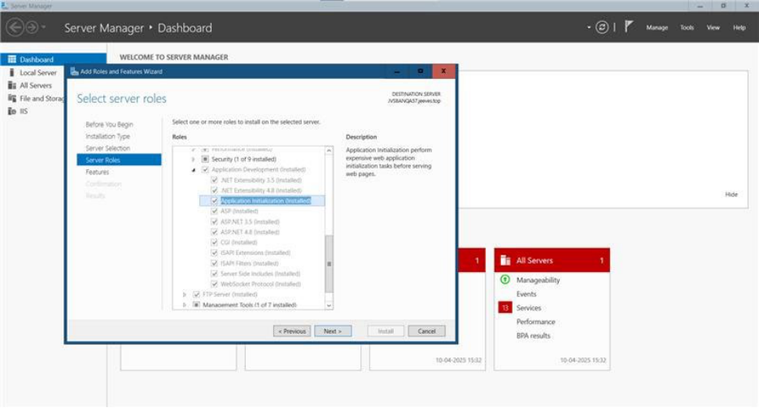


3. Install the .Net core hosting bundle. Make sure to download the latest release and the Windows-hosting-bundle file from: <u>Download .NET 10.0 (Linux, macOS, and Windows) | .NET.</u> 

4. Download **Jeeves.Server.zip** from the Product download center, then create a folder with IIS user permission (as described in the following section: Admin rights to Jeeves Server folder) and extract the files from **Jeeves.Server.zip** into it. 

5. Update the **appsettings.json** file with database connection string, metadata base path (also called Application directory), site database, secret key (random key with minimum 32 characters that can be generated from <u>Random String Generator Online (codebeautify.org)),</u> etc. as shown in the following examples: 

##### **Note:** 

Regularly rotate and update the secret key used to generate the JWT token; for instance, when <mark>applying updates or hotfixes.</mark> 

<mark>The secret key must be lengthy, robust, and always kept confidential.</mark> The Secret key must be unique for each server running on the same machine. 

Example 1: For SQL login 

```
{
```

```
  "DistributedCache": "InMemory",
  "SiteDB": "YourDB_Site",
  "MetadataBasePath": "\\\\JBS\\JeevesApplicationMetaDataPath",
  "ConnectionStrings": {
```

7 (13) 

© Copyright Forterro Sweden AB. All Rights Reserved. 

<u>Set up New Local Business Server</u> 


```
    "Jeeves": "Data Source=YOURSQLSERVER;Initial
Catalog=YourJeevesDB;User ID=YourSQLUser;Password=YourSQLPW"
  },
  "SecretKey": "RandomStringWithMinimum32Characters",
  "AuthenticationSettings": {
    "AuthenticationTypes": 1
  }
}
```

Example 2: For federated authentication 

```
{
  "DistributedCache": "InMemory",
  "MemoryCacheExpiration": 6000000000,
  "SiteDB": "YourDB_Site",
  "MetadataBasePath": \\\\JBS\\JeevesApplicationMetaDataPath,
  "SecretKey": "RandomStringWithMinimum32Characters",
  "ConnectionStrings": {
    "Jeeves": "Data Source=YOURSQLSERVER;Initial
Catalog=YourJeevesDB;User ID=YourSQLUser;Password=YourSQLPW"
},
  "AuthenticationSettings": {
    "AuthenticationTypes": 2,
    "Federated": {
      "Authority": "IdentityServerUrl",
      "FederatedClientId": "YourFedClient",
      "Provider": "Microsoft"
    }
  }
}
```

##### **Note** 

Authentication types are defined as: <mark>1 – SQL login only (Security mode = 0) 2 – Federated login only (Security mode = 6)</mark> 3 – Both SQL and Federated login (Security modes 0 and 6) 

8 (13) 

© Copyright Forterro Sweden AB. All Rights Reserved. 

<u>Set up New Local Business Server</u> 


6. Create an application pool. 


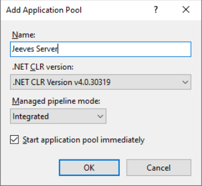


##### **Note:** 

Make sure a separate application pool has been created. 

7. Set **Start mode** to **Always running** and **Idle Time-out (minutes)** to **0** on the Application Pools > Advanced settings dialog. 


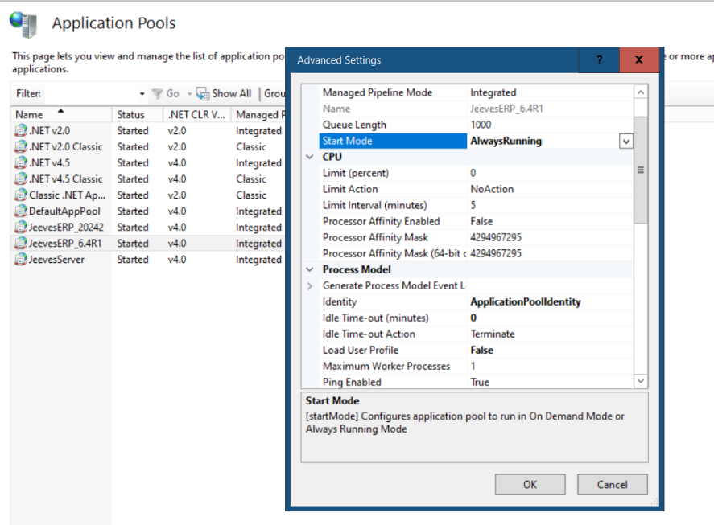


9 (13) 

© Copyright Forterro Sweden AB. All Rights Reserved. 

<u>Set up New Local Business Server</u> 


#### 2.2.2.1 Admin rights to Jeeves Server folder 

To grant administrative rights to the **Jeeves Server** folder, perform the following steps: 

1. Right-click on the **Jeeves Server** folder and select **Properties** . The properties dialog appears as shown in the image below: 


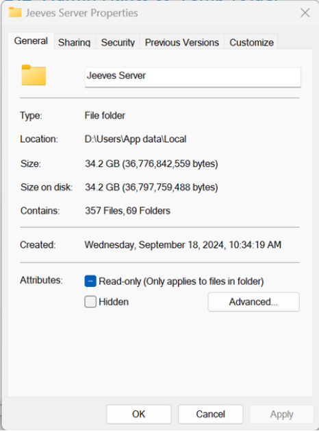


2. Select the **Security** tab and click **Edit** . 


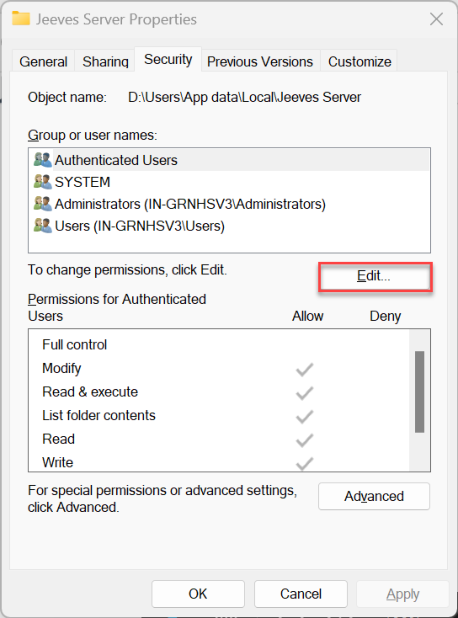


10 (13) 

© Copyright Forterro Sweden AB. All Rights Reserved. 

<u>Set up New Local Business Server</u> 


3. The **Permissions for Jeeves Server** dialog appears. If present, select IIS_IUSRS. If not, add the user as follows: 

   - a. Click **Add** . 


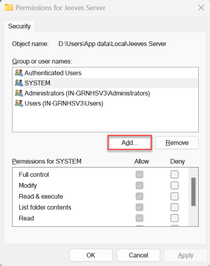


- b. Click on **Locations** and select your system’s name and click **OK** . 


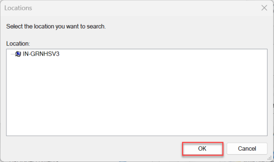


- c. Enter IIS_IUSRS in the **Enter the object names to select** field and click on **Check Names** . Your IIS user name appears, click **OK** . 


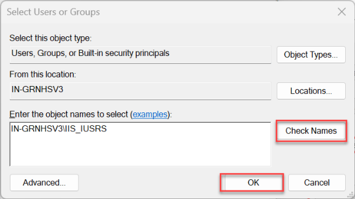


- d. Select IIS_IUSRS in the **Group or user names** list. 

11 (13) 

© Copyright Forterro Sweden AB. All Rights Reserved. 

<u>Set up New Local Business Server</u> 


4. Under the Permissions for IIS_IUSRS, check the **Allow** checkbox for the Full control permission and click **OK.** 


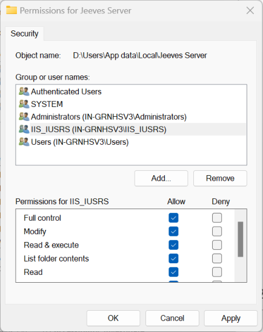


### 2.2.3 Installation 

Create an IIS site (following the steps in the Microsoft documentation at <u>https://learn.microsoft.com/en-us/iis/get-started/getting-started-with-iis/create-a-web-site).</u> 


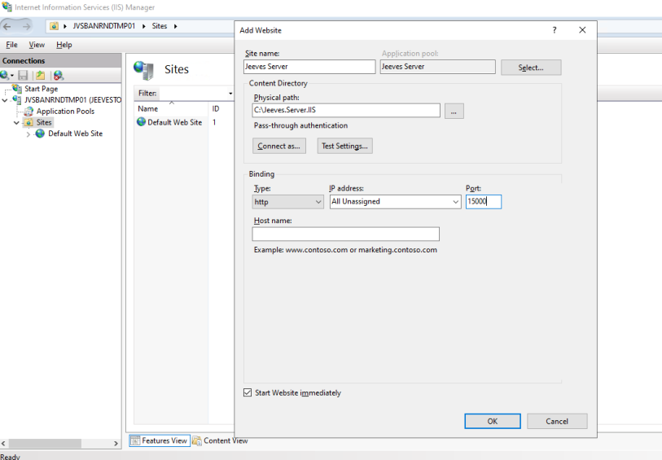


##### **Note:** 

Each Jeeves ERP Server must have its own website. For example, for development, test, and production. 

12 (13) 

© Copyright Forterro Sweden AB. All Rights Reserved. 

<u>Set up New Local Business Server</u> 


Set **Preload Enabled** to **True** on the service in IIS. 


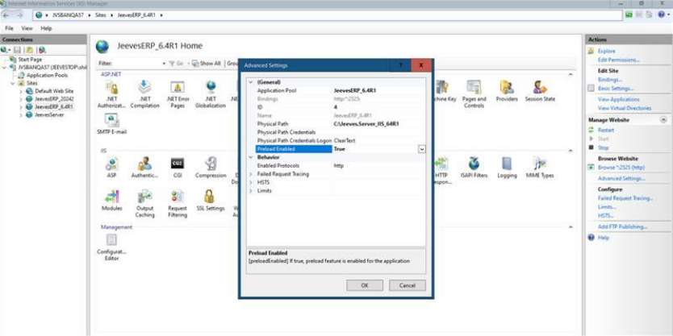


### 2.2.4 Post-installation 

Verify the New Local Business Server is installed correctly as follows: 

- In IIS manager, select the Jeeves server, right-click and select **Manage application** and then click **Browse** . The browser should open as shown below: 


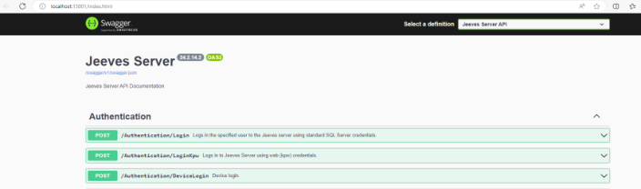


### 2.2.5 Troubleshooting and event log 

Launch Microsoft **Event Viewer** and check the application log for logging information from the New Local Business Server to verify that the service is running. 


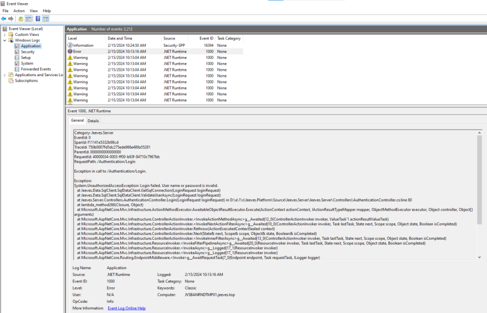


> © Copyright Forterro Sweden AB. All Rights Reserved. 

13 (13) 

