© Copyright Forterro Sweden AB. All rights reserved. 

# **Jeeves ERP** PEPPOL Installation and configuration guide 

###### **Copyright notice** 

- © Copyright Forterro Sweden AB. All rights reserved. 

No part of this guide may be copied, reproduced, translated, or transmitted in any form or by any means without the prior written consent of Jeeves Information Systems AB. 

###### **Document disclaimer** 

Information contained in this guide is subject to change without notice. Please check with your Jeeves support team representative to make sure you have the most recent information. 

2 (32) 

© Copyright Forterro Sweden AB. All rights reserved. 

About this document 


## **Contents** 

|**1.**|**About this document ............................................................................ 5**|
|---|---|
|1.1|Document version/revision ...................................................................... 5|
|1.2|List of acronyms ................................................................................... 6|
|**2.**|**Product and component overview............................................................ 7**|
|2.1|Visual overview .................................................................................... 7|
|2.2|Roles and responsibilities ........................................................................ 7|
|2.3|Personnel for installation ........................................................................ 8|
|2.4|Limitations ......................................................................................... 8|
|2.5|Endpoint information ............................................................................. 8|
|2.6|Prerequisites before installation ............................................................... 8|
|2.7|Create/renew cloud agent keys ................................................................ 8|
|2.8|PEPPOL Integration availability ................................................................. 8|
|**3.**|**Documentation overview ..................................................................... 10**|
|3.1|Documentation describing installation and technical configuration .................... 10|
|3.2|Documentation describing setup in Jeeves ERP ............................................ 10|
|**4.**|**Installation ....................................................................................... 11**|
|4.1|Import the PEPPOL package .................................................................... 11|
|4.2|Jeeves MessageBroker cloud agent............................................................ 12|
|4.3|Message broker mapping tool installation ................................................... 12|
|4.3.1|Prerequisites ..................................................................................... 12|
|4.3.2|Installation ....................................................................................... 12|
|4.3.3|Message broker mapping tool - Post installation .......................................... 14|
|4.4|Configurations in the Pagero tab in the Admin console ................................... 14|
|4.4.1|Prerequisites ..................................................................................... 14|
|4.4.2|Pagero service maintenance .................................................................. 14|
|4.4.3|View and update mapping information...................................................... 15|
|4.4.4|Map user accounts to multi-company setup in Pagero Online........................... 18|
|4.5|Send invoices to Pagero ......................................................................... 19|
|4.5.1|Prerequisites ..................................................................................... 19|
|4.5.2|Sending invoices ................................................................................. 20|
|4.6|Polish KSeF integration .......................................................................... 20|
|4.6.1|Version requirements ........................................................................... 21|
|4.6.2|Clearance response handling .................................................................. 21|
|4.6.3|PDF retrieval for KSeF outgoing invoices ................................................... 21|
|4.7|Send invoices to Crediflow ..................................................................... 23|
|4.7.1|Prerequisites ..................................................................................... 23|
|4.7.2|Sending invoices ................................................................................. 23|
|4.8|Store/export eInvoice XML or outgoing business response in S3 or on-premises ..... 24|
|4.8.1|Pre-requisites .................................................................................... 24|
|4.8.2|Storing an eInvoice XML in S3 bucket or On-premises .................................... 24|
|4.8.3|Exporting files from S3 bucket or On-premises ............................................ 25|
|**5.**|**Post installation................................................................................. 26**|
|5.1|Sending a test invoice to Pagero .............................................................. 26|
|5.2|Sending a test invoice to Crediflow ........................................................... 26|
|**6.**|**Import supplier invoices ...................................................................... 27**|


3 (32) 

© Copyright Forterro Sweden AB. All rights reserved. 

|||About this document|
|---|---|---|
|6.1|Visual overview ..............................................................|..................... 27|
|6.2|Prerequisites .................................................................|..................... 27|
|6.2.1|EDM document type for incoming invoice PDF attachments .......|..................... 27|
|6.3|Edit mapping information ..................................................|..................... 27|
|6.4|Import of supplier invoices via Pagero: Example process ............|..................... 30|
|**7.**|**Support .......................................................................**|**.................... 32**|


4 (32) 

© Copyright Forterro Sweden AB. All rights reserved. 

About this document 


## 1. About this document 

This document provides an overview of Jeeves ERP’s electronic invoicing integration, including PEPPOL-based invoice exchange. 

It describes the prerequisites for installation and use, outlines the documents that cover the product’s functionality and configuration, and identifies the areas that should be tested before the solution is deployed to production. 

This guide is intended for implementation consultants, system administrators, and technical personnel responsible for installing and configuring Jeeves ERP's PEPPOL integration. Cloud-hosted components and related configurations that require elevated access are managed by Jeeves Cloud Operations. 

### 1.1 Document version/revision 

|**Version/revision**|**Description**|**Date**|
|---|---|---|
|1.0|Created for PEPPOL|March 2021|
|1.1|Updated for Jeeves ERP 6.0 Update 6 GA|August 2021|
|1.2|Updated with information re. PEPPOL rules|February2022|
|1.3|Updated with information re. Troubleshooting|May2022|
|1.4|Updated with information re. Message broker<br>folderpath|June 2022|
|1.5|Updated with information re. Message broker<br>Mappingtool installer|Nov 2023|
|1.6|Changed sender service from Opto Sweden to<br>Crediflow|Feb 2024|
|1.7|Changed Pagero sender service to Pagero<br>integration service<br>Added section on Importingsupplier invoices|Dec 2024|
|1.8|Updated for mapping user accounts to multi-<br>company setup in Pagero Online.<br>Added information to improve the understanding<br>of the architecture and responsibilities when<br>importingsupplier invoices.|March 2025|
|1.9|Updated link to the PEPPOL package.<br>Added information on AllowCRonPeppolOut and<br>handlingof Clearance responses in Pagero|May 2025|
|1.10|Added information on PEPPOL Integration<br>availability<br>Store/export eInvoice for outgoing business<br>response in S3 or on-premises|Aug 2025|
|2.0|Added chapter on importing supplier invoices,<br>including incoming invoice flow, Finance API<br>configuration, Admin console enhancements, and<br>updated explanations of responsibilities and<br>architecture.|Nov 2025|
|2.1|Added documentation for Polish KSeF integration<br>(FA(3) format), including package import<br>clarification, clearance handling notes, and<br>minimum version requirements.|February 2026|


5 (32) 

© Copyright Forterro Sweden AB. All rights reserved. 

About this document 


|**Version/revision**|**Description**|**Date**|
|---|---|---|
|2.2|Added documentation for Pagero tab<br>enhancements, including Pagero Service<br>Maintenance, Finance API key reset, and expiry<br>highlighting for refresh tokens and Finance API<br>keys.<br>Added documentation for KSeF outgoing-invoice<br>PDF retrieval, including the company-level<br>Retrieve PDF checkbox, Auto-fetch KSeF PDF and<br>its shared Finance API configuration, retrieval and<br>retry behavior, and EDM attachment<br>success/failure monitoring.|May 2026|
|2.3|Updated information on polling interval for<br>incoming invoices.<br>Updated link to download the required Peppol<br>package(s)|Aug 2026|


### 1.2 List of acronyms 

|**Acronym**|**Description**|
|---|---|
|AWS|Amazon web service|
|SQL|Structuredquerylanguage|


6 (32) 

© Copyright Forterro Sweden AB. All rights reserved. 

Product and component overview 


## 2. Product and component overview 

PEPPOL is a standardized framework for the electronic exchange of business documents. Jeeves ERP supports PEPPOL BIS (Business Interoperability Specifications) documents through certified access points such as Pagero and Crediflow. 

In addition to PEPPOL-based exchange, Jeeves ERP supports country-specific e-invoicing models, including clearance-based integrations where invoices must be validated by a national platform before becoming legally valid. 

### 2.1 Visual overview 

The following diagram provides an overview of the PEPPOL invoicing flow. 


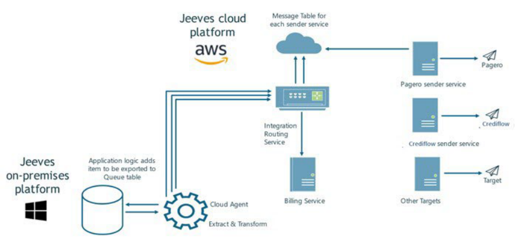


### 2.2 Roles and responsibilities 

|**Task**|**Who**|**Comments**|
|---|---|---|
|Register as a customer to<br>Pagero/Crediflow|Consultants|Used to map to the respective access point|
|Import PEPPOLpackage|Consultants|Import into Jeeves ERP application|
|Install Cloud agent|Consultants|Refer to the Hybrid cloud setupdocument|
|Provide customer name to CloudOps|Consultants|Used to receive the respective customer’s<br>client ID andprivate key|
|Output from Jeeves Cloud Operations -<br>Client ID andprivate key|CloudOps|Used during installation of Message broker|
|Install Message broker service|Consultants|Refer to the Hybrid cloud setupdocument|
|Install Message broker mapping tool|Consultants|Used for integration mappings, described in<br>this document.|
|Map company to Pagero login|Consultants|The**PageroAdmin**role must be assigned to<br>the Client ID to mapthe company.|
|Submit service provider information to<br>CloudOps|Consultants||
|Set up Payment service and Pagero<br>integration service/Crediflow sender<br>service|CloudOps|Reviewed and updated during each Jeeves<br>ERP update, if required. Used to send<br>invoices to Pagero/Crediflow|
|CloudOps provides Client ID and private<br>key-  Pagero/Crediflowpackage|Cloud ops|Refer Send invoices to Pagero/Crediflow<br>section for more information on setup|


7 (32) 

© Copyright Forterro Sweden AB. All rights reserved. 

Product and component overview 


### 2.3 Personnel for installation 

A PEPPOL installation can be performed by a single individual if they have the necessary skills, permissions, and access to: 

- Identify the required objects and files. 

- Verify installation prerequisites. 

- Perform the installation activities. 

### 2.4 Limitations 

Currently, PEPPOL invoices can be sent to the APIs of Pagero or Crediflow access points. Support for additional access points may be introduced in future releases. However, if an access point other than Pagero or Crediflow is to be used, you can generate a standard PEPPOL XML file in the local file system. Integration with alternative access points requires customer-specific customization. 

These limitations apply to PEPPOL-based invoice exchange. Country-specific e-invoicing integrations that operate outside the PEPPOL network may follow different processing models. 

### 2.5 Endpoint information 

If the ACCREC042 JVSP parameter is set to ON, endpoint information is retrieved 

from the **Party scheme identification (PartySchemeIdentification)** node accessed through: 

- the **e-Invoice agreements (eInvoiceAdm)** and/or **System data, financials (Sye)** programs for invoices. 

- the **Suppliers (le)** program for business responses. 

### 2.6 Prerequisites before installation 

PEPPOL requires the following product versions or higher: 

- Jeeves ERP application services 15.0.7 

- Jeeves ERP Kernel 5.1 R10 

For information about the required version of Kernel/JAS, see the Release notes for the Jeeves ERP version you are running. 

### 2.7 Create/renew cloud agent keys 

Cloud agents operate using cloud agent keys (also referred to as Private keys), which must be renewed before their expiration dates. 

The Message Broker agent key is required to enable the locally installed PEPPOL function to communicate securely with cloud services. 

For on-premise customers, a SQL Tunnel agent key is also required to enable optimal use of the SQL Tunnel service. 

For details on the required key types, creation process, renewal procedure, and responsibilities, see Create/renew keys for cloud agents and APIs in the Hybrid cloud local installation and configuration guide. 

### 2.8 PEPPOL Integration availability 

PEPPOL BIS integration is currently provided for countries where PEPPOL-based invoice exchange is used (for example Sweden, Denmark, Finland, and Norway). 

Jeeves also supports country-specific e-invoicing models that operate outside the PEPPOL network. For example, Poland uses the KSeF clearance model with FA(3) XML invoices, which is implemented separately from the PEPPOL integration. 

8 (32) 

© Copyright Forterro Sweden AB. All rights reserved. 

Product and component overview 


PEPPOL addressing is supported for multiple countries. However, because PEPPOL rules may differ and limit standard functionality across regions, full support remains restricted to the Nordic countries (including Norway). For other countries, use is technically possible, but country-specific testing is required to ensure compliance and functionality. 

If PEPPOL integration is needed for other prioritized countries, the necessary rules and functionality can be implemented upon request as a customization. Please contact the Jeeves Services team to discuss implementation for your specific country. 

9 (32) 

© Copyright Forterro Sweden AB. All rights reserved. 

Documentation overview 


## 3. Documentation overview 

### 3.1 Documentation describing installation and technical configuration 

Please refer to these documents to read about how you install and configure Jeeves ERP’s integration with PEPPOL. Jeeves ERP’s technical documentation is available from Jeeves Product download center. 

|**Document**|**Coverage**|
|---|---|
|This document|Describes the installation of the PEPPOL<br>package and its setup|
|Jeeves ERP Hybrid cloud local installation<br>and configuration|Describes the setup and installation of<br>cloud related components|


### 3.2 Documentation describing setup in Jeeves ERP 

Please refer to these chapters in Jeeves ERP’s online documentation to read about how you set up Jeeves ERP and use PEPPOL. 

- Chapter 106, Integration to support submission of invoices in electronic format 

- Chapter 107, Working with integration packets 

- Chapter 608, Integration to support import of suppl invoices via API calls 

- Chapter 30, Logging framework 

- Chapter 1610: KSeF Overview and links to related chapters 

10 (32) 

© Copyright Forterro Sweden AB. All rights reserved. 

Installation 


## 4. Installation 

The following diagram shows the installation flow: 


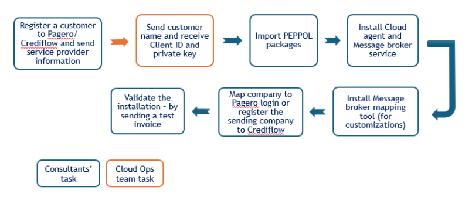


### 4.1 Import the PEPPOL package 

**Prerequisite** : Make sure you have JAS 15.0.7 or higher installed on your system. 

Download and import the required PEPPOL package(s) from the <u>SFTPGo WebClient – Login.</u> Sign in using **OpenID** with the password **JeevesRO** . If you are unable to access the site, please contact your Jeeves representative for assistance. Once logged in, navigate to Jeeves Peppol to access the required files. 


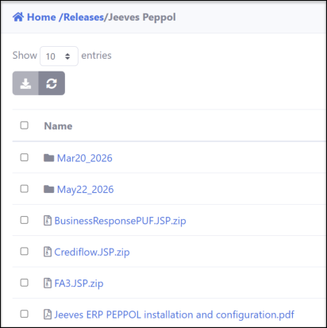


###### **<u>Note</u>** 

If you have an older package installed and you import the latest package without deleting the <mark>existing Integration packet ID, it can result in duplicate entries in your environment. To resolve</mark> this, delete the integration packet before importing the latest package. 

<mark>You can also refer to the Jeeves ERP Apps builder chapter (604) in Jeeves ERP’s online</mark> documentation for more information on importing packages. 

1. Launch the Jeeves ERP Apps builder ( **jvspackagesolutions** ) program from your Jeeves ERP application or launch **JeevesPackagemanager.exe** . 

2. Click **Import** and browse to the location of your PEPPOL package. Select the package or packages required for your implementation and click **Open.** 

11 (32) 

© Copyright Forterro Sweden AB. All rights reserved. 

Installation 


   - **PUF.JSP.zip** – Pagero universal format (PUF) contains the Jeeves ERP:s integration with PEPPOL for Pagero. Import this package to use Pagero as your access point. 

   - **Crediflow.JSP.zip** – Contains the Jeeves ERP PEPPOL integration for Crediflow, including registration and deregistration packages. Import this package to use Crediflow as your access point. 

   - **PEPPOLBIS3.0.JSP.zip** – Import this package to use a different access point i.e., other than Pagero or Crediflow. 

   - **BusinessResponsePUF.JSP.zip** – Import this package to exchange business responses to invoices between Pagero and Jeeves 

   - **FA3.JSP.zip** - If invoices must comply with Polish KSeF regulations in the FA(3) format, select the FA(3)- package provided by Jeeves. The import procedure is identical to that of the other PEPPOL packages. 

3. Enter the server, database login and password and select the **Show options** checkbox. Click **Connect** . 

4. Select the company (to match the one in your Jeeves ERP application). Click **OK** . Verify the Import options and click **Next** . 

###### **<u>Note</u>** 

You may observe some SQL warnings during the import, click OK. 

5. Once the import is completed, launch the Integration packets ( **intgpackets** ) program and verify the import. 

### 4.2 Jeeves MessageBroker cloud agent 

Jeeves MessageBroker cloud agent service is required for financial invoices and PEPPOL. Refer to the _Jeeves ERP Hybrid cloud setup document_ for information on installing and setting up Jeeves ERP MessageBroker cloud agent service. 

###### **<u>Note</u>** 

Each time new PEPPOL services are released, you must upgrade the Jeeves MessageBroker cloud agent service to the latest version. 

### 4.3 Message broker mapping tool installation 

The Message broker mapping tool helps simplify the process of creating integration mappings and provides good visual feedback on the mapping. 

#### 4.3.1 Prerequisites 

To be able to install the Message broker mapping tool you must have the following: 

- .Net 10 

- Administrator privileges to install the Message broker mapping tool 

#### 4.3.2 Installation 

1. Download and extract the contents of the Message broker mapping tool installer from the Jeeves ERP Product download center (Navigate to the latest delivered Platform version and drill down to the available Jeeves ERP Update’s .zip folder in the Jeeves ERP Product download center.) 

2. Double-click **MessageBrokerMappingTool.msi** to launch the installer and in the initial screen of the **Message broker Mapping tool setup** wizard, do the following: 

   - a. Enter a name for the database connection and specify the server and database details. 

12 (32) 

© Copyright Forterro Sweden AB. All rights reserved. 

Installation 


- b. To allow authorized communication between the SQL Server instance and client, select **Encrypt connection** and/or **Trust server certificate** . The selected properties are set to true, added to the connection string, and considered when making the connection. 

- c. Click Add to include the entry in the list of database settings. 

###### **<u>Note</u>** 

Make sure you click **Add** so that the setting is available in the mappingtool.json file. If you wish to remove an existing setting, select the setting from the list and click **Remove** . 


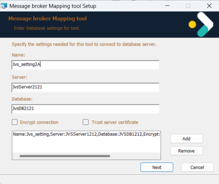


   - d. Click **Next** to continue. 

3. Click **Install** to begin the installation. 


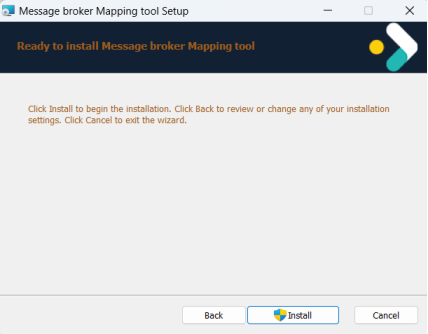


4. Click **Finish** to close the wizard or exit the setup. 


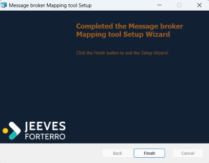


> © Copyright Forterro Sweden AB. All rights reserved. 

13 (32) 

Installation 


#### 4.3.3 Message broker mapping tool - Post installation 

After installation, navigate to the **…\ProgramData\Jeeves Information Systems\Jeeves Message broker Mapping tool\** folder, open the **mappingtool.json** file and check if your Name, Server and database match the entered values. 

###### **<u>Note</u>** 

To run the mapping tool, you must have the Jeeves system administrator privileges. 

For more information on the Message broker mapping tool, refer to Jeeves ERP’s online documentation, chapter _Integration to support submission of invoices in electronic format (106)_ and _Working with integration packets (107)_ . 

### 4.4 Configurations in the Pagero tab in the Admin console 

The Pagero tab in the admin console is the central configuration surface for Pagero-based PEPPOL integration. From this tab you can: 

- Monitor and control the Pagero Integration service (Pagero Service Maintenance). 

- • Manage the mapping between ERP companies (foretagkod) and Pagero logins, and the refresh tokens and Finance API keys that those mappings depend on. 

Jeeves ERP supports multi-company environments, and a customer may use multiple Pagero accounts within a single database. 

The Pagero tab lets you connect a particular client (Message broker instance) and a company in the database with a Pagero login, so that the Pagero Integration service can send invoices on behalf of a particular customer. 

#### 4.4.1 Prerequisites 

- .Net 10 

- The Pagero Integration service is set up and running. 

- The PageroAdmin role is assigned to the Client ID. The **Pagero** tab is only visible to users who have been assigned this role. 

For more information on the setup of the Pagero Integration service, contact Jeeves Cloud team. 

#### 4.4.2 Pagero service maintenance 

The **Pagero Service Maintenance** panel at the top of the **Pagero** tab shows the current state of the **Pagero Integration service (Jeeves.Pagero.Integration.Service** ) and provides controlled pause and resume of its background processing. 

##### **When to use Maintenance mode** 

Use Maintenance mode during deployments or service restarts of Pagero Integration service components, for temporary operational pauses when a downstream system is unavailable, or for any planned activity where you want to avoid items being picked up mid-change. 

Items remain in the queues during the pause rather than being lost, and processing resumes cleanly when the service is taken out of Maintenance mode. 

##### **Status and metadata** 

The panel displays: 

- **Status badge** — **Operational** (green) when the service is processing normally, or **Maintenance mode active** (amber) when background processing has been paused. 

- • **Service** — the service identifier. 

14 (32) 

© Copyright Forterro Sweden AB. All rights reserved. 

Installation 


- **Version and Build** — the deployed service version and build label. 

- **Uptime** — time elapsed since the service was last started. 

- **Started** — the UTC timestamp of the last service start. 


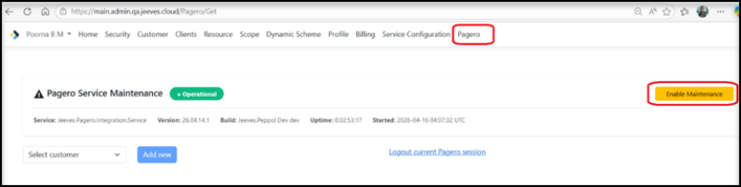


##### **Enabling and disabling Maintenance mode** 

Use the button at the right of the panel to toggle the Maintenance mode: 

- Click **Enable Maintenance** to pause the service. While Maintenance mode is active, the Pagero Integration service stops processing new items from the queues, and incoming requests or messages are not picked up. The status badge changes to **Maintenance mode Active** and the button label changes to **Resume services** . 

- Click **Resume services** to return to normal operation. Pending or unprocessed items that accumulated during the pause are picked up and processed, and the status badge returns to **Operational** . 


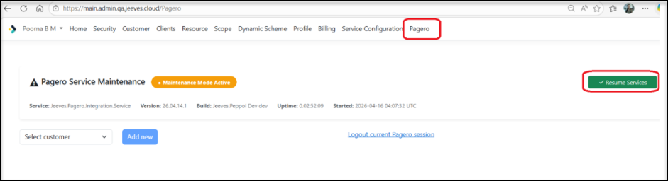


#### 4.4.3 View and update mapping information 

The **Pagero** tab in the Jeeves Identity service admin console is used to map a customer’s client to a Pagero login, so the Pagero Integration service can send/receive invoices on behalf of the customer for further processing. 

Select the desired client from the drop-down list of clients defined in the Clients tab that have Router scope access to view the list of linked companies. The companies are displayed along with their Pagero username and Send mode status. The Send mode status can be one of the following: 

- **Production** - Production mode 

- **Test** - Test mode. Documents will be delivered to the recipients but will be delivered in test mode if the recipients support it. Please note that not all recipients support test mode. 

- **Certification** - Certification mode. Documents will be processed by Pagero Online but will not be delivered to the recipients. This can be useful during testing. 

##### **Add company mapping** 

To add a new company mapping for the client, perform the following steps in the **Admin console** : 

1. Click the **Add new** button and provide the company code, name, and send mode and click **Submit** in the **Add company mapping** dialog box. The Pagero login wizard is displayed. 

2. Enter your Pagero login credentials and sign in to the **Connect account** page. Note that if you have an active session, you will be directly taken to the **Connect account** page. 

15 (32) 

© Copyright Forterro Sweden AB. All rights reserved. 

Installation 


3. Enter your Pagero username to map to the customer’s client and view the refresh token that is generated automatically by the system, along with the refresh token expiry date. 

4. Click **Submit** to update the information in the PageroSenderConfig table and view it in the **Pagero** tab. 

The mapping details are retrieved from the PageroSenderConfig table in **DynamoDB** and are displayed in the **Admin console** . You can edit, delete, or set a new Pagero user for any record on this page by clicking the relevant button against the record. 

##### **Renew Pagero refresh token** 

The Pagero tab displays expiry dates for two types of authentication credential used by each company mapping: 

- **Pagero expiry** — the expiry date of the Pagero refresh token for the mapping, in YYYY-MMDD HH:MM:SS UTC format. The value matches the expiry date returned by the Pagero API at the time the token was issued. 

- **Finance Api Key expiry** — the expiry date of the Finance API key used by the mapping. See the section Edit mapping information for how the Finance API client and key are created. 

Rows and cells are highlighted to draw attention to credentials that need action: 

- **Pagero refresh token** — the entire mapping row is highlighted **red** when the current date and time exceed the value in the Pagero Expiry column, and **amber** when the token is within 30 days of expiry. 

- **Finance API key** — the **Finance Api Client Id** cell is highlighted **red** when the current date and time exceed the value in the Finance Api Key Expiry column, and **amber** when the key is within 30 days of expiry. 


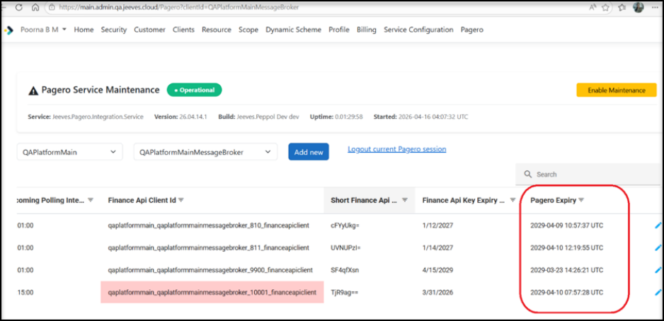


16 (32) 

© Copyright Forterro Sweden AB. All rights reserved. 

Installation 


##### **Renew Pagero refresh token** 

To renew an expired or soon-to-expire **Pagero refresh token** , click the **Set user** icon in the highlighted row and complete the Pagero login wizard process. A new refresh token is generated automatically. The **Pagero Expiry** column is updated with the new expiry date, and the row highlighting is removed. 


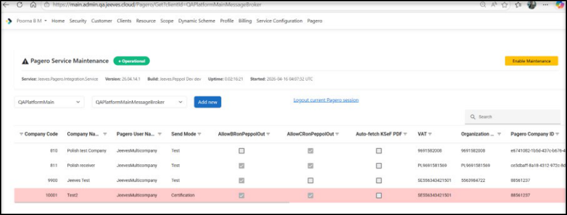


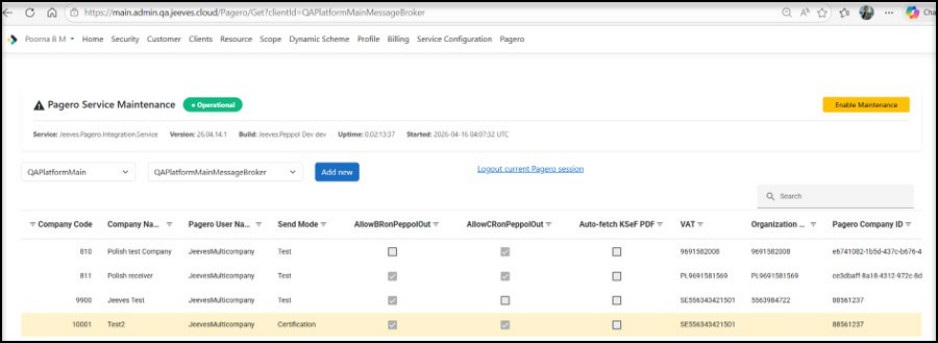


##### **Renew Finance API key** 

To renew an expired or soon-to-expire Finance API key, click the **Reset Finance API Key** icon (circular arrow) displayed alongside the **Edit** , **Delete** , and **Set User** icons in the affected row. A new key is generated with a validity period of three years from the current date. Only the Finance API key is updated; the company mapping remains active, and all existing configuration details, including **CompanyCode** , **VAT** , **OrganizationNo** , **Finance API parameters** , and **PageroCompanyID** , are retained. 


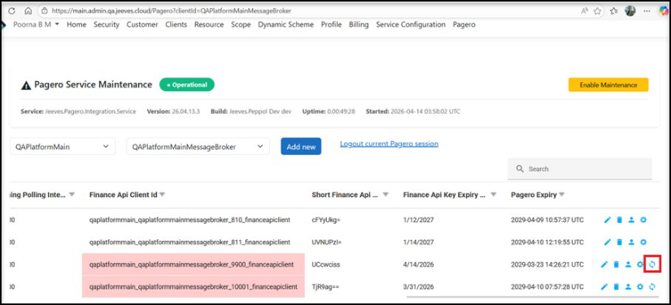


© Copyright Forterro Sweden AB. All rights reserved. 

17 (32) 

Installation 


###### **<u>Note</u>** 

Finance API key reset behavior depends on how many keys exist for the mapping: 

- <mark>If</mark> **<mark>a single key</mark>** <mark>named</mark> **<mark>ApiKeyForFinanceApi</mark>** <mark>exists, the reset extends its expiry date by</mark> three years. The key value itself is unchanged. 

- <mark>If</mark> **<mark>multiple</mark>** <mark>Finance API keys exist (for example, additional keys created manually from the Clients tab), the reset deletes all existing keys and generates a new key named</mark> **<mark>ApiKeyForFinanceApi</mark>** <mark>with a validity of three years. In this case, any service or process</mark> 

- configured with an old key value will fail until it is updated with the new key. 

<mark>The current key and its expiry date are visible in the Company Mapping grid after the reset</mark> completes. 

##### **Search mappings and logout** 

You can look for specific content on the page by entering a search condition in the **Search** field. Only the rows with matching content are displayed. 

You can log out of the current session by clicking on the **Logout current Pagero session** link. 

#### 4.4.4 Map user accounts to multi-company setup in Pagero Online 

Companies with a multi-company structure can access multiple accounts in Pagero Online. Each account is assigned a unique Company ID, which Pagero shares with end customers. 

Follow these steps to retrieve the Pagero Company ID for submitting e-invoices via the Pagero Integration Service by companies in a multi-company setup: 

1. Add the **VAT registration number** and/or the **Organization number** when updating company mapping for the customer’s own company and click **Submit** . 


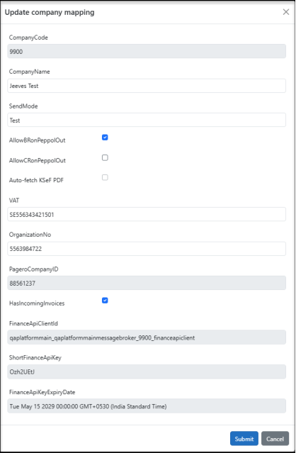


> © Copyright Forterro Sweden AB. All rights reserved. 

18 (32) 

Installation 


2. Click the **Set user** icon against the row for which the Pagero company ID is required. 


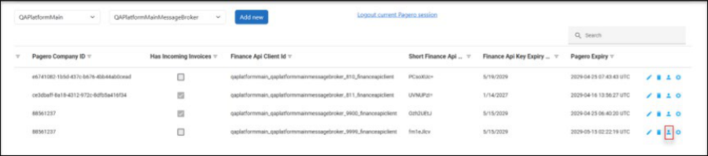


3. The Pagero sign-in page is displayed. Enter your login credentials and you are redirected to the Connect account page in the Admin console. Here, provide your Pagero username and click **Submit** . 

The **Pagero company ID** is retrieved and can be viewed in the relevant column within the **Pagero** tab on the **Admin console** . 


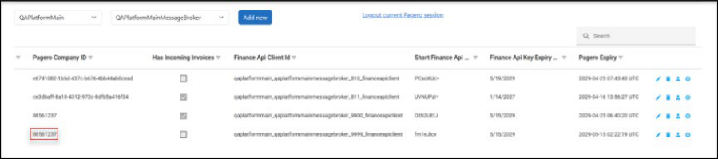


This unique **Pagero Company ID** is passed with the Peppol invoices during submission of e- invoices (in and out), so Pagero can identify to which company (Pagero ID) the invoice belongs. 

### 4.5 Send invoices to Pagero 

#### 4.5.1 Prerequisites 

The following must be set up and running: 

- Jeeves MessageBroker cloud agent service 

- Jeeves Integration routing service 

- Jeeves Payment service 

- Jeeves Pagero integration service 

###### **In your Jeeves ERP application:** 

- For a customer’s company ID ( **fh.ftgnr** ) in the Customer Invoice ( **fh** ) program, a valid record must exist in e-Invoice agreements ( **eInvoiceAdm** ) program. If such a record does not exist and the payer’s company ID ( **fh.kundbetalarenr** ) is not equal to the customer’s Company ID ( **fh.ftgnr** ), a valid record must exist in the e-Invoice agreements ( **eInvoiceAdm** ) program for the payer’s company ID. 

###### **<u>Note</u>** 

The Integration routing service, payment service and Pagero integration service will be set up for you in AWS by Jeeves Cloud Ops team. 

19 (32) 

© Copyright Forterro Sweden AB. All rights reserved. 

Installation 


#### 4.5.2 Sending invoices 

Once your invoice is ready in the Customer invoices ( **fh** ) program (i.e., the status ( **fh.faktstkod** ) = Invoiced, the Document ID ( **fh.intgdocid** ) = null and the Document status ( **intgdocstatus.intgdocstatusdesc** = null), click the **Send eInvoice** ( **PB_AddPeppolInvoiceToQueue** ) button or execute the **Jeeves_AddPeppolInvoiceToQueue** procedure to upload the invoice in XML format in the queue to Pagero. 

For example: 

```
execute Jeeves_AddPeppolInvoiceToQueue
@c_IntrnCoNo=9998,@c_PersSign='seks',@c_InvoiceNumber=1000235
Arguments:
a = Company code of own company.
b = Signature of person running (according to sy2). If it is NULL,
takes database user.
c = Invoice No. to process. If it is NULL, processes all the valid
invoices in that company.
```

The following operations occur when you click the **Send eInvoice** button: 

1. The invoice is added into the read queue in XML format. 

2. The invoice is read by the Cloud agent with the message broker and is extracted. 

3. The invoice is sent to the Integration routing service. 

4. The DynamoDB is updated with the state of the invoice from the Integration routing service. 

5. The Pagero Integration service contacts the DynamoDB and sends the invoice to Pagero. 

6. A success/failure message is sent from the Pagero integration service to the DynamoDB. The Message broker checks for messages at regular intervals and updates the state of the invoice. 

7. Once the state is updated, the message is updated in the DynamoDB, and the billing information is updated in the Payment service. 

Though most of this activity is not visible, you can track your invoice being sent to Pagero in the Integration packet queue status log ( **IntgPacketQueueStatusLog** ) node accessed from the Integrations packets ( **Intgpackets** ) program. It is also updated in the Integration queue history ( **IntgQueueHistory** ) program. 

### 4.6 Polish KSeF integration 

This section describes additional behavior applicable only when Polish KSeF clearance processing is used. 

For detailed information of KSeF incoming and outgoing flows, see chapter _1610: KSeF overview_ in the Jeeves help. 

For invoices processed through KSeF, a clearance step is performed by KSeF through the integration partner before standard PEPPOL business response processing continues. 

To enable FA(3) handling: 

- In the **Admin console** , check the **AllowCRonPeppolOu** t checkbox to enable polling for Clearance responses received from KSeF and routed via Pagero for outgoing invoices. 

If checked, this enables polling for Clearance responses on outgoing invoices and invoice status is shown as **ClearanceResponseWaiting** for invoice entries that are waiting for the Clearance response. 

20 (32) 

© Copyright Forterro Sweden AB. All rights reserved. 

Installation 


#### 4.6.1 Version requirements 

When using Polish KSeF, FA(3) format, the following minimum versions are required: 

- Message Broker cloud agent: Jeeves.Peppol release_26.01.26.1 

- Application: JAS version 2024 

For KSeF PDF retrieval specifically, the following higher minimum versions apply: 

- Message Broker cloud agent: Jeeves.Peppol release_26.05.18.2 

- Platform: Jeeves.Platform 2026.1_26.1.26147.02 

###### **<u>Note</u>** 

Earlier versions do not support these features. 

#### 4.6.2 Clearance response handling 

In the Pagero integration service, the Clearance response related status is handled as follows: 

- **CR - Approved and CR - Approved with warnings statuses:** Once the invoice is received, the invoice status is set to **Sent** in Jeeves. The corresponding record is deleted from DynamoDB unless Business Response (BR) handling is enabled. If **AllowBRonPeppolOut** is checked for mapping in the **Admin console** , the record is retained, and the system continues polling for Business Response updates. 

- **CR - Rejected status:** The corresponding record is deleted from DynamoDB. The invoice is marked as failed, and the status update is sent to Jeeves. 

#### 4.6.3 PDF retrieval for KSeF outgoing invoices 

After a Polish customer invoice receives positive clearance from KSeF, Pagero generates the legally valid invoice PDF (with the official QR code and KSeF ID). 

Jeeves can automatically retrieve this PDF from Pagero and attach it to the invoice header, alongside any existing Jeeves-generated invoice PDF. 

##### **Prerequisite** 

The JVSP parameter **ACCREC044** must be configured with the EDM document type that should hold the PDF attachment for outgoing invoices. 

If **ACCREC044** is not defined, the system returns the EDM document type that is configured with PDF as the default extension and is not marked as a supplier invoice document type. 

For a document type to be returned in either case — whether from ACCREC044 or from the fallback above — the **Retrieve PDF checkbox** in **Sy1** must be selected. If it is not, no document type is returned and KSeF PDF retrieval does not occur. 

**ACCREC044** is required for the EDM attachment to succeed; if it is not configured and no suitable default document type exists, the PDF attachment fails. The invoice itself continues through its normal delivery flow regardless of attachment outcome — see Behavior when enabled below. 

The installer delivers the version-appropriate UPD procedure automatically and sets the JVSP parameter **ACCREC044** in the database. 

If you are not using the installer — for example, when applying a patch/hotfix manually — execute the UPD procedure for the version you are running. **Jeeves_Upd_1526.spr** works as a universal manual fallback across all supported versions. 

###### **<u>Note</u>** 

Ensure that the default document type is set to .pdf for document types that are not marked as supplier invoice. 

> © Copyright Forterro Sweden AB. All rights reserved. 

21 (32) 

Installation 


<mark>The server path configured for the outgoing invoice document type must also be registered in the Applicable server paths (SPTH) program. If the path is missing from SPTH, file opening or</mark> access errors may occur when the PDF is attached. 

##### **Activation** 

To enable retrieval of the cleared KSeF invoice PDF from Pagero: 

- Verify that the JVSP parameter **ACCREC044** is configured with the appropriate EDM document type. 

- In **system data (Program: Sy1)** , check the **Retrieve PDF (EnablePDFRetrieval)** checkbox for the company. The checkbox is unchecked by default. When this checkbox is not selected, no EDM document type information is returned for KSeF PDF retrieval, and the PDF is neither fetched nor attached — regardless of the **ACCREC044** setting and the **Auto-fetch KSeF PDF** setting in the **Admin Console** . 

- In the **Admin Console** , on the **Pagero** tab, select the **Auto-fetch KSeF PDF** checkbox. 

###### **<u>Note</u>** 

Finance API configuration: Enabling **Auto-fetch KSeF PDF** automatically creates the Finance <mark>API configuration for the mapping (client with FinanceAPI scope, API key, empty service</mark> configuration, and DynamoDB entry) if it does not already exist. 

<mark>This is the same configuration described in the</mark> _<mark>Edit mapping information</mark>_ <mark>section for the</mark> **<mark>HasIncomingInvoices</mark>** <mark>option; the two features share a single Finance API configuration and can be enabled independently. After creation, configure the customer-specific values for the</mark> Finance API as described in the _Edit mapping information_ section. 

##### **Behavior when enabled** 

After positive clearance, the invoice status in Jeeves becomes **CR-Approved** , and the KSeF reference number is updated. Jeeves then automatically retrieves the legally valid invoice PDF generated by Pagero and attaches it to the invoice header. The attachment is stored with the name **<InvoiceNo>_KSeFPDF** . Any existing Jeeves invoice PDF is retained alongside the KSeF PDF. 

Invoice delivery is not blocked by PDF retrieval. If the initial retrieval or attachment fails, for example due to a Pagero outage, a missing ACCREC044 configuration, or an internal error, the system retries the retrieval up to three times before recording a final failure. Regardless of whether the attachment succeeds or fails, the invoice continues through its normal delivery flow and its status becomes **Sent.** 

The outcome of the retrieval is reflected in the Integration packet queue status log **(IntgPacketQueueStatusLog)** node accessed from the Integration packets **(Intgpackets)** program, and in the Integration queue history **(IntgQueueHistory)** program. A successful attachment is displayed as **EDM Attached – Success** , while a final failure after all retry attempts is displayed as **EDM Attached – Failure.** 

##### **Auto-fetch KSeF PDF gating** 

The behavior of the **Auto-fetch KSeF PDF** checkbox depends on the **AllowCRonPeppolOut** setting: 

- If **AllowCRonPeppolOut** is enabled, **Auto-fetch KSeF PDF** can be set to **ON** or **OFF** as required. 

- If **AllowCRonPeppolOut** is disabled, **Auto-fetch KSeF PDF** is read-only and forced to **OFF** . 

The default state of **Auto-fetch KSeF PDF** is **OFF** on a fresh installation or upgrade where no prior configuration exists. The setting persists across **Admin Console** sessions. The checkbox is available only for supported versions and Polish-localized companies with KSeF clearance functionality activated. 

22 (32) 

© Copyright Forterro Sweden AB. All rights reserved. 

Installation 


### 4.7 Send invoices to Crediflow 

#### 4.7.1 Prerequisites 

- The following services must be set up and running: 

   - Jeeves MessageBroker cloud agent service 

   - Jeeves Integration routing service 

   - Jeeves Payment service 

   - Jeeves CrediflowSender service 

- Sender and receiver parties must be registered with Crediflow. For details on how to register/deregister parties for/from this service, please refer to the online documentation. 

- Crediflow must be entered as a customer (in Jeeves ERP application). 

###### **In your Jeeves ERP application:** 

- For a customer’s company ID ( **fh.ftgnr** ) in the Customer Invoice ( **fh** ) program, a valid record must exist in e-Invoice agreements ( **eInvoiceAdm** ) program. If such a record does not exist and the payer’s company ID ( **fh.kundbetalarenr** ) is not equal to the customer’s Company ID ( **fh.ftgnr** ), a valid record must exist in e-Invoice agreements ( **eInvoiceAdm** ) program for the <u>payer’s company ID.</u> 

###### **<u>Note</u>** 

The Integration routing service, payment service and CrediflowSender service will be set up for you in AWS by Jeeves Cloud team. 

#### 4.7.2 Sending invoices 

Once your invoice is ready in the Customer invoices ( **fh** ) program (i.e., the status ( **fh.faktstkod** ) = Invoiced, the Document ID ( **fh.intgdocid** ) = null and the Document status ( **intgdocstatus.intgdocstatusdesc** ) = null), click the **Send eInvoice** (PB_AddPeppolInvoiceToQueue) button or execute the **Jeeves_AddPeppolInvoiceToQueue** procedure to upload the invoice in XML format in the queue to Crediflow. 

For example: 

```
execute Jeeves_AddPeppolInvoiceToQueue
@c_IntrnCoNo=9998,@c_PersSign='seks',@c_InvoiceNumber=1000235
```

```
Arguments:
a = Company code of own company.
b = Signature of person running (according to sy2). If it is NULL,
takes database user.
c = Invoice No. to process. If it is NULL, processes all the valid
invoices in that company.
```

The following operations occur when you click the Send eInvoice button: 

1. The invoice is added into the read queue in XML format. 

2. The invoice is read by the Cloud agent with the message broker and is extracted. 

3. The invoice is sent to the Integration routing service. 

4. The DynamoDB is updated with the state of the invoice from the Integration routing service. 

5. The CrediflowSender service contacts the DynamoDB and sends the invoice to Crediflow for further processing. 

Note that the sender service handles three message types: RegisterParty, DeregisterParty, and PEPPOL invoice. If the type of message is a PEPPOL invoice, the data is extracted from 

23 (32) 

© Copyright Forterro Sweden AB. All rights reserved. 

Installation 


the Invoice message to find the sender and receiver parties in the party store and/or the Crediflow Web API. Once both sending party and receiving party are identified and validated, the invoice is sent. 

6. A success/failure message is sent from the CrediflowSender service to the DynamoDB depending on the outcome of the request. The Message broker checks for messages at regular intervals and updates the state of the invoice. 

The status of the Message broker packet and hence the invoice can be one of the following: 

   - 10 - Read 

   - 20 - Sent to cloud 

   - 30 - Resending 

   - 40 - Added to queue 

   - 900 - Confirmed 

   - 910 - Failed 

7. Once the state is updated to **Sent to Cloud** , the generated XML is archived in S3 storage, and the billing information is updated in the Payment service. 

Though most of this activity is not visible, you can track your invoice being sent to **Crediflow** in the Integration packet queue status log ( **IntgPacketQueueStatusLog** ) node accessed from the Integrations packets ( **Intgpackets** ) program. 

You can also resend an invoice-message from Integration packet queue status log ( **IntgPacketQueueStatusLog** ). It is also updated in the Integration queue history 

( **IntgQueueHistory** ) program. 

### 4.8 Store/export eInvoice XML or outgoing business response in S3 or on-premises 

#### 4.8.1 Pre-requisites 

In the **Integr folder path (IntgFolderPath)** field in the Integration targets **(IntgTargets)** program, configure the storage path for packet transformation results as follows: 

- a local file system path for on-premise customers. Note that this path must point to a shared directory. The file is stored in the local file system by the MessageBroker cloud agent service. Any change made to this path will require a restart of the MessageBroker cloud agent service. 

- an S3 bucket path for cloud customers. Note that when specifying an S3 bucket, enter only the bucket name; i.e., do NOT include any internal directory paths. 

#### 4.8.2 Storing an eInvoice XML in S3 bucket or On-premises 

eInvoice XML files generated by the integration service partner are retrieved to the **File name (Intgdocfilename)** field in the **Integration documents (Intgdocuments)** program. 

The eInvoice XML can be stored in an Amazon S3 bucket or an on-premises system by specifying the Integration folder path in the **Integr folder path (intgfolderpath)** field in the **Integration targets (intgtargets)** program as follows: 

- By defining a local file system path for on-premise customers. 

   - Note that this path must point to a shared directory. The file is stored in the local file system by the MessageBroker cloud agent service, so customers who require this feature must install the latest version of the MessageBroker cloud agent service. Any change made to this path will require a restart of the MessageBroker cloud agent service. 

- By defining an S3 bucket path for cloud customers. 

   - Note that when specifying an S3 bucket, enter only the bucket name, i.e., do NOT include any internal directory paths. The Integration routing service automatically creates a folder within the bucket named after the client used to initiate the integration. Inside this folder, it creates subfolders for each integration target (e.g., PageroSender). The invoice XML files are stored within these subfolder. 

24 (32) 

© Copyright Forterro Sweden AB. All rights reserved. 

Installation 


#### 4.8.3 Exporting files from S3 bucket or On-premises 

###### **From S3 bucket:** 

1. Confirm the file name in **IntgDocuments** uses the following standard format: **/Client/Integrationtarget/filename.xml** . 

2. Ensure that the Application directory configured in the **Kernel (JINI)** program points to the correct S3 bucket. 

3. In the **Server.ini** file, under the **Cloud** section, include the following parameters: 

|**[Cloud]**|||
|---|---|---|
|**Parameter**|**Description**|**Mandatory**|
|S3FolderPath|The S3 folder path where the application files are stored,<br>along with the S3 bucket name.<br>When this parameter is not configured or does not start with<br>‘s3://’, then the other two parameters do NOT have any<br>impact, and the Kernel does not validate them. It will instead<br>load the application files from the path mentioned in<br>ApplicationDirectoryJINIparameter.|Y – required<br>to look for<br>application<br>files in AWS<br>S3 bucket.|
|S3Region|The AWS S3 region.|Y|
|LocalPathForS3|The local path in the system, where application files and<br>folders are downloaded from the AWS S3 bucket.<br>It must be a valid local directory name to cache the<br>application files from AWS S3|Y|
|S3LogFolderPath|The S3 folder path including the S3 bucket name where the<br>control server log files and server log files along with the<br>client manager logfiles and client broker files are stored.|N|


For example: 

```
[Cloud]
```

```
S3FolderPath = s3://regressionbucket/JVSAWSQAAPP10/Version20252/
S3Region = ap-south-1
LocalPathForS3 = D:\Temp\stdalone
```

```
S3LogFolderPath = s3://regressionbucket/JVSAWSQAAPP10/Version20252/Logs/
```

4. Verify that the server running Jeeves has network and credential access (IAM role) to the specified S3 bucket. 

5. Confirm that the target destination path (where files are exported) is accessible by the Jeeves server. 

###### **<u>Note</u>** 

The export is successful only when the destination path is accessible to the Jeeves server. 

###### **From On-premises set-up:** 

- Add the **Applicable server path (SPTH)** only when the source path is a shared local path, not when sourcing from S3. 

25 (32) 

© Copyright Forterro Sweden AB. All rights reserved. 

Post installation 


## 5. Post installation 

After you have completed the installation of PEPPOL to your access point, you can validate your installation by sending a test invoice to your access point. 

### 5.1 Sending a test invoice to Pagero 

Perform the following to validate your connection with Pagero access point by sending a test invoice: 

1. Log in to the admin console and navigate to the **Pagero** tab. 

2. Select the **Client ID** from the drop-down list and the list of companies for that client are displayed. 

3. Click on the **Edit** icon for the respective company. 

4. Select the **SendMode** to **Certification** and click **Submit** . You can also select the **SendMode** as **Test** to send a test invoice if you have agreed to do so with the Pagero customer. 

   - If the **Business response (fh.busresp)** option is enabled in Jeeves and the response is sent via Pagero online, the response is received as approved, approved with warnings, or rejected and updated in the **Document status (intgdocstatus)** field. 

   - If the **Clearance response (fh.clrncresp)** option is enabled in Jeeves (based on the **sy1.clrncresp** and the **einvoiceadm.clrncresp** ) clearance response is sent by Polish Ksef  via Pagero online, the clearance response is received as CR-approved, **CRapproved with warnings** , or **CR-rejected** and updated in the **Document status (intgdocstatus)** field. 

### 5.2 Sending a test invoice to Crediflow 

Perform the following to validate your connection with Crediflow access point by sending a test invoice: 

1. Launch your Jeeves ERP application and navigate to the **Integration targets** ( **intgtargets** ) program. 

2. Check if an integration target is available for Crediflow. The target is usually named **CrediflowTestSender** . If the target is not available, create it. 


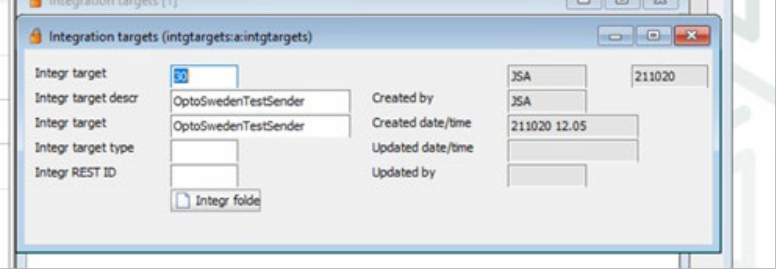


3. Choose this integration target in the e-invoice agreements ( **einvoiceadm** ) program for the customer record. 

26 (32) 

© Copyright Forterro Sweden AB. All rights reserved. 

Import supplier invoices 


## 6. Import supplier invoices 

### 6.1 Visual overview 

The image below gives a schematic overview of the incoming supplier invoice flow from the integration service partner. 


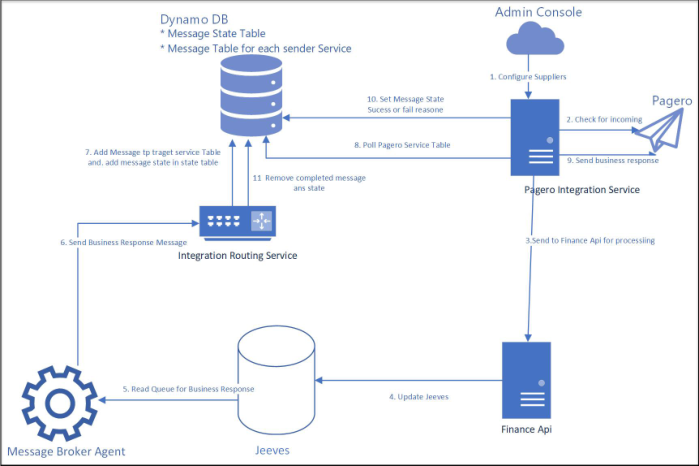


### 6.2 Prerequisites 

Map the company to a Pagero login as described in the _View and update mapping information_ section. 

#### 6.2.1 EDM document type for incoming invoice PDF attachments 

The JVSP parameter **ACCPAY087** defines the EDM document type used when PDF attachments are saved for incoming supplier invoices. 

If **ACCPAY087** is not defined, the system returns the EDM document type that is configured with PDF as the default extension and is not marked as a supplier invoice document type. 

###### **Note** 

Ensure that the default document type is set to .pdf for document types that are not marked as supplier invoice. 

### 6.3 Edit mapping information 

1. Once you have created and saved the mapping in the **Admin console** , click the **Edit** icon to update the company mapping. 


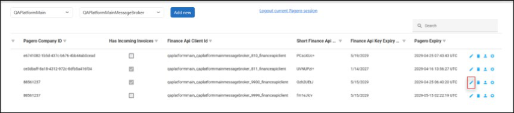


> © Copyright Forterro Sweden AB. All rights reserved. 

27 (32) 

Import supplier invoices 


2. In the **Update company mapping** dialog, make the following changes to enable the import the supplier invoices received from Pagero: 


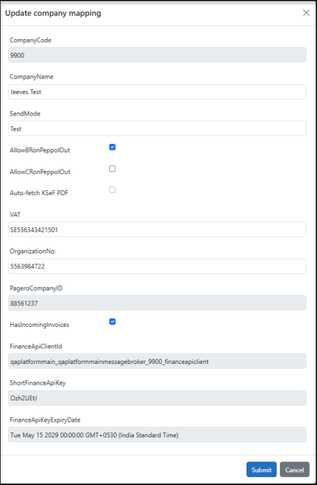


- a. Check the **AllowBRonPeppolOut** checkbox to enable polling for Business responses on outgoing invoices if required. 

If checked, enables polling for Business responses on outgoing invoices. If unchecked, there is no polling for business responses. In both cases, the invoice status is displayed as **Sent** in Jeeves. Once the response is received, the status is updated as follows: 

   - **BR approved** 

   - **BR approved with warnings** 

   - **BR rejected** 

- b. Check the **HasIncomingInvoices** checkbox. 

If checked, allows the import of supplier invoices received from integration service providers, such as Pagero. 

When **HasIncomingInvoices** is enabled or when **Auto-fetch KSeF PDF** is enabled on the Pagero tab (see the section _PDF retrieval for KSeF outgoing invoices_ ) and the mapping is submitted, the system does the following if a Finance API configuration does not already exist for the mapping: 

- Automatically creates a Client with the FinanceAPI scope. 

- Automatically generates an API key. 

- Creates an empty service configuration for the FinanceAPI profile. 

- **A** utomatically populates the DynamoDB table PageroSenderConfig with the required details, removing the need for manual entry. 

###### **<u>Note</u>** 

Incoming invoices and credit notes are checked every five minutes. The interval is defined internally and does not require configuration in the **Admin Console** . 

28 (32) 

© Copyright Forterro Sweden AB. All rights reserved. 

Import supplier invoices 


<mark>The</mark> **<mark>FinanceApiKeyExpiryDate</mark>** <mark>field (read-only) shows the current expiry date of the Finance</mark> API key for this mapping. 

- c. Click **Submit** to save the information. 

A Finance API client is created with all the column values listed. 

###### **<u>Note</u>** 

Because the Finance API configuration is shared between **HasIncomingInvoices** and **Auto-fetch** **<mark>KSeF PDF</mark>** <mark>. Disabling only one of the two options does not remove the Finance API client or its</mark> key. The configuration is removed only when both options are disabled. 

3. Click the **Service configuration** icon against the record. The following screen is shown where you can update the service configuration of the Finance API as required. 


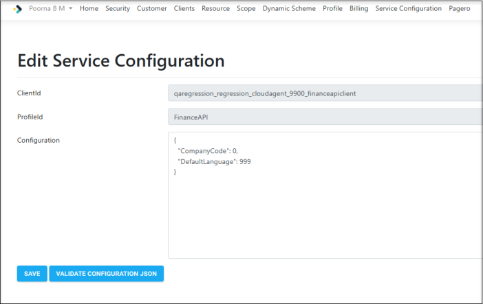


4. Configure the customer-specific values as follows: 

   - **ConnectionString** – the database to which invoices are imported. 

   - **CompanyCode** – Customer No. (sy1.foretagkod) of the receiving company. 

   - **PerSign** : Signature (sy2.perssign). 

   - **TunnelService** : URL of the SqlTunnel__TunnelService when the database connection is done via the SQL tunnel (Optional). 

   - **Channel** : Name of the SqlTunnel__Channel. 

   - **DefaultLanguage** : Language for the API endpoint outputs. 

   - **JeevesServer** : provide the following values required to save the invoice images received from Pagero in Jeeves: 

      - URL 

      - UserName 

      - Password 

The following screenshot shows an example configuration with dummy values. 

29 (32) 

© Copyright Forterro Sweden AB. All rights reserved. 

Import supplier invoices 


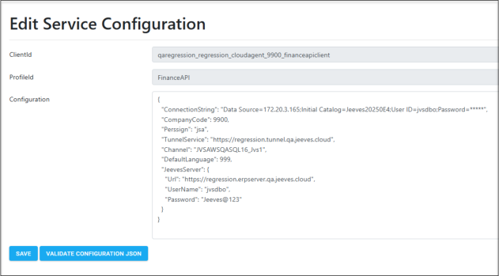


### 6.4 Import of supplier invoices via Pagero: Example process 

The following image shows an example setup for importing supplier invoice through the Pagero integration service environment. It shows who is responsible for setting up each step within the process. Key steps in the process are explained below the image. 


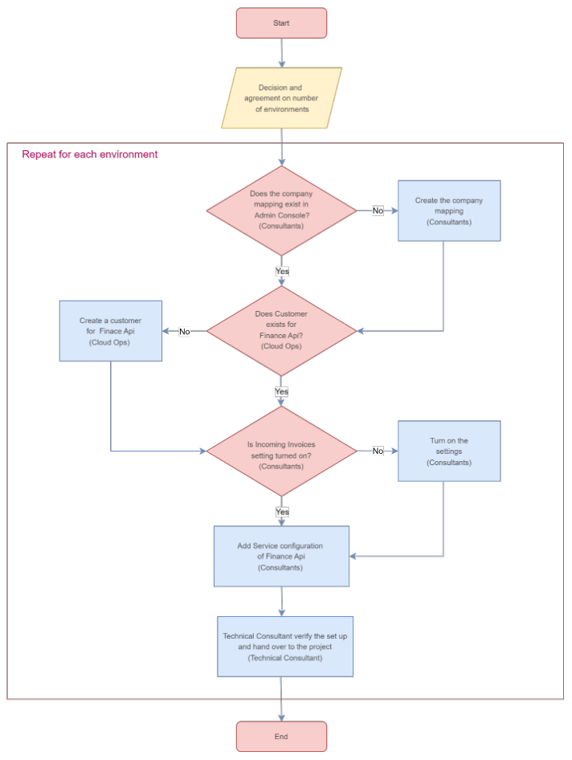


> © Copyright Forterro Sweden AB. All rights reserved. 

30 (32) 

Import supplier invoices 


Following is an example of the process to be followed to set up a single environment for a customer: 

1. Consultants create the necessary company mappings and add/manage company users using Pagero Online. 

2. Jeeves CloudOps creates a customer for Finance API. 

3. Consultants enable the incoming invoice check box and add the incoming polling interval. The Finance API client is automatically created when the mapping information is saved. 

4. Consultants enter the service configuration of the Finance API. 

31 (32) 

© Copyright Forterro Sweden AB. All rights reserved. 

<u>Support</u> 


## 7. Support 

If you have any questions regarding Jeeves ERP’s integration with PEPPOL, contact Jeeves Support. 

32 (32) 

© Copyright Forterro Sweden AB. All rights reserved. 

