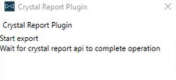
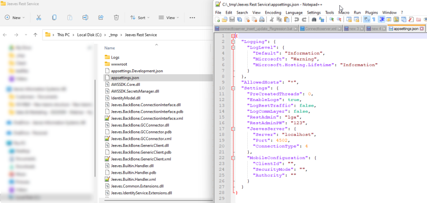
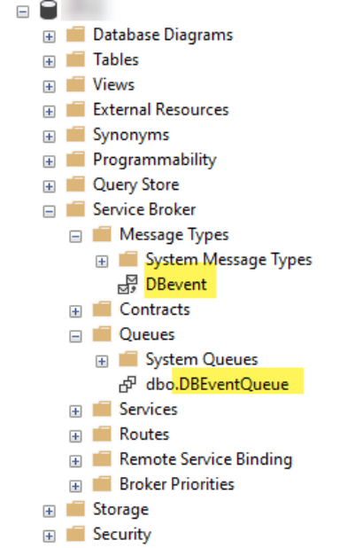
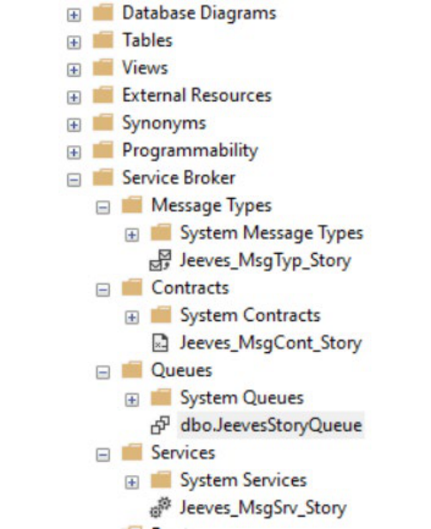

© Copyright Forterro Sweden AB. All Rights Reserved. 

# **Jeeves ERP** Upgrade considerations Revision 1.41 updated on August 27, 2026 

##### **Copyright notice** 

- © Copyright Forterro Sweden AB. All Rights Reserved. 

No part of this guide may be copied, reproduced, translated, or transmitted in any form or by any means without the prior written consent of Jeeves Information Systems AB. 

##### **Document disclaimer** 

Information contained in this guide is subject to change without notice. Please check with your Jeeves support team representative to make sure you have the most recent information. 

2 (72) 

© Copyright Forterro Sweden AB. All Rights Reserved. 

<u>About this guide</u> 


## **Contents** 

|**1**|**About this guide ........................................................................................................... 7**|
|---|---|
|1.1|Document version/revision..................................................................................................................... 7|
|1.2|Audience.......................................................................................................................................................... 9|
|1.3|Document conventions.............................................................................................................................. 9|
|1.4|List of acronyms........................................................................................................................................... 9|
|**2**|**Minimum system requirements ................................................................................ 10**|
|**3**|**Considerations when upgrading to JAS 15.0.0 and above ..................................... 11**|
|**4**|**Considerations related to kernel 5.1 R4 ................................................................. 12**|
|4.1|Own program menu icons causing access violations..................................................................12|
|**5**|**Considerations related to kernel 5.1 R5 ................................................................. 13**|
|5.1|Small change for After retrieving record event...........................................................................13|
|5.2|Language packages specific to JAS version...................................................................................13|
|5.3|Considerations when using Print to EDM.........................................................................................13|
|**6**|**Considerations related to kernel 5.1 R6 ................................................................. 14**|
|6.1|Corrected MOD tags..................................................................................................................................14|
|6.2|Language packages specific to JAS version...................................................................................14|
|**7**|**Considerations related to kernel 5.1 R7 ................................................................. 15**|
|7.1|Changes in VAT/Tax declaration........................................................................................................15|
|7.2|TLS version...................................................................................................................................................15|
|7.3|Language packages specific to JAS version...................................................................................15|
|7.4|Updated JAS hotfix catalogue.............................................................................................................15|
|**8**|**Considerations when updating to Kernel 5.1 R8 .................................................... 16**|
|8.1|Default language for standard records............................................................................................16|
|8.2|Dialog for sending feedback and reporting bugs.........................................................................16|
|8.3|Conditions in Rules for printout program.......................................................................................16|
|**9**|**Considerations when upgrading to Kernel 5.1 R9/ JAS 15.0.6 .............................. 17**|
|9.1|Backward compatibility in IPv6...........................................................................................................17|
|9.2|Issue in creating SAF-t files...................................................................................................................17|
|9.3|Modifications in e-Approval..................................................................................................................17|
|9.4|New notification service updates.......................................................................................................17|
|9.5|Issues with copying/creating a new item.......................................................................................19|
|9.6|Effect of new fields in sy2devices table on Mobility.................................................................20|
|9.7|Conditions in Rules for printout program.......................................................................................20|
|**10**|**Consideration when upgrading to Kernel 5.1 R10/JAS 15.0.7 .............................. 21**|
|10.1|Update to WebView2 runtime.............................................................................................................21|
|10.2|Creation of Intrastat records................................................................................................................21|
|10.3|Show prompts and datanames of hidden fields...........................................................................21|
|10.4|Cost price for each unit..........................................................................................................................21|
|10.5|Importing a package with dashboards and widgets...................................................................22|
|10.6|Modified MOD tags....................................................................................................................................22|


3 (72) 

© Copyright Forterro Sweden AB. All Rights Reserved. 

<u>About this guide</u> 


|**11**|**Considerations when upgrading to Kernel 5.1 R11/JAS 15.0.8 ............................. 37**|
|---|---|
|11.1|Login modified for Single sign-on/federated login....................................................................37|
|11.2|Changes in Tables to copy (xfil).........................................................................................................37|
|11.3|Breaking changes for Crystal reports 2020....................................................................................37|
|**12**|**Considerations when upgrading to Kernel 5.1 R12/ JAS 15.0.9 ............................ 38**|
|12.1|Clear ResourceText table......................................................................................................................38|
|12.2|Known issue in EMVS 2.2........................................................................................................................38|
|**13**|**Considerations when upgrading to Kernel 5.2 R1/ JAS 15.0.10............................ 39**|
|13.1|New parameter in connecttoserver.xml.........................................................................................39|
|13.2|Upgrade SQLTunnel.Service.msi.........................................................................................................39|
|13.3|Extra tag in udo program.......................................................................................................................39|
|13.4|Argument to enable performance measurement........................................................................39|
|13.5|Crystal reports upgrade to .NET 6.0.................................................................................................39|
|13.6|.NET 6.0 Upgrade......................................................................................................................................39|
|13.7|.NET 6.0 changes in REST configuration.........................................................................................40|
|13.8|Modified format in the /S parameter...............................................................................................40|
|**14**|**Considerations when upgrading to Kernel 5.2 R2/JAS 15.0.11 ............................. 41**|
|**15**|**Considerations when upgrading to Kernel 5.2 R3/ JAS 15.0.12............................ 42**|
|15.1|Jeeves Outlook Plugin discontinued.................................................................................................42|
|15.2|Numerical fields changed in sft_rules program...........................................................................42|
|15.3|Error while setting up Event service agent....................................................................................44|
|**16**|**Considerations when upgrading to Kernel 5.2 R4/ JAS 15.0.13............................ 46**|
|16.1|Enhanced usage logging for Service broker...................................................................................46|
|16.2|Automatic job scheduling in the customer database................................................................47|
|16.3|Jeeves API platform in JAS 15.0.13...................................................................................................47|
|16.4|Corrected mod tags..................................................................................................................................47|
|16.5|Settings to restrict access to features in security modes 5 and 6.......................................48|
|**17**|**Considerations when upgrading to Kernel 5.2 R5/JAS 15.0.14 ............................. 49**|
|**18**|**Considerations when upgrading to Kernel 5.2 R6/JAS 15.0.15 ............................. 50**|
|18.1|.NET requirement......................................................................................................................................50|
|18.2|Jeeves Design client discontinued.....................................................................................................50|
|**19**|**Considerations when upgrading to Kernel 5.2 R7/JAS 15.0.16 ............................. 51**|
|19.1|Packages included in Jeeves installer..............................................................................................51|
|**20**|**Considerations when upgrading to Jeeves ERP version 2024.Q2.0 ...................... 52**|
|20.1|.NET requirement......................................................................................................................................52|
|20.2|Support for customization using MOD procedures discontinued..........................................52|
|20.3|Settings to restrict access to features in security modes 5 and 6.......................................52|
|**21**|**Considerations when upgrading to Jeeves ERP version 2024.Q2.1 ...................... 53**|
|21.1|Folder name in SSRS report server URL...........................................................................................53|
|**22**|**Considerations when upgrading to Jeeves ERP version 2024.Q2.2 ...................... 54**|
|22.1|Settings to restrict access to features in security modes 5 and 6.......................................54|


4 (72) 

© Copyright Forterro Sweden AB. All Rights Reserved. 

<u>About this guide</u> 


|**23**|**Considerations when upgrading to Jeeves ERP version 2024.Q2.3 ...................... 55**|
|---|---|
|23.1|Settings to restrict access to features in security modes 5 and 6.......................................55|
|**24**|**Considerations when upgrading to Jeeves ERP version 2025.Q2.0 ...................... 56**|
|**25**|**Considerations when upgrading to Jeeves ERP version 2025.Q2.1 ...................... 57**|
|**26**|**Considerations when upgrading to Jeeves ERP version 2025.Q2.2 ...................... 58**|
|26.1|Upgrade to .NET Core 8.0......................................................................................................................58|
|26.2|Removal of 32-bit source build...........................................................................................................59|
|26.3|Mod tags to be handled for upgrade compatibility....................................................................59|
|**27**|**Considerations when upgrading to Jeeves ERP version 2025.Q2.3 ...................... 60**|
|27.1|New files in AWS server plugin folder..............................................................................................60|
|**28**|**Considerations when upgrading to Jeeves ERP version 2026.Q2.0 ...................... 61**|
|28.1|Upgrade to .NET Core 10.0...................................................................................................................61|
|28.2|Updated patch release process for Jeeves Platform.................................................................61|
|28.3|Deprecation of CreditCardNumber field.........................................................................................61|
|28.4|Classic client shortcut properties configuration.........................................................................61|
|28.5|Polish e-Invoicing (KSeF) prerequisites............................................................................................62|
|28.6|Run JvsRegisterDBO for new license support................................................................................62|
|28.7|Removal of COM-hosted interop DLL registration requirements..........................................62|
|28.8|Prerequisite considerations..................................................................................................................63|
|**29**|**Considerations when upgrading to Jeeves ERP version 2026.Q2.1 ...................... 64**|
|29.1|Modified mod tags in bpi_insert trigger..........................................................................................64|
|29.2|Removal of COM-hosted interop DLL registration requirements..........................................64|
|29.3|Prerequisite considerations..................................................................................................................64|
|**30**|**Considerations when upgrading to Jeeves ERP version 2026.Q2.2 ...................... 65**|
|30.1|Removal of COM-hosted interop DLL registration requirements..........................................65|
|30.2|Prerequisite considerations..................................................................................................................65|
|30.3|AKFT and AKLT triggers updated to use Jeeves_Std_Replicate2FY....................................65|
|30.4|BNP Paribas payment procedure limitations for summarized payments..........................65|
|**31**|**ODBC Driver version requirement ............................................................................ 66**|
|**32**|**UDO subtag records removed during upgrade......................................................... 67**|
|**33**|**Considerations when using Desktop client .............................................................. 68**|
|33.1|Settings for Enter in list to define payment by installment...................................................68|
|33.2|Regional settings........................................................................................................................................68|
|33.3|Multiple environments.............................................................................................................................68|
|33.4|Design studio setting for Product configurator............................................................................68|
|33.5|Add own columns manually into embedded list(s).....................................................................68|
|33.6|Embedded PDF viewer.............................................................................................................................68|
|33.7|Import language texts for Desktop client.......................................................................................69|
|33.8|Gaps in Desktop client............................................................................................................................69|
|33.9|Difference in memory usage between Classic client and Desktop client........................69|
|33.10|Errors in log file.........................................................................................................................................69|


5 (72) 

© Copyright Forterro Sweden AB. All Rights Reserved. 

|||About this guide|
|---|---|---|
|33.11|Removed client-side COM dependency...........................................|.................................................69|
|**34**|**Considerations when using Mobile client ...........................**|**..................................... 70**|
|34.1|Prerequisites...............................................................................................|.................................................70|
|34.2|Enable SSRS reports.................................................................................|.................................................70|
|34.3|Upload files from Mobile client..........................................................|.................................................70|
|34.4|Appointments in Jeeves Android app..............................................|.................................................70|
|34.5|Limitations...................................................................................................|.................................................70|
|34.6|New notification service.......................................................................|.................................................71|
|34.7|Data with parentheses in forms.........................................................|.................................................71|
|**35**|**Deprecated menu codes .......................................................**|**..................................... 72**|


6 (72) 

© Copyright Forterro Sweden AB. All Rights Reserved. 

<u>About this guide</u> 


## 1 About this guide 

This guide contains information that must be considered when upgrading from previous versions of Jeeves ERP to Jeeves ERP 6.0 and higher. 

The objective is to help the user: 

- understand the changes made to Jeeves ERP, 

- take the correct actions while upgrading to Jeeves ERP 6.0 and higher 

### 1.1 Document version/revision 

|**Version/revision**|<br>**Description **|**Date**|
|---|---|---|
|1.0|Updated for Jeeves ERP 6.0|October 2019|
|1.01|Updated the following chapters:<br>•<br>Considerations when using the Desktop client<br>•<br>Considerations when using Mobile client chapter|November 28, 2019|
|1.02|Updated license information<br>Add new chapter:<br>•<br>Menu codes not supported on any Jeeves client|January 16, 2020|
|1.03|Updated considerations re. Kernel 5.1 R4|March 9,2020|
|1.04|Added considerations re. Kernel 5.1 R5|May2020|
|1.05|Added considerations re. Kernel 5.1 R6 and updated<br>considerations when usingthe Desktopclient|August 20, 2020|
|1.06|Updated information re. ANSI settings|August 26,2020|
|1.07|Added considerations re. Kernel 5.1 R7|November 10,2020|
|1.08|Added considerations re. Kernel 5.1 R8|February15,2021|
|1.09|Updated for notification API|March 22,2021|
|1.10|Added considerations re. Jeeves ERP 6.0 Update 6|May18,2021|
|1.11|Updated limitations and effect of sy2devices on Mobility|June 11,2021|
|1.12|Updated for Rules for printout program|June 24,2021|
|1.13|Updated for Jeeves ERP 6.0 Update 7|August 23,2021|
|1.14|Updated the considerations re. Mobile client|October 05,2021|
|1.15|Updated for Jeeves ERP 6.0 Update 8|November 15,2021|
|1.16|Updated re. Database recovery model and Crystal<br>reports|December 02, 2021|
|1.17|Updates re. Crystal reports|January13,2022|
|1.18|Updated for Jeeves ERP 6.0 Update 9|February14,2022|
|1.19|Updated re. Gaps in Desktop client|February24,2022|
|1.20|Updated for Jeeves ERP 6.0 Update 10|May16,2022|
|1.21|Updated for preferipv6 for REST service|June 01,2022|
|1.22|Updated for Jeeves ERP 6.0 Update 11|August 22,2022|
|1.23|Updated for Jeeves ERP 6.0 Update 12|November 14,2022|
|1.24|Updated for Jeeves ERP 6.0 Update 13|February10,2023|
|1.25|Updated for Jeeves ERP 6.0 Update 14|May09,2023|
|1.26|Updated for Jeeves ERP 6.0 Update 15|Aug16,2023|
|1.27|Updates re.Log_ExtendedLog parameter|Sep01,2023|
|1.28|Updated for Jeeves ERP 6.0 Update 16|November 15,2023|


7 (72) 

© Copyright Forterro Sweden AB. All Rights Reserved. 

<u>About this guide</u> 


|**Version/re**|**vision**<br>**Description **|**Date**|
|---|---|---|
|1.29|Added considerations for Jeeves ERP 2024.Q2.0|February06,2024|
|1.30|Added considerations for Jeeves ERP 2024.Q2.1|May31,2024|
|1.31|Removed information on UserClientHideUnboundObjects<br>parameter|Aug 30, 2024|
|1.32|Added considerations for Jeeves ERP 2024.Q2.3<br>Updated considerations for the following versions:<br>-<br>Kernel 5.2 R4/ JAS 15.0.13<br>-<br>Jeeves ERP version 2024.Q2.0<br>-<br>Jeeves ERP version 2024.Q2.2|Dec 16, 2024|
||Updated about restriction access to SID and FA users to<br>specific features in securitymodes 5 and 6||
|1.33|Added considerations for Jeeves ERP 2025.Q2.0|March 17,2025|
|1.34|Added considerations for Jeeves ERP 2025.Q2.1|May20,2025|
|1.35|Added considerations for Jeeves ERP 2025.Q2.2<br>Upgrade .Net Core 8.0 for Jeeves Business Server and its<br>impact on SSRS reports plugin folders and COM<br>registration of JvsNetIntegrationSvrMgr and<br>vsNetReportingServices.comhost.dll<br>Removal of 32-bit binaries (Jvs32 folder) from version<br>2025.0 onwards<br>Mod tags handlingfor upgrade compatibility|August 22, 2025|
|1.36|Added considerations for Jeeves ERP 2025.Q2.3<br>Upgrade .Net Core 8.0 for Jeeves Business Server and its<br>impact on AWS plugin folders and COM registration of<br>JvsAWSS3Service and JvsAWSS3Service.comhost.dll|November 17, 2025|
|1.37|Added considerations for Jeeves ERP 2026.Q2.0<br>- Updated about upgrade to .NET Core 10.0<br>- Updated about new patch release process for Jeeves<br>Platform<br>- Updated information on deprecation of<br>Creditcardnumber term<br>- Updated classic client shortcut properties<br>configuration<br>- Added Polish e-Invoicing (KSeF) prerequisites<br>- Removed sections: Considerations when upgrading to<br>JAS 3.0, Considerations when upgrading to JAS 4.0 and<br>Considerations when upgradingto JAS 5.0|March 06, 2026|
|1.38|Updated about running JvsRegisterDBO for new license<br>support|May 07, 2026|
|1.39|Updated about UDO Subtag records removed during<br>upgrading from 2024.x to Jeeves ERP 2025.x and Jeeves<br>ERP 2026.0|May 18, 2026|
|1.40|Added considerations for Jeeves ERP 2026.Q2.1|May19,2026|
|1.40|Added information on supported versions for Microsoft<br>ODBC Driver for SQL Server|June 10, 2026|
|1.41|Added considerations for Jeeves ERP 2026.Q2.2<br>- Removal of COM-hosted interop DLL registration<br>requirements.<br>- Prerequisite considerations regarding .Net Framework<br>- AKFT and AKLT triggers updated to use<br>Jeeves_Std_Replicate2FY<br>- BNP Paribas payment procedure limitations for<br>summarizedpayment|Jul 07, 2026|


8 (72) 

© Copyright Forterro Sweden AB. All Rights Reserved. 

<u>About this guide</u> 


### 1.2 Audience 

This guide is intended for technicians who upgrade and configure Jeeves. 

### 1.3 Document conventions 

Use of typographic conventions in documentation helps users locate and interpret information easily. The following guidelines present specific typographic conventions. This guide enables you to establish and maintain a common understanding of various conventions used in the document. For simplicity and consistency, this guide describes the method of performing tasks. Other conventions used in this guide are listed in the following table. 

|**Representation **|**Description **|
|---|---|
|Bold text|Procedures, references to screens, dialog boxes and their<br>elements,file and folder names,commands and buttons.|
|Numbered list|Stepwise instructions.|
|Bulleted list|Sets of features or options used toperform an activity.|
|Note text|Anyexception,extra information,orpitfalls.|
|Italic text|References to related documents.|


### 1.4 List of acronyms 

|**Acronym **|**Description **|
|---|---|
|JAS|Jeeves application services|
|JIS|Jeeves information systems|


9 (72) 

© Copyright Forterro Sweden AB. All Rights Reserved. 

<u>Minimum system requirements</u> 


## 2 Minimum system requirements 

The following are the minimum system requirements while upgrading to Jeeves ERP 2026.Q2.2. 

|**Requirement**|**Version**|
|---|---|
|Jeeves product version|Jeeves ERP 2026.Q2.2|
|Jeeves Application services version|2026.2|
|Platform version|2026.2|
|Windows Server version|Microsoft Windows Server 2022 or 2025|
|SQL Server version|SQL Server 2022 (latest CU) and SQL Server 2025<br>(latest CU)|
|Operating system|Windows 11 23H2 (or earlier versions supported<br>by Microsoft)|
|iOS Mobile client|1.54.1|
|iOS version|26.2|
|Android Mobile client|1.54.1|
|Android OS version|16|
|.Net framework|4.8.1|
|.NET core (for REST service)|10.0 Runtime|
|Microsoft office|Microsoft 365 (apps), Office 2021, Office 2024<br>New MS Outlook is not supported in this version|
|Microsoft C++ runtime|14.0|
|Crystal reports|SAP Crystal report 2016<br>SAP Crystal report 2020|
|Crystal reports runtime|13.0.31.4010|


The Desktop client for Kernel 5.1 R4 and above must be run on 64-bit operating systems; 32-bit operating systems are not supported. 

10 (72) 

© Copyright Forterro Sweden AB. All Rights Reserved. 

<u>Considerations when upgrading to JAS 15.0.0 and above</u> 


- 3 Considerations when upgrading to JAS 15.0.0 and above 

Though the application installer runs on the same principles as the earlier installer, it has a few changes. 

The following actions must be considered when upgrading to JAS 15.0.0 from earlier versions: 

- Make sure you have upgraded your system to support the system requirements for JAS 15 

- • You can customize your Jeeves installation by choosing features you require during installation 

- A shared folder can exist before you begin the installation. 

- After you have completed the installation, Kernel files must be copied/installed to your application directory. Make sure that you map the ini files to the application file path. 

- Run the dacpac to install the site repository before installing other features. 

- The language installation must be manually done. It is important that you import language package using apps builder for English or Swedish languages. 

- The CustomerDropDown functionality must be manually installed, if required. It is not activated automatically in the installer. 

- The windows installer logs must be manually enabled in the registry during the installation, if required. 

- The template company 9000 is included and must be installed manually in Package manager. You cannot select template/demo packages during installation. 

11 (72) 

© Copyright Forterro Sweden AB. All Rights Reserved. 

<u>Considerations related to kernel 5.1 R4</u> 


## 4 Considerations related to kernel 5.1 R4 

- 4.1 Own program menu icons causing access violations 

Customers’ own, added icons in Jeeves program menu may not be transferred to the Jeeves Client, causing access violations. 

When upgrading to a new kernel 5.1 R4 the Icons folder, if it exists in the Server (ApplicationDirectory\bin32\Icons), needs to be manually copied to the ProgramData folder. This will help the server to load icons from the ProgramData folder. Newer Jeeves clients, however, will request Icons from the server and copy it to its ProgramData folder avoiding any permissions issue. 

#### **<u>Note</u>** 

The maximum allowed size of the icon file is 80000 bytes (80 KB). 

12 (72) 

© Copyright Forterro Sweden AB. All Rights Reserved. 

<u>Considerations related to kernel 5.1 R5</u> 


## 5 Considerations related to kernel 5.1 R5 

### 5.1 Small change for After retrieving record event 

In earlier kernels, the **After retrieving record** event's macro was executed immediately after the header record was loaded. If the macro makes calls to functions such as **GoToNode** , it caused a deep recursion and the program crashed. 

To avoid this issue, the **After retrieving record** event's macro is now posted to the message queue of the client thread, delaying its execution very slightly, so that it is executed after all the messages are processed. This slight delay in execution avoids any recursion. 

#### **<u>Note</u>** 

This change impacts only the **After retrieving record** event. You may need to adjust your macro code for this event. 

### 5.2 Language packages specific to JAS version 

Note that it is not possible to install a later language package than the relevant JAS version, as each application release has its own language package(s). 

### 5.3 Considerations when using Print to EDM 

Changes have been made in the Jeeves_edm_record_fr_file.spr procedure so the kernel will pass correctly formatted values based on the datatype of the field: 

- Date: "yyyyMMdd" 

- Time: "hh:mm" 

- DateTime: "yyyyMMdd hh:mm" 

Previously, unformatted values were being passed to the stored procedure where it was converted to the proper format, but this has been undone. Now since the kernel passes the correctly formatted values to the procedure, when you upgrade to the latest version of the kernel (5.1 R5 and above) you will need the new stored procedure also and vice versa. The stored procedure is available in All changed files (ACF). 

13 (72) 

© Copyright Forterro Sweden AB. All Rights Reserved. 

<u>Considerations related to kernel 5.1 R6</u> 


## 6 Considerations related to kernel 5.1 R6 

### 6.1 Corrected MOD tags 

MOD tag names were mismatched, and objects have been corrected by removing code/text. The following must be verified for modifications while upgrading to kernel 5.1 R6 and JAS 15.0.3: Triggers: 

- bat.trg 

- bpi.trg 

- ctim.trg 

Stored procedures: 

- Jeeves_Add_SlsMgrBudget_Det.spr 

- Jeeves_AdvDeduction_ChgInvNo.spr 

- Jeeves_AdvDeduction_InvNo.spr 

- Jeeves_ALFA_SalesCostMarkup.spr 

- Jeeves_ar_disp_test.spr 

- Jeeves_ArPyrSr_AL.spr 

- Jeeves_Bp_Orp_Update.spr 

- Jeeves_Calc_OrderNr.spr 

- Jeeves_Check_PO_AO_OrderLines.spr 

- Jeeves_CnfgrEvaluate.spr 

- Jeeves_ConsistencyChecking_FormLoad.spr 

- Jeeves_ConsistencyChecking_ListLoad.spr 

- Jeeves_CopyVoucher.spr 

- Jeeves_Create_WL_From_AO.spr 

- Jeeves_EAZYSTOCK_SendMail.spr 

- Jeeves_Get_VariableKey.spr 

- Jeeves_Gps_Get_Items.spr 

- Jeeves_GPS_UPDATE_Operations.spr 

- Jeeves_ItemRevision_OLD_Ars_Get_Color.spr 

- Jeeves_JMI_Installation.spr 

- Jeeves_JMI_Installation_Settings.spr 

- Jeeves_JuVr.spr 

- Jeeves_LruVr.spr 

- Jeeves_Mod_Sh_Copy_End.spr 

- Jeeves_Mod_Sh_Copy_Post.spr 

- Jeeves_Normsinv_Validate.spr 

- Jeeves_Oh_From_Fh.spr 

- Jeeves_Oh_From_Oh.spr 

- Jeeves_Oh_Orp_Brist.spr 

- Jeeves_op_create_ao.spr 

- Jeeves_op_create_ao_aon_Log.spr 

- Jeeves_op_create_ao_aon_Log_Print.spr 

- Jeeves_Orp_Produkt_Pris.spr 

- Jeeves_oru_arsi.spr 

- Jeeves_Repl_Table_Post.spr 

### 6.2 Language packages specific to JAS version 

Note that it is not possible to install a later language package than the relevant JAS version, as each application release has its own language package(s). 

14 (72) 

© Copyright Forterro Sweden AB. All Rights Reserved. 

<u>Considerations related to kernel 5.1 R7</u> 


## 7 Considerations related to kernel 5.1 R7 

### 7.1 Changes in VAT/Tax declaration 

The priority order for transactions considered in the Source VAT/tax declaration totals ( **be_vat_total** ) program has been modified. The account number in the VAT/tax declaration ( **be_vat_grid** ) program is given the highest priority. You may have to update your VAT report. 

Refer to the online documentation, Chapter 590, _VAT/tax declaration_ for more information. 

### 7.2 TLS version 

Transport Layer Security (TLS) is a cryptographic protocol designed to provide secure communications over a computer network. Jeeves does not refer to TLS directly in its source code for any of its applications i.e., Jeeves server, Jeeves clients (Classic client, Desktop client, and Mobile clients) and Client broker. TLS is used in web service applications. Jeeves REST service and JSB may use TLS to support https communication. 

TLS affects multiple components in the operating systems like MS Office, IIS, SQL server, browsers, SSRS, .Net framework, applications, etc. If you intend to use TLS, it is advised that you use TLS 1.2 as TLS 1.0 and 1.1 have been deprecated by Microsoft. To enable TLS 1.2, refer to <u>https://docs.microsoft.com/en-us/mem/configmgr/core/plan-design/security/enable-tls-1-2</u> 

### 7.3 Language packages specific to JAS version 

Note that it is not possible to install a later language package than the relevant JAS version, as each application release has its own language package(s). 

### 7.4 Updated JAS hotfix catalogue 

The _JvsSqlRun.doc_ which was earlier provided with hotfixes is no longer provided. You will be provided with an updated document called _Jeeves ERP Installation of application objects using JvsSQLRun.pdf_ or you can also refer the _Jeeves ERP Installation and configuration guide.pdf_ for information on how to install and configure objects for hotfixes. 

15 (72) 

© Copyright Forterro Sweden AB. All Rights Reserved. 

<u>Considerations when updating to Kernel 5.1 R8</u> 


- 8 Considerations when updating to Kernel 5.1 R8 

### 8.1 Default language for standard records 

From Jeeves ERP 6.0 Update 4 onwards, the language code mentioned in the Language (sy1.sprakkod) field is alone considered for the import of the standard records for that company. For more information on language installation, refer to _Jeeves ERP Installation and configuration.pdf._ 

### 8.2 Dialog for sending feedback and reporting bugs 

The new dialog for sending feedback and reporting bugs will suggest the e-mail address entered in the **SupportMailAddress** kernel parameter, when an e-mail is created. It is recommended that you enter your internal IT support’s e-mail address in the parameter. 

### 8.3 Conditions in Rules for printout program 

You must upgrade to Kernel 5.1 R8 ( **R8_5.1.21190.1** ) and JAS 15.0.5 for the conditions you have set for a report program in the Rules for printout ( **ffld** ) program to take effect. 

16 (72) 

© Copyright Forterro Sweden AB. All Rights Reserved. 

<u>Considerations when upgrading to Kernel 5.1 R9/ JAS 15.0.6</u> 


- 9 Considerations when upgrading to Kernel 5.1 R9/ JAS 15.0.6 

### 9.1 Backward compatibility in IPv6 

It must be noted that backward compatibility is not possible in IPv6 connectivity i.e., a client with IPv4 capability cannot connect to the server that has IPv6 capability. 

### 9.2 Issue in creating SAF-t files 

While creating SAF-t files, the <mark>ExecSqlOutput2FileEx function may not work as expected for large volumes of data. To avoid this, make sure your Jeeves application i</mark> ncludes an assembly called **Jeeves.Sql.Utilities** . The file is set up when you install Jeeves. For more information on Jeeves SQL CLR, refer to _Jeeves ERP Installation and configuration.pdf_ . 

### 9.3 Modifications in e-Approval 

The e-Approval web application has been modified to support only web user login. The previously existing ERP user login has been removed. 

### 9.4 New notification service updates 

The API used for the existing notification service was withdrawn on March 31 2021, a cloud-based notification service has been introduced. Perform the following set up to upgrade to the new service. 

##### **Configure kernel parameters** 

Launch the Jeeves application and add the two Kernel parameters as explained below: 

In the Kernel parameters (jini) program, add new records (Ctrl+A). 

Enter the following values for the first parameter: Parameter section: Jeeves System (jini) parameter: NotificationUrl Configuration name: * Group: 9999 Signature: * Parameter data: Enter the notification service URL created for you by Cloud ops. (Example: https://notificationsp.eapproval.qa.jeeves.cloud ) 

Enter the following values for the second parameter: Parameter section: Jeeves System (jini) parameter: NotificationApiKey Configuration name: * Group: 9999 Signature: * Parameter data: Enter the generated API key. 

17 (72) 

© Copyright Forterro Sweden AB. All Rights Reserved. 

<u>Considerations when upgrading to Kernel 5.1 R9/ JAS 15.0.6</u> 


##### **Change existing macro** 

To implement the new notification service, modify the macro as shown in the example below: 

function q_jis_notify : boolean; `var Form : Object; ino : integer; s,sBookmark,sSignature,sBody : string; begin q_jis_notify := TRUE; ino := 0; Form := Application.GetCurrentForm;` <mark>`sBookmark := Form.GetBookMark( 'New Service order`</mark> `'+sh.ordernr+' has been assigned to you!',  'shtg' );` <mark>`sBody :='The service order '+sh.ordernr+' is assigned to you ('`</mark> `+ar.artbeskr+')'; if GetString('Notify message:', s ) then begin` <mark>`SqlBegin('select distinct multiplesrvctechn.perssign2 from multiplesrvctechn with (READUNCOMMITTED) '+ 'where multiplesrvctechn.ordernr = '+sh.ordernr+'`</mark> `AND  multiplesrvctechn.foretagkod = '+sh.foretagkod); SqlBind(sSignature); if(SqlExecute) then begin while(SqlFetch) do begin` <mark>`SendPushNotification (sSignature, sBody, sBookmark,`</mark> `'q_jis_rest_fail', 'q_jis_rest_ok'); ino:=ino+1; end; end else` 

18 (72) 

© Copyright Forterro Sweden AB. All Rights Reserved. 

<u>Considerations when upgrading to Kernel 5.1 R9/ JAS 15.0.6</u> 


```
        begin
           message('SQLExecuteError');
        end;
        SqlEnd;
          Message(iNo+' notifications queued' );
    end;
end;
```

### 9.5 Issues with copying/creating a new item 

If you encounter an error with message _Procedure or function JEEVES_Mod_arsi_insert_post has too many arguments_ while copying an item using the Copy item button or Ctrl+A, execute the following procedure in your Jeeves database: 

```
Alter procedure JEEVES_Mod_arsi_insert_post
@c_IntrnCoNo smallint=null,
@c_ItemNo JEEVES_ItemNo=NULL,
@c_WareHouse Jeeves_StrVarChar16=NULL,
@c_BatID Jeeves_StrVarChar64=NULL,
@c_SerialNo Jeeves_StrVarChar64=NULL,
@c_Bin Jeeves_StrVarChar32=NULL,
@c_ProjCode Jeeves_StrVarChar20=NULL,
@c_LoadCarrId Jeeves_StrVarChar32=NULL,
@c_PersSign Jeeves_StrVarChar32=NULL,
@Error_Text Jeeves_StrVarChar2048 = NULL OUTPUT
as
select @Error_Text = NULL
if @c_IntrnCoNo = -1
begin
            return 0
end
return 0
```

19 (72) 

© Copyright Forterro Sweden AB. All Rights Reserved. 

<u>Considerations when upgrading to Kernel 5.1 R9/ JAS 15.0.6</u> 


### 9.6 Effect of new fields in sy2devices table on Mobility 

If you are using the Jeeves Mobile client with Kernel 5.1 R9 and JAS version 15.0.0, 15.0.1, 15.0.2, or 15.0.3, you may observe the error message “ **Invalid column name ‘devicetype’”** when you open the Jeeves ERP app. 

To overcome this, perform the following: 

- Add the **sy2devices.tbd** file (contact Jeeves ERP Support if you cannot find the relevant file) to your Jeeves application directory 

- Add the following in your appl.ted file: 

```
,(#DeviceType,#ztString,[#ZSPrompt ""Device type"",#ZSHeader
""Device type"",#ZSLength 32])
```

- Restart Jeeves client and update your Jeeves database so that the changes are reflected. 

### 9.7 Conditions in Rules for printout program 

You must upgrade to Kernel 5.1 R9 ( **R9_5.1.21189.1** ) and JAS 15.0.6 for the conditions you have set for a report program in the Rules for printout ( **ffld** ) program to take effect. 

20 (72) 

© Copyright Forterro Sweden AB. All Rights Reserved. 

<u>Consideration when upgrading to Kernel 5.1 R10/JAS 15.0.7</u> 


- 10 Consideration when upgrading to Kernel 5.1 R10/JAS 15.0.7 

### 10.1 Update to WebView2 runtime 

The Internet explorer (IE) based web component for Jeeves client is changed to a chromium-based web component as IE is deprecated. 

The web browser component in Jeeves Desktop client has been updated to use Microsoft Edge WebView2 runtime. WebView2 runtime is automatically installed in your system when you install the latest version of Desktop client. 

You must install Microsoft Edge WebView2 before you set up your Jeeves Classic client to use this web component. 

For manual installation of Microsoft Edge WebView2, navigate to <u>https://developer.microsoft.com/en-us/microsoft-edge/webview2/</u> 

To install the chromium-based browser, navigate to <u>https://www.microsoftedgeinsider.com/download</u> 

### 10.2 Creation of Intrastat records 

The EU VAT/tax reg No. ( **eumomsnr** ) and Country of origin ( **ursprungsland** ) fields must be manually added to the **IDEP** tab in the Instrastat, item record sales ( **intstat:aa:wistsum1** ) form in the Instrastat report period and generation ( **intstat** ) program to successfully use the export functionality in the Intrastat program. 

### 10.3 Show prompts and datanames of hidden fields 

In the Classic client, when the keyboard shortcut to display a field’s dataname (Ctrl+Alt+F12) is pressed, the datanames are now also displayed in the total window for fields whose prompts are hidden (ZSSuppressPrompt=Y). In the Desktop client, the prompts in the total window are displayed even if they are set up to be hidden and are switched to datanames when pressing Ctrl+Alt+F12. 

### 10.4 Cost price for each unit 

The behavior of cost price is calculated on a per unit basis in each of the following new terms: 

- Actual labor cost/unit (EnhArbVerklArbKost) 

- Actual material cost/unit (EnhMtrlVerklKost) 

- Actual setup cost/unit (EnhArbVerklStallKost) 

- Calc admin OH cost/unit (EnhAdminOmkBelopp) 

- Calc admin sales OH/unit (EnhForsOmkBelopp) 

- Calc mfg overhead cost/unit (EnhProdOmkBelopp) 

- Calc mtrl cost/unit (EnhMtrlKalkKost) 

- Calc setup cost/unit (EnhArbKalkStallKost) 

- CalcCost labor/op/unit (EnhArbKalkArbKost) 

- Calculated sales price/unit (EnhFKalkBerFPris) 

- Cost price/unit (EnhSjalvKost) 

- Developmt cost/unit (EnhUtvKost) 

- Est delivery value/unit (EnhFkalkInlevVarde) 

- Fixed labor OH/unit (EnhArbOmkFast) 

- Indir subcontr cost/unit (EnhLegoBiKost) 

- Indirect labor costs/unit (EnhArbStyckBiKost) 

- Indirect setup costs/unit (EnhArbStallBiKost) 

- Labor cost/unit (EnhArbStyckKost) 

- Labor OH op/unit (EnhArbOmkOp) 

21 (72) 

© Copyright Forterro Sweden AB. All Rights Reserved. 

<u>Consideration when upgrading to Kernel 5.1 R10/JAS 15.0.7</u> 


- Labor overhead/unit (EnhArbOmk) 

- Manufacturing cost 1/unit (EnhTK1) 

- Manufacturing cost 2/unit (EnhTK2) 

- Material cost/unit (EnhMtrlKost) 

- Mfg cost diff/unit (EnhTillvVinst) 

- Mfg grp depr/unit (EnhPgAvskrKost) 

- Mfg grp fixed rate/unit (EnhPgFastKost) 

- Mfg grp setup cost/unit (EnhPgStallKost) 

- Mfg grp var cost/unit (EnhPgRorlKost) 

- MO startup cost/unit (EnhToStartKost) 

- Mtrl overhead/unit (EnhMtrlMoKost) 

- OH cost/unit (EnhUtvOmk) 

- Receiving value/unit (EnhInlevKalkVarde) 

- Setup cost/unit (EnhArbStallKost) 

- Setup overhead/unit (EnhArbOmkStall) 

- Subcontr OH setup cost/unit (EnhLegoStallBiKost) 

- Subcontract cost/unit (EnhLegoKost) 

- Technical OH cost/unit (EnhTeknikOmk) 

- Tool cost/unit (EnhVyStyckKost) 

- Tool depr/unit (EnhVyAvskrKost) 

- Tool fix cost/unit (EnhVyFastKost) 

- Tool setup cost/unit (EnhVyStallKost) 

- Tool var cost/unit (EnhVyRorlKost) 

- Var OH labor/unit (EnhArbOmkRorl) 

### 10.5 Importing a package with dashboards and widgets 

When importing a package that contains dashboards and widgets, you may observe errors and the import may fail. This was caused due to an error in the Jeeves Site database binary package (dacpac). It is recommended that you download and install the latest, corrected Jeeves Site database binary package (dacpac) to avoid such errors during import. 

### 10.6 Modified MOD tags 

Repeated instances of the below listed MOD tags have been modified. However, the first instance of the MOD tag in the specified object remains unchanged. Refer to the below table to verify and implement the modified MOD tags. 

|**Object**|**MOD tag**|**Modified MOD tag**|
|---|---|---|
|kltdt|<UsrDef_Mod_Trigger_repl_BeginMod>|<UsrDef_Mod_Trigger_MultiCompRepl__B<br>eginMod>|
|a_upae|<UsrDef_Mod_Trigger_repl_EndMod>|<UsrDef_Mod_Trigger_MultiCompRepl_En<br>dMod>|
||<UsrDef_Mod_View_Tin_Qty_BeginMod>|<UsrDef_Mod_View_Tin_Mrn_Qty_BeginM<br>od>|
||<UsrDef_Mod_View_Tin_Qty_EndMod>|<UsrDef_Mod_View_Tin_Mrn_Qty_EndMo<br>d>|
|ATP_Planned_<br>Transactions_v<br>iew|<UsrDef_Mod_View_Tin_Join_BeginMod>|<UsrDef_Mod_View_Tin_Mrn_Join_Begin<br>Mod>|
||<UsrDef_Mod_View_Tin_Join_EndMod>|<UsrDef_Mod_View_Tin_Mrn_Join_EndMo<br>d>|
||<UsrDef_Mod_View_Tin_Where_BeginMod<br>>|<UsrDef_Mod_View_Tin_Mrn_Where_Begi<br>nMod>|


22 (72) 

© Copyright Forterro Sweden AB. All Rights Reserved. 

<u>Consideration when upgrading to Kernel 5.1 R10/JAS 15.0.7</u> 


|**Object**|**MOD tag**|**Modified MOD tag**|
|---|---|---|
||<UsrDef_Mod_View_Tin_Where_EndMod>|<UsrDef_Mod_View_Tin_Mrn_Where_End<br>Mod>|
|InvyOptzn_ars_|<UsrDef_Mod_CallSprArgs_BeginMod>|<UsrDef_Mod_CallSprArgs1_BeginMod>|
|Upd|<UsrDef_Mod_CallSprArgs_EndMod>|<UsrDef_Mod_CallSprArgs1_EndMod>|
||<UsrDef_Mod_EnterProcedure_BeginMod>|<UsrDef_Mod_EnterProcedure_Checks_Be<br>ginMod>|
|InvyOptzn_Pne<br>Forecast|<UsrDef_Mod_EnterProcedure_EndMod>|<UsrDef_Mod_EnterProcedure_Checks_En<br>dMod>|
||<UsrDef_Mod_CallSprArgs_BeginMod>|<UsrDef_Mod_CallSprArgs1_BeginMod>|
||<UsrDef_Mod_CallSprArgs_EndMod>|<UsrDef_Mod_CallSprArgs1_EndMod>|
||<UsrDef_Mod_CallSprArgs_BeginMod>|<UsrDef_Mod_CallSprArgs1_BeginMod>|
|InvOtznRea|<UsrDef_Mod_CallSprArgs_EndMod>|<UsrDef_Mod_CallSprArgs1_EndMod>|
|yp_<br>dPurchaseOrde<br>rs|<UsrDef_Mod_Read_Potype_BeginMod>|<UsrDef_Mod_Read_Potype_Where_Begin<br>Mod>|
||<UsrDef_Mod_Read_Potype_EndMod>|<UsrDef_Mod_Read_Potype_Where_EndM<br>od>|
||<UsrDef_Mod_CallSprArgs_BeginMod>|<UsrDef_Mod_CallSprArgs1_BeginMod>|
||<UsrDef_Mod_CallSprArgs_EndMod>|<UsrDef_Mod_CallSprArgs1_EndMod>|
|InvyOptzn_Rea<br>|<UsrDef_Mod_AfterEndYesAll_BeginMod>|<UsrDef_Mod_AfterEndYesAll_1_BeginMo<br>d>|
|dTransactional<br>Demands|<UsrDef_Mod_AfterEndYesAll_EndMod>|<UsrDef_Mod_AfterEndYesAll_1_EndMod>|
||<UsrDef_Mod_AfterEndYesAll_BeginMod>|<UsrDef_Mod_AfterEndYesAll_2_BeginMo<br>d>|
||<UsrDef_Mod_AfterEndYesAll_EndMod>|<UsrDef_Mod_AfterEndYesAll_2_EndMod>|
|InvyOptzn_Srpr<br>|<UsrDef_Mod_EnterProcedure_BeginMod>|Second instance has been removed|
|Forecast|<UsrDef_Mod_EnterProcedure_EndMod>||
|Note: The DECLA<br>InvyOptzn_SrprF|RE @TransactionFrmDate DATE code has be<br>orecast object.|en moved outside the modified mod tag in|
|InvyOptzn_Srpr|<UsrDef_Mod_CallSprArgs_BeginMod>|<UsrDef_Mod_CallSprArgs1_BeginMod>|
|Forecast|<UsrDef_Mod_CallSprArgs_EndMod>|<UsrDef_Mod_CallSprArgs1_EndMod>|
|InvyOptzn_To_|<UsrDef_Mod_CallSprArgs_BeginMod>|<UsrDef_Mod_CallSprArgs1_BeginMod>|
|Bh|<UsrDef_Mod_CallSprArgs_EndMod>|<UsrDef_Mod_CallSprArgs1_EndMod>|
|InvyOptzn_To_|<UsrDef_Mod_CallSprArgs_BeginMod>|<UsrDef_Mod_CallSprArgs1_BeginMod>|
|Bia|<UsrDef_Mod_CallSprArgs_EndMod>|<UsrDef_Mod_CallSprArgs1_EndMod>|
|InvyOptzn_To_|<UsrDef_Mod_CallSprArgs1_BeginMod>|<UsrDef_Mod_CallSprArgs2_BeginMod>|
|Bia_SelectionId|<UsrDef_Mod_CallSprArgs1_EndMod>|<UsrDef_Mod_CallSprArgs2_EndMod>|
|JEEVES_Ars_Esi|<UsrDef_Mod_CallSprArgs_BeginMod>|<UsrDef_Mod_CallSprArgs1_BeginMod>|
|nvtryparamete<br>rs_Upd|<UsrDef_Mod_CallSprArgs_EndMod>|<UsrDef_Mod_CallSprArgs1_EndMod>|
|JEEVES_Ars_Esi|<UsrDef_Mod_CallSprArgs1_BeginMod>|<UsrDef_Mod_CallSprArgs2_BeginMod>|
|nvtryparamete|||
|rs_Upd_Selecti|||
|onId|<UsrDef_Mod_CallSprArgs1_EndMod>|<UsrDef_Mod_CallSprArgs2_EndMod>|
||<UsrDef_Mod_CallSprArgs_BeginMod>|<UsrDef_Mod_CallSprArgs1_BeginMod>|


23 (72) 

© Copyright Forterro Sweden AB. All Rights Reserved. 

<u>Consideration when upgrading to Kernel 5.1 R10/JAS 15.0.7</u> 


|**Object**|**MOD tag**|**Modified MOD tag**|
|---|---|---|
|JEEVES_Ars_Esi|||
|nvtryparamete<br>rs_Upd|<UsrDef_Mod_CallSprArgs_EndMod>|<UsrDef_Mod_CallSprArgs1_EndMod>|
|JEEVES_Ars_Esi<br>|<UsrDef_Mod_CallSprArgs1_BeginMod>|<UsrDef_Mod_CallSprArgs2_BeginMod>|
|nvtryparamete<br>rs_Upd_Selecti|||
|onId|<UsrDef_Mod_CallSprArgs1_EndMod>|<UsrDef_Mod_CallSprArgs2_EndMod>|
|Jeeves_Ars_NB<br>|<UsrDef_Mod_CallSprArgs_BeginMod>|<UsrDef_Mod_CallSprArgs1_BeginMod>|
|ehov|<UsrDef_Mod_CallSprArgs_EndMod>|<UsrDef_Mod_CallSprArgs1_EndMod>|
||<UsrDef_Mod_Procedure_LoadWorkTable<br>_Orp_Prior_BeginMod>|<UsrDef_Mod_Procedure_LoadWorkTable<br>_Orp_Prior_1_BeginMod>|
||<UsrDef_Mod_Procedure_LoadWorkTable|<UsrDef_Mod_Procedure_LoadWorkTable|
|Jeeves_Ars_NB|_Orp_Prior_EndMod>|_Orp_Prior_1_EndMod>|
|ehov_Ar|<UsrDef_Mod_Procedure_LoadWorkTable<br>_Where_Shp_BeginMod>|<UsrDef_Mod_Procedure_LoadWorkTable<br>_Where_Shp_1_BeginMod>|
||<UsrDef_Mod_Procedure_LoadWorkTable<br>_Where_Shp_EndMod>|<UsrDef_Mod_Procedure_LoadWorkTable<br>_Where_Shp_1_EndMod>|
|Jeeves_ATP_Q|<UsrDef_Mod_Declare_BeginMod>|<UsrDef_Mod_Declare_1_BeginMod>|
|uery|<UsrDef_Mod_Declare_EndMod>|<UsrDef_Mod_Declare_1_EndMod>|
|Jeeves_ATP_Se|<UsrDef_Mod_CallSprArgs_BeginMod>|<UsrDef_Mod_CallSprArgs1_BeginMod>|
|t_LogON|<UsrDef_Mod_CallSprArgs_EndMod>|<UsrDef_Mod_CallSprArgs1_EndMod>|
||<UsrDef_Mod_Insert_PlannedTransaction<br>_Columns_BeginMod>|<UsrDef_Mod_Insert_PlannedTransaction<br>_Columns_1_BeginMod>|
||<UsrDef_Mod_Insert_PlannedTransaction<br>_Columns_EndMod>|<UsrDef_Mod_Insert_PlannedTransaction<br>_Columns_1_EndMod>|
||<UsrDef_Mod_Insert_PlannedTransaction<br>_1_Values_BeginMod>|<UsrDef_Mod_Insert_PlannedTransaction<br>_11_Values_BeginMod>|
|Jeeves_ATP_S|<UsrDef_Mod_Insert_PlannedTransaction<br>_1_Values_EndMod>|<UsrDef_Mod_Insert_PlannedTransaction<br>_11_Values_EndMod>|
|OLine|<UsrDef_Mod_Insert_PlannedTransaction<br>_1_Join_BeginMod>|<UsrDef_Mod_Insert_PlannedTransaction<br>_11_Join_BeginMod>|
||<UsrDef_Mod_Insert_PlannedTransaction<br>_1_Join_EndMod>|<UsrDef_Mod_Insert_PlannedTransaction<br>_11_Join_EndMod>|
||<UsrDef_Mod_Setup_Output_Style_Begin<br>Mod>|<UsrDef_Mod_Setup_Output_Style_1_Beg<br>inMod>|
||<UsrDef_Mod_Setup_Output_Style_EndM<br>od>|<UsrDef_Mod_Setup_Output_Style_1_End<br>Mod>|
|Jeeves_chk_Ar|<UsrDef_Mod_CallSprArgs_BeginMod>|<UsrDef_Mod_CallSprArgs1_BeginMod>|
|sr|<UsrDef_Mod_CallSprArgs_EndMod>|<UsrDef_Mod_CallSprArgs1_EndMod>|
|Jeeves_Chk_Ar|<UsrDef_Mod_CallSprArgs_BeginMod>|<UsrDef_Mod_CallSprArgs1_BeginMod>|
|sr_Bp|<UsrDef_Mod_CallSprArgs_EndMod>|<UsrDef_Mod_CallSprArgs1_EndMod>|
||<UsrDef_Mod_CallSprArgs_BeginMod>|<UsrDef_Mod_CallSprArgs1_BeginMod>|
||<UsrDef_Mod_CallSprArgs_EndMod>|<UsrDef_Mod_CallSprArgs1_EndMod>|
|Jeeves_Chk_Ar<br>sr_Mr|<UsrDef_Mod_mr_arsr_Columns_BeginMo<br>d>|<UsrDef_Mod_mr_arsr_Columns_1_Begin<br>Mod>|
||<UsrDef_Mod_mr_arsr_Columns_EndMod>|<UsrDef_Mod_mr_arsr_Columns_1_EndMo<br>d>|


24 (72) 

© Copyright Forterro Sweden AB. All Rights Reserved. 

<u>Consideration when upgrading to Kernel 5.1 R10/JAS 15.0.7</u> 


|**Object**|**MOD tag**|**Modified MOD tag**|
|---|---|---|
||<UsrDef_Mod_arsr_Update_Columns_Begi<br>nMod>|<UsrDef_Mod_arsr_Update_Columns_1_B<br>eginMod>|
||<UsrDef_Mod_arsr_Update_Columns_End<br>Mod>|<UsrDef_Mod_arsr_Update_Columns_1_E<br>ndMod>|
||<UsrDef_Mod_arsr_Update_Columns_Begi<br>nMod>|<UsrDef_Mod_arsr_Update_Columns_2_B<br>eginMod>|
||<UsrDef_Mod_arsr_Update_Columns_End<br>Mod>|<UsrDef_Mod_arsr_Update_Columns_2_E<br>ndMod>|
|Jeeves_Chk_Ar|<UsrDef_Mod_CallSprArgs_BeginMod>|<UsrDef_Mod_CallSprArgs1_BeginMod>|
|sr_Shp|<UsrDef_Mod_CallSprArgs_EndMod>|<UsrDef_Mod_CallSprArgs1_EndMod>|
|Jeeves_Chk_Ar|<UsrDef_Mod_CallSprArgs_BeginMod>|<UsrDef_Mod_CallSprArgs1_BeginMod>|
|sr_Ti|<UsrDef_Mod_CallSprArgs_EndMod><br><UsrDef_Mod_CallSprArgs_BeginMod>|<UsrDef_Mod_CallSprArgs1_EndMod><br><UsrDef_Mod_CallSprArgs1_BeginMod>|
||<UsrDef_Mod_CallSprArgs_EndMod>|<UsrDef_Mod_CallSprArgs1_EndMod>|
|Jeeves_chk_Bo|<UsrDef_Mod_CallSprArgs_BeginMod>|<UsrDef_Mod_CallSprArgs2_BeginMod>|
|okedQty|<UsrDef_Mod_CallSprArgs_EndMod>|<UsrDef_Mod_CallSprArgs2_EndMod>|
||<UsrDef_Mod_CallSprArgs_BeginMod>|<UsrDef_Mod_CallSprArgs3_BeginMod>|
||<UsrDef_Mod_CallSprArgs_EndMod>|<UsrDef_Mod_CallSprArgs3_EndMod>|
|Jeeves_Chk_In|<UsrDef_Mod_CallSprArgs_BeginMod>|<UsrDef_Mod_CallSprArgs1_BeginMod>|
|dexes|<UsrDef_Mod_CallSprArgs_EndMod>|<UsrDef_Mod_CallSprArgs1_EndMod>|
||<UsrDef_Mod_Call_SaveResult_0_BeginM<br>od>|<UsrDef_Mod_Call_SaveResult_01_BeginM<br>od>|
|Jeeves_Cnfgr_<br>Ct|<UsrDef_Mod_Call_SaveResult_0_EndMod<br>>|<UsrDef_Mod_Call_SaveResult_01_EndMo<br>d>,|
|reae_orpa_o<br>rps|<UsrDef_Mod_Call_SaveResult_0_BeginM<br>od><br><UsrDef_Mod_Call_SaveResult_0_EndMod<br>>|<UsrDef_Mod_Call_SaveResult_02_BeginM<br>od><br><UsrDef_Mod_Call_SaveResult_02_EndMo<br>d>,|
|Jeeves_Cnfgr_I<br>CTPreRemoveD|<UsrDef_Mod_ProcedureBodyStart_Begin<br>Mod>|<UsrDef_Mod_ProcedureBodyStart_1_Beg<br>inMod>|
|CO|<UsrDef_Mod_ProcedureBodyStart_EndM<br>od>|<UsrDef_Mod_ProcedureBodyStart_1_End<br>Mod>|
|Jeeves_Cnfgr_<br>UdtCfR|<UsrDef_Mod_Call_SaveResult_0_BeginM<br>od>|<UsrDef_Mod_Call_SaveResult_01_BeginM<br>od>|
|pae_ngr<br>ow|<UsrDef_Mod_Call_SaveResult_0_EndMod<br>>|<UsrDef_Mod_Call_SaveResult_01_EndMo<br>d>|
||<UsrDef_Mod_Call_SaveResult_0_BeginM<br>od>|<UsrDef_Mod_Call_SaveResult_02_BeginM<br>od>|
||<UsrDef_Mod_Call_SaveResult_0_EndMod<br>>|<UsrDef_Mod_Call_SaveResult_02_EndMo<br>d>|
|Jeeves_Cnfgr_<br>Update_CnfgrR<br>ow|<UsrDef_Mod_Call_SaveResult_0_BeginM<br>od>|<UsrDef_Mod_Call_SaveResult_03_BeginM<br>od>|
||<UsrDef_Mod_Call_SaveResult_0_EndMod<br>>|<UsrDef_Mod_Call_SaveResult_03_EndMo<br>d>|
||<UsrDef_Mod_Call_SaveResult_0_BeginM<br>od>|<UsrDef_Mod_Call_SaveResult_04_BeginM<br>od>|


25 (72) 

© Copyright Forterro Sweden AB. All Rights Reserved. 

<u>Consideration when upgrading to Kernel 5.1 R10/JAS 15.0.7</u> 


|**Object**|**MOD tag**|**Modified MOD tag**|
|---|---|---|
||<UsrDef_Mod_Call_SaveResult_0_EndMod<br>>|<UsrDef_Mod_Call_SaveResult_04_EndMo<br>d>|
||<UsrDef_Mod_Call_SaveResult_0_BeginM<br>od>|<UsrDef_Mod_Call_SaveResult_05_BeginM<br>od>|
||<UsrDef_Mod_Call_SaveResult_0_EndMod<br>>|<UsrDef_Mod_Call_SaveResult_05_EndMo<br>d>|
|Jeeves_Cnfgr_<br>Update_CnfgrR|<UsrDef_Mod_Call_SaveResult_0_BeginM<br>od>|<UsrDef_Mod_Call_SaveResult_01_BeginM<br>od>|
|ow_From_Grid<br>Cell|<UsrDef_Mod_Call_SaveResult_0_EndMod<br>>|<UsrDef_Mod_Call_SaveResult_01_EndMo<br>d>|
||<UsrDef_Mod_Call_SaveResult_0_BeginM<br>od>|<UsrDef_Mod_Call_SaveResult_01_BeginM<br>od>|
||<UsrDef_Mod_Call_SaveResult_0_EndMod<br>>|<UsrDef_Mod_Call_SaveResult_01_EndMo<br>d>|
|Jeeves_CnfgrM<br>odelValidate|<UsrDef_Mod_Call_Jeeves_CnfgrParseFor<br>mula_Numeric_FromFormula_0_BeginMo<br>d>|<UsrDef_Mod_Call_Jeeves_CnfgrParseFor<br>mula_Numeric_FromFormula_01_BeginM<br>od>|
||<UsrDef_Mod_Call_Jeeves_CnfgrParseFor<br>mula_Numeric_FromFormula_0_EndMod>|<UsrDef_Mod_Call_Jeeves_CnfgrParseFor<br>mula_Numeric_FromFormula_01_EndMod<br>>|
||<UsrDef_Mod_CallSprArgs_BeginMod>|<UsrDef_Mod_CallSprArgs1_BeginMod>|
|JEEVES_Copy_a<br>klr_ak|<UsrDef_Mod_CallSprArgs_EndMod>|<UsrDef_Mod_CallSprArgs1_EndMod>|
||<UsrDef_Mod_CallSprArgs_BeginMod>|<UsrDef_Mod_CallSprArgs1_BeginMod>|
|JEEVES_Create|<UsrDef_Mod_CallSprArgs_EndMod>|<UsrDef_Mod_CallSprArgs1_EndMod>|
|_EUSum_Recor<br>|<UsrDef_Mod_CallSprArgs_BeginMod>|<UsrDef_Mod_CallSprArgs2_BeginMod>|
|ds|<UsrDef_Mod_CallSprArgs_EndMod>|<UsrDef_Mod_CallSprArgs2_EndMod>|
||<UsrDef_Mod_BeforeStartSepString_Begin<br>Mod>|<UsrDef_Mod_BeforeStartSepString_1_Be<br>ginMod>|
|JEEVES_Create|<UsrDef_Mod_BeforeStartSepString_EndM<br>od>|<UsrDef_Mod_BeforeStartSepString_1_En<br>dMod>|
|_SEPA_FI_Fbs|<UsrDef_Mod_AfterStartSepString_Begin<br>Mod>|<UsrDef_Mod_AfterStartSepString_1_Begi<br>nMod>|
||<UsrDef_Mod_AfterStartSepString_EndMo<br>d>|<UsrDef_Mod_AfterStartSepString_1_End<br>Mod>|
||<UsrDef_Mod_CallSprArgs_BeginMod><br><UsrDef_Mod_CallSprArgs_EndMod>|<UsrDef_Mod_CallSprArgs1_BeginMod><br><UsrDef_Mod_CallSprArgs1_EndMod>|
||<UsrDef_Mod_PreUpdateValues_BeginMo<br>d>|<UsrDef_Mod_PreUpdateValues_1_Begin<br>Mod>|
|JEEVES_Create<br>_VAT_BE_2|<UsrDef_Mod_PreUpdateValues_EndMod>|<UsrDef_Mod_PreUpdateValues_1_EndMo<br>d>|
||<UsrDef_Mod_CallSprArgs_BeginMod>|<UsrDef_Mod_CallSprArgs2_BeginMod>|
||<UsrDef_Mod_CallSprArgs_EndMod>|<UsrDef_Mod_CallSprArgs2_EndMod>|
|Jeeves_Create<br>VATDeclaratio|<UsrDef_Mod_CallSprArgs_BeginMod>|<UsrDef_Mod_CallSprArgs1_BeginMod>|
|_<br>n_File|<UsrDef_Mod_CallSprArgs_EndMod>|<UsrDef_Mod_CallSprArgs1_EndMod>|
|JEEVES_Direct_<br>inva|<UsrDef_Mod_ProcedureBodyCreateTemp<br>_EndBeginMod>|<UsrDef_Mod_ProcedureBodyCreateTemp<br>_End_BeginMod>|


© Copyright Forterro Sweden AB. All Rights Reserved. 

26 (72) 

<u>Consideration when upgrading to Kernel 5.1 R10/JAS 15.0.7</u> 


|**Object**|**MOD tag**|**Modified MOD tag**|
|---|---|---|
||<UsrDef_Mod_ProcedureBodyCreateTemp<br>_EndEndMod>|<UsrDef_Mod_ProcedureBodyCreateTemp<br>_End_EndMod>|
|Jeeves_eAppSu<br>|<UsrDef_Mod_CallSprArgs_BeginMod>|<UsrDef_Mod_CallSprArgs1_BeginMod>|
|pInvW_Account<br>Parts|<UsrDef_Mod_CallSprArgs_EndMod>|<UsrDef_Mod_CallSprArgs1_EndMod>|
|Jeeves_eAppSu<br>IWAt|<UsrDef_Mod_CallSprArgs_BeginMod>|<UsrDef_Mod_CallSprArgs1_BeginMod>|
|pnv_ccoun<br>s|<UsrDef_Mod_CallSprArgs_EndMod>|<UsrDef_Mod_CallSprArgs1_EndMod>|
|Jeeves_eAppSu|<UsrDef_Mod_CallSprArgs_BeginMod>|<UsrDef_Mod_CallSprArgs1_BeginMod>|
|pInvW_Action|<UsrDef_Mod_CallSprArgs_EndMod>|<UsrDef_Mod_CallSprArgs1_EndMod>|
|Jeeves_eAppSu<br>|<UsrDef_Mod_CallSprArgs_BeginMod>|<UsrDef_Mod_CallSprArgs1_BeginMod>|
|pInvW_Allowed<br>Company|<UsrDef_Mod_CallSprArgs_EndMod>|<UsrDef_Mod_CallSprArgs1_EndMod>|
|Jeeves_eAppSu<br>|<UsrDef_Mod_CallSprArgs_BeginMod>|<UsrDef_Mod_CallSprArgs1_BeginMod>|
|pInvW_AllowPo<br>stCheck|<UsrDef_Mod_CallSprArgs_EndMod>|<UsrDef_Mod_CallSprArgs1_EndMod>|
|Jeeves_eAppSu<br>|<UsrDef_Mod_CallSprArgs_BeginMod>|<UsrDef_Mod_CallSprArgs1_BeginMod>|
|pInvW_CopyPo<br>sting|<UsrDef_Mod_CallSprArgs_EndMod>|<UsrDef_Mod_CallSprArgs1_EndMod>|
|Jeeves_eAppSu<br>|<UsrDef_Mod_CallSprArgs_BeginMod>|<UsrDef_Mod_CallSprArgs1_BeginMod>|
|pInvW_Dynami<br>cApprovers|<UsrDef_Mod_CallSprArgs_EndMod>|<UsrDef_Mod_CallSprArgs1_EndMod>|
|Jeeves_eAppSu<br>|<UsrDef_Mod_CallSprArgs_BeginMod>|<UsrDef_Mod_CallSprArgs1_BeginMod>|
|pInvW_GetApp<br>rovers|<UsrDef_Mod_CallSprArgs_EndMod>|<UsrDef_Mod_CallSprArgs1_EndMod>|
|Jeeves_eAppSu<br>|<UsrDef_Mod_CallSprArgs_BeginMod>|<UsrDef_Mod_CallSprArgs1_BeginMod>|
|pInvW_GetInvM<br>atchType|<UsrDef_Mod_CallSprArgs_EndMod>|<UsrDef_Mod_CallSprArgs1_EndMod>|
|Jeeves_eAppSu<br>|<UsrDef_Mod_CallSprArgs_BeginMod>|<UsrDef_Mod_CallSprArgs1_BeginMod>|
|pInvW_GetLogi<br>nProfile|<UsrDef_Mod_CallSprArgs_EndMod>|<UsrDef_Mod_CallSprArgs1_EndMod>|
|Jeeves_eAppSu<br>|<UsrDef_Mod_CallSprArgs_BeginMod>|<UsrDef_Mod_CallSprArgs1_BeginMod>|
|pInvW_GetPost<br>ingColumns|<UsrDef_Mod_CallSprArgs_EndMod>|<UsrDef_Mod_CallSprArgs1_EndMod>|
|Jeeves_eAppSu<br>|<UsrDef_Mod_CallSprArgs_BeginMod>|<UsrDef_Mod_CallSprArgs1_BeginMod>|
|pInvW_GetUser<br>Settings|<UsrDef_Mod_CallSprArgs_EndMod>|<UsrDef_Mod_CallSprArgs1_EndMod>|
|Jeeves_eAppSu<br>|<UsrDef_Mod_CallSprArgs_BeginMod>|<UsrDef_Mod_CallSprArgs1_BeginMod>|
|pInvW_InsertU<br>Bpi|<UsrDef_Mod_CallSprArgs_EndMod>|<UsrDef_Mod_CallSprArgs1_EndMod>|
|Jeeves_eAppSu<br>|<UsrDef_Mod_CallSprArgs_BeginMod>|<UsrDef_Mod_CallSprArgs1_BeginMod>|
|pInvW_Invoice<br>AmtInfo|<UsrDef_Mod_CallSprArgs_EndMod>|<UsrDef_Mod_CallSprArgs1_EndMod>|
|Jeeves_eAppSu<br>|<UsrDef_Mod_CallSprArgs_BeginMod>|<UsrDef_Mod_CallSprArgs1_BeginMod>|
|pInvW_LoadAc<br>countingUsers|<UsrDef_Mod_CallSprArgs_EndMod>|<UsrDef_Mod_CallSprArgs1_EndMod>|
|Jeeves_eAppSu<br>|<UsrDef_Mod_CallSprArgs_BeginMod>|<UsrDef_Mod_CallSprArgs1_BeginMod>|
|pInvW_LoadAct<br>ions|<UsrDef_Mod_CallSprArgs_EndMod>|<UsrDef_Mod_CallSprArgs1_EndMod>|
||<UsrDef_Mod_CallSprArgs_BeginMod>|<UsrDef_Mod_CallSprArgs1_BeginMod>|


27 (72) 

© Copyright Forterro Sweden AB. All Rights Reserved. 

<u>Consideration when upgrading to Kernel 5.1 R10/JAS 15.0.7</u> 


|**Object**|**MOD tag**|**Modified MOD tag**|
|---|---|---|
|Jeeves_eAppSu<br>pInvW_LoginCh<br>eckKPW|<UsrDef_Mod_CallSprArgs_EndMod>|<UsrDef_Mod_CallSprArgs1_EndMod>|
|Jeeves_eAppSu<br>|<UsrDef_Mod_CallSprArgs_BeginMod>|<UsrDef_Mod_CallSprArgs1_BeginMod>|
|pInvW_LrAccou<br>nts|<UsrDef_Mod_CallSprArgs_EndMod>|<UsrDef_Mod_CallSprArgs1_EndMod>|
|Jeeves_eAppSu<br>IWP2|<UsrDef_Mod_CallSprArgs_BeginMod>|<UsrDef_Mod_CallSprArgs1_BeginMod>|
|pnv_ptr__<br>Vr|<UsrDef_Mod_CallSprArgs_EndMod>|<UsrDef_Mod_CallSprArgs1_EndMod>|
|Jeeves_eAppSu<br>|<UsrDef_Mod_CallSprArgs_BeginMod>|<UsrDef_Mod_CallSprArgs1_BeginMod>|
|pInvW_Remove<br>ReserveDt|<UsrDef_Mod_CallSprArgs_EndMod>|<UsrDef_Mod_CallSprArgs1_EndMod>|
|Jeeves_eAppSu<br>pInvW_WebLog|<UsrDef_Mod_CallSprArgs_BeginMod><br><UsrDef_Mod_CallSprArgs_EndMod>|<UsrDef_Mod_CallSprArgs1_BeginMod><br><UsrDef_Mod_CallSprArgs1_EndMod>|
|Jeeves_eAppW<br>eb_Activity_Vw|<UsrDef_Mod_View_Columns_BeginMod>|<UsrDef_Mod_View_Columns_1_BeginMod<br>>|
|1|<UsrDef_Mod_View_Columns_EndMod>|<UsrDef_Mod_View_Columns_1_EndMod>|
|Jeeves_EAZYST<br>|<UsrDef_Mod_CallSprArgs_BeginMod>|<UsrDef_Mod_CallSprArgs1_BeginMod>|
|OCK_PneForec<br>ast|<UsrDef_Mod_CallSprArgs_EndMod>|<UsrDef_Mod_CallSprArgs1_EndMod>|
|Jeeves_EAZYST<br>OCK_PneForec|<UsrDef_Mod_CallSprArgs1_BeginMod>|<UsrDef_Mod_CallSprArgs2_BeginMod>|
|ast_SelectionId|<UsrDef_Mod_CallSprArgs1_EndMod>|<UsrDef_Mod_CallSprArgs2_EndMod>|
|JEEVES_EAZYS<br>|<UsrDef_Mod_CallSprArgs_BeginMod>|<UsrDef_Mod_CallSprArgs1_BeginMod>|
|TOCK_ReadBO<br>M|<UsrDef_Mod_CallSprArgs_EndMod>|<UsrDef_Mod_CallSprArgs1_EndMod>|
|JEEVES_EAZYS<br>|<UsrDef_Mod_CallSprArgs1_BeginMod>|<UsrDef_Mod_CallSprArgs2_BeginMod>|
|TOCK_ReadBO<br>M_SelectionId|<UsrDef_Mod_CallSprArgs1_EndMod>|<UsrDef_Mod_CallSprArgs2_EndMod>|
|JEEVES_EAZYS<br>|<UsrDef_Mod_CallSprArgs_BeginMod>|<UsrDef_Mod_CallSprArgs1_BeginMod>|
|TOCK_ReadIte<br>ms|<UsrDef_Mod_CallSprArgs_EndMod>|<UsrDef_Mod_CallSprArgs1_EndMod>|
|JEEVES_EAZYS<br>|<UsrDef_Mod_CallSprArgs1_BeginMod>|<UsrDef_Mod_CallSprArgs2_BeginMod>|
|TOCK_ReadIte<br>ms_SelectionId|<UsrDef_Mod_CallSprArgs1_EndMod>|<UsrDef_Mod_CallSprArgs2_EndMod>|
|JEEVES_EAZYS<br>|<UsrDef_Mod_CallSprArgs_BeginMod>|<UsrDef_Mod_CallSprArgs1_BeginMod>|
|TOCK_ReadPur<br>chaseOrders|<UsrDef_Mod_CallSprArgs_EndMod>|<UsrDef_Mod_CallSprArgs1_EndMod>|
|JEEVES_EAZYS<br>|<UsrDef_Mod_Read_Potype_BeginMod>|<UsrDef_Mod_Read_Potype_1_BeginMod>|
|TOCK_ReadPur<br>chaseOrders|<UsrDef_Mod_Read_Potype_EndMod>|<UsrDef_Mod_Read_Potype_1_EndMod>|
|JEEVES_EAZYS<br>TOCK_ReadPur|<UsrDef_Mod_CallSprArgs1_BeginMod>|<UsrDef_Mod_CallSprArgs2_BeginMod>|
|chaseOrders_S<br>electionId|<UsrDef_Mod_CallSprArgs1_EndMod>|<UsrDef_Mod_CallSprArgs2_EndMod>|
|JEEVESEAZYS|<UsrDef_Mod_CallSprArgs_BeginMod>|<UsrDef_Mod_CallSprArgs1_BeginMod>|
|_<br>TOCK_ReadTra<br>|<UsrDef_Mod_CallSprArgs_EndMod>|<UsrDef_Mod_CallSprArgs1_EndMod>|
|nsactionalDem<br>ands|<UsrDef_Mod_BeforeStartRemYesAll_Begi<br>nMod>|<UsrDef_Mod_BeforeStartRemYesAll_1_B<br>eginMod>|


28 (72) 

© Copyright Forterro Sweden AB. All Rights Reserved. 

<u>Consideration when upgrading to Kernel 5.1 R10/JAS 15.0.7</u> 


|**Object**|**MOD tag**|**Modified MOD tag**|
|---|---|---|
||<UsrDef_Mod_BeforeStartRemYesAll_End<br>Mod>|<UsrDef_Mod_BeforeStartRemYesAll_1_E<br>ndMod>|
||<UsrDef_Mod_AfterStartRemYesAll_Begin<br>Mod>|<UsrDef_Mod_AfterStartRemYesAll_1_Be<br>ginMod>|
||<UsrDef_Mod_AfterStartRemYesAll_EndM<br>od>|<UsrDef_Mod_AfterStartRemYesAll_1_En<br>dMod>|
||<UsrDef_Mod_AfterEndYesAll_BeginMod>|<UsrDef_Mod_AfterEndYesAll_1_BeginMo<br>d>|
||<UsrDef_Mod_AfterEndYesAll_EndMod>|<UsrDef_Mod_AfterEndYesAll_1_EndMod>|
|JEEVES_EAZYS<br>TOCK_ReadTra<br>|<UsrDef_Mod_CallSprArgs1_BeginMod>|<UsrDef_Mod_CallSprArgs2_BeginMod>|
|nsactionalDem<br>ands_Selection<br>Id|<UsrDef_Mod_CallSprArgs1_EndMod>|<UsrDef_Mod_CallSprArgs2_EndMod>|
|Jeeves_EAZYST<br>|<UsrDef_Mod_CallSprArgs_BeginMod>|<UsrDef_Mod_CallSprArgs1_BeginMod>|
|OCK_SrprForec<br>ast|<UsrDef_Mod_CallSprArgs_EndMod>|<UsrDef_Mod_CallSprArgs1_EndMod>|
|Jeeves_EAZYST<br>|<UsrDef_Mod_CallSprArgs1_BeginMod>|<UsrDef_Mod_CallSprArgs2_BeginMod>|
|OCK_SrprForec<br>ast_SelectionId|<UsrDef_Mod_CallSprArgs1_EndMod>|<UsrDef_Mod_CallSprArgs2_EndMod>|
|JEEVES_Eazyst|<UsrDef_Mod_CallSprArgs_BeginMod>|<UsrDef_Mod_CallSprArgs1_BeginMod>|
|ock_To_Bh|<UsrDef_Mod_CallSprArgs_EndMod>|<UsrDef_Mod_CallSprArgs1_EndMod>|
|Jeeves_Eazysto<br>|<UsrDef_Mod_CallSprArgs1_BeginMod>|<UsrDef_Mod_CallSprArgs2_BeginMod>|
|ck_To_Bh_Sele<br>ctionId|<UsrDef_Mod_CallSprArgs1_EndMod>|<UsrDef_Mod_CallSprArgs2_EndMod>|
|JEEVES_Eazyst|<UsrDef_Mod_CallSprArgs_BeginMod>|<UsrDef_Mod_CallSprArgs1_BeginMod>|
|ock_To_Bia|<UsrDef_Mod_CallSprArgs_EndMod>|<UsrDef_Mod_CallSprArgs1_EndMod>|
|Jeeves_Eazysto<br>|<UsrDef_Mod_CallSprArgs1_BeginMod>|<UsrDef_Mod_CallSprArgs2_BeginMod>|
|ck_To_Bia_Sel<br>ectionId|<UsrDef_Mod_CallSprArgs1_EndMod>|<UsrDef_Mod_CallSprArgs2_EndMod>|
|Jeeves_EDM_G<br>|<UsrDef_Mod_CallSprArgs_BeginMod>|<UsrDef_Mod_CallSprArgs1_BeginMod>|
|etServerFileLo<br>cationInfo|<UsrDef_Mod_CallSprArgs_EndMod>|<UsrDef_Mod_CallSprArgs1_EndMod>|
|Jeeves_EDM_N<br>|<UsrDef_Mod_CallSprArgs_BeginMod>|<UsrDef_Mod_CallSprArgs1_BeginMod>|
|ewDocument_I<br>nfo|<UsrDef_Mod_CallSprArgs_EndMod>|<UsrDef_Mod_CallSprArgs1_EndMod>|
|Jeeves_eRepor|<UsrDef_Mod_CallSprArgs_BeginMod>|<UsrDef_Mod_CallSprArgs1_BeginMod>|
|t_eFS_getVal|<UsrDef_Mod_CallSprArgs_EndMod>|<UsrDef_Mod_CallSprArgs1_EndMod>|
|Jeeves_eRepor|<UsrDef_Mod_CallSprArgs_BeginMod>|<UsrDef_Mod_CallSprArgs1_BeginMod>|
|t_eFSFile|<UsrDef_Mod_CallSprArgs_EndMod>|<UsrDef_Mod_CallSprArgs1_EndMod>|
|JeevesFixArs|<UsrDef_Mod_CallSprArgs_BeginMod>|<UsrDef_Mod_CallSprArgs1_BeginMod>|
|__<br>r|<UsrDef_Mod_CallSprArgs_EndMod>|<UsrDef_Mod_CallSprArgs1_EndMod>|
|JeevesGetRe|<UsrDef_Mod_CallSprArgs_BeginMod>|<UsrDef_Mod_CallSprArgs1_BeginMod>|
|__<br>sourceText|<UsrDef_Mod_CallSprArgs_EndMod>|<UsrDef_Mod_CallSprArgs1_EndMod>|
|Jeeves_Get_Te|<UsrDef_Mod_CallSprArgs_BeginMod>|<UsrDef_Mod_CallSprArgs1_BeginMod>|
|rmTexts|<UsrDef_Mod_CallSprArgs_EndMod>|<UsrDef_Mod_CallSprArgs1_EndMod>|


29 (72) 

© Copyright Forterro Sweden AB. All Rights Reserved. 

<u>Consideration when upgrading to Kernel 5.1 R10/JAS 15.0.7</u> 


|**Object**|**MOD tag**|**Modified MOD tag**|
|---|---|---|
||<UsrDef_Mod_EnterProcedure_BeginMod>|<UsrDef_Mod_EnterProcedure_1_BeginMo<br>d>|
||<UsrDef_Mod_EnterProcedure_EndMod>|<UsrDef_Mod_EnterProcedure_1_EndMod<br>>|
||<UsrDef_Mod_Email_Fetch_BeginMod>|<UsrDef_Mod_Email_Fetch_1_BeginMod>|
|JEEVESGetEm|<UsrDef_Mod_Email_Fetch_EndMod>|<UsrDef_Mod_Email_Fetch_1_EndMod>|
|_<br>ailReceiver|<UsrDef_Mod_Email_Fetch_BeginMod>|<UsrDef_Mod_Email_Fetch_2_BeginMod>|
||<UsrDef_Mod_Email_Fetch_EndMod>|<UsrDef_Mod_Email_Fetch_2_EndMod>|
||<UsrDef_Mod_Email_Fetch_BeginMod>|<UsrDef_Mod_Email_Fetch_3_BeginMod>|
||<UsrDef_Mod_Email_Fetch_EndMod>|<UsrDef_Mod_Email_Fetch_3_EndMod>|
||<UsrDef_Mod_Email_Fetch_BeginMod>|<UsrDef_Mod_Email_Fetch_4_BeginMod>|
||<UsrDef_Mod_Email_Fetch_EndMod>|<UsrDef_Mod_Email_Fetch_4_EndMod>|
|JEEVES_GPS_P<br>ostOperationTo|<UsrDef_Mod_ProcedureBody01_BeginMo<br>d>|<UsrDef_Mod_ProcedureBody02_BeginMo<br>d>|
|Jeeves|<UsrDef_Mod_ProcedureBody01_EndMod>|<UsrDef_Mod_ProcedureBody02_EndMod>|
|Jeeves_Install_|<UsrDef_Mod_CallSprArgs_BeginMod>|<UsrDef_Mod_CallSprArgs1_BeginMod>|
|TimeZone|<UsrDef_Mod_CallSprArgs_EndMod>|<UsrDef_Mod_CallSprArgs1_EndMod>|
||<UsrDef_Mod_CallSprArgs_BeginMod>|<UsrDef_Mod_CallSprArgs1_BeginMod>|
|JEEVES_Inv2GL|<UsrDef_Mod_CallSprArgs_EndMod>|<UsrDef_Mod_CallSprArgs1_EndMod>|
|_fhvt_2_vt|<UsrDef_Mod_CallSprArgs_BeginMod>|<UsrDef_Mod_CallSprArgs2_BeginMod>|
||<UsrDef_Mod_CallSprArgs_EndMod>|<UsrDef_Mod_CallSprArgs2_EndMod>|
||<UsrDef_Mod_CallSprArgs_BeginMod>|<UsrDef_Mod_CallSprArgs1_BeginMod>|
||<UsrDef_Mod_CallSprArgs_EndMod>|<UsrDef_Mod_CallSprArgs1_EndMod>|
|JEEVES_Inv2GL|<UsrDef_Mod_CallSprArgs_BeginMod>|<UsrDef_Mod_CallSprArgs2_BeginMod>|
|_Inv_J|<UsrDef_Mod_CallSprArgs_EndMod>|<UsrDef_Mod_CallSprArgs2_EndMod>|
||<UsrDef_Mod_CallSprArgs_BeginMod>|<UsrDef_Mod_CallSprArgs3_BeginMod>|
||<UsrDef_Mod_CallSprArgs_EndMod>|<UsrDef_Mod_CallSprArgs3_EndMod>|
|Jeeves_JSBIntg<br>|<UsrDef_Mod_CallSprArgs_BeginMod>|<UsrDef_Mod_CallSprArgs1_BeginMod>|
|_FR_Addressup<br>date|<UsrDef_Mod_CallSprArgs_EndMod>|<UsrDef_Mod_CallSprArgs1_EndMod>|
|Jeeves_JSBIntg<br>|<UsrDef_Mod_CallSprArgs_BeginMod>|<UsrDef_Mod_CallSprArgs1_BeginMod>|
|_GetAPIInform<br>ation|<UsrDef_Mod_CallSprArgs_EndMod>|<UsrDef_Mod_CallSprArgs1_EndMod>|
||<UsrDef_Mod_CallSprArgs_BeginMod>|<UsrDef_Mod_CallSprArgs1_BeginMod>|
|Jeeves_JSBIntg<br>|<UsrDef_Mod_CallSprArgs_EndMod>|<UsrDef_Mod_CallSprArgs1_EndMod>|
|_GetConsumer<br>Address|<UsrDef_Mod_CallSprArgs_BeginMod>|<UsrDef_Mod_CallSprArgs2_BeginMod>|
||<UsrDef_Mod_CallSprArgs_EndMod>|<UsrDef_Mod_CallSprArgs2_EndMod>|
|Jeeves_JSBIntg|<UsrDef_Mod_CallSprArgs_BeginMod>|<UsrDef_Mod_CallSprArgs1_BeginMod>|
|_InsertQueueR<br>eference|<UsrDef_Mod_CallSprArgs_EndMod>|<UsrDef_Mod_CallSprArgs1_EndMod>|
|Jeeves_JSBIntg<br>InsertQueueR|<UsrDef_Mod_CallSprArgs_BeginMod>|<UsrDef_Mod_CallSprArgs1_BeginMod>|
|_<br>efHdr|<UsrDef_Mod_CallSprArgs_EndMod>|<UsrDef_Mod_CallSprArgs1_EndMod>|
||<UsrDef_Mod_CallSprArgs_BeginMod>|<UsrDef_Mod_CallSprArgs1_BeginMod>|


30 (72) 

© Copyright Forterro Sweden AB. All Rights Reserved. 

<u>Consideration when upgrading to Kernel 5.1 R10/JAS 15.0.7</u> 


|**Object**|**MOD tag**|**Modified MOD tag**|
|---|---|---|
|Jeeves_JSBIntg<br>_InsertQueueR<br>efRow|<UsrDef_Mod_CallSprArgs_EndMod>|<UsrDef_Mod_CallSprArgs1_EndMod>|
||<UsrDef_Mod_CallSprArgs_BeginMod>|<UsrDef_Mod_CallSprArgs1_BeginMod>|
||<UsrDef_Mod_CallSprArgs_EndMod>|<UsrDef_Mod_CallSprArgs1_EndMod>|
||<UsrDef_Mod_CallSprArgs_BeginMod>|<UsrDef_Mod_CallSprArgs2_BeginMod>|
||<UsrDef_Mod_CallSprArgs_EndMod>|<UsrDef_Mod_CallSprArgs2_EndMod>|
|Jeeves_JSBIntg<br>InvoicePostTo|<UsrDef_Mod_CallSprArgs_BeginMod>|<UsrDef_Mod_CallSprArgs3_BeginMod>|
|_<br>Queue|<UsrDef_Mod_CallSprArgs_EndMod>|<UsrDef_Mod_CallSprArgs3_EndMod>|
||<UsrDef_Mod_CallSprArgs_BeginMod>|<UsrDef_Mod_CallSprArgs4_BeginMod>|
||<UsrDef_Mod_CallSprArgs_EndMod>|<UsrDef_Mod_CallSprArgs4_EndMod>|
||<UsrDef_Mod_CallSprArgs_BeginMod>|<UsrDef_Mod_CallSprArgs5_BeginMod>|
||<UsrDef_Mod_CallSprArgs_EndMod>|<UsrDef_Mod_CallSprArgs5_EndMod>|
|Jeeves_JSBIntg<br>_ReadInvoiceA|<UsrDef_Mod_CallSprArgs_BeginMod>|<UsrDef_Mod_CallSprArgs1_BeginMod>|
|ddDocReferenc<br>e|<UsrDef_Mod_CallSprArgs_EndMod>|<UsrDef_Mod_CallSprArgs1_EndMod>|
|Jeeves_JSBIntg<br>|<UsrDef_Mod_CallSprArgs_BeginMod>|<UsrDef_Mod_CallSprArgs1_BeginMod>|
|_ReadInvoiceC<br>ustomerParty|<UsrDef_Mod_CallSprArgs_EndMod>|<UsrDef_Mod_CallSprArgs1_EndMod>|
||<UsrDef_Mod_CallSprArgs_BeginMod>|<UsrDef_Mod_CallSprArgs1_BeginMod>|
||<UsrDef_Mod_CallSprArgs_EndMod>|<UsrDef_Mod_CallSprArgs1_EndMod>|
|Jeeves_JSBIntg<br>_ReadInvoiceD<br>elivery|<UsrDef_Mod_InOutputSelect_BeginMod0<br>1>|<UsrDef_Mod_InOutputSelect_01_BeginM<br>od>|
||<UsrDef_Mod_InOutputSelect_EndMod01>|<UsrDef_Mod_InOutputSelect_01_EndMod<br>>|
||<UsrDef_Mod_CallSprArgs_BeginMod><br><UsrDef_Mod_CallSprArgs_EndMod>|<UsrDef_Mod_CallSprArgs1_BeginMod><br><UsrDef_Mod_CallSprArgs1_EndMod>|
|Jeeves_JSBIntg<br>|<UsrDef_Mod_BeforeOutput_BeginMod>|<UsrDef_Mod_BeforeOutput_1_BeginMod<br>>|
|_ReadInvoiceH<br>eader|<UsrDef_Mod_BeforeOutput_EndMod>|<UsrDef_Mod_BeforeOutput_1_EndMod>|
||<UsrDef_Mod_InOutputSelect_BeginMod>|<UsrDef_Mod_InOutputSelect_1_BeginMo<br>d>|
||<UsrDef_Mod_InOutputSelect_EndMod>|<UsrDef_Mod_InOutputSelect_1_EndMod>|
|Jeeves_JSBIntg<br>|<UsrDef_Mod_CallSprArgs_BeginMod>|<UsrDef_Mod_CallSprArgs1_BeginMod>|
|_ReadInvoiceH<br>eaderTax|<UsrDef_Mod_CallSprArgs_EndMod>|<UsrDef_Mod_CallSprArgs1_EndMod>|
|Jeeves_JSBIntg<br>|<UsrDef_Mod_CallSprArgs_BeginMod>|<UsrDef_Mod_CallSprArgs1_BeginMod>|
|_ReadInvoiceP<br>ayeeParty|<UsrDef_Mod_CallSprArgs_EndMod>|<UsrDef_Mod_CallSprArgs1_EndMod>|
|Jeeves_JSBIntg<br>|<UsrDef_Mod_CallSprArgs_BeginMod>|<UsrDef_Mod_CallSprArgs1_BeginMod>|
|_ReadInvoiceP<br>aymentMeans|<UsrDef_Mod_CallSprArgs_EndMod>|<UsrDef_Mod_CallSprArgs1_EndMod>|
|Jeeves_JSBIntg<br>|<UsrDef_Mod_CallSprArgs_BeginMod>|<UsrDef_Mod_CallSprArgs1_BeginMod>|
|_ReadInvoiceR<br>ow|<UsrDef_Mod_CallSprArgs_EndMod>|<UsrDef_Mod_CallSprArgs1_EndMod>|
||<UsrDef_Mod_CallSprArgs_BeginMod>|<UsrDef_Mod_CallSprArgs1_BeginMod>|


31 (72) 

© Copyright Forterro Sweden AB. All Rights Reserved. 

<u>Consideration when upgrading to Kernel 5.1 R10/JAS 15.0.7</u> 


|**Object**|**MOD tag**|**Modified MOD tag**|
|---|---|---|
|Jeeves_JSBIntg<br>_ReadInvoiceS<br>upplierParty|<UsrDef_Mod_CallSprArgs_EndMod>|<UsrDef_Mod_CallSprArgs1_EndMod>|
|Jeeves_JSBIntg<br>|<UsrDef_Mod_CallSprArgs_BeginMod>|<UsrDef_Mod_CallSprArgs1_BeginMod>|
|_ReadOrderBill<br>ingAddress|<UsrDef_Mod_CallSprArgs_EndMod>|<UsrDef_Mod_CallSprArgs1_EndMod>|
|Jeeves_JSBIntg<br>|<UsrDef_Mod_CallSprArgs_BeginMod>|<UsrDef_Mod_CallSprArgs1_BeginMod>|
|_ReadOrderDel<br>iveryAddress|<UsrDef_Mod_CallSprArgs_EndMod>|<UsrDef_Mod_CallSprArgs1_EndMod>|
|Jeeves_JSBIntg<br>|<UsrDef_Mod_CallSprArgs_BeginMod>|<UsrDef_Mod_CallSprArgs1_BeginMod>|
|_ReadOrderHe<br>ader|<UsrDef_Mod_CallSprArgs_EndMod>|<UsrDef_Mod_CallSprArgs1_EndMod>|
|Jeeves_JSBIntg<br>|<UsrDef_Mod_CallSprArgs_BeginMod>|<UsrDef_Mod_CallSprArgs1_BeginMod>|
|_ReadOrderRo<br>w|<UsrDef_Mod_CallSprArgs_EndMod>|<UsrDef_Mod_CallSprArgs1_EndMod>|
|Jeeves_JSBIntg<br>|<UsrDef_Mod_CallSprArgs_BeginMod>|<UsrDef_Mod_CallSprArgs1_BeginMod>|
|_ReadOrderShi<br>pmentInfo|<UsrDef_Mod_CallSprArgs_EndMod>|<UsrDef_Mod_CallSprArgs1_EndMod>|
|Jeeves_JSBIntg<br>_ReadQueue|<UsrDef_Mod_CallSprArgs_BeginMod><br><UsrDef_Mod_CallSprArgs_EndMod>|<UsrDef_Mod_CallSprArgs1_BeginMod><br><UsrDef_Mod_CallSprArgs1_EndMod>|
|Jeeves_JSBIntg<br>|<UsrDef_Mod_CallSprArgs_BeginMod>|<UsrDef_Mod_CallSprArgs1_BeginMod>|
|_ReadQueueRe<br>ference|<UsrDef_Mod_CallSprArgs_EndMod>|<UsrDef_Mod_CallSprArgs1_EndMod>|
|Jeeves_JSBIntg|<UsrDef_Mod_CallSprArgs_BeginMod>|<UsrDef_Mod_CallSprArgs1_BeginMod>|
|_SendToQueue|<UsrDef_Mod_CallSprArgs_EndMod>|<UsrDef_Mod_CallSprArgs1_EndMod>|
|Jeeves_JSBIntg<br>|<UsrDef_Mod_CallSprArgs_BeginMod>|<UsrDef_Mod_CallSprArgs1_BeginMod>|
|_UpdateQueue<br>Ref|<UsrDef_Mod_CallSprArgs_EndMod>|<UsrDef_Mod_CallSprArgs1_EndMod>|
||<UsrDef_Mod_CallSprArgs_BeginMod><br><UsrDef_Mod_CallSprArgs_EndMod>|<UsrDef_Mod_CallSprArgs1_BeginMod><br><UsrDef_Mod_CallSprArgs1_EndMod>|
|Jeeves_JSBIntg<br>|<UsrDef_Mod_CallSprArgs_BeginMod>|<UsrDef_Mod_CallSprArgs2_BeginMod>|
|_UpdateQueue<br>Reference|<UsrDef_Mod_CallSprArgs_EndMod>|<UsrDef_Mod_CallSprArgs2_EndMod>|
||<UsrDef_Mod_CallSprArgs_BeginMod>|<UsrDef_Mod_CallSprArgs3_BeginMod>|
||<UsrDef_Mod_CallSprArgs_EndMod><br><UsrDef_Mod_Upd_PBokf_Pre_BeginMod>|<UsrDef_Mod_CallSprArgs3_EndMod><br><UsrDef_Mod_Upd_PBokf_Pre_1_BeginMo<br>d>|
|JEEVESLrMak|<UsrDef_Mod_Upd_PBokf_Pre_EndMod>|<UsrDef_Mod_Upd_PBokf_Pre_1_EndMod<br>>|
|__<br>_Utb|<UsrDef_Mod_Upd_PBokf_After_BeginMo<br>d>|<UsrDef_Mod_Upd_PBokf_After_1_Begin<br>Mod>|
||<UsrDef_Mod_Upd_PBokf_After_EndMod>|<UsrDef_Mod_Upd_PBokf_After_1_EndMo<br>d>|
||<UsrDef_Mod_CallSprArgs_BeginMod>|<UsrDef_Mod_CallSprArgs1_BeginMod>|
|Jeeves_Matrix_|<UsrDef_Mod_CallSprArgs_EndMod>|<UsrDef_Mod_CallSprArgs1_EndMod>|
|Main|<UsrDef_Mod_CallSprArgs_BeginMod>|<UsrDef_Mod_CallSprArgs2_BeginMod>|
||<UsrDef_Mod_CallSprArgs_EndMod>|<UsrDef_Mod_CallSprArgs2_EndMod>|
|Jeeves_MRP|<UsrDef_Mod_CallSprArgs_BeginMod>|<UsrDef_Mod_CallSprArgs1_BeginMod>|


32 (72) 

© Copyright Forterro Sweden AB. All Rights Reserved. 

<u>Consideration when upgrading to Kernel 5.1 R10/JAS 15.0.7</u> 


|**Object**|**MOD tag**|**Modified MOD tag**|
|---|---|---|
||<UsrDef_Mod_CallSprArgs_EndMod>|<UsrDef_Mod_CallSprArgs1_EndMod>|
||<UsrDef_Mod_Procedure_LoadWorkTable<br>_Orp_Prior_BeginMod>|<UsrDef_Mod_Procedure_LoadWorkTable<br>_Orp_Prior_1_BeginMod>|
||<UsrDef_Mod_Procedure_LoadWorkTable<br>_Orp_Prior_EndMod>|<UsrDef_Mod_Procedure_LoadWorkTable<br>_Orp_Prior_1_EndMod>|
||<UsrDef_Mod_LoadWorkTable_Where_AR<br>SR_120_BeginMod>|<UsrDef_Mod_LoadWorkTable_Where_AR<br>SR_120_1_BeginMod>|
|Jeeves_MRP_It|<UsrDef_Mod_LoadWorkTable_Where_AR<br>SR_120_EndMod>|<UsrDef_Mod_LoadWorkTable_Where_AR<br>SR_120_1_EndMod>|
|em|<UsrDef_Mod_Post_LoadWorkTable_ARSR<br>_BeginMod>|<UsrDef_Mod_Post_LoadWorkTable_ARSR<br>_1_BeginMod>|
||<UsrDef_Mod_Post_LoadWorkTable_ARSR<br>_EndMod>|<UsrDef_Mod_Post_LoadWorkTable_ARSR<br>_1_EndMod>|
||<UsrDef_Mod_Procedure_LoadWorkTable<br>_Where_Shp_BeginMod>|<UsrDef_Mod_Procedure_LoadWorkTable<br>_Where_Shp_1_BeginMod>|
||<UsrDef_Mod_Procedure_LoadWorkTable<br>_Where_Shp_EndMod>|<UsrDef_Mod_Procedure_LoadWorkTable<br>_Where_Shp_1_EndMod>|
|Jeeves_MsgQue<br>|<UsrDef_Mod_CallSprArgs_BeginMod>|<UsrDef_Mod_CallSprArgs1_BeginMod>|
|ue_Create|<UsrDef_Mod_CallSprArgs_EndMod>|<UsrDef_Mod_CallSprArgs1_EndMod>|
|Jeeves_MsgQue<br>|<UsrDef_Mod_CallSprArgs_BeginMod>|<UsrDef_Mod_CallSprArgs1_BeginMod>|
|ue_Remove|<UsrDef_Mod_CallSprArgs_EndMod>|<UsrDef_Mod_CallSprArgs1_EndMod>|
|Jeeves_MTD_L|<UsrDef_Mod_CallSprArgs_BeginMod>|<UsrDef_Mod_CallSprArgs1_BeginMod>|
|og|<UsrDef_Mod_CallSprArgs_EndMod>|<UsrDef_Mod_CallSprArgs1_EndMod>|
||<UsrDef_Mod_CallSprArgs_BeginMod>|<UsrDef_Mod_CallSprArgs1_BeginMod>|
|JEEVES_NewYe|<UsrDef_Mod_CallSprArgs_EndMod>|<UsrDef_Mod_CallSprArgs1_EndMod>|
|ar_Item|<UsrDef_Mod_CallSprArgs_BeginMod>|<UsrDef_Mod_CallSprArgs2_BeginMod>|
||<UsrDef_Mod_CallSprArgs_EndMod>|<UsrDef_Mod_CallSprArgs2_EndMod>|
||<UsrDef_Mod_ProcedureBodyStart_Begin<br>Mod>|<UsrDef_Mod_ProcedureBodyStart_1_Beg<br>inMod>|
||<UsrDef_Mod_ProcedureBodyStart_EndM<br>od>|<UsrDef_Mod_ProcedureBodyStart_1_End<br>Mod>|
||<UsrDef_Mod_CallSprArgs_BeginMod>|<UsrDef_Mod_CallSprArgs1_BeginMod>|
|Jeeves_Oh_Fro|<UsrDef_Mod_CallSprArgs_EndMod>|<UsrDef_Mod_CallSprArgs1_EndMod>|
|m_Oh|<UsrDef_Mod_ProcedureBodyEnd_BeginM<br>od>|<UsrDef_Mod_ProcedureBodyEnd_1_Begi<br>nMod>|
||<UsrDef_Mod_ProcedureBodyEnd_EndMo<br>d>|<UsrDef_Mod_ProcedureBodyEnd_1_EndM<br>od>|
||<UsrDef_Mod_CallSprArgs_BeginMod>|<UsrDef_Mod_CallSprArgs2_BeginMod>|
||<UsrDef_Mod_CallSprArgs_EndMod>|<UsrDef_Mod_CallSprArgs2_EndMod>|
||<UsrDef_Mod_EnterProcedure_BeginMod>|<UsrDef_Mod_EnterProcedure_1_BeginMo<br>d>|
|Jeeves_OruVr|<UsrDef_Mod_EnterProcedure_EndMod>|<UsrDef_Mod_EnterProcedure_1_EndMod<br>>|


**Note:** Multiple mod tags that begin with <Mod_ALFA_....> inside <UsrDef_Mod_EnterProcedure_BeginMod> have been removed in Jeeves_OruVr object. 

33 (72) 

© Copyright Forterro Sweden AB. All Rights Reserved. 

<u>Consideration when upgrading to Kernel 5.1 R10/JAS 15.0.7</u> 


|**Object**|**MOD tag**|**Modified MOD tag**|
|---|---|---|
||<UsrDef_Mod_PrelimPvLr_Tmp_Insert_Ins<br>ertColumns_BeginMod>|<UsrDef_Mod_PrelimPvLr_Tmp_Insert_Ins<br>ertColumns_1_BeginMod>|
||<UsrDef_Mod_PrelimPvLr_Tmp_Insert_Ins<br>ertColumns_EndMod>|<UsrDef_Mod_PrelimPvLr_Tmp_Insert_Ins<br>ertColumns_1_EndMod>|
||<UsrDef_Mod_PrelimPvLr_Tmp_Insert_Ins<br>ertValues_BeginMod>|<UsrDef_Mod_PrelimPvLr_Tmp_Insert_Ins<br>ertValues_1_BeginMod>|
|Jeeves_PEPPOL<br>2relimvlr|<UsrDef_Mod_PrelimPvLr_Tmp_Insert_Ins<br>ertValues_EndMod>|<UsrDef_Mod_PrelimPvLr_Tmp_Insert_Ins<br>ertValues_1_EndMod>|
|__pp_<br>rows|<UsrDef_Mod_PrelimPvLrd_Tmp_Insert_I<br>nsertColumns_BeginMod>|<UsrDef_Mod_PrelimPvLrd_Tmp_Insert_I<br>nsertColumns_1_BeginMod>|
||<UsrDef_Mod_PrelimPvLrd_Tmp_Insert_I<br>nsertColumns_EndMod>|<UsrDef_Mod_PrelimPvLrd_Tmp_Insert_I<br>nsertColumns_1_EndMod>|
||<UsrDef_Mod_PrelimPvLrd_Tmp_Insert_I<br>nsertColumns_BeginMod>|<UsrDef_Mod_PrelimPvLrd_Tmp_Insert_I<br>nsertColumns_2_BeginMod>|
||<UsrDef_Mod_PrelimPvLrd_Tmp_Insert_I<br>nsertColumns_EndMod>|<UsrDef_Mod_PrelimPvLrd_Tmp_Insert_I<br>nsertColumns_2_EndMod>|
||<UsrDef_Mod_ProcedureBodyStart_Begin<br>Mod>|<UsrDef_Mod_ProcedureBodyStart_1_Beg<br>inMod>|
|Jeeves_Pvm_R<br>eplicate_SrOp|<UsrDef_Mod_ProcedureBodyStart_EndM<br>od>|<UsrDef_Mod_ProcedureBodyStart_1_End<br>Mod>|
||<UsrDef_Mod_ProcCallArgs_BeginMod><br><UsrDef_Mod_ProcCallArgs_EndMod>|<UsrDef_Mod_ProcCallArgs1_BeginMod><br><UsrDef_Mod_ProcCallArgs1_EndMod>|
|Jeeves_ReCalc<br>|<UsrDef_Mod_CallSprArgs_BeginMod>|<UsrDef_Mod_CallSprArgs1_BeginMod>|
|_WorkLoad_2_<br>Tmp|<UsrDef_Mod_CallSprArgs_EndMod>|<UsrDef_Mod_CallSprArgs1_EndMod>|
|Jeeves_Recon_<br>|<UsrDef_Mod_CallSprArgs_BeginMod>|<UsrDef_Mod_CallSprArgs1_BeginMod>|
|APRecordsDtWi<br>se|<UsrDef_Mod_CallSprArgs_EndMod>|<UsrDef_Mod_CallSprArgs1_EndMod>|
|JEEVES_Remov|<UsrDef_Mod_CallSprArgs_BeginMod>|<UsrDef_Mod_CallSprArgs1_BeginMod>|
|e_BIA_Records|<UsrDef_Mod_CallSprArgs_EndMod>|<UsrDef_Mod_CallSprArgs1_EndMod>|
|JEEVES_remov|<UsrDef_Mod_CallSprArgs_BeginMod>|<UsrDef_Mod_CallSprArgs1_BeginMod>|
|e_old_AP|<UsrDef_Mod_CallSprArgs_EndMod>|<UsrDef_Mod_CallSprArgs1_EndMod>|
|JEEVES_remov|<UsrDef_Mod_CallSprArgs_BeginMod>|<UsrDef_Mod_CallSprArgs1_BeginMod>|
|e_old_AR|<UsrDef_Mod_CallSprArgs_EndMod>|<UsrDef_Mod_CallSprArgs1_EndMod>|
|Jeeves_Remov|<UsrDef_Mod_CallSprArgs_BeginMod>|<UsrDef_Mod_CallSprArgs1_BeginMod>|
|e_Old_Items|<UsrDef_Mod_CallSprArgs_EndMod>|<UsrDef_Mod_CallSprArgs1_EndMod>|
|Jeeves_Remov<br>|<UsrDef_Mod_CallSprArgs_BeginMod>|<UsrDef_Mod_CallSprArgs1_BeginMod>|
|e_Old_ManInvt<br>Tran|<UsrDef_Mod_CallSprArgs_EndMod>|<UsrDef_Mod_CallSprArgs1_EndMod>|
|JEEVES_Remov|<UsrDef_Mod_CallSprArgs_BeginMod>|<UsrDef_Mod_CallSprArgs1_BeginMod>|
|e_Old_Orpo|<UsrDef_Mod_CallSprArgs_EndMod>|<UsrDef_Mod_CallSprArgs1_EndMod>|
|JEEVES_remov|<UsrDef_Mod_CallSprArgs_BeginMod>|<UsrDef_Mod_CallSprArgs1_BeginMod>|
|e_old_OUS|<UsrDef_Mod_CallSprArgs_EndMod>|<UsrDef_Mod_CallSprArgs1_EndMod>|
|Jeeves_Remov|<UsrDef_Mod_CallSprArgs_BeginMod>|<UsrDef_Mod_CallSprArgs1_BeginMod>|
|e_Old_PO|<UsrDef_Mod_CallSprArgs_EndMod>|<UsrDef_Mod_CallSprArgs1_EndMod>|
||<UsrDef_Mod_CallSprArgs_BeginMod>|<UsrDef_Mod_CallSprArgs1_BeginMod>|


34 (72) 

© Copyright Forterro Sweden AB. All Rights Reserved. 

<u>Consideration when upgrading to Kernel 5.1 R10/JAS 15.0.7</u> 


|**Object**|**MOD tag**|**Modified MOD tag**|
|---|---|---|
|Jeeves_Remov<br>e_Old_SO|<UsrDef_Mod_CallSprArgs_EndMod>|<UsrDef_Mod_CallSprArgs1_EndMod>|
|JEEVES_remov|<UsrDef_Mod_CallSprArgs_BeginMod>|<UsrDef_Mod_CallSprArgs1_BeginMod>|
|e_old_WO|<UsrDef_Mod_CallSprArgs_EndMod>|<UsrDef_Mod_CallSprArgs1_EndMod>|
|JeevesUd15|<UsrDef_Mod_CallSprArgs_BeginMod>|<UsrDef_Mod_CallSprArgs1_BeginMod>|
|_p_|<UsrDef_Mod_CallSprArgs_EndMod>|<UsrDef_Mod_CallSprArgs1_EndMod>|
|Jeeves_Update<br>|<UsrDef_Mod_CallSprArgs_BeginMod>|<UsrDef_Mod_CallSprArgs1_BeginMod>|
|_Jsdp|<UsrDef_Mod_CallSprArgs_EndMod>|<UsrDef_Mod_CallSprArgs1_EndMod>|
|Jeeves_V7K_Po<br>|<UsrDef_Mod_CallSprArgs_BeginMod>|<UsrDef_Mod_CallSprArgs1_BeginMod>|
|lish|<UsrDef_Mod_CallSprArgs_EndMod>|<UsrDef_Mod_CallSprArgs1_EndMod>|
|Jeeves_V7M_P|<UsrDef_Mod_CallSprArgs_BeginMod>|<UsrDef_Mod_CallSprArgs1_BeginMod>|
|olish|<UsrDef_Mod_CallSprArgs_EndMod>|<UsrDef_Mod_CallSprArgs1_EndMod>|
|Jeeves_VAT_R<br>|<UsrDef_Mod_CallSprArgs_BeginMod>|<UsrDef_Mod_CallSprArgs1_BeginMod>|
|egister_Polish_<br>V3|<UsrDef_Mod_CallSprArgs_EndMod>|<UsrDef_Mod_CallSprArgs1_EndMod>|
|Jeeves_VatTra<br>ns_Polish|<UsrDef_Mod_CallSprArgs_BeginMod>|<UsrDef_Mod_CallSprArgs1_BeginMod>|
||<UsrDef_Mod_CallSprArgs_EndMod>|<UsrDef_Mod_CallSprArgs1_EndMod>|
|LagVarde|<UsrDef_Mod_CallSprArgs_BeginMod>|<UsrDef_Mod_CallSprArgs1_BeginMod>|
||<UsrDef_Mod_CallSprArgs_EndMod>|<UsrDef_Mod_CallSprArgs1_EndMod>|
|NY_Sru|<UsrDef_Mod_CallSprArgs_BeginMod>|<UsrDef_Mod_CallSprArgs1_BeginMod>|
||<UsrDef_Mod_CallSprArgs_EndMod>|<UsrDef_Mod_CallSprArgs1_EndMod>|
||<UsrDef_Mod_MtrlWithDrawCd_BeginMod<br>>|<UsrDef_Mod_MtrlWithDrawCd_1_BeginM<br>od>|
||<UsrDef_Mod_MtrlWithDrawCd_EndMod>|<UsrDef_Mod_MtrlWithDrawCd_1_EndMo<br>d>|
||<UsrDef_Mod_Where_BeginMod>|<UsrDef_Mod_Where_1_BeginMod>|
||<UsrDef_Mod_Where_EndMod>|<UsrDef_Mod_Where_1_EndMod>|
||<UsrDef_Mod_PlannedQty_Ins_sfr_mruh_<br>BeginMod>|<UsrDef_Mod_PlannedQty_Ins_sfr_mruh_<br>1_BeginMod>|
||<UsrDef_Mod_PlannedQty_Ins_sfr_mruh_<br>EndMod>|<UsrDef_Mod_PlannedQty_Ins_sfr_mruh_<br>1_EndMod>|
|SFR_LoadMru|<UsrDef_Mod_ScrapQty_Ins_sfr_mruh_Be<br>ginMod>|<UsrDef_Mod_ScrapQty_Ins_sfr_mruh_1_<br>BeginMod>|
||<UsrDef_Mod_ScrapQty_Ins_sfr_mruh_En<br>dMod>|<UsrDef_Mod_ScrapQty_Ins_sfr_mruh_1_<br>EndMod>|
||<UsrDef_Mod_MtrlWithDrawCd_BeginMod<br>>|<UsrDef_Mod_MtrlWithDrawCd_2_BeginM<br>od>|
||<UsrDef_Mod_MtrlWithDrawCd_EndMod>|<UsrDef_Mod_MtrlWithDrawCd_2_EndMo<br>d>|
||<UsrDef_Mod_Where_BatchBooking_Begi<br>nMod>|<UsrDef_Mod_Where_BatchBooking_1_Be<br>ginMod>|
||<UsrDef_Mod_Where_BatchBooking_EndM<br>od>|<UsrDef_Mod_Where_BatchBooking_1_En<br>dMod>|


35 (72) 

© Copyright Forterro Sweden AB. All Rights Reserved. 

<u>Consideration when upgrading to Kernel 5.1 R10/JAS 15.0.7</u> 


|**Object**|**MOD tag**|**Modified MOD tag**|
|---|---|---|
||<UsrDef_Mod_PlannedQty_Ins_sfr_mruh_<br>BeginMod>|<UsrDef_Mod_PlannedQty_Ins_sfr_mruh_<br>2_BeginMod>|
||<UsrDef_Mod_PlannedQty_Ins_sfr_mruh_<br>EndMod>|<UsrDef_Mod_PlannedQty_Ins_sfr_mruh_<br>2_EndMod>|
||<UsrDef_Mod_ScrapQty_Ins_sfr_mruh_Be<br>ginMod>|<UsrDef_Mod_ScrapQty_Ins_sfr_mruh_2_<br>BeginMod>|
||<UsrDef_Mod_ScrapQty_Ins_sfr_mruh_En<br>dMod>|<UsrDef_Mod_ScrapQty_Ins_sfr_mruh_2_<br>EndMod>|
||<UsrDef_Mod_MtrlWithDrawCd_BeginMod<br>>|<UsrDef_Mod_MtrlWithDrawCd_3_BeginM<br>od>|
||<UsrDef_Mod_MtrlWithDrawCd_EndMod>|<UsrDef_Mod_MtrlWithDrawCd_3_EndMo<br>d>|
||<UsrDef_Mod_MtrlWithDrawCd_BeginMod<br>>|<UsrDef_Mod_MtrlWithDrawCd_4_BeginM<br>od>|
||<UsrDef_Mod_MtrlWithDrawCd_EndMod>|<UsrDef_Mod_MtrlWithDrawCd_4_EndMo<br>d>|
|ANt|<UsrDef_Mod_View_Join_BeginMod>|<UsrDef_Mod_View_Join_1_BeginMod>|
|voex|<UsrDef_Mod_View_Join_EndMod>|<UsrDef_Mod_View_Join_1_EndMod>|
|AP|<UsrDef_Mod_View_Join_BeginMod>|<UsrDef_Mod_View_Join_1_BeginMod>|
|vorev|<UsrDef_Mod_View_Join_EndMod>|<UsrDef_Mod_View_Join_1_EndMod>|
|WFL_SendClou|<UsrDef_Mod_CallSprArgs_BeginMod>|<UsrDef_Mod_CallSprArgs_1_BeginMod>|
|dEmail|<UsrDef_Mod_CallSprArgs_EndMod>|<UsrDef_Mod_CallSprArgs_1_EndMod>|
||<UsrDef_Mod_ProcedureBodyStart_Begin|<UsrDef_Mod_ProcedureBodyStart_1_Beg|
|Jeeves_Arsm_|Mod>|inMod>|
|OU_Lager|<UsrDef_Mod_ProcedureBodyStart_EndM<br>od>|<UsrDef_Mod_ProcedureBodyStart_1_End<br>Mod>|
|Jeeves_chk_OU|<UsrDef_Mod_CallSprArgs_BeginMod>|<UsrDef_Mod_CallSprArgs_1_BeginMod>|
|_Arsp|<UsrDef_Mod_CallSprArgs_EndMod>|<UsrDef_Mod_CallSprArgs_1_EndMod>|
|Jeeves_Copy_A|<UsrDef_Mod_CallSprArgs_BeginMod>|<UsrDef_Mod_CallSprArgs_1_BeginMod>|
|pprovalChain|<UsrDef_Mod_CallSprArgs_EndMod>|<UsrDef_Mod_CallSprArgs_1_EndMod>|
|JEEVES_Create<br>SEPAFIBNPP|<UsrDef_Mod_BeforeStartSepString_Begin<br>Mod>|<UsrDef_Mod_BeforeStartSepString_1_Be<br>ginMod>|
|___<br>aribas|<UsrDef_Mod_BeforeStartSepString_EndM<br>od>|<UsrDef_Mod_BeforeStartSepString_1_En<br>dMod>|


• 

36 (72) 

© Copyright Forterro Sweden AB. All Rights Reserved. 

<u>Considerations when upgrading to Kernel 5.1 R11/JAS 15.0.8</u> 


- 11 Considerations when upgrading to Kernel 5.1 R11/JAS 15.0.8 

### 11.1 Login modified for Single sign-on/federated login 

While using Single sign-on or federated login, as you cannot switch user or change any other information in the login dialog, the information in the login dialog is hidden. 

### 11.2 Changes in Tables to copy (xfil) 

In earlier versions of Jeeves ERP, the functionality for copying data to newly created companies also flagged transaction tables for copying. The idea was to be able to create different types of companies, such as test and training companies, containing transactions to test or train on. 

Since consultants do not normally use the functionality this way, the table definition has been changed so that transaction tables are no longer flagged for copying. The Tables to copy ( **xfil** ) table definition now only flags base data tables and system data tables. 

The JAS installer has been modified to only add new records to the **xfil** table instead of overwriting the **xfil** table as it used to. 

### 11.3 Breaking changes for Crystal reports 2020 

The Crystal reports plugin on your client must be 13.0.31 (SP 31) or newer and it cannot co-exist with older plugins (13.0.20 (SP 20)). If you attempt to run Kernel 5.1 R11 with a Crystal reports runtime plugin older than 13.0.31, you will observe an error in the Desktop client. 

Jeeves ERP has introduced support for running reports created with Crystal reports 2020. You may need to re-save your reports in Crystal reports 2020, if they were created in an earlier version of Crystal reports to make your report compatible with Crystal reports 2020. If you are using lower versions of Crystal reports, upgrade to Crystal reports 2020 to successfully run the reports for Kernel 5.1 R11. 

37 (72) 

© Copyright Forterro Sweden AB. All Rights Reserved. 

<u>Considerations when upgrading to Kernel 5.1 R12/ JAS 15.0.9</u> 


- 12 Considerations when upgrading to Kernel 5.1 R12/ JAS 15.0.9 

### 12.1 Clear ResourceText table 

Before you install the latest Resource text package ( _Resourcetext Desktop&Design&eApp.JSP.zip_ ), you must clear the Text resources (ResourceText) table in your Jeeves database. 

### 12.2 Known issue in EMVS 2.2 

Currently, the scenario in which the Batch ID is missing when manually supplying, decommissioning or reactivating is not supported when you upgrade to EMVS 2.2. 

38 (72) 

© Copyright Forterro Sweden AB. All Rights Reserved. 

<u>Considerations when upgrading to Kernel 5.2 R1/ JAS 15.0.10</u> 


- 13 Considerations when upgrading to Kernel 5.2 R1/ JAS 15.0.10 

### 13.1 New parameter in connecttoserver.xml 

The **preferipv6** parameter has been added to the **connecttoserver.xml** (for Jeeves ERP Desktop client) and **appsettings.json** (for REST service) to help faster connectivity when using IPv4 connections. 

### 13.2 Upgrade SQLTunnel.Service.msi 

If you have installed **SQLTunnel.Service.msi** for any hybrid solutions in Jeeves ERP, such as e- Approval cloud solution or PEPPOL, you must install a new version of this file, which is available in the Product download center, when you upgrade to Jeeves ERP 6.0 Update 10 and higher. 

### 13.3 Extra tag in udo program 

The **SubTag Irvine_ItemRevision** tag is present in the udo program at inappropriate places. Before upgrading to Jeeves ERP Update 10, please remove following sub tag from the UDO program, if it exists: 

--<UsrDef_Mod_Trigger_CheckRevision_BeginMod> <mark>--<SubTag Irvine_ItemRevision --<UsrDef_Mod_Trigger_CheckRevision_EndMod> --<UsrDef_Mod_Trigger_CheckRevision1_BeginMod> --<SubTag Irvine_ItemRevision</mark> --<UsrDef_Mod_Trigger_CheckRevision1_EndMod> 

### 13.4 Argument to enable performance measurement 

A command line argument called **/PerfMeasure** is introduced to enable performance measurement in Jeeves ERP Classic client and Desktop client. 

For the Classic client, the logs are written to a new log file called **ClientClientPerformanceLog.txt** in your temp folder i.e., **C:\Users\<username>\AppData\Local\Temp.** 

For the Desktop client, the logs are written to a new log file called **DesktopClientPerformanceLog.txt** in your Jeeves app data folder 

i.e., **C:\Users\<username>\AppData\Roaming\JeevesFolder** 

### 13.5 Crystal reports upgrade to .NET 6.0 

When you have upgraded to the latest Jeeves ERP Desktop client, that works on .Net 6.0, you may observe the following pop-up message displayed while running a Crystal report. The pop-up will disappear when the report is successfully completed. If the report does not execute successfully or has some errors, you may have to manually close this pop-up message. 





### 13.6 .NET 6.0 Upgrade 

With Jeeves ERP 6.0 Update 10, the Jeeves Desktop client is available in .Net 6.0. Due to this upgrade, there maybe a few areas which work differently. 

© Copyright Forterro Sweden AB. All Rights Reserved. 

39 (72) 

<u>Considerations when upgrading to Kernel 5.2 R1/ JAS 15.0.10</u> 


One such known difference is .NET integration is not available in Desktop client with Kernel 5.2 R1. 

### 13.7 .NET 6.0 changes in REST configuration 

**Prerequisite** : Make sure .NET core 6.0 is installed when you run the REST service. 

With Kernel 5.2 R1 the configuration for the REST service can be done in **appsettings.json** . In earlier kernels, this configuration was in **connecttoserver.xml** and **web.config** . 

The current **appsettings.json** looks as shown in the example below: 





In this configuration file, you can also configure the settings that you would configure in **web.config** like **LogRestTraffic** , etc. 

For more information regarding .NET core 6.0 in the REST service, refer to the _Jeeves ERP Installation and configuration guide_ . 

### 13.8 Modified format in the /S parameter 

In the Jeeves ERP Desktop client, the format to specify the /S parameter in the Desktop client shortcut’s **Properties** has been modified with semi-colon as the separator instead of a colon. 

**Important** : You must update the format of the /S parameter in all Desktop client shortcuts. 

Right-click on the Desktop client shortcut and select Properties. Navigate to the Shortcut tab and in the Target field, you can add parameters (like /U,/p,/s,/S) to the shortcut’s path. 

Earlier format for /S: serverName:port:connectionType:securityMode:FederatedClientID:Authority 

Example : **C:\Program Files\Jeeves ERP Client\Jeeves.ERPClient.exe /Usa /pMyPassword1 /sJSA** 

**/Skernelmobscm:4504:4:6:MyFederatedClientId:https://identity.qa.jeeves.cloud** 

Modified format for /S: serverName;port:connectionType;securityMode;FederatedClientID;Authority 

Example: **C:\Program Files\Jeeves ERP Client\Jeeves.ERPClient.exe /Usa /pMyPassword1 /sJSA /Skernelmobscm;4504;4;6;MyFederatedClientId;https://identity.qa.jeeves.cloud** 

For more information about the settings in the Desktop client shortcut, refer to the _Jeeves ERP Installation and configuration guide_ . 

40 (72) 

© Copyright Forterro Sweden AB. All Rights Reserved. 

<u>Considerations when upgrading to Kernel 5.2 R2/JAS 15.0.11</u> 


- 14 Considerations when upgrading to Kernel 5.2 R2/JAS 15.0.11 

There are no specific considerations for this upgrade. 

41 (72) 

© Copyright Forterro Sweden AB. All Rights Reserved. 

<u>Considerations when upgrading to Kernel 5.2 R3/ JAS 15.0.12</u> 


- 15 Considerations when upgrading to Kernel 5.2 R3/ JAS 15.0.12 

### 15.1 Jeeves Outlook Plugin discontinued 

Jeeves Outlook Plugin has been discontinued from Jeeves ERP 6.0 Update 12. 

### 15.2 Numerical fields changed in sft_rules program 

It should be noted that the following numerical fields have been changed to drop-down lists in the Validation rules (sft_rules) program to improve the understanding the value option of each setting when setting up the controls so you can more effectively set up the right controls: 

42 (72) 

© Copyright Forterro Sweden AB. All Rights Reserved. 

<u>Considerations when upgrading to Kernel 5.2 R3/ JAS 15.0.12</u> 


|**Termdescription **|**Term**|
|---|---|
|Divide machine time|SFRRDivideLabourTime|
|Divide man hours|SFRRDivideManhours|
|Check onpickedqty|SFRRMruCheckOnQty|
|Defpicking qty|SFRRMruDefaultQty|
|Report allprev finished|SFRRReportAllPrevFinished|
|Report finished op|SFRRReportFinishedOp|
|Report only printed WO|SFRRReportOnlyPrinted|
|Reportprevious finished|SFRRReportPrevFinished|
|Show WO rem 0qty|SFRRShowNotRemZero|
|Report absoluteqty|SFRVabsoluteqty|
|Avail check|SFRVAvailCheck|
|Change mfgrpat start|SFRVchangepg|
|Check if notpresence|SFRVcheckattr|
|Checkpresence wrkgrp|SFRVcheckattrWrkGrp|
|Check report if no team|SFRVchecklag|
|Activejob mfgrp|SFRVcheckworunning|
|Activejob employee|SFRVcheckworunningperssign2|
|Enter bin at delivery|SFRVEnterBin|
|Report ongoingop|SFRVFinishInProcessOp|
|Report finish 0qty|SFRVFinishZeroQty|
|Reportgreaterqty|SFRVGreaterqty|
|Report interrupt 0qty|SFRVInterruptZeroQty|
|Enter time manual|SFRVManualTime|
|Propose batch No.|SFRVProposeBatchNo|
|Propose remaining qty|SFRVProposeRemqty|
|Report only qty/pallet|SFRVQtyPerPallet|
|Reportquantity0qty|SFRVQuantityZeroQty|
|Question at finish setup|SFRVQuestFinishSetup|
|Report finish mtrl not OK|SFRVReportFinishedMtrlNotOk|
|Report opmtrl not OK|SFRVReportMtrlNotOk|
|Report optolerance|SFRVReportOpTolLimit|
|Report over mtrl issue|SFRVReportOverMtrlIssue|
|Report without start|SFRVReportwithoutStart|
|Def restartqtyreport|SFRVRestartQtyReport|
|Mtrl issue when 0 scrap|SFRVShowMtrlIssue|
|Report with tolerance|SFRVTolLimit|


43 (72) 

© Copyright Forterro Sweden AB. All Rights Reserved. 

<u>Considerations when upgrading to Kernel 5.2 R3/ JAS 15.0.12</u> 


### 15.3 Error while setting up Event service agent 

If you have set up Jeeves Sales API against Jeeves ERP 6.0 Update 12, you may observe an error regarding the Message broker service while installing the Event service agent plugin. Perform the following steps to rectify the issue: 

Launch SQL Server Management Studio (SSMS) and navigate to the database where your Sales API is set up. 

Execute the following code to check if your Message broker service is enabled: 

SELECT is_broker_enabled FROM sys.databases WHERE name = '[YOUR_DB_NAME]'; 

where YOUR_DB_NAME is the name of your database. 

If 1 (Yes) is displayed as the result, proceed to the next step. If 0 (Disabled) is displayed as the result, execute the following code: 

##### ALTER DATABASE [DATABASE NAME] SET ENABLE_BROKER WITH ROLLBACK IMMEDIATE 

If you get an error with the following message, you must create a new message broker instead of the one that is enabled, **The Service Broker in database [DATABASE NAME] cannot be enabled because there is already an enabled Service Broker with the same ID** . You can also run the following: 

ALTER DATABASE [DATABASE NAME] SET NEW_BROKER WITH ROLLBACK IMMEDIATE 

#### **<u>Note:</u>** 

The above command will drop all active connections to the database and then create the Message <mark>broker. Do not run this when users are logged into the service. It is recommended that you run</mark> the command in a maintenance slot. 

Execute the following individually to create the Message broker service and queues: 

CREATE MESSAGE TYPE [DBevent] VALIDATION = NONE <mark>GO CREATE CONTRACT [postDBevent] ([DBevent] SENT BY ANY) GO CREATE QUEUE [dbo].[DBEventQueue] WITH STATUS = ON , RETENTION = OFF , POISON_MESSAGE_HANDLING (STATUS = ON)  ON [PRIMARY] GO CREATE SERVICE [DBEventService]  ON QUEUE [dbo].[DBEventQueue] ([postDBevent]) GO CREATE QUEUE [dbo].[DBEventQueue] WITH STATUS = ON , RETENTION = OFF , POISON_MESSAGE_HANDLING (STATUS = ON)  ON [PRIMARY]</mark> GO 

To verify the setup, check for **DBeventBroker** and **DBEventQueue** in the folders shown in the image below: 

44 (72) 

© Copyright Forterro Sweden AB. All Rights Reserved. 

<u>Considerations when upgrading to Kernel 5.2 R3/ JAS 15.0.12</u> 





Install the Event service agent plugin. 

45 (72) 

© Copyright Forterro Sweden AB. All Rights Reserved. 

<u>Considerations when upgrading to Kernel 5.2 R4/ JAS 15.0.13</u> 


- 16 Considerations when upgrading to Kernel 5.2 R4/ JAS 15.0.13 

### 16.1 Enhanced usage logging for Service broker 

Note that the service broker queue is automatically created by T-SQL scripts run by the JAS installer. After the installation is complete, perform the following steps to ensure the Message broker service is enabled and to verify the set-up: 

Launch SQL Server Management Studio (SSMS) and navigate to the desired database, most likely your live database. 

Execute the following code to check if your Message broker service is enabled: 

SELECT is_broker_enabled FROM sys.databases WHERE name = '[YOUR_DB_NAME]'; 

where YOUR_DB_NAME is the name of your database. 

If 0 (Disabled) is displayed as the result, execute the following code: 

ALTER DATABASE [DATABASE NAME] SET ENABLE_BROKER WITH ROLLBACK IMMEDIATE 

To verify the setup, check for Jeeves_MsgTyp_Story, Jeeves_MsgCont_Story, dbo.JeevesStoryQueue, and Jeeves_MsgSrv_Story in the relevant folders as shown in the image below: 





46 (72) 

© Copyright Forterro Sweden AB. All Rights Reserved. 

<u>Considerations when upgrading to Kernel 5.2 R4/ JAS 15.0.13</u> 


### 16.2 Automatic job scheduling in the customer database 

The Log_ExtendedLog kernel parameter specifies whether to log accumulated executions of the following objects: 

Programs including nodes Macros and user functions Stored procedures run from macros/user functions Jeeves standard reports including nodes and templates used Crystal Reports 

SSRS Report 

When the Log_ExtendedLog parameter is enabled, all user functions, stored procedures, and program information are captured. To optimize performance, you must patch the Jeeves_Log_Event_SendToQueue procedure from the application hotfix. The procedure must be dated Aug 30, 2023 or later. Once this is done, the server sends the necessary log information to the database every 10 minutes thereby improving performance. 

### 16.3 Jeeves API platform in JAS 15.0.13 

The company ID column (ForetagKod) is not required in Jeeves API platform, and therefore some of the primary key columns in one or more tables have been altered. If in any table(s) you encounter ForetagKod and primary key related issues, please drop them and re-create them. This can be done by running the Update database option from the Jeeves client, which will fix any column definition and primary key issues. 

### 16.4 Corrected mod tags 

There were duplicate mod tags in the following objects, which have been corrected. The objects must be verified for any modifications when upgrading to JAS 15.0.13: 

Triggers: 

- CnfgrFeatureMatrix.trg, Cnfgr feature matrix 

- aklt.trg, Posting templates, inventory 

Stored procedures: 

- Jeeves_API_GetCOStatesSimple.spr 

- Jeeves_API_GetProductGroups.spr 

- Jeeves_API_GetProducts.spr 

- JEEVES_Chk_Olh.spr 

- Jeeves_chk_OU_Arsp.spr 

- Jeeves_Cnfgr_Update_CnfgrRow.spr 

- JEEVES_Create_IntraStat_Records.spr 

- JEEVES_Create_IntraStat_Records_OLD.spr 

- JEEVES_Delete_IntraStat_Records.spr 

- Jeeves_FN_ExcludePermission.spr 

- Jeeves_ICT_Updates_Other_DB_LinkedServer.spr 

- Jeeves_IntgOptoSweden_GetInvoice.spr 

- Jeeves_IntgPackets_CopyPacket.spr 

- Jeeves_IntgPUF_GetInvoice.spr 

- Jeeves_Invalid_RowCreatedBy.spr 

- JEEVES_kusrtaallakus.spr 

- Jeeves_MRP_Item_OUS.spr 

- JEEVES_oru_sal_perden.spr 

- JEEVES_OU_Perden_NEW.spr 

- Jeeves_OU_PerDen_xyz.spr 

- Jeeves_Performance_Create_Base_Data_Mfg.spr 

47 (72) 

© Copyright Forterro Sweden AB. All Rights Reserved. 

<u>Considerations when upgrading to Kernel 5.2 R4/ JAS 15.0.13</u> 


- Jeeves_Setup_Log_TRG_ExecTime.spr 

- JEEVES_Upd_Ars.spr 

- Jeeves_UpdateIntgDocument.spr 

- SFR_LoadMru.spr 

- View_Wou_BaseTables.spr 

- vwActiveStaff.spr 

### 16.5 Settings to restrict access to features in security modes 5 and 6 

Settings to restrict access to certain features for SID (Security mode 5) and FA (Security mode 6) users are available in the following Kernel and Application versions: 

- Kernel version: 5.2 R4_5.2.24299.1_1 

- JAS version: JAS15013HF_20241027.1 

Note that you must upgrade to both Kernel and the corresponding Jeeves ERP application version for these features to work. 

#### **Restriction to right-click and Run program when RightClickBySA is enabled** 

Enable the Adm RightclickBySA (JVSAdminFun_RightClickBySA) field in the Users (sy2) program, to enable users (both SID and FA) to right-click to and use the Run program to start programs missing on the menu. 

#### **Restriction to access Security manager and Shut down client feature** 

Enable the following fields in the Users (sy2) program to allow additional permissions to SID and FA users: 

- Adm Security manager (JVSAdminFun_SecMgrEX): To allow access to the Security manager feature. Further, the Security manager menu is enabled or disabled depending on the value of this field in both the Classic client and the Desktop client 

- Adm Shutdown (JVSAdminFun_Shutdown): To allow access to the Shut down client feature. 

**Note** : In security modes 5 and 6, upgrading to JAS version 15.0.13 with the latest hotfix, restricts SID and FA users from accessing the RightclickBySA, Security Manager, and Shut Down features. Access is granted to these features by enabling the corresponding fields in the Users (sy2) program. 

48 (72) 

© Copyright Forterro Sweden AB. All Rights Reserved. 

<u>Considerations when upgrading to Kernel 5.2 R5/JAS 15.0.14</u> 


- 17 Considerations when upgrading to Kernel 5.2 R5/JAS 15.0.14 

There are no specific considerations for this upgrade. 

49 (72) 

© Copyright Forterro Sweden AB. All Rights Reserved. 

<u>Considerations when upgrading to Kernel 5.2 R6/JAS 15.0.15</u> 


- 18 Considerations when upgrading to Kernel 5.2 R6/JAS 15.0.15 

### 18.1 .NET requirement 

In both client and server machines -.Net framework 4.8 is required as .Net dlls are retargeted. Note that the CR plugin is still targeted to 4.6.2, so that also needs to be installed. 

### 18.2 Jeeves Design client discontinued 

Development and distribution of Jeeves Design client has been discontinued from JAS version 15.0.15 (Kernel version 5.2 R6). 

If you need the Design client msi-file please find it from previous versions; e.g. 5.2 R4 on the Jeeves Download portal. Please contact Jeeves support if you need help to find the file. 

50 (72) 

© Copyright Forterro Sweden AB. All Rights Reserved. 

<u>Considerations when upgrading to Kernel 5.2 R7/JAS 15.0.16</u> 


- 19 Considerations when upgrading to Kernel 5.2 R7/JAS 15.0.16 

### 19.1 Packages included in Jeeves installer 

Only the following packages are included in the Jeeves installer: 

- Lang_se.JSP.zip 

- Lang_sw.JSP.zip 

- Resourcetext Desktop&Design&Eapp.JSP.zip 

Other packages that are not included in the installer can be downloaded from the Jeeves ERP Product download center. For details, refer the Prerequisites section in _Jeeves ERP Installation and configuration guide.pdf_ document. 

51 (72) 

© Copyright Forterro Sweden AB. All Rights Reserved. 

Considerations when upgrading to Jeeves ERP version <u>2024.Q2.0</u> 


- 20 Considerations when upgrading to Jeeves ERP version 2024.Q2.0 

### 20.1 .NET requirement 

The following offerings from Jeeves now use .NET 8.x: 

- Design Studio 

- Desktop client 

- REST service 

### 20.2 Support for customization using MOD procedures discontinued 

Functionality using mod procedures for customization has been deprecated and is not supported anymore. As a result, all existing mod procedures must be converted/changed to mod tags when updating to Jeeves ERP 2024.Q2.0 or later versions. 

### 20.3 Settings to restrict access to features in security modes 5 and 6 

Settings to restrict access to certain features for SID (Security mode 5) and FA (Security mode 6) users are available in the following Kernel and Application versions: 

- Kernel version: 2024.0_24.10.25.01_1 

- JAS version: JAS20240HF_20241027.1 

Note that you must upgrade to both Kernel and the corresponding Jeeves ERP application version for these features to work. 

#### **Restriction to right-click and Run program when RightClickBySA is enabled** 

Enable the Adm RightclickBySA (JVSAdminFun_RightClickBySA) field in the Users (sy2) program, to enable users (both SID and FA) to right-click to and use the Run program to start programs missing on the menu. 

#### **Restriction to access Security manager and Shut down client feature** 

Enable the following fields in the Users (sy2) program to allow additional permissions to SID and FA users: 

- Adm Security manager (JVSAdminFun_SecMgrEX): To allow access to the Security manager feature. Further, the Security manager menu is enabled or disabled depending on the value of this field in both the Classic client and the Desktop client 

• Adm Shutdown (JVSAdminFun_Shutdown): To allow access to the Shut down client feature. **Note** : In security modes 5 and 6, upgrading to JAS version 2024.0 with the latest hotfix, restricts SID and FA users from accessing the RightclickBySA, Security Manager, and Shut Down features. Access is granted to these features by enabling the corresponding fields in the Users (sy2) program. 

52 (72) 

© Copyright Forterro Sweden AB. All Rights Reserved. 

Considerations when upgrading to Jeeves ERP version <u>2024.Q2.1</u> 


- 21 Considerations when upgrading to Jeeves ERP version 2024.Q2.1 

- 21.1 Folder name in SSRS report server URL 

Changes have been made in the SQL Server Reporting Services (SSRS) area and the ReportingServicesURL kernel parameter if you have a sub-folder specified. 

Please validate your reports and macros related to SSRS when upgrading. Refer to the chapter on Kernel parameters (jini) (1999) in Jeeves help documentation for more information. 

53 (72) 

© Copyright Forterro Sweden AB. All Rights Reserved. 

Considerations when upgrading to Jeeves ERP version <u>2024.Q2.2</u> 


- 22 Considerations when upgrading to Jeeves ERP version 2024.Q2.2 

### 22.1 Settings to restrict access to features in security modes 5 and 6 

Settings to restrict access to certain features for SID (Security mode 5) and FA (Security mode 6) users are available in the following Kernel and Application versions: 

   - Kernel version: 2024.2_24.10.25.01_1 

- JAS version: JAS20242HF_20241027.1 

- Note that you must upgrade to both Kernel and the corresponding Jeeves ERP application version for these features to work. 

#### **Restriction to right-click and Run program when RightClickBySA is enabled** 

Enable the Adm RightclickBySA (JVSAdminFun_RightClickBySA) field in the Users (sy2) program, to enable users (both SID and FA) to right-click to and use the Run program to start programs missing on the menu. 

#### **Restriction to access Security manager and Shut down client feature** 

Enable the following fields in the Users (sy2) program to allow additional permissions to SID and FA users: 

- Adm Security manager (JVSAdminFun_SecMgrEX): To allow access to the Security manager feature. Further, the Security manager menu is enabled or disabled depending on the value of this field in both the Classic client and the Desktop client 

• Adm Shutdown (JVSAdminFun_Shutdown): To allow access to the Shut down client feature. **Note** : In security modes 5 and 6, upgrading to JAS version 2024.2 with the latest hotfix, restricts SID and FA users from accessing the RightclickBySA, Security Manager, and Shut Down features. Access is granted to these features by enabling the corresponding fields in the Users (sy2) program. 

54 (72) 

© Copyright Forterro Sweden AB. All Rights Reserved. 

Considerations when upgrading to Jeeves ERP version <u>2024.Q2.3</u> 


## 23 Considerations when upgrading to Jeeves ERP version 2024.Q2.3 

### 23.1 Settings to restrict access to features in security modes 5 and 6 

Settings to restrict access to certain features for SID (Security mode 5) and FA (Security mode 6) users are available in the following Kernel and Application versions: 

- Kernel version: 2024.3 

- JAS version: 2024.3 

Note that you must upgrade to both both Kernel and the corresponding Jeeves ERP application version for these features to work. 

#### **Restriction to right-click and Run program when RightClickBySA is enabled** 

Enable the Adm RightclickBySA (JVSAdminFun_RightClickBySA) field in the Users (sy2) program, to enable users (both SID and FA) to right-click to and use the Run program to start programs missing on the menu. 

#### **Restriction to access Security manager and Shut down client feature** 

Enable the following fields in the Users (sy2) program to allow additional permissions to SID and FA users: 

- Adm Security manager (JVSAdminFun_SecMgrEX): To allow access to the Security manager feature. Further, the Security manager menu is enabled or disabled depending on the value of this field in both the Classic client and the Desktop client 

• Adm Shutdown (JVSAdminFun_Shutdown): To allow access to the Shut down client feature. **Note** : In security modes 5 and 6, upgrading to JAS version 2024.3 restricts SID and FA users from accessing the RightclickBySA, Security Manager, and Shut Down features. Access is granted to these features by enabling the corresponding fields in the Users (sy2) program. 

Refer to the Jeeves ERP Installation and configuration document and chapters on New functionality in Platform and Kernel - 2024.2-3 (3038), Kernel parameters (jini) (1999) and Security manager (609) in Jeeves help documentation for more information. 

55 (72) 

© Copyright Forterro Sweden AB. All Rights Reserved. 

Considerations when upgrading to Jeeves ERP version <u>2025.Q2.0</u> 


- 24 Considerations when upgrading to Jeeves ERP 

   - version 2025.Q2.0 

There are no specific considerations for this upgrade. 

56 (72) 

© Copyright Forterro Sweden AB. All Rights Reserved. 

Considerations when upgrading to Jeeves ERP version <u>2025.Q2.1</u> 


- 25 Considerations when upgrading to Jeeves ERP version 2025.Q2.1 

There are no specific considerations for this upgrade. 

57 (72) 

© Copyright Forterro Sweden AB. All Rights Reserved. 

Considerations when upgrading to Jeeves ERP version <u>2025.Q2.2</u> 


- 26 Considerations when upgrading to Jeeves ERP version 2025.Q2.2 

### 26.1 Upgrade to .NET Core 8.0 

### **26.1.1 .NET requirement** 

From version 2025.2 onwards .Net Core 8.0.* runtime must be installed in the machine where Jeeves Business Server will be run, as it is required for the latest Jeeves Kernel. 

You can download .Net 8.0 from the following link: Download .NET 8.0 (Linux, macOS, and <u>Windows) | .NET</u> 

For Kernel components (server and client): Net Desktop <u>Runtime. https://dotnet.microsoft.com/en-us/download/dotnet/thank-you/runtime-desktop8.0.18-windows-x64-installer</u> 

### **26.1.2 New files in SSRSReports plugin folders** 

Following the upgrade to .NET Core 8.0, new files are added in the following folders 

- Bin\Client\Plugin\SSRSReports 

- Bin\Server\Plugin\SSRSReports 

#### **Important:** 

After upgrading to .NET Core, the SSRS plugins are exposed as COM-hosted interop components. <mark>Before using any SSRS reports, ensure that JvsNetReportingServices.comhost.dll is properly registered. After copying the server binaries to the Bin folder, manually perform the COM</mark> registration. . 

**Registering the JvsNetReportingServices.comhost.dll for COM interoperability** 

#### **<u>Note:</u>** 

The paths in the following examples are for understanding purposes; they can be different when installed via the installer. 

To register the JvsNetReportingServices.comhost.dll to enable COM-hosted interop for SSRS plugins, follow the steps below: 

Launch Command Prompt as Administrator. 

Execute regsvr32, making sure you use the appropriate version: For Server machine (since it supports server-side SSRS printing): 

```
regsvr32
D:\Jeeves\Bin\Server\plugin\ssrsreports\JvsNetReportingServices.comhost.
dll
```

- For Client machine: 

```
regsvr32
D:\Jeeves\Bin\Client\plugin\ssrsreports\JvsNetReportingServices.dll
```

### **26.1.3 Relocation and COM Registration of JvsNetIntegrationSvrMgr** 

With the upgrade to **.NET Core 8.0** , the JvsNetIntegrationSvrMgr component has been moved from **Bin** \ **Server\** folder to **Bin\Server\Plugin\NetIntMgr** . This includes dependencies like RemObjects.Hydra.dll. 

58 (72) 

© Copyright Forterro Sweden AB. All Rights Reserved. 

Considerations when upgrading to Jeeves ERP version <u>2025.Q2.2</u> 


In .NET Core, plugins operate as **COM-hosted interop components** and must be correctly registered before running the Jeeves Server. 

The path to the relocated plugin is - 

Bin\Server\Plugin\NetIntMgr\JvsNetIntegrationSvrMgr.comhost.dll 

After copying the server binaries to the Bin folder, manually perform the COM registration. Failure to register JvsNetIntegrationSvrMgr.comhost.dll correctly will result in the following: 

- Prevent Jeeves Server from starting. 

- Cause incorrect translations in messages and dialog boxes. 

To register the COM interop DLL: 

- Run regsvr32.exe in the command prompt with administrative privileges. 

For example (note that the path in the following examples is for understanding purposes; it can be different when installed via the installer): 

```
regsvr32
```

```
D:\Jeeves\Bin\Server\plugin\NetIntMgr\JvsNetIntegrationSvrMgr.comhost.dll
```

### 26.2 Removal of 32-bit source build 

From Kernel version 2025.0 onwards, the deliverables do not include 32-bit binaries (Jvs32 folder). 

This change does not apply to Kernel version 2024.0 and earlier. 

### 26.3 Mod tags to be handled for upgrade compatibility 

With the upgrade to Jeeves 2025.Q2.2, key components have been reclassified to improve maintainability and compatibility: 

- If Jeeves_Fh_End exists in the Jeeves Upd procedure, replace it with Jeeves_MOD_Fh_End. 

- • JEEVES_ICT_DSO_Mod_Update_% and JEEVES_ICT_SPO_Mod_Update_% are now treated as regular mod procedures if you want to add modifications using mod tags. 

59 (72) 

© Copyright Forterro Sweden AB. All Rights Reserved. 

Considerations when upgrading to Jeeves ERP version <u>2025.Q2.3</u> 


- 27 Considerations when upgrading to Jeeves ERP version 2025.Q2.3 

### 27.1 New files in AWS server plugin folder 

Following the upgrade to .NET Core 8.0, new DLL files have been added to the Bin\Server\Plugin\AWS folder. This folder includes dependencies like RemObjects.Hydra.dll 

#### **Important:** 

After upgrading to .NET Core, the AWS plugins are exposed as COM-hosted interop components. <mark>Before using any AWS S3 functionality, ensure that JvsAwsS3Service.comhost.dll is properly registered. After copying the server binaries to the Bin folder, manually perform the COM</mark> registration. 

#### **Registering JvsAwsS3Service.comhost.dll using regSvr32.exe for COM interoperability** 

To register the JvsAwsS3Service.comhost.dll using regSvr32.exe, follow these steps: 

- Launch the command prompt as administrator. 

- Execute regsvr32.exe, making sure you use the appropriate version. 

For example: 

(The path below is for illustration purposes and may vary depending on your installation.) 

```
regsvr32 D:\Jeeves\Bin\Server\plugin\AWS\JvsAwsS3Service.comhost.dll
```

### **27.1.1 Relocation and COM registration of JvsAWSS3Service** 

With the upgrade to **.NET Core 8.0** , the JvsAWSS3Service component has been moved from **Bin\Server\** folder to **Bin\Server\Plugin\AWS** folder. This includes dependencies like RemObjects.Hydra.dll. 

In .NET Core, plugins operate as **COM-hosted interop components** and must be correctly registered before running the Jeeves Server. 

The path to the relocated plugin is – 

Bin\Server\Plugin\AWS\JvsAwsS3Service.comhost.dll 

After copying the server binaries to the Bin folder, manually perform the COM registration. Failure to register JvsAwsS3Service.comhost.dll correctly will result in the following: 

- Prevent Jeeves Server from starting. 

- Cause incorrect translations in messages and dialog boxes. 

To register the COM interop DLL: 

- Run regsvr32.exe in the command prompt with administrative privileges. 

For example (note that the path in the following examples is for understanding purposes; it can be different when installed via the installer): 

```
regsvr32 D:\Jeeves\Bin\Server\plugin\AWS\JvsAwsS3Service.comhost.dll
```

60 (72) 

© Copyright Forterro Sweden AB. All Rights Reserved. 

Considerations when upgrading to Jeeves ERP version <u>2026.Q2.0</u> 


- 28 Considerations when upgrading to Jeeves ERP version 2026.Q2.0 

### 28.1 Upgrade to .NET Core 10.0 

The following offerings from Jeeves now use .NET 10.x: 

- Jeeves Business server 

- Design Studio 

- Desktop client 

- REST service 

You can download .Net 10.0 from the following link: <u>Download .NET 10.0 (Linux, macOS, and Windows) | .NET</u> 

- For Desktop Client and Design Studio: Install Desktop Runtime 

- For Rest Service: Install ASP.NET Core Runtime/Hosting bundle) 

- For Kernel components (server and client): Install .NET 8.0 runtime 

#### **<u>Note:</u>** 

The classic server side DLLs are not upgraded to .NET 10.0. 

### 28.2 Updated patch release process for Jeeves Platform 

Every Platform patch delivery now includes **only the components related to the specific update** , packaged together in a single folder. 

Additionally, each Platform patch delivery folder now includes a **Manifest file (JSON format)** . This file provides: 

- A list of all components included in the delivery 

- The file version of each component 

- Compatibility details validated during testing 

The manifest file can be used to prevent version mismatches and to check which components are impacted by the update. 

For more information on the new hotfix delivery process, see the Jeeves ERP Patch delivery process.pdf. 

### 28.3 Deprecation of CreditCardNumber field 

Effective with the **2026.0 release** , the **Credit card No. (CreditCardNumber)** field is deprecated and should no longer be used to store credit card information. 

Any existing data currently stored in this field must be permanently removed while upgrading to this release. 

This update strengthens our security standards and ensures alignment with compliance requirements. Since storing credit card information requires PCI compliance certification, and Jeeves is not PCI-certified, sensitive credit card data cannot be supported within the system. 

### 28.4 Classic client shortcut properties configuration 

After creating the Classic client shortcut, ensure that double quotes are used in the shortcut properties, as the folder name now contains spaces. 

61 (72) 

© Copyright Forterro Sweden AB. All Rights Reserved. 

Considerations when upgrading to Jeeves ERP version <u>2026.Q2.0</u> 


When configuring the shortcut properties: 

- **Target field** (must include double quotes): 

“\\...\bin64\Classic Client\Jvs32Client.exe” “\\...\bin64\Classic Client\RichClientServer.ini” 

- **Start in field** (must include double quotes): 

"\\...\bin64\Classic Client" 

If the double quotes are omitted, the shortcut may fail to launch due to the space in the folder name. 

### 28.5 Polish e-Invoicing (KSeF) prerequisites 

Support for Polish e-invoicing using the KSeF clearance model has been introduced in Jeeves ERP 2026.Q2.0. 

Customers upgrading to this version who intend to use Polish electronic invoicing must verify that the required integration prerequisites are fulfilled before enabling the functionality. 

The following minimum component versions are required: 

- **Message Broker cloud agent:** Jeeves.Peppol release_26.01.26.1 

- **Application:** JAS version 2024 

Earlier versions do not support FA (3)-compliant clearance processing. 

#### **<u>Note</u>** 

KSeF invoicing is implemented as a country-specific clearance integration and operates independently of the PEPPOL integration. 

### 28.6 Run JvsRegisterDBO for new license support 

Due to changes in the licensing module and license-handling mechanism in Classic Server 2026.0, existing environments must be updated to support the new 2026.0 license file format. 

After upgrading to Classic Server 2026.0 or later, run JvsRegisterDBO.exe from the 2026.0 Classic Server installation folder. This updates the database registration required for the server to accept newer license files. 

### 28.7 Removal of COM-hosted interop DLL registration requirements 

The guidance provided in versions 2025.Q2.2 and 2025.Q2.3 regarding manual COM registration of .NET plugin components is no longer applicable from version 2026.0 onwards. The project build process no longer generates .comhost.dll files. Consequently, manual COM registration using regsvr32.exe is not required. 

The following DLLs are no longer generated and therefore must not be registered: 

- JvsNetIntegrationSvrMgr.comhost.dll 

- JvsAwsS3Service.comhost.dll 

- JvsNetReportingServices.comhost.dll 

As a result: 

- Remove any upgrade, deployment, or installation steps that instruct administrators to register these DLLs using regsvr32.exe. 

62 (72) 

© Copyright Forterro Sweden AB. All Rights Reserved. 

Considerations when upgrading to Jeeves ERP version <u>2026.Q2.0</u> 


- Existing upgrade guidance related to COM registration for these components in 2025.Q2.2 and 2025.Q2.3 should be disregarded when upgrading to 2026.0 or later. 

- No manual COM registration is required for SSRS Reports, AWS S3 services, or Net Integration Manager components. 

### 28.8 Prerequisite considerations 

For the following Jeeves components, Microsoft .NET Framework 4.8.1 must be installed on the target machine: 

- Jeeves Server 

- Client Broker 

- Jeeves ERP Client 

- Classic Client 

- Classic Utils 

Ensure that .NET Framework 4.8.1 is installed before performing the upgrade or installing these components. 

63 (72) 

© Copyright Forterro Sweden AB. All Rights Reserved. 

Considerations when upgrading to Jeeves ERP version <u>2026.Q2.1</u> 


- 29 Considerations when upgrading to Jeeves ERP version 2026.Q2.1 

### 29.1 Modified mod tags in bpi_insert trigger 

In the bpi_insert trigger, the mod tags were updated: 

From 

--<UsrDef_Mod_Trigger_End_BeginMod> 

--<UsrDef_Mod_Trigger_End_EndMod> 

To 

--<UsrDef_Mod_Trigger_End01_BeginMod> 

--<UsrDef_Mod_Trigger_End01_EndMod> 

### 29.2 Removal of COM-hosted interop DLL registration requirements 

The guidance provided in versions 2025.Q2.2 and 2025.Q2.3 regarding manual COM registration of .NET plugin components is no longer applicable from version 2026.0 onwards. The project build process no longer generates .comhost.dll files. Consequently, manual COM registration using regsvr32.exe is not required. 

The following DLLs are no longer generated and therefore must not be registered: 

- JvsNetIntegrationSvrMgr.comhost.dll 

- JvsAwsS3Service.comhost.dll 

- JvsNetReportingServices.comhost.dll 

As a result: 

- Remove any upgrade, deployment, or installation steps that instruct administrators to register these DLLs using regsvr32.exe. 

- Existing upgrade guidance related to COM registration for these components in 2025.Q2.2 and 2025.Q2.3 should be disregarded when upgrading to 2026.0 or later. 

- No manual COM registration is required for SSRS Reports, AWS S3 services, or Net Integration Manager components. 

### 29.3 Prerequisite considerations 

For the following Jeeves components, Microsoft .NET Framework 4.8.1 must be installed on the target machine: 

- Jeeves Server 

- Client Broker 

- Jeeves ERP Client 

- Classic Client 

- Classic Utils 

Ensure that .NET Framework 4.8.1 is installed before performing the upgrade or installing these components. 

64 (72) 

© Copyright Forterro Sweden AB. All Rights Reserved. 

Considerations when upgrading to Jeeves ERP version <u>2026.Q2.2</u> 


- 30 Considerations when upgrading to Jeeves ERP version 2026.Q2.2 

### 30.1 Removal of COM-hosted interop DLL registration requirements 

The guidance provided in versions 2025.Q2.2 and 2025.Q2.3 regarding manual COM registration of .NET plugin components is no longer applicable from version 2026.0 onwards. The project build process no longer generates .comhost.dll files. Consequently, manual COM registration using regsvr32.exe is not required. 

The following DLLs are no longer generated and therefore must not be registered: 

- JvsNetIntegrationSvrMgr.comhost.dll 

- JvsAwsS3Service.comhost.dll 

- JvsNetReportingServices.comhost.dll 

As a result: 

- Remove any upgrade, deployment, or installation steps that instruct administrators to register these DLLs using regsvr32.exe. 

- Existing upgrade guidance related to COM registration for these components in 2025.Q2.2 and 2025.Q2.3 should be disregarded when upgrading to 2026.0 or later. 

- No manual COM registration is required for SSRS Reports, AWS S3 services, or Net Integration Manager components. 

### 30.2 Prerequisite considerations 

For the following Jeeves components, Microsoft .NET Framework 4.8.1 must be installed on the target machine: 

- Classic Server 

- Calssic Util 

- Client Broker 

- Control Client 

### 30.3 AKFT and AKLT triggers updated to use Jeeves_Std_Replicate2FY 

In the AKFT and AKLT triggers, the logic has been changed to call the new standard procedure, Jeeves_Std_Replicate2FY instead of the MOD procedure, Jeeves_Mod_Table_Update_Replicate2FY. 

If there are any customizations implemented in Jeeves_Mod_Table_Update_Replicate2FY related to the AKFT or AKLT tables, those changes must be move to the standard procedure Jeeves_Std_Replicate2FY using appropriate MOD tags 

### 30.4 BNP Paribas payment procedure limitations for summarized payments 

The BNP Paribas payment procedure (JEEVES_Create_SEPA_FI_BNPParibas) does not support summarized payment grouping in the same way as the standard FBS payment procedure. 

When the Summarized SEPA file option is enabled in the Invoice payment service (xjfbs) program: 

- Invoices are not consolidated into a single payment transaction. 

- Separate payment entries are generated for each invoice. 

- The output differs from the standard FBS implementation, where invoices are grouped into one payment and multiple KSeF references are included in the remittance information. 

For summarized payments with consolidated KSeF references, please use the standard JEEVES_Create_SEPA_FI_Fbs procedure until equivalent functionality is implemented in the BNP Paribas payment procedure.. 

65 (72) 

© Copyright Forterro Sweden AB. All Rights Reserved. 

<u>ODBC Driver version requirement</u> 


## 31 ODBC Driver version requirement 

The Microsoft ODBC Driver 17 for SQL Server or Microsoft ODBC Driver 18 for SQL Server must be installed on the Jeeves Business Server. 

Jeeves 2025.0, 2026.0 and 2026.1 support both ODBC Driver 17 and ODBC Driver 18 for SQL Server. Customers may continue using ODBC Driver 17 or choose to upgrade to ODBC Driver 18 based on their organization's requirements and SQL Server environment. 

If an earlier ODBC driver version is installed, it must be upgraded to a supported version before proceeding with the Jeeves upgrade. 

66 (72) 

© Copyright Forterro Sweden AB. All Rights Reserved. 

<u>UDO subtag records removed during upgrade</u> 


## 32 UDO subtag records removed during upgrade 

A known issue exists in the Jeeves_UsrDefModSQLObject procedure included in the base Jeeves ERP package when upgrading from 2024.x to Jeeves ERP 2025.x and Jeeves ERP 2026.0. 

The issue occurs when: 

- New tags or subtags have been added to an object after the version freeze for 2025.x and 2026.0. 

- An upgrade or patch installs an older version of the object that does not yet contain those tags. 

- The procedure removes subtag records in the UDO tables for tags that are not present in the currently installed object definition. 

As a result: 

- Existing customizations may be removed from UDO. 

- The deleted subtags will not automatically reappear when a later patch containing the missing tags is installed. 

To prevent unintended deletion of UDO subtag records, the following installation procedure must be followed: 

1. Ensure that all customization related mod tags are imported in UDO, by clicking on the "Import all changes from DB" button in the UDO program. 

2. Backup modtag tables before starting the upgrade using Backup.sql 

3. Run the Jeeves ERP 2025.x or 2026.0 upgrade installer. 

4. Take the backup of updated UDO table after the upgrade, and restore the deleted modtag using Restore.sql 

5. Compile the latest stored procedure, "Jeeves_UsrDefModSQLObject" provided in Jeeves_UsrDefModSQLObject.sql 

#### **<u>Note:</u>** 

The ModTagHandlingPatch scripts are available along with the JeevesERP20260 installer package. 

##### Recovery Information 

A log table connected to UDO can be used to identify previously removed customizations. 

If subtags were deleted during earlier installations, the log information can be used to: 

- Compare removed records 

- Identify missing customizations 

67 (72) 

© Copyright Forterro Sweden AB. All Rights Reserved. 

<u>Considerations when using Desktop client</u> 


## 33 Considerations when using Desktop client 

### 33.1 Settings for Enter in list to define payment by installment 

In the Payment terms, sales/AR ( **xx2** ) program, the definition of payment by installment node is used when an invoice must be divided into more than one payment. To improve the performance of the **xx2** program in the Desktop client, perform the following steps: 

Launch the **xx2** program in the Desktop client and load a payment term. Navigate to the **Definition of payment by installment** node. 

In the Search mode ( **Ctrl+Q** ), enable the **Enter in list** option and enter the records in the list. Close the list ( **Ctrl+Q** ) and disable the **Enter in list** option. 

Focus on the list and navigate back to the **xx2** program. 

### 33.2 Regional settings 

When using the Desktop client, make sure that the date and time formats in the static text fields match that of your system. For example, if the language on your system is _Finnish_ , make sure the date format is _vvvv-kk-pp_ and not yyyy-mm-dd. 

### 33.3 Multiple environments 

Multiple environments can now be configured for the Desktop client. 

Therefore, you can now have only one folder with binary files for all configured environments. If you previously had multiple folders for different environments, these must be deleted and replaced by a single folder. 

You can replace the parameters/switches in the Desktop client shortcut to support multiple servers. 

For more information, refer to _Jeeves ERP Installation and configuration.pdf._ 

### 33.4 Design studio setting for Product configurator 

As the Product configurator ( **cnfgr** ) program contains a dynamic tab grid, it is recommended that you check the **IsDialog** property checkbox while designing the program in the Design client. 

Refer to the online documentation, Chapter 1010, _Design studio_ for more information. 

### 33.5 Add own columns manually into embedded list(s) 

In the Desktop client, records may not visible in the embedded list of a user-defined node because of the customized form design. You must manually add columns into embedded list(s) so that the columns are bound to the data and thereby made visible in the own nodes. 

### 33.6 Embedded PDF viewer 

In the Desktop client, invoices in the Review imported supplier invoices ( **xpvlr** ) program pop up in a separate window. To embed the invoice (PDF) in the program, perform the following: 

Launch the **xpvlr** program in the Design client. 

Add the **PDF viewer** control from the Design controls menu (program design) to the program and name the control **MyPdfViewer** . 

Save to site and publish the design with Desktop as the device dimension. 

Refer to online documentation, Chapter 1010, _Design studio_ for more information. 

68 (72) 

© Copyright Forterro Sweden AB. All Rights Reserved. 

<u>Considerations when using Desktop client</u> 


### 33.7 Import language texts for Desktop client 

Install the **ResourceText Desktop&Design.JSP** package available in the **Packages** folder in your Jeeves application folder. For more information, refer to _Jeeves ERP Installation and configuration.pdf_ . 

### 33.8 Gaps in Desktop client 

The following are known gaps in the Desktop client i.e., functionality is available in the Classic client but not in the Desktop client: 

- Support for touch-enabled devices in the UI 

- Developer menu, Reports and Advanced Log options in the File menu 

- Copy/Copy whole table option in the Edit menu 

- Show current settings option in the Tools menu 

- Navigation in drop-down lists using home/end keys 

- Shortcut to print the contents of the list (Ctrl + U) 

- Support for more than two dimensions in Variant matrix 

- Excel import/export using JvsLegacyBridge 

- Rich client 

- Hide form window option 

- Connecting with connection type 2 

- CheckBoxStyle Kernel parameter 

### 33.9 Difference in memory usage between Classic client and Desktop client 

The Classic client utilizes about 40 MB of memory while the Desktop client uses approximately 82 MB of memory when launching the client. Memory usage may increase depending on the activities that are done after the client is launched. 

### 33.10 Errors in log file 

If you observe errors in the Desktop client’s log file, import the latest version of Resourcetext.flex (contact Jeeves support team for the file) to fix the issue. 

Perform the following to install Resourcetext.flex: 

Navigate to the **IsolatedStorage** folder located at 

<u>C:\Users\...\AppData\Local\IsolatedStorage\eieimu3z.xzl\bqzsugtg.yns\Publisher.h1hzvueypvqslqioq 1ixo5stgytumnui\AssemFiles and delete the following files:</u> 

`o` **staticTexts-3-999-1.xml** - for English 

`o` **staticTexts-3-0-1.xml** - for Swedish 

Delete all records from the ResourceText table in your Jeeves database. 

Install the latest Resourcetext Desktop&Design.JSP.zip package on the same database. 

Run Desktop client and change the language to Swedish. The **staticTexts-3-999-1.xml** and **staticTexts-3-0-1.xml** files will be recreated with proper GUIDs. 

### 33.11 Removed client-side COM dependency 

Jeeves ERP client has shifted away from direct COM dependencies on Microsoft Office. 

Instead, it references Microsoft.Office.Interop.* assemblies, such as Microsoft.Office.Interop.Outlook.dll and Microsoft.Office.Interop.Excel.dll, along with any required dependent DLLs. 

These Interop assemblies are delivered in the Bin directory during installation, and no registration is required in the ERP (Desktop) client. 

69 (72) 

© Copyright Forterro Sweden AB. All Rights Reserved. 

<u>Considerations when using Mobile client</u> 


## 34 Considerations when using Mobile client 

### 34.1 Prerequisites 

This topic only covers upgrade considerations specific to the Mobile client. It assumes that you have already read the _Upgrade considerations_ chapters for earlier releases. 

You must have the following working in the mobile routine in question to run the Mobile client: 

- Program menu (as defined in the Design studio) 

- Saved search activated by the StartProgram macro 

In the online documentation, the chapter on the mobility framework, you will find an overview of important steps and recommendations when designing mobile routines. 

### 34.2 Enable SSRS reports 

To enable SSRS reports in your Mobile client, you must: 

- Have access to **JvsNetReportingServices.dll** in …\Server\Plugins\SSRSReports folder 

- Add plugins to the server and client ini files 

- Enable macros to allow printing SSRS reports 

For more information on the settings to be made, refer to _SSRS reports_ section in _Jeeves ERP Installation and configuration.pdf_ . 

### 34.3 Upload files from Mobile client 

To upload files from the Mobile client on the release version of Jeeves Kernel 5.1 R4 or above (builds 5.1 R4_5.1.19254.4 and higher), make sure you are using the latest version of the UF_pdmn_import_file user function by copying it from Hotfixes for JAS. 

Note that the updated user function is supported from JAS version 14.0.1 and above. 

### 34.4 Appointments in Jeeves Android app 

To set appointments in the Jeeves Android app, the **ScheduleAppointment** macro is used. If the appointment is set in silent mode i.e., **bSilentOperation** parameter set to True, the appointments that are created are not reflected on the Android app. Calendar apps in Android cannot read the device calendar event that is created by other mobile routines. Hence, it is recommended to set the **bSilentOperation** parameter to False and add the appointment directly in the calendar. 

### 34.5 Limitations 

The following settings/features are currently not available in the Mobile client: 

- Color property in embedded lists 

- Total windows in main and embedded lists 

- Program connections and own program connections 

- Editing lists in list windows 

- Dynamic tab grid 

- Product configurator 

- Variant matrix 

- COM and Outlook integrations 

- Business graphs 

- Use of field service routine in Dark mode setting 

- Online documentation 

- Some of the macro commands. Refer to the chapter on Macro function and objects: supported clients (1996) in Jeeves online documentation for more information. 

70 (72) 

© Copyright Forterro Sweden AB. All Rights Reserved. 

<u>Considerations when using Mobile client</u> 


- The following properties that are available in the SetFieldProperty macro are not available in the SetXAMLProperty macro in the Mobile client: 

   - Change the background color in the field 

   - Change the font in the app 

   - Change the prompt of a field in a form 

   - Change the column header in a list 

   - Format (Mask) fields 

The following settings/features are currently not available in the e-Approval mobile routine: 

- Routine handles only scanned PDF files 

- Login for names User (xsy2) 

- Invoice matching 

### 34.6 New notification service 

The notification service has been updated for Jeeves Mobile client. The new notification service is effective from 01 April 2021. Refer to the _Jeeves ERP Notification service configuration.pdf_ for information on how to update to the new service. 

### 34.7 Data with parentheses in forms 

Make sure your REST service and your Jeeves ERP Mobile app are updated to the latest version to ensure that Jeeves ERP’s built-in Intellisense will work in cases when the data you search on can contain parentheses. 

71 (72) 

© Copyright Forterro Sweden AB. All Rights Reserved. 

<u>Deprecated menu codes</u> 


## 35 Deprecated menu codes 

<mark>The following menu codes are no longer supported in any Jeeves client (Classic, Desktop, or Mobile):</mark> 

|**Menu code**|**ID**|
|---|---|
|STARTBATCHTIMER|109|
|STOPBATCHTIMER|110|
|TESTMENU|111|
|ConnectDoc|505|
|DropCond|918|
|CtrlShiftF8|931|
|DeleteCustom|935|
|CtrlShiftF9|936|
|HELPINDEX|940|
|HELPWINDOW|942|
|HELPPROGRAM|943|
|MAKECALENDAR|948|
|UNDOCALENDAR|949|
|RESTOREALLFIELDPOS|971|
|SETLANGUAGE|996|
|HELPTERMLANG|997|
|MAIL|998|
|CONTROLX|1000|
|CONTROLC|1001|
|CONTROLV|1002|
|DUMMY|1003|
|SKIPAUTODETAILADD|1004|
|ADDTOLIST|1005|
|REMOVEFROMLIST|1006|
|SHOWADDEDLIST|1007|
|MULTICOMPANY|1010|
|POSTRUNMACRO|1022|


72 (72) 

© Copyright Forterro Sweden AB. All Rights Reserved. 

