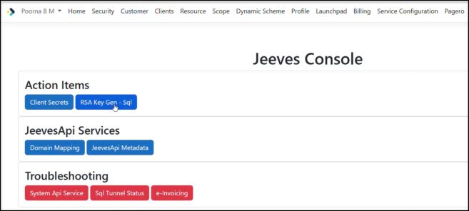
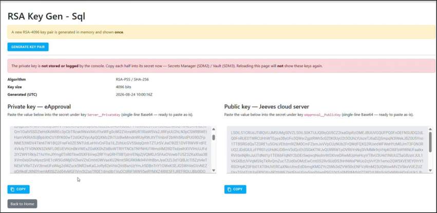
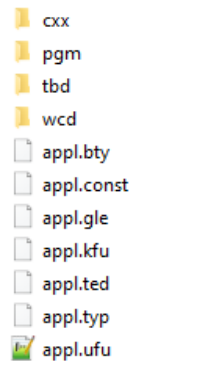

- © Copyright Forterro Sweden AB. All Rights Reserved. 

# **Jeeves ERP** eApproval configuration guide 

###### **Copyright notice** 

- © Copyright Forterro Sweden AB. All Rights Reserved. 

No part of this guide may be copied, reproduced, translated, or transmitted in any form or by any means without the prior written consent of Jeeves Information Systems AB. 

###### **Document disclaimer** 

Information contained in this guide is subject to change without notice. Please check with your Jeeves support team representative to make sure you have the most recent information. 

© Copyright Forterro Sweden AB. All Rights Reserved. 

2 (21) 

<u>Contents</u> 


## **Contents** 

|**1**|**About this guide ............................................................................................................. 4**|
|---|---|
|1.1|Document version/revision..................................................................................................................... 4|
|1.2|Audience.......................................................................................................................................................... 4|
|1.3|Document conventions.............................................................................................................................. 4|
|1.4|List of acronyms........................................................................................................................................... 6|
|**2**|**System requirements ..................................................................................................... 7**|
|**3**|**Terminology .................................................................................................................... 8**|
|3.1|Service.............................................................................................................................................................. 8|
|3.2|Docker containers........................................................................................................................................ 8|
|3.3|Cookies............................................................................................................................................................. 8|
|**4**|**DNS configuration ........................................................................................................... 9**|
|4.1|Load balancer settings.............................................................................................................................. 9|
|4.2|Target Groups............................................................................................................................................... 9|
|4.3|Route 53.........................................................................................................................................................10|
|**5**|**Deployment of Jeeves server ..................................................................................... 11**|
|5.1|Prerequisites................................................................................................................................................11|
|5.2|Configuration...............................................................................................................................................11|
|5.2.1|Volume .............................................................................................11|
|5.2.2|Environment Variables ..........................................................................11|
|5.2.3|Configuration settings in AWS Secrets Manager .............................................12|
|**6**|**eApproval deployment ................................................................................................ 14**|
|6.1|Prerequisites................................................................................................................................................14|
|6.2|Configuration...............................................................................................................................................14|
|6.2.1|Environment variables ...........................................................................14|
|6.2.2|Configuration settings in AWS Secrets Manager .............................................14|
|6.2.3|Configure request-signing keys ................................................................15|
|6.2.4|Federated authentication configuration .....................................................16|
|**7**|**Synchronizing metadata and EDM files to S3 bucket ............................................... 19**|
|7.1|Prerequisites................................................................................................................................................19|
|7.2|S3 security settings...................................................................................................................................19|
|7.3|S3 FileSync service....................................................................................................................................19|
|7.4|Synchronize changed files after service start..............................................................................20|
|**8**|**Known issues ................................................................................................................. 21**|
|8.1|Procedure error during login................................................................................................................21|


© Copyright Forterro Sweden AB. All Rights Reserved. 

3 (21) 

<u>About this guide</u> 


## 1 About this guide 

This guide provides instructions for configuring Jeeves eApproval. 

The purpose of this guide is to help you: 

- Gain an overview of Jeeves eApproval. 

- Understand its deployment and configuration. 

### 1.1 Document version/revision 

|**Version/revision**|**Description **|**Date**|
|---|---|---|
|Version 1.0|Created for eApproval web|October 2020|
|Version 2.0|Added information on the Environment<br>key under Configuration settings in AWS<br>Secrets Manager|March 2025|
|Version 3.0|Updated for eApproval web|May2025|
|Version 4.0|Added JwtSecretKey as a mandatory<br>settingin AWS Secrets Manager|Aug 2025|
|Version 5.0|Added federated authentication (OIDC)<br>configuration, prerequisites, and<br>authentication flow documentation for<br>eApproval (default authentication from<br>2026.0).|February 2026|
|Version 6.0|Removed section on Notification service<br>and validating the deployment.<br>Added RSA key pair configuration<br>(Server__PrivateKey and<br>eApproval__PublicKey) and request-<br>signing validation requirements.<br>Updated port requirements for target<br>groups|Aug 2026|


### 1.2 Audience 

This guide is intended for system administrators and technical personnel with experience in cloud environments who are responsible for installing and configuring Jeeves ERP eApproval. 

### 1.3 Document conventions 

Use of typographic conventions in documentation helps users locate and interpret information easily. The following guidelines present specific typographic conventions. This guide enables you to establish and maintain a common understanding of various conventions used in the document. For simplicity and consistency, this guide describes the method of performing tasks. Other conventions used in this guide are listed in the following table. 

|**Representation **|**Description **|
|---|---|
|Bold text|Procedures, references to screens, dialog boxes and their<br>elements,file and folder names,commands,and buttons.|
|Numbered list|Stepwise instructions.|
|Bulleted list|Sets of features or options used toperform an activity.|
|Note text|Anyexception,extra information,orpitfalls.|
|Italic text|References to related documents and information.|


© Copyright Forterro Sweden AB. All Rights Reserved. 

4 (21) 

<u>About this guide</u> 


© Copyright Forterro Sweden AB. All Rights Reserved. 

5 (21) 

<u>About this guide</u> 


### 1.4 List of acronyms 

|**Acronym **|**Description **|
|---|---|
|AWS|Amazon web service|
|DNS|Domain name system|
|ECS|Elastic container service|
|SMTP|Simple mail transferprotocol|
|URL|Uniform resource locator|
|VPC|Virtualprivate cloud|


© Copyright Forterro Sweden AB. All Rights Reserved. 

6 (21) 

<u>System requirements</u> 


## 2 System requirements 

The following are the minimum system requirements for eApproval Cloud: 

- Jeeves ERP 2026.0 (or a later supported release) 

- Microsoft .NET 8 or higher 

- Microsoft Edge, Google Chrome version 127 or higher 

- Included project files created using Visual studio 2022 

- Supports Unicode (in database procedures) 

- SQL tunnel 

- Access to a supported OpenID Connect (OIDC) identity provider is required for user authentication 

- Identity provider parameters must be configured in AWS Secrets Manager 

© Copyright Forterro Sweden AB. All Rights Reserved. 

7 (21) 

<u>Terminology</u> 


## 3 Terminology 

### 3.1 Service 

A service is an operation that can be invoked externally. The function of the service is defined by mapping nodes, which can be attached to resource handlers to retrieve, alter, and create data in resources such as a database or file system. 

There are two types of services: 

- Multi-tenant: These services are always up and running and are used by all customers. They must be configured for every new deployment. 

- Single-tenant: These services are unique per customer and must be deployed individually. 

### 3.2 Docker containers 

Docker is a set of platform-as-a-service products that deliver software packages in bundles called containers. A Docker container includes the software, libraries, and configuration files required to run an application. 

### 3.3 Cookies 

An HTTP cookie (or web/browser cookie) is a small piece of data that a server sends to your web browser. The browser may store it and send it back with later requests to the same server. 

© Copyright Forterro Sweden AB. All Rights Reserved. 

8 (21) 

<u>DNS configuration</u> 


## 4 DNS configuration 

The following components must be configured for eApproval DNS routing: 

- Load Balancer 

- Target Groups 

- Route 53 

### 4.1 Load balancer settings 

The Load balancer is setup to manage the load on your server. 

Navigate to the AWS EC2 dashboard, select Load Balancer on the menu and click **Create load balancer** . 

Select Load balance type as Application load balancer. 

1. Under **Configure load balancer** , enter the following: Basic configuration 

   - Name: Name of the load balancer 

   - Scheme: Internet facing 

   - Ip address type: IPv4 

   - Listeners 

   - Load balancer protocol: HTTPS 

   - Load balancer port: 443 

Choose your availability zones 

2. Under **Configure security settings** , enter the following: 

   - Select default certificate 

   - Certificate type: Choose a certificate from ACM (recommended) 

   - Certificate name: Select your eApproval certificate 

   - Select security policy 

   - Security policy: ELBSecurityPolicy-2016-08 

3. Under **Configure security groups** : Associate the default security group for the VPC and the Redis Cache security group. 

### 4.2 Target Groups 

1. Configure the target group routing to connect to Jeeves Server in the **Configure routing settings** with the following: 

Target group 

   - Target group: New target group 

   - Name: JeevesServer 

   - Target type: Instance 

   - Protocol: HTTP 

   - Port: 8080 

   - Health check 

   - Protocol: HTTP 

   - Path: /index.html 

2. Check the **Register targets** and **Review tabs** for modifications. You will receive a success message for creating the load balancer. 

3. Select **Target groups** on the left-hand menu in the EC2 Dashboard to add the target group to eApproval. 

© Copyright Forterro Sweden AB. All Rights Reserved. 

9 (21) 

<u>DNS configuration</u> 


4. Click **Create target group** and enter the following settings: 

   - Target group name: eApproval 

   - Target type: IP 

   - Protocol: HTTP 

   - Port: 8080 

   - VPC: your network’s VPC details 

   - Health check settings: 

   - Protocol: HTTP 

   - Path: path to eApproval application (landing page) 

5. Navigate back to the EC2 dashboard and click on your load balancer from the **Listeners** tab and click **View/edit rules** . 

6. Navigate to the Edit tab and add the following rules to connect to Jeeves Server and the eApproval target group: 

   - IF Host header = DNS for eApproval THEN forward to eApproval Target Group 

   - IF Host header = DNS for Jeeves Server THEN forward to Jeeves Server Target Group 

7. Save the Listener configuration. 

8. Copy DNS from the Load balancer description and define eApproval and Jeeves Server DNS on Route 53. 

### 4.3 Route 53 

Jeeves Server and eApproval DNS addresses are defined so that connection to the Route53 service can be established. 

The ***.jeeves.cloud** domain is hosted on Amazon Route 53 and is used to define DNS addresses for each load balancer. 

Perform the following to establish Route53 service in https://console.aws.amazon.com/route53/: 

1. Select **Hosted zones** in the navigation pane and select **jeeves.cloud** . 

2. Click **Create record set** and add DNS as follows: 

   - Name: For Jeeves Server -> name.erpserver; For eApproval –> name.eapproval 

   - Alias: Yes 

   - Alias target: Enter your load balancer DNS 

3. Click **Create** 

© Copyright Forterro Sweden AB. All Rights Reserved. 

10 (21) 

<u>Deployment of Jeeves server</u> 


## 5 Deployment of Jeeves server 

Jeeves server must be deployed in a Docker container service in AWS 

### 5.1 Prerequisites 

Before deploying and configuring the Jeeves server, the following must be set up: 

- Jeeves database: <mark>Your Jeeves database must be configured and made accessible to the Jeeves server. If the database is in AWS, then the SQL port (port 1433 is a SQL default, it can be changed) must be available in the Jeeves server. If the database is on your local machine, then a tunnel service must be configured.</mark> 

- <mark>S3 bucket on AWS: A</mark> WS S3 is a vast and scalable object storage solution provided by Amazon web services. A S3 bucket is like a folder/container which hosts application data and is uniquely created for your environment. 

A unique S3 bucket must be created to contain the following folders: 

- edm - contains the EDM files uploaded and downloaded from the Jeeves server. This folder is automatically synchronized with the old Kernel server. 

- jvs - contains the metadata files from Jeeves application. This folder is automatically updated every time a new version is deployed, or when an application hotfix is made available. 

For more information on creation of S3 bucket, refer to: 

<u>https://docs.aws.amazon.com/AmazonS3/latest/user-guide/create-bucket.html</u> 

- Redis cache: Redis is an open source in-memory data structure store, used as a database, cache and message broker. A unique Redis database must be created, and it must be available to both Jeeves server and eApproval (if installed). For more information on Redis cache, refer to: <u>https://aws.amazon.com/elasticache/redis/</u> 

### 5.2 Configuration 

When deploying the Jeeves server in a Docker container, like AWS ECS, the following configuration is required: 

#### 5.2.1 Volume 

The container must have a volume mapped to the configured S3 bucket. A volume is a storage service containing folders and subfolders. 

#### 5.2.2 Environment Variables 

Jeeves server requires unique environment variables for each customer/deployment. The variables can be specified either directly in the container or in a settings service, like AWS Secrets Manager. 

If using AWS Secrets Manager, the following environment variables must be set in the container: 

|**Key**|**Value**|**Description **|
|---|---|---|
|AWSSecretName|<name>|Reference to the name of the secret<br>in AWS Secrets Manager|
|UseAWSSecretsManager|True|If set to true, Jeeves server reads<br>variables from AWS Secrets Manager|


© Copyright Forterro Sweden AB. All Rights Reserved. 

11 (21) 

<u>Deployment of Jeeves server</u> 


#### 5.2.3 Configuration settings in AWS Secrets Manager 

###### **Note** 

If you are not using AWS Secrets Manager, the following variables can be stored in your container or configuration providers. 

The following variables must be set in the AWS Secrets Manager. It is recommended that a unique secret is created for every user/deployment. 

Mandatory variables for every user/deployment: 

|**Key**|**Value**|**Description **|
|---|---|---|
|MetadataBasePath||Navigates to the location of metadata (For example, to the<br>folder containing appl.ufu). The value must match the<br>configurations in S3 bucket and Volume.<br>While configuring EDM/Metadata based paths in AWS Secrets<br>Manager, add the corresponding local path for synchronizing<br>metadata and EDM files to the S3 bucket.<br>Example:<br>•<br>Local EDM path: \\server\localfolder<br>(\\JVSBANANON006\Jeeves15X\metadata)<br>•<br>S3 synchronization path:<br>s3://bucketname/basefolder (s3://sync-<br>jvsbananon006/Jeeves)<br>In this case, the metadata files are synchronized to<br>s3://bucketname/basefolder/server/localfolder (s3://sync-<br>jvsbananon006/Jeeves/JVSBANANON006/Jeeves15X/metada<br>ta)|
|ConnectionStrings__<br>Redis|<redis<br>connection<br>string>|Connection string of the configured Redis cache. For<br>example:<br>`jeevesservercache.valn6g.ng.0001.eun1.c`<br>`ache.amazonaws.com:6379`|
|||**Note**: This key has two consecutive underscores.|
|ConnectionStrings__<br>Jeeves|<jeeves<br>database<br>connection<br>string>|Connection string of the configured Jeeves database.|
|EdmPath||Navigates to the location of EDM files. The value must match<br>the configuration in S3 bucket.<br>The configuration for synchronization between S3 and the<br>local system is similar to that used for the MetadataBasePath.|
|SiteDB|<name of site<br>database>|Name of the configured site database.|
|eApproval__PublicKe<br>y|<base64-<br>encoded PEM>|Base64-encoded PEM public key used to validate signed<br>requests from eApproval. The key must be RSA and at least<br>4096 bits. See_Configure request-signing keys_.<br>Keys that do not meet these requirements are rejected as<br>invalid.|


© Copyright Forterro Sweden AB. All Rights Reserved. 

12 (21) 

<u>Deployment of Jeeves server</u> 


Before continuing, generate the RSA key pair described in _Configure request-signing keys_ and record both generated values for use in the settings described above. Optional settings: 

|**Key**|**Default value**|**Description **|
|---|---|---|
|IgnoreEdmCentralPa<br>th|False|Ignores the central path when combining paths for EDM<br>files. Default value in AWS is false and in Azure file share<br>is true.|
|EnableCompression|False|Enables/disables the result of the response<br>compression.|
|SecretKey|<secret string>|It is recommended to change this setting in all<br>deployments so that it is hard to decrypt.|
|Logging__LogLevel_<br>_Default|<Warning>|Specifies the traceability levels in a log stream. Valid<br>values are Trace, Debug, Information, Warning, Error,<br>Critical and None.|


© Copyright Forterro Sweden AB. All Rights Reserved. 

13 (21) 

<u>eApproval deployment</u> 


## 6 eApproval deployment 

eApproval must be deployed in a Docker container service. In your AWS, use the Fargate instance. 

### 6.1 Prerequisites 

The Jeeves Server must be deployed and running before eApproval is deployed. 

### 6.2 Configuration 

The following must be configured to deploy eApproval: 

#### 6.2.1 Environment variables 

eApproval requires unique environment variables for each customer/deployment. The variables can be specified either directly in the container or in a settings service, like AWS Secrets Manager. 

If using AWS Secrets Manager, the following environment variables must be set in the container: 

|**Key**|**Value**|**Description **|
|---|---|---|
|AWSSecretName|<name>|Reference to the name of the secret in AWS Secrets<br>Manager|
|UseAWSSecretsManager|True|If set to true, eApproval reads variables from AWS Secrets<br>Manager|


#### 6.2.2 Configuration settings in AWS Secrets Manager 

###### **Note** 

If you are not using AWS Secrets Manager, the following variables can be stored in your container or configuration providers. 

The following variables must be set in the AWS Secrets Manager. It is recommended that a unique secret is created for every user/deployment. 

**Mandatory settings** (to be updated for every user/deployment): 

|**Key**|**Value**|**Description **||
|---|---|---|---|
|Server__URL|<url>|Path to the Jeeves server service||
|ConnectionStrings__Re<br>disDataProtectionKeyRi<br>ng|<redis_url_1>|Connection string of the configured Redis cache.<br>database number must be set to 1. For example:<br>`jeevesservercache.valn6g.ng.0001.eun1`<br>`.cache.amazonaws.com:6379,defaultData`<br>`base=1`|The|
|ConnectionStrings__Re<br>dis|<redis_url_1>|Connection string of the configured Redis cache.<br>database number must be set to 2. For example:|The|
|||`jeevesservercache.valn6g.ng.0001.eun1`<br>`.cache.amazonaws.com:6379,defaultData`<br>`base=2`||
|JwtSecretKey|<secret<br>string>|It is recommended that you change this setting i<br>deployments so that it is hard to decrypt.<br>**Note**: The keymust be the same as in Jeeves server|n all|


> © Copyright Forterro Sweden AB. All Rights Reserved. 

14 (21) 

<u>eApproval deployment</u> 


|**Key**|**Value**|**Description **|
|---|---|---|
|Server__PrivateKey|<base64-<br>encoded PEM>|Private key used to sign requests sent to Jeeves Server. Must<br>be RSA and at least 4096 bits. See_Configure request-signing_<br>_keys_.|


For information about generating and configuring request-signing keys, see _Configure requestsigning keys_ . 

###### **Note** 

Server__PrivateKey is mandatory. 

<mark>If Server__PrivateKey is missing or empty, eApproval fails startup and request processing with a clear error message.</mark> 

<mark>eApproval does not downgrade to unsigned requests.</mark> 

<mark>If the key is malformed, not an RSA key, or is smaller than 4096 bits, startup/request</mark> 

<mark>processing fails with an explicit validation error.</mark> 

Unsigned requests are never sent when private-key configuration is invalid. 

###### **Optional settings:** 

|**Key**|**Default**<br>**value**|**Description**|
|---|---|---|
|EnableCompression|False|Enables/disables the result of the response compression|
|Authentication__ERPU<br>ser__Enabled|True|Specifies if users mentioned in Accounting and time<br>report users(pr) program can loginto eApproval|
|Authentication__Web<br>User__Enabled|True|Specifies if users mentioned in Web users (kpw) program<br>can loginto eApproval|
|PrivacyPolicyUrl|“”|Specifies the URL to your privacy policy page. Mention<br>the URL withinquotes.|
|Authentication__IdleT<br>imeout|14|Specifies the idle timeout in days before the browser<br>cookie is cleared andyou must login again.|
|Logging__LogLevel__D<br>efault|<Warning>|Specifies the traceability levels in a log stream. Valid<br>values are Trace, Debug, Information, Warning, Error,<br>Critical and None.|
|AWS__region|eu-north-1|Specifies the default region where the S3 service is<br>deployed.|
|Environment|<value>|Specifies the eApproval environment that will be used as<br>a key prefix for Redis cache items.|


#### 6.2.3 Configure request-signing keys 

eApproval authenticates requests to Jeeves Server using an RSA public/private key pair. The public key is configured in Jeeves Server and the corresponding private key is configured in eApproval. Both keys must belong to the same RSA key pair. 

##### 6.2.3.1 Generate the RSA key pair 

To generate an RSA key pair: 

1. In the **Jeeves console** , under **Action Items** click **RSA Key Gen – SQL** .Key 

© Copyright Forterro Sweden AB. All Rights Reserved. 

15 (21) 

<u>eApproval deployment</u> 





A new RSA-4096 key pair is generated as follows: 

- **Server__PrivateKey** -> eApproval private key (base64-encoded PEM) 

- **eApproval__PublicKey** -> eApproval public key (base64-encoded PEM) 





2. Copy the generated public key. 

3. In the **AWS Secrets Manager** secret for Jeeves Server, paste the public key into **eApproval__PublicKey** and save the secret. 

4. Copy the generated private key. 

5. In the **AWS Secrets Manager** secret for eApproval, paste the private key into **Server__PrivateKey** and save the secret. 

6. Restart or redeploy the services if required by your deployment process. 

#### 6.2.4 Federated authentication configuration 

eApproval supports the following authentication methods: 

|**Authentication method**|**Description**|
|---|---|
|Federated authentication|User authentication handled by external identity provider|
|Web user (kpw) login|Specifies if users mentioned in Accounting and time report<br>users(pr) program can loginto eApproval|


From version 2026.0, Jeeves eApproval supports **federated authentication (FDA)** using OpenID Connect (OIDC), and from this version onwards, federated authentication is **the default authentication method for eApproval** . 

Federated authentication must be configured before the feature can be used. 

© Copyright Forterro Sweden AB. All Rights Reserved. 

16 (21) 

<u>eApproval deployment</u> 


###### **Prerequisites:** 

The following prerequisites must be fulfilled: 

- Jeeves ERP version 2026.0 or later 

- Jeeves Hybrid SQL tunnel cloud agent version 2026.Q2.0 or a later supported release 

- Access to a supported OpenID Connect (OIDC) identity provider 

- Required  parameters configured in AWS Secrets Manager 

###### **Note:** 

- During federated login, the password stored in **kpw** is **not validated** . 

- <mark>A corresponding Web user record must still exist.</mark> 

- <mark>eApproval access continues to be based on Web users and not on full Jeeves licenses.</mark> 

- <mark>Federated authentication validates the user identity only; user permissions and access rights</mark> are still controlled by the associated Jeeves Web user. 

How Jeeves resolves the Web user 

After successful authentication with the identity provider: 

1. The user’s e-mail address is returned from the identity provider. 

2. eApproval searches for a matching user in Accounting and time report users (pr) using the e-mail address. 

3. The user is mapped to a Web user through the signature connection: 

pr.PersSign  →  kpw.perssign5 

4. The associated Web user is used to create the eApproval session. 

###### **Requirements:** 

- The user must exist in pr with a valid e-mail address. 

- The e-mail address must match the identity provider account. 

- The user must be connected to a Web user in kpw. 

###### **Enabling federated authentication** 

Perform the following to set up federated authentication for eApproval: 

1. Register an app for OpenID connect at the identity provider. 2. Provide details about your Identity provider application to Jeeves Cloud Operations, enabling configuration of Jeeves Identity service. 

3. Based on the above identity provider information from the customer, Cloud Operations will configure the Backend Website Client ID, generate the corresponding client secret, and update the required AWS secret parameters for eApproval accordingly. 

The steps are explained in detail in the Hybrid cloud local installation and configuration.docx with an example on how to set up federated authentication through Azure active directory (Azure AD) for a Forterro company. 

|**Input/output**|**Data**|**Usage **|
|---|---|---|
|The service you request from Jeeves|Federated<br>authentication|Service to use a trusted identity provider<br>for authentication in Jeeves eApproval|
|Input to Jeeves Cloud Operations|Application name|Used to set up the customer-unique link<br>between Jeeves identity service and the<br>identity provider|


© Copyright Forterro Sweden AB. All Rights Reserved. 

17 (21) 

<u>eApproval deployment</u> 


|Input to Jeeves Cloud Operations|Client ID|Used to set up the customer-unique link<br>between Jeeves identity service and the<br>identity provider|
|---|---|---|
|Input to Jeeves Cloud Operations|Client secret|Used to set up the customer-unique link<br>between Jeeves identity service and the<br>identity provider|
|Input to Jeeves Cloud Operations|Client secret expiry|Used to set up the customer-unique link<br>between Jeeves identity service and the<br>identity provider|
|Input to Jeeves Cloud Operations|Authority (URL)|Used to set up the customer-unique link<br>between Jeeves identity service and the<br>identity provider|


Federated authentication is activated through configuration in AWS Secrets Manager. Set the following parameter in AWS Secrets Manager for eApproval: 

|**Parameter **|**Type**|**Description **|
|---|---|---|
|Authentication__UseFederated|Boolean (true/false)|true by default, enables federated<br>authentication for eApproval|
|Authentication__OIDC__Authority|URL|Jeeves Identity service<br>URL.(common for all customers)|
|Authentication__OIDC__ClientId|String|BackendWebsite Client ID from the<br>Admin console.|
|Authentication__OIDC__ClientSecret|String|Client secret generated for the<br>above client in Admin console.|


When federated authentication is enabled, eApproval redirects users to the configured identity provider using the OpenID Connect (OIDC) settings defined above. 

###### **Note:** 

All OIDC parameters must be configured in the same AWS secret before enabling federated authentication. Missing or incorrect values will prevent users from signing in. 

© Copyright Forterro Sweden AB. All Rights Reserved. 

18 (21) 

<u>Synchronizing metadata and EDM files to S3 bucket</u> 


## 7 Synchronizing metadata and EDM files to S3 bucket 

<mark>To ensure that the same versions of metadata and EDM files are available on-premise and in the cloud, the required files should be synchronized periodically to the customer’s S3 bucket.</mark> 

- <mark>Metadata files</mark> 

<mark>The metadata files are synchronized one-way to S3 and only the following application files and folders are synched.</mark> 





All metadata files in the S3 bucket are deployed with names defined in lower case, as Amazon S3 is case sensitive, to enable the Jeeves server to retrieve the files without any issue. However, if the customer does not have metadata file names defined in lower case, they can set the ToLowerCase flag to True in the Jeeves Identity service administration website. 

- EDM files 

Newly added EDM files from eApproval that are added to S3 are synchronized to the local filesystem. 

### 7.1 Prerequisites 

- Jeeves server must be up and running 

- S3 bucket must be configured 

- File setup must be in place 

### 7.2 S3 security settings 

Allow Jeeves server security group to access the specific configured S3 bucket for the relevant environment. 

### 7.3 S3 FileSync service 

Jeeves identity service component (multi-tenant) needs to be deployed, and this configuration must be set using the Jeeves Identity service administration website. Information on how to do this is provided in a separate document. 

Edit the service configuration to specify mappings as follows: 

- Path: String specifying the shared path for the synchronization; for example to synchronize the local shared directory with S3. 

- ToLowerCase (optional): If set to True, changes the filename to lower case before uploading to S3. (Note that only the filename is changed, not the complete path). 

- Filter: Comma separated file filters to define the types of files that must be synchronized; for example: cxx*, wcd*, pgm*, tbd*, appl.*. 

© Copyright Forterro Sweden AB. All Rights Reserved. 

19 (21) 

<u>Synchronizing metadata and EDM files to S3 bucket</u> 


Note that a single configuration may contain multiple mappings. Following is an example of a Metadata/EDM configuration: 

```
{
    "Region":"eu-north-1",
    "AccessKeyId":"xxxxxxxx",
    "SecretAccessKey":"xxxxxxxxxxxxxxx",
    "S3Path":"s3://bucketname/basefolder",
    "Mappings":[{
        "Path":"\\\\JVSBANANON006\\Jeeves15x\Jeeves",
        "ToLowerCase": True,
        "Filter":"cxx*, wcd*, pgm*, tbd*, appl.*"
        "Path":"\\\\jvsanon005\\metadata",
        "ToLowerCase": True,
        "Filter":"cxx*, wcd*, pgm*, tbd*, appl.*"
     },{
        "Path":"\\\\jvsanon005\\edm",
     }]
}
```

###### **Note** 

AccessKeyId and SecretAccessKey permissions should be restricted to the specified bucket <mark>only. For information on how to do this, see</mark> <u><mark>https://aws.amazon.com/premiumsupport/knowledge-center/s3-console-access-certain-</mark> bucket/</u> 

### 7.4 Synchronize changed files after service start 

Sometimes files may be updated while the cloud agent is down. In such cases, the updated files will be synchronized to the S3 bucket from the mapped directory when the cloud agent service becomes available. 

© Copyright Forterro Sweden AB. All Rights Reserved. 

20 (21) 

<u>Known issues</u> 


- 8 Known issues 

### 8.1 Procedure error during login 

When logging in to eApproval, the Jeeves_eAppSupInvW_Weblog procedure is run. This procedure requires a company code. If you log in as an ERP user and the default company as set in the Users (xsy2) program is different from that in the Web users (kpw) program, the execution of the procedure fails. 

© Copyright Forterro Sweden AB. All Rights Reserved. 

21 (21) 

