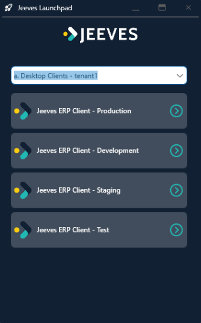
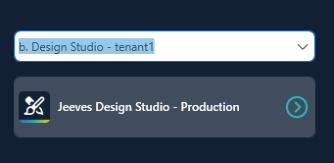
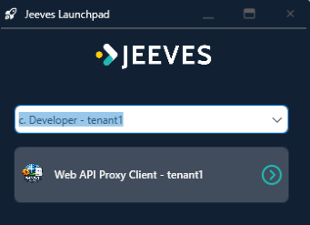
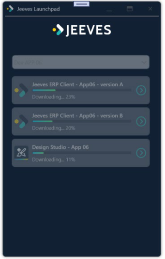
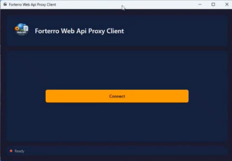
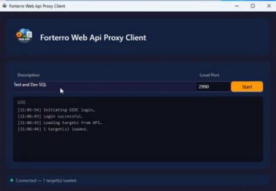
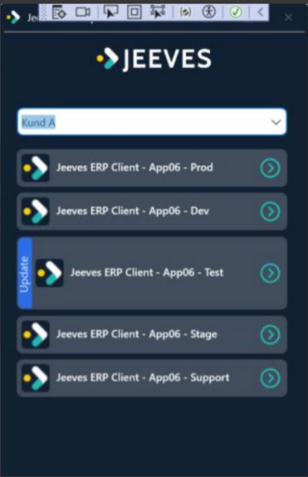
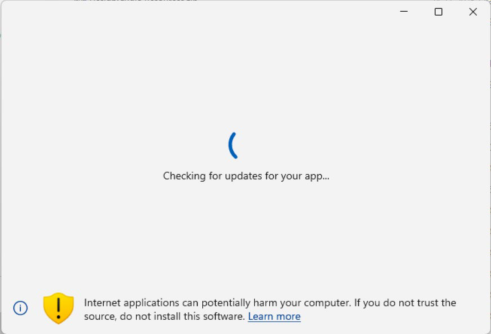
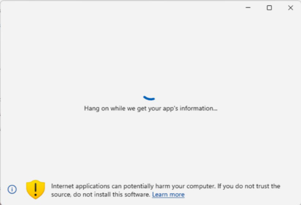

© Copyright Forterro Sweden AB. All Rights Reserved. 

**Jeeves Launchpad** User Guide 

#### **Copyright notice** 

- © Copyright Forterro Sweden AB. All Rights Reserved. 

No part of this guide may be copied, reproduced, translated, or transmitted in any form or by any means without the prior written consent of Jeeves Information Systems AB. 

#### **Document disclaimer** 

Information contained in this guide is subject to change without notice. Please check with your Jeeves support team representative to make sure you have the most recent information. 

© Copyright Forterro Sweden AB. All Rights Reserved. 

2 (11) 

<u>Contents</u> 

# **Contents** 

|**1**|**About this guide ....................................................................................................... 4**|
|---|---|
|1.1|Document version/revision..................................................................................................................... 4|
|1.2|Audience.......................................................................................................................................................... 4|
|1.3|Document conventions.............................................................................................................................. 4|
|**2**|**System requirements ............................................................................................... 5**|
|2.1|Jeeves Launchpad....................................................................................................................................... 5|
|2.2|Jeeves ERP client......................................................................................................................................... 5|
|2.3|Design studio................................................................................................................................................. 5|
|**3**|**Introduction to Jeeves Launchpad .......................................................................... 6**|
|3.1|Key features................................................................................................................................................... 6|
|**4**|**Jeeves Launchpad deployment ............................................................................... 7**|
|4.1|Launchpad – Client selection screen................................................................................................... 7|
|4.2|Launch process............................................................................................................................................. 8|
|4.2.1|Downloading and extracting files to cache .................................................... 8|
|4.2.2|Launching the client ............................................................................... 8|
|4.2.3|Connecting to WebApi Proxy using Launchpad ................................................ 8|
|4.2.4|Monitoring for automatic upgrades ............................................................. 9|
|4.2.1|Auto update Jeeves Launchpad ................................................................. 10|

© Copyright Forterro Sweden AB. All Rights Reserved. 

3 (11) 

About this guide 

# 1 About this guide 

Jeeves Launchpad keeps your Jeeves applications up-to-date automatically. When you open your Jeeves ERP client, Design studio, or Web Api Proxy through Launchpad, it checks if you have the latest version and downloads it for you if needed. You'll always be working with the current software without having to think about updates 

The objective of this documents is to help you to install Jeeves Launchpad to support automatic upgrades of clients that are located on a users’ own workstations on premises for customers on the cloud. 

## 1.1 Document version/revision 

|**Version/revision**|**Description**|**Date**|
|---|---|---|
|1.0|Created for release 2026.Q2.0|March 2026|
|2.0|Updated for 2026.Q2.1 Added information on Connectingto WebApi Proxy|May 2026|

## 1.2 Audience 

This guide is intended for anyone who want to set up Jeeves Launchpad for users on-premises for customers on the cloud. 

## 1.3 Document conventions 

Use of typographic conventions in documentation helps users locate and interpret information easily. The following guidelines present specific typographic conventions. This guide enables you to establish and maintain a common understanding of various conventions used in the document. For simplicity and consistency, this guide describes the method of performing tasks. Other conventions used in this guide are listed in the following table. 

|**Representation**|**Description**|
|---|---|
|Bold text|Procedures, references to screens, dialog boxes and their elements,file and folder names,commands,and buttons.|
|Numbered list|Stepwise instructions.|
|Bulleted list|Sets of features or options used toperform an activity.|
|Note text|Anyexception,extra information,orpitfalls.|
|Italic text|References to related documents and important information.|

© Copyright Forterro Sweden AB. All Rights Reserved. 

4 (11) 

<u>System requirements</u> 

# 2 System requirements 

## 2.1 Jeeves Launchpad 

|Component|**Requirement**|
|---|---|
|OperatingSystem|Windows 11|
|Runtime|.NET Core 10.x|

## 2.2 Jeeves ERP client 

|Component|**Requirement**|
|---|---|
|.NET Framework|4.6.2 and 4.8|
|.NET|10.0|
|Microsoft Visual C++ Runtime|14.0|
|Microsoft Edge WebView2 Runtime|Latest|

## 2.3 Design studio 

|Component|**Requirement**|
|---|---|
|.NET Core|10.x|
|Microsoft Edge WebView2 Runtime|Latest|

For more information on system requirements for the Jeeves ERP client/Design studio, please refer to the following documents: 

- Jeeves ERP Installation and configuration 

- Jeeves ERP Design studio installation and configuration 

© Copyright Forterro Sweden AB. All Rights Reserved. 

5 (11) 

Introduction to Jeeves Launchpad 

# 3 Introduction to Jeeves Launchpad 

Jeeves Launchpad is a launcher and version manager for the Jeeves ERP client and Design studio, available exclusively for cloud customers. It also allows you to securely access backend systems, such as SQL databases, through a controlled proxy connection called Web Api Proxy. 

The installer can be accessed on the Web using the URL: <u>Jeeves Launchpad.</u> 

Before launching, Jeeves Launchpad checks whether a newer version is available. If so, it downloads and installs the update automatically — ensuring that client applications on users' workstations are always up to date without any manual intervention. 

## 3.1 Key features 

Jeeves Launchpad streamlines upgrade of Jeeves clients through an automated process designed for flexible, reliable, and user-friendly execution Following is a list of things you can do with Launchpad: 

- **Switch between environments easily** — Access different versions of Jeeves (like Production, Development, or Testing) from one simple screen. Just select which environment you need and click to launch it. 

- **Stay current automatically** — New versions download and install in the background. You'll get a quick notification when an update is ready, then continue working with the latest features and fixes. 

- **Run multiple clients at once** — Need to work in both Production and Testing at the same time? You can launch several environments side by side. 

- **See your download progress** — A progress bar shows you what's happening when new files are being downloaded. 

© Copyright Forterro Sweden AB. All Rights Reserved. 

6 (11) 

Jeeves Launchpad deployment 

# 4 Jeeves Launchpad deployment 

Before using Jeeves Launchpad, ensure that you have run the MSI file that is provided by Jeeves. The MSI installer takes care of the following: 

- Creating the Jeeves Launchpad folder: %APPDATA%\Jeeves Launchpad 

- Installing Jeeves Launchpad.msix 

- Installing the following files: 

   - connecttoserver.xml for ERP Client 

   - UserSettings.json for Design Studio 

   - appsettings.json 

## 4.1 Launchpad – Client selection screen 

Search for Jeeves Launchpad in the Windows search and select it. The **Jeeves Launchpad – Client Selection** screen appears, as shown below. It lists each launchable application configuration as a shortcut button. You can resize the window to adjust its height or width. When the height is increased, the shortcuts are automatically arranged horizontally, and a scrollbar becomes available for navigating between them. 

This screen displays a list of available clients (Desktop client, Design studio, or Web Api Proxy) for a selected customer (e.g., Prod, Dev, Test, Stage, Support, etc.). A drop-down menu at the top allows switching between environments. 

You can select the desired environment to launch the corresponding client. You can select more than one environment/client at a time. 

#### **Desktop client** 

#### **Design studio** 

> © Copyright Forterro Sweden AB. All Rights Reserved. 

7 (11) 

Jeeves Launchpad deployment 

#### **Web Api Proxy** 

## 4.2 Launch process 

### 4.2.1 Downloading and extracting files to cache 

Click a shortcut in the Jeeves Launchpad. The system checks the cached version, downloads any updated files if needed, and then starts the corresponding client. 

During the download, a progress bar is displayed. Note that once a download begins, all shortcuts are temporarily disabled, and you cannot click on them. 

### 4.2.2 Launching the client 

After the required files are available, Jeeves Launchpad starts the client. 

The client version files are stored in the path: **C:\Users\user-name\AppData\Roaming\Jeeves Launchpad \versions** 

The Launchpad maintains a record of all started processes to monitor their status and check that they are running during version changes. 

### 4.2.3 Connecting to WebApi Proxy using Launchpad 

Use the following steps to connect to the remote cloud database through the Web Api Proxy and run SQL queries securely from your local machine. 

1. Start the Web Api Proxy via Launchpad. 

© Copyright Forterro Sweden AB. All Rights Reserved. 

8 (11) 

Jeeves Launchpad deployment 

2. Click **Connect** , sign into the app using your login credentials. 

3. Once you are signed in, the Application retrieves proxy targets defined in configuration as shown below: 

4. Select the desired Web Api Proxy, enter the local port from which you want to connect, and click **Start.** The tunnel connection is established and SSMS is successfully connected to the remote cloud database. You can run SQL queries normally. 

If proxy is for SQL connection(port 1433), connect using SQL Management Studio: 

   - a. Go to Query > Connection > Change connection. In the SQL Server login dialog 

   - b. Provide the following details: 

      - **Server name** : Connect via SQL tools using: 127.0.0.1,{local port}. Do not use name piping in this field as it will not work; use comma instead. 

      - **Authentication** : Windows Authentication is not supported—you must use SQL login credentials. 

      - Test by executing a query in the target database. 

5. You can use the **Start/Stop** button to start or stop the Web Api Proxy. If you click **Stop** , the local port is closed, and the tunnel shuts down. SSMS queries will then fail (expected behavior), preventing accidental continued access. 

### 4.2.4 Monitoring for automatic upgrades 

The Jeeves Launchpad periodically monitors the configuration setup to detect any changes. This ensures that any version or configuration updates are reflected automatically. 

If a shortcut’s version changes and the client application is not running, no immediate action is taken. A notification – Update, is shown against the shortcut. The next time the user clicks the shortcut, the new version is downloaded, installed, and started. 

© Copyright Forterro Sweden AB. All Rights Reserved. 

9 (11) 

Jeeves Launchpad deployment 

If the client application is running when a new version is detected, based on the setting configured for the shortcut, the following action occurs: 

- A message box is displayed, informing that a restart is required to apply the new version. OR 

- An always-on-top message box is displayed, notifying that the application will be closed automatically for upgrade. If you click **OK** , the running process is terminated. A new version is then downloaded and launched. 

During upgrade operations, any outdated version folders are removed from the directory: **\AppData\Roaming\Jeeves Launchpad \versions** 

This ensures that only valid and active versions remain available. 

### 4.2.1 Auto update Jeeves Launchpad 

The application performs regular checks against the <u>Launchpad cloud repository. Whenever it</u> detects an updated _Jeeves.launchpad.msix_ package, it initiates a seamless automatic update, ensuring the application remains current. 

You will see the following message that shows that the application is checking for updates when you click to run it: 

If updates are found, you will see the following additional message: 

© Copyright Forterro Sweden AB. All Rights Reserved. 

10 (11) 

Jeeves Launchpad deployment 

© Copyright Forterro Sweden AB. All Rights Reserved. 

11 (11) 

